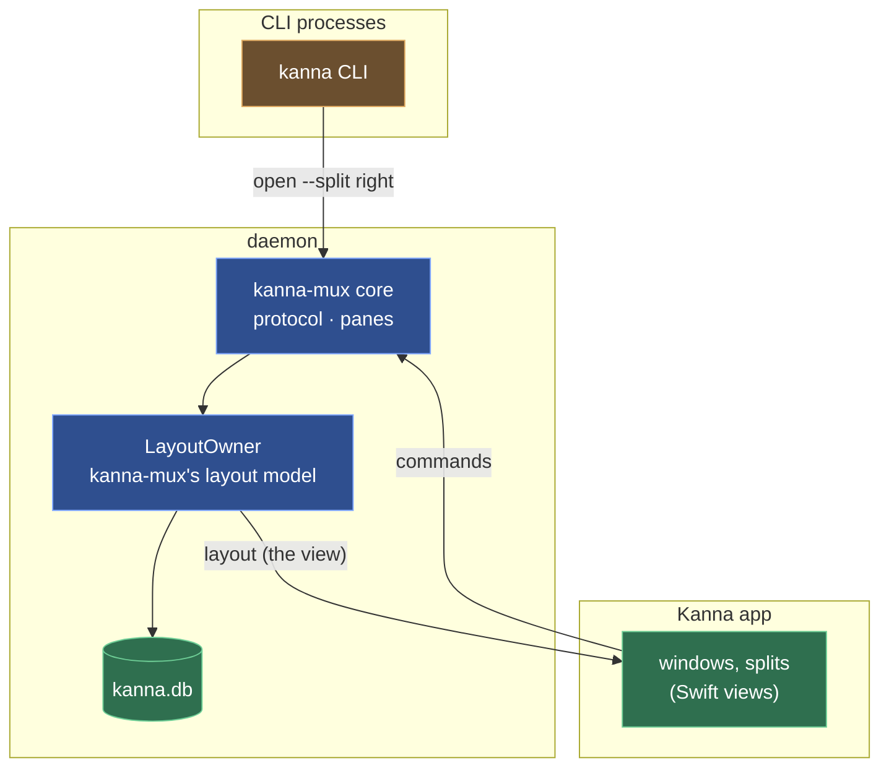
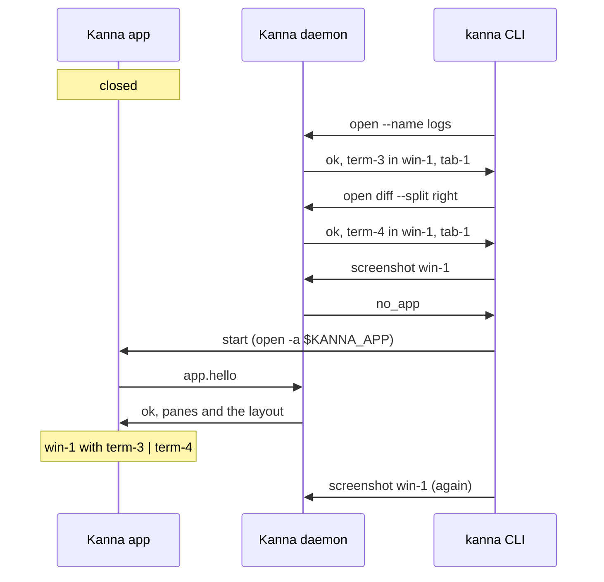

# The Layout

**Status:** built · **Builds on:** [the app link](app-link.md) · **Reference:** [kmux](kmux-reference.md)

The daemon owns the layout (windows, tabs, splits, focus, zoom, each task's workspace and which app has it out) and saves it, beside the terminals. Apps subscribe to it and draw it ([presentation layers](presentation-layers.md)). It works with no app attached.

Each task has a [workspace](workspaces.md): its Desk part (agent and tabs) and windows of its own, which a Desk shows; replies name the workspace a pane is in.

## Contents

1. [One layout model, in Rust, run by the daemon](#1-one-layout-model-in-rust-run-by-the-daemon)
2. [Layout steps](#2-layout-steps)
3. [Saving and restoring](#3-saving-and-restoring)
4. [With the app closed](#4-with-the-app-closed)
5. [The CLI starts the app](#5-the-cli-starts-the-app)
6. [Conformance](#6-conformance)
7. [Glossary](#7-glossary)

## 1. One layout model, in Rust, run by the daemon

The layout logic is `kanna-mux`'s model (ported from kmux, checked with kmux's protocol cases); there is no second copy in Swift. The daemon runs it as a `LayoutOwner` (`crates/kanna-daemon/src/layout.rs`) and is the only process that holds a layout: it applies layout commands from every client, saves it, and publishes each change to the attached app as a `layout` message, the view the app draws ([windows](windows.md)). The `kanna-mux` core reaches it through its asynchronous seam, `LayoutLink`, answered in-process.

Why one model in the daemon:

- **One implementation.** A Swift copy would be a second model to keep in step with the Rust one `kanna-mux` needs anyway.
- **Conformance is checked on what runs** ([6](#6-conformance)).
- **No app needed.** Tasks and scripts open tabs and show diffs with the app closed, and any number of apps can draw the same layout.

## 2. Layout steps

`kanna-mux`'s core turns each command into steps on the layout (`place`, `location`, `command`, `panes-in`, `remove`, `windows`, `export`, `check`, `install`) and sends them through its `LayoutLink`; in the daemon they run on its `LayoutOwner` at once. A command's steps and its changes to the panes run one command at a time, so pane IDs and layout changes happen in kmux's order.

The app changes the layout only with the CLI's commands: a click is `focus`, a dragged divider is `resize {tab, path, index, share}` (the two panes either side share what they had, the first getting `share`; plain `resize PANE` rescales all its siblings), a new tab or split is `open`, and so on.

**`auto` splits** go by the shape the pane has in the layout: its share of a window taken as 16:10, less the docked pane. A pane at least as wide as it is tall splits sideways, a taller one down. No app is asked.

**What stays in the app** ([presentation layers](presentation-layers.md#1-the-three-layers)): window frames, the docked pane's width when the user drags it, and text size (⌘+ and ⌘− in a markdown, code or diff pane). The app saves them in `app-state.json` beside the daemon's files, and lays them over each view it draws. A dragged dock width holds until the layout's own width changes (`kanna resize agent 1/2`).

## 3. Saving and restoring

**Saving.** The daemon saves the layout in kmux's state file format, Kanna's version 3 of it ([workspaces](workspaces.md#5-saved-state)), in `kanna.db` beside the tasks ([database](database.md)): half a second after a change, when it stops, and with a task's row when the task is done, only when something changed. A daemon started with `KANNA_FRESH=1` starts without it, and `KANNA_NO_STATE=1` neither reads nor writes one. An app passes its `--fresh` on to a daemon it starts. A `layout.json` left by an older Kanna is imported once and renamed `layout.json.imported`.

**Restoring.** On start the daemon reads it (one it can't trust, or of an unknown version, isn't restored, and says so in its log), installs its panes, takes back the keeper's terminals, drops every pane that's gone and places every terminal it doesn't know as `open` would. Web, markdown, code, diff and iOS panes come back running: an app shows them when it attaches. An app that attaches gets the view in the hello reply and every change after it.

## 4. With the app closed

Every command but `screenshot`, `comment` (the app snaps its lines to the code) and `debug.*` works: panes open where they're asked to, tabs and windows are made, moved and closed, and `list` shows them. A pane that isn't a terminal is running from the start; an app shows it when it attaches. The app opens on the layout as it was left.

## 5. The CLI starts the app

When the daemon answers a command with `no_app` and `KANNA_SOCKET` isn't set, `kanna` starts Kanna.app (`open -n -a $KANNA_APP`; else, for a dev build, its checkout's `target/Kanna.app`; else by its channel's bundle ID, `dev.kanna.app` or `dev.kanna.app.staging`; never the branded kmux `dev.kanna.kanna`; with `KANNA_SOCKET` and `KANNA_STATE_DIR` passed on, in the background with `--bg` or `KANNA_BG=1`), retries the command every 200 ms until the app has attached (a `no_app` answer changes nothing, so the retry is safe), and gives up after 20 s with exit 6.

With `KANNA_SOCKET` set (a test, a script, a terminal inside Kanna) it never starts an app: it exits 6 with the daemon's message and "KANNA_SOCKET is set, so kanna doesn't start Kanna.app for it". Without it, kanna talks to its instance's daemon ([instances](instances.md)), and when nothing answers there it starts Kanna.app, which starts the daemon ([app link](app-link.md#4-the-app-starts-the-daemon)), as kmux's CLI starts kmux. The CLI itself never starts a daemon ([reaching Kanna](cli.md#3-reaching-kanna)).

## 6. Conformance

kmux's protocol cases pass three ways: against `kanna-mux` with the model in-process; with the model behind `LayoutOwner`, every step sent as JSON and answered on a later turn (`crates/kanna-mux/tests/protocol_cases.rs`); and through a running daemon and keeper (`crates/kanna-daemon/tests/protocol_cases.rs`), docked panes' included. The app's glue is checked by `layout_restored`, `cli_without_app` and `cli_starts_app` of `scripts/e2e-kanna.sh`.

## 7. Glossary

| Term | Meaning |
|---|---|
| **LayoutLink** | The core's seam to the layout. |
| **LayoutOwner** | The layout model as the daemon runs it, answering layout steps as JSON. |
| **Layout step** | One request from the core to the layout model (`place`, `command`, `remove`, …). |
| **`no_app`** | The daemon's error for a command that needs Kanna.app (`screenshot`, `comment`, `debug.*`) when none is attached. |
