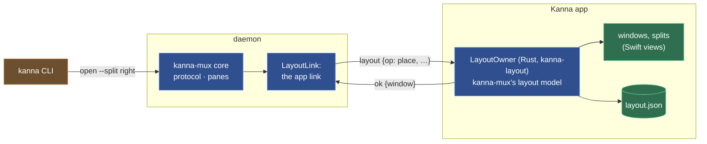

# The Layout

**Status:** built · **Builds on:** [the app link](app-link.md) · **Reference:** [kmux](kmux-reference.md)

The app owns the layout (windows, tabs, splits, focus, zoom, the docked pane, Desk and Shelf) and saves it; the daemon owns the terminals ([architecture](architecture.md#2-what-the-daemon-keeps-what-the-apps-keep)).

Each task has a [workspace](workspaces.md): its Desk part (agent and tabs) and windows of its own, which a Desk shows; replies name the workspace a pane is in.

## Contents

1. [One layout model, in Rust, run by the app](#1-one-layout-model-in-rust-run-by-the-app)
2. [Layout steps](#2-layout-steps)
3. [Saving and restoring](#3-saving-and-restoring)
4. [With the app closed](#4-with-the-app-closed)
5. [The CLI starts the app](#5-the-cli-starts-the-app)
6. [Conformance](#6-conformance)
7. [Glossary](#7-glossary)

## 1. One layout model, in Rust, run by the app

The layout logic is `kanna-mux`'s model (ported from kmux, checked with kmux's protocol cases); there is no second copy in Swift. The app links it as `crates/kanna-layout` (a small C interface taking and returning JSON, linked through `kanna-ffi`, [architecture](architecture.md#3-languages-and-platforms)) and is the only process that holds a layout: it applies layout commands, draws it ([windows](windows.md)) and saves it. The daemon's `kanna-mux` core keeps the protocol and the panes, and reaches the layout through an asynchronous seam, `LayoutLink`; in the daemon that link is the app link.



Why this and not kmux's Swift model copied into the app:

- **One implementation.** A Swift copy would be a second model to keep in step with the Rust one `kanna-mux` needs anyway; every kmux change would be ported twice.
- **Conformance is checked on what runs** ([6](#6-conformance)).
- **Linux.** A Linux UI gets the same layout by linking the same library.
- **The app knows the views.** Choices only a UI can make (which way an `auto` split goes, window frames) are made where the views are.

## 2. Layout steps

`kanna-mux`'s core turns each command into steps on the layout and sends them through its `LayoutLink`. In-process (kmux's own shape, and `kanna-mux`'s tests) they run at once; in the daemon each is a `layout` request on the app link that the app answers with `LayoutOwner`. Every step carries the daemon's pane table (`panes`), so the app resolves names and labels as the daemon would. A command's steps and its changes to the panes run one command at a time, so pane IDs and layout changes happen in kmux's order however slowly the app answers.

| Step (`op`) | Used by | The app answers | With no app attached, the daemon answers |
|---|---|---|---|
| `place {pane, at}` | `open` (`at` holds only the `split`, `size`, `tab`, `window`, `dock` given) | places it: `{window, tab, workspace}`, and `dock` (its edge) for a docked pane, whose `tab` is null; `window` is null for a hidden Desk part | with no `at`: `{window: null, tab: null}`, unplaced; with one: `no_app` |
| `location {pane}` | `open`, once the pane has started; `close` of a pane, which a docked one refuses ([docked pane](docked-pane.md)) | `{window, tab}`, and `dock` as `place` | `{window: null, tab: null}` |
| `command {cmd, args}` | `focus`, `zoom`, `rename-tab`, `move`, `move-tab`, `resize`, `arrange`, and Kanna's `task` and `window` | the command's reply, as kmux, with the `workspace` it acted in | `no_app` |
| `panes-in {tab}` / `{window}` | `close --tab`, `close --window` | the panes there | `no_app` |
| `remove {ids, tidy}` | `close`, `debug.restoreState` | removes them (and closes emptied tabs and windows) | nothing to do |
| `windows` | `list`, `debug.restoreState` | kmux's `windows` (those on screen), and `workspaces` | `[]` |
| `export`, `check {state, ids}`, `install {state, ids}` | `debug.saveState`, `debug.restoreState` | as kmux: its state, version 1, with a Desk carrying what it shows and hidden workspaces `parked` | `no_app` |

- **With the app attached** every layout command is the app's; `close` closes the terminals in the daemon and then has the app remove them.
- **If the app goes away mid-step**, the step gets the no-app answer: an unplaced `open` still opens its terminal, a placed one fails.

## 3. Saving and restoring

**Saving.** The app saves its layout in kmux's state file format, Kanna's version 2 of it (`kmux: "state"`, `version: 2`: Desks and free windows with their frames, tabs, splits, focus and zoom, then each workspace with its Desk part and its own windows, [workspaces](workspaces.md#5-saved-state); the panes it places by ID, name and type) to `layout.json` in its state folder: `$KANNA_STATE_DIR`, or the daemon socket's folder. As kmux: half a second after a change and on quit, only when something changed, written atomically (a new file, then renamed) with mode 0600; `--fresh` (or `KANNA_FRESH=1`) starts without it, `KANNA_NO_STATE=1` neither reads nor writes one.

**Restoring.** On launch the app reads the file (one it can't trust, or of a version other than 1 or 2, is moved aside as `layout.json.bad`; a version 1 file loads, and is saved as version 2). When the daemon accepts its hello, the reply lists the daemon's terminals; the app drops every pane the daemon no longer has (closing emptied splits, tabs and windows), places every terminal it doesn't know as `open` would (beside the focused pane), opens every window where it was, and attaches each terminal it shows. A reconnect to a restarted daemon does the same with the layout in memory. Nothing is saved until the saved layout has been installed, so an app that never reached its daemon doesn't overwrite it.

## 4. With the app closed

Terminals keep working: `list`, `send`, `send-key`, `read`, `close`, `restart`, and `open` without a placement (the pane is placed when the app next opens). Commands that need the layout fail with `no_app`: "… needs Kanna.app, and none is attached to this daemon". `list` answers `panes` from the daemon and `windows` from the app; with no app, `windows` is `[]` (the app's file is the only copy of the layout, and it may be stale) and each pane's window shows as `-`. The full list: [CLI](cli.md#4-with-the-app-closed).

```mermaid
sequenceDiagram
    participant A as Kanna app
    participant D as Kanna daemon
    participant C as kanna CLI
    Note over A: closed
    C->>D: open --name logs
    D->>C: ok, p3, window null
    C->>D: open --split right
    D->>C: no_app
    C->>A: start (open -a $KANNA_APP)
    Note over A: read layout.json (p1, p2)
    A->>D: app.hello
    D->>A: ok, panes p1 p2 p3
    Note over A: p1, p2 where they were; p3 placed
    C->>D: open --split right (again)
    D->>A: layout {op: place, pane p4, at: right}
    A->>D: ok {window w1, tab t1}
    D->>C: ok, p4
```

## 5. The CLI starts the app

When the daemon answers a command with `no_app` and `KANNA_SOCKET` isn't set, `kanna` starts Kanna.app (`open -n -a $KANNA_APP`; else, for a dev build, its checkout's `target/Kanna.app`; else by its channel's bundle ID, `dev.kanna.app` or `dev.kanna.app.staging`; never the branded kmux `dev.kanna.kanna`; with `KANNA_SOCKET` and `KANNA_STATE_DIR` passed on, in the background with `--bg` or `KANNA_BG=1`), retries the command every 200 ms until the app has attached (a `no_app` answer changes nothing, so the retry is safe), and gives up after 20 s with exit 6.

With `KANNA_SOCKET` set (a test, a script, a terminal inside Kanna) it never starts an app: it exits 6 with the daemon's message and "KANNA_SOCKET is set, so kanna doesn't start Kanna.app for it". Without it, kanna talks to its instance's daemon ([instances](instances.md)), and when nothing answers there it starts Kanna.app, which starts the daemon ([app link](app-link.md#4-the-app-starts-the-daemon)), as kmux's CLI starts kmux. The CLI itself never starts a daemon ([reaching Kanna](cli.md#3-reaching-kanna)).

## 6. Conformance

kmux's protocol cases pass three ways: against `kanna-mux` with the model in-process; with the model behind `LayoutOwner`, every step sent as JSON and answered on a later turn (`crates/kanna-mux/tests/protocol_cases.rs`); and through a running daemon, keeper and app link, with a test app answering through `LayoutOwner` (`crates/kanna-daemon/tests/protocol_cases.rs`), docked panes' included. The app's own glue is checked by `layout_restored` and `cli_starts_app` of `scripts/e2e-kanna.sh` and by `crates/kanna-layout/tests`.

## 7. Glossary

| Term | Meaning |
|---|---|
| **LayoutLink** | The core's seam to the layout: in-process in tests, the app link in the daemon. |
| **LayoutOwner** | The layout model as the app runs it, answering layout steps as JSON (`crates/kanna-layout`). |
| **Layout step** | One request from the core to the layout model (`place`, `command`, `remove`, …). |
| **`no_app`** | The daemon's error for a command that needs Kanna.app when none is attached. |
