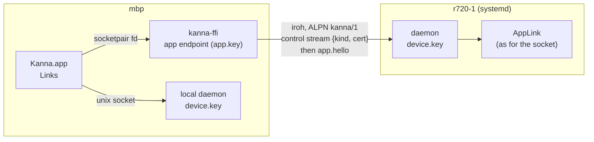
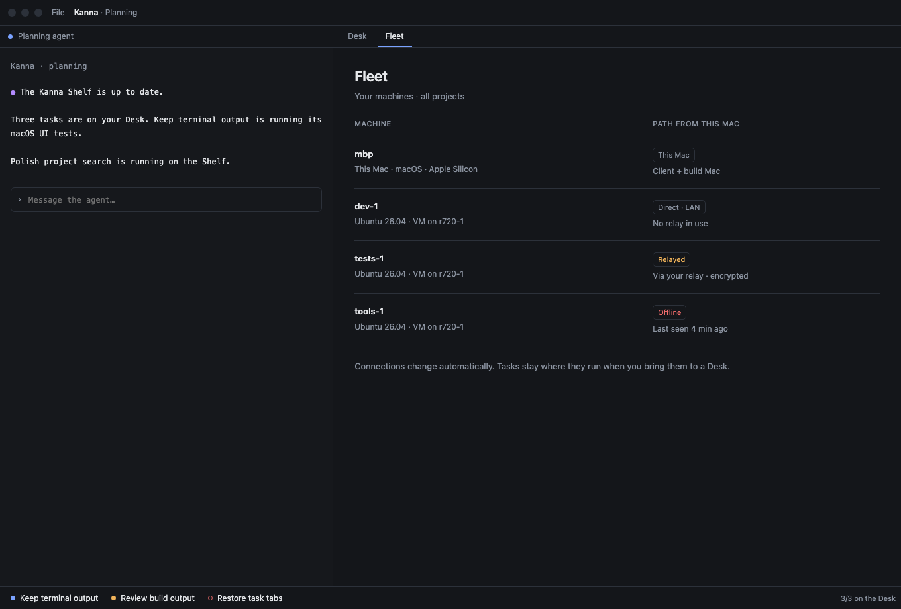

# Machines: One Link per Machine

**Status:** built (Machines 3) · **Part of:** [Machines §5–6](machines.md#5-the-app-link-over-the-network) · **Presentation:** [Desks across machines](machines-app.md), [model](../../references/mockups/fleet.html) · **Messages:** [app link](app-link.md)

Kanna.app holds one [app link](app-link.md) per machine: the local daemon's unix socket, and for every trusted peer of that daemon an iroh connection through `kanna-net`. Each remote link carries the same JSON lines as the local one. The app merges the machines' layouts and Shelves into one set of Desks, keyed by (machine, ID).

## 1. Making a link

1. **The app's endpoint.** At launch the app opens its own iroh endpoint with `app.key` in its state folder (made once, `0600`). Its key is not a device in the peer log; it is certified: the app asks the local daemon `machine {action: certify, key}` and gets `{key, device, sig}`, signed by `device.key`.
2. **Which machines.** Every 10 s the app reads the local daemon's `machine status`. While this machine is paired and its log isn't broken, each peer that is trusted, not revoked, not in conflict and named gets a link; its addresses are the log's plus any found nearby. A peer that leaves that set loses its link, and its views go (§5).
3. **The stream.** The app opens a `control` stream whose header carries the certificate: `{"kind": "control", "cert": {key, device, sig}}`. The remote daemon admits the stream if the connection's key is the certificate's `key` and `device` is a trusted, unrevoked peer, else `unpaired` or `revoked`. **Changed** from [identity §1](machine-identity.md#1-keys): the certificate is in the stream header, not the hello, so a refusal comes before any app message.
4. **The bridge.** A control stream whose first request is `app.hello` becomes an app link: the daemon joins it to a socketpair and serves the other end exactly as an accepted unix connection. On the app side `kanna_machines_link` returns a socketpair fd joined to the stream, and the app's `DaemonConnection` reads it as it reads the socket. Each side ends the bridge when either half ends. A revocation closes every bridge of the revoked device at once, and every later line is checked against the log.

## 2. The hello

`app.hello {pid, app, protocols: [min, max], commit, client, build?}`; `build` is sent to the local daemon only.

| | Local daemon | Remote daemon |
|---|---|---|
| `build` mismatch | `other_build`; the daemon stops and the app starts its own ([daemon build](daemon-build.md)) | not checked |
| No protocol in common | `other_protocol {mine, commit, version}`, the daemon keeps running | the same |
| Reply | `{ok, protocol, daemon: {pid, build, commit, machine, capabilities: {os, arch, cores}}, panes, layout}` | the same |
| App already attached | `app_attached` if it is local; a local app **takes over** from a remote one | `app_attached` |

- **Protocols:** `kanna_build::PROTOCOLS = [1, 1]` today (Kanna.app's `Protocols.mine` must match; a test checks), shared with the daemons' own streams ([updates §6](machine-update.md#6-protocols)); the highest both support is used. `commit` is the build's short commit (`KANNA_COMMIT`, else `git rev-parse --short=12`), shown with `other_protocol`. The app shows a refused machine as Offline with the refusal in its tooltip, and one of another protocol says which side is older and how to update it ([updates §6](machine-update.md#6-protocols)); it never starts, stops or replaces a remote daemon, and a remote `quit` doesn't quit the app.
- **`DaemonStarter` is the local link's only.** A remote link that drops redials with backoff up to 30 s.
- **`client`** is this Mac's machine name. The daemon makes it the default claimant (§4) while that app is attached.

## 3. IDs and routing

- **Qualified at the boundary.** A remote link rewrites every ID it receives to `ID@machine` (`term-41@r720-1`), and strips its own suffix from every ID it sends. Both ways, only strings under ID keys (`id`, `pane`, `terminal`, `workspace`, `window`, `tab`, `task`, `planner`, `agent`, `owner`, `from`, …) that match `(task|ws|win|tab|term|diff|file|page|ios)-[alnum]+` are rewritten, so paths and text are never touched. An ID that already carries another machine's suffix is re-qualified to the sender, so a peer can't name another machine's panes.
- **Routing.** Input, resize, attach, `diff.subscribe`, `file.subscribe` and app requests go to the link named by the ID's suffix; an unqualified ID is local. A request that names no ID takes `args.machine`. The daemon passes a pane reference containing `@` through to the app unchanged, so `kanna` on one machine can name another's pane through the app.
- **Merged views.** The app keeps each machine's layout, Shelf, panes and folder places separately, and draws their union: workspaces and windows are tagged with their machine, and every view is keyed by (machine, ID).
- **Local only.** A remote link's `app.machine.confirm` (signing a peer takes a gesture on this Mac's own daemon) and `app.snap` are refused. A daemon certifies an endpoint (`machine certify`) only for its own machine's app: a request from another machine, by `machine call` or over a remote app link, gets `local_only`, since the certificate is signed as this device and would outlive the requester's revocation. A remote daemon can't open an iOS pane, or a web pane other than `http(s)` to a host this Mac can reach (no `file:`, no loopback, which would be this Mac's).

## 4. Projects, Desks and claims

- **A location** is a path on this Mac or `machine:/path`. `kanna PATH` run on r720-1 opens or brings forward the Desk on `r720-1:PATH` (`opened d1 on r720-1:/home/u/repo`).
- **Project identity** joins projects across machines: the origin URL normalized to `url:host/path` (scheme, user, `.git` and case dropped), else `commit:<first commit>`. The origin is read each time, so one added later counts; a first commit is cached once found. `kanna PATH` sends the folder's place with its Desk request, so a clone never seen before joins its project's Desk at once, on its main checkout. The daemon adds it as `project` to its folder notices, recent projects and Shelf rows, each with its place `{main, root, branch, project}`. On one machine a project is its main checkout, as before: two local repos with the same first commit stay two projects.
- **The planner** runs on the Desk's machine, and is asked for only while that machine's link is attached; a Desk restored while its machine is offline waits for it. A planning terminal started for a remote app is claimed `{planner: CLIENT}`. A machine without the app's `planner.sh` runs the one `server-setup.sh` installs beside its daemon.
- **Claims** use the hello's `client`: a remote task the app moves to a Desk or starts is `{desk: "mbp"}` (on mbp's Desk) on its own daemon. The local daemon's claims stay `mac`. The daemon's `claimant` is the attached app's client (local: `mac`), so `kanna task pick` and `tasks plan` from the CLI claim for whichever app is attached; it is reset when that app goes.
- **The Desk and Recent** keep each machine's entries apart: the Desk's tasks in `app-state.json` keep an absent machine's claims in place, and Open Recent merges per-machine lists, deduplicated only across machines.

## 5. Paths, the Machines tab and offline

What the user sees follows the [model](../../references/mockups/fleet.html) ([Desks across machines §2–3](machines-app.md#2-the-machines-tab-and-paths)):

- **Fixed tabs.** Desk and Machines are the first two items of the [Desk view](desk-view.md)'s tab bar (the planning agent beside the Desk's tasks and the Shelf), with no close button; choosing one shows its page over the tab area and leaves the agent, its input and the claims as they are; a document tab returns. Next and Previous Tab (⇧⌘] and ⇧⌘[) step through Desk, Machines and the document tabs, and a focused Desk or Machines tab takes ← and → and Return or Space. The active task has neither: the strip along its bottom already shows the Desk, so its tab bar holds only the task's tabs and Next and Previous Tab step through those. Showing the active task leaves the Desk or Machines page; showing the Desk view (⌘., Done, Move to Shelf) shows the Desk page.
- **The path** is `kanna_machines_path(key)`: `{path: direct|relay, lan, rtt_ms, remote}`, where `lan` means the remote address is private, loopback, link-local or CGNAT. Labels: **This Mac**, **Direct · LAN**, **Direct · internet**, **Relayed**, **Offline**. The Machines tab lists this Mac and each linked machine with its OS and chip, its path, a note (round trip, relay, or last seen) and the explanation as a tooltip. A machine's capabilities (cores, Xcode, display) aren't shown: they are [Kanna Cloud's](kanna-cloud.md#5-directory-and-relays), for placing work, not the user's.
- **Tooltips, not badges.** A task card, Desk or Shelf row and the agent header put `machine · path` in a tooltip.
- **Offline.** When a link drops, its machine's tasks keep their place, claims and last view. The agent header says the machine is offline and since when, the task's row's dot is hollow red, and input is dropped, not queued. On reconnect the same panes attach again and take input.

## 6. Interfaces

| Where | Interface |
|---|---|
| `kanna-net` | `Host::app(from, hello, UnixStream)`; `Node::certify(app_key) → cert`; `Client::{start(secret), key, link(key, addrs, cert) → UnixStream, path(key), close}` |
| `kanna-ffi` (`kanna_machines.h`) | `kanna_machines_client(key_path) → {key}`, `kanna_machines_link(json) → {fd}\|{error}`, `kanna_machines_path(key)`, `kanna_machines_free` |
| daemon | `machine {action: certify, key}` (local app only); `app.hello` as §2 |
| app | `Links` (one `DaemonLink` per machine), `MachineIDs` (qualify, strip, route, locations); `debug.machines` → `{name, links: [{machine, attached, daemon, path, failure}]}` |

## 7. Tests

- `kanna-net` `node`: an app certified by a paired machine holds a link until its machine is revoked.
- `kanna` `machine`: an app on another machine attaches over the network, takes input, is taken over by a local app that then gets its own snapshots; it can't have an endpoint certified, nor can a `machine call`; another protocol leaves the daemon running; an unpaired key is refused.
- `kanna-daemon` `projects`: a project is known by its origin wherever it is cloned, has no identity before its first commit, and takes an origin added later.
- e2e `machine_remote_task`: a second daemon paired over iroh loopback; a Desk on its project with its planner there, claimed by `mbp`; a task planned there, started from the Desk view's Shelf, made active, typed into through the app, its diff shown; a tab title that looks like an ID kept through the app; no fixed tabs on the task's Desk, Next and Previous Tab stepping through its own tabs; the Desk view (⌘.), its Desk and Machines tabs by click and by Next and Previous Tab, the Machines tab and tooltips; back to the active task from the Machines page, no fixed tab or page; the remote daemon killed (offline header, input dropped), the app restarted with its Desk saved, the daemon restarted on its port (the same task takes input again); a clone on this Mac of the same origin brings the Desk forward.
- **On Linux:** the same flow by hand against `server-setup.sh`'s systemd daemon in an Ubuntu 26.04 arm64 lima VM.

## 8. Limits

- **macOS Local Network privacy** blocks an unsigned or not-yet-allowed binary from sending to LAN addresses (`sendto` gives "No route to host"; loopback is exempt). The dev daemon and app hit it when run from an agent's shell, so the Linux check went through a loopback UDP relay. The app's `Info.plist` declares the use (`NSLocalNetworkUsageDescription`, `_kanna._udp`); the user still has to allow Kanna under Privacy & Security → Local Network before machines on a LAN can reach each other.
- One app per daemon, as before: a remote app and the local one can't both attach; the local one wins.
- A remote checkout's branch reaches the app only with its folder notices.
- Screenshots of the product couldn't be made where Machines 3 was built (the agent's display renders blank); the pictures here are the model's, which still labels the tab Fleet.
