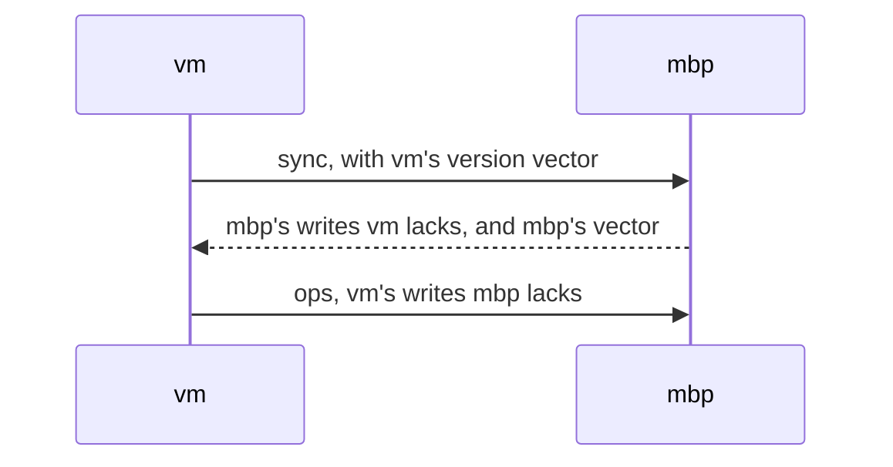
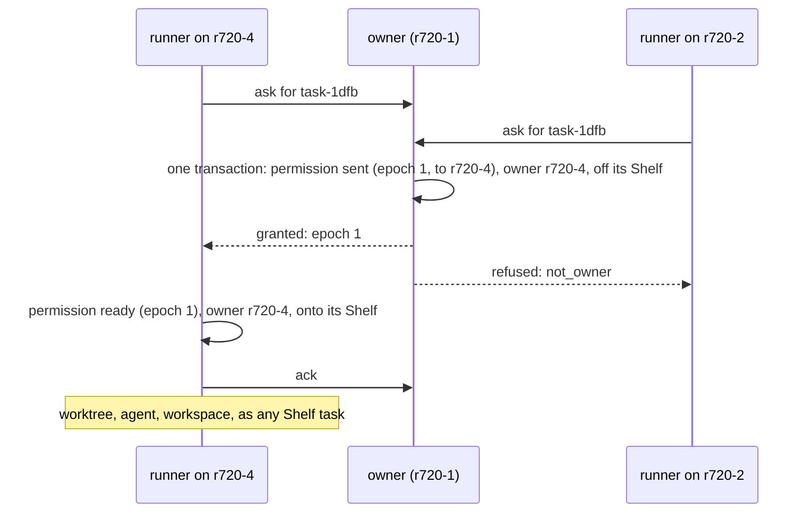
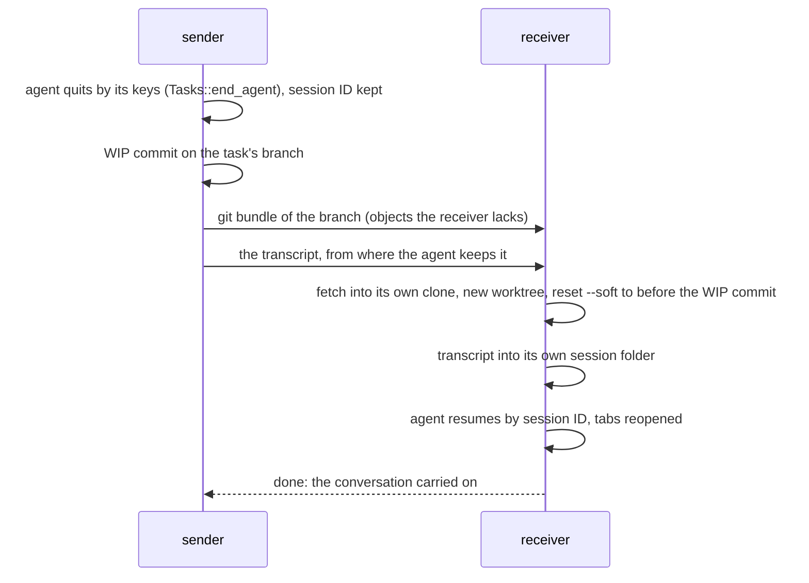

# Machines: Tasks Across Machines

**Status:** §1–2 built (slice 10; takeover after 2 minutes away added with the user, 2026-11-02), §3–4 planned · **Tested:** `cargo test -p kanna --test machines_shelf` (two and three daemons), `-p kanna-daemon replica` · **Part of:** [your machines](machines.md) · **Builds on:** [Shelf runners](shelf-runners.md), [tasks](tasks.md), [each app's Desks](app-desk.md)

Where a task runs when you have several machines: one Shelf replicated to all of them, exactly one machine allowed to start each task while its machines can reach each other, and tasks moving between any two daemons at a boundary. All of it works on your own machines with no account; [Kanna Cloud](kanna-cloud.md#5-directory-and-relays) adds an always-on copy.

## Contents

1. [The replicated Shelf](#1-the-replicated-shelf)
2. [Owners and grants](#2-owners-and-grants)
3. [Transfer](#3-transfer)
4. [Repos and credentials](#4-repos-and-credentials)

## 1. The replicated Shelf

Every one of your daemons holds every task's record, synced peer to peer over iroh, LAN first.

| Part | Consistency |
|---|---|
| A task's record: project, name, first message, agent, `after`, `on`, state, owner, and a `run.DEVICE` field for each machine that ran it | eventual: last writer wins per field, ordered by a hybrid logical clock ("oldest first") |
| Who may start or grant it: the **authority** | one machine; changes by a grant from the machine that holds it, or by a takeover when that machine has been away 2 minutes (§2) |

- **The record is a log of field writes** in `kanna.db`: `record_ops (device, ms, n, task, birth, field, value)`, one row per write, never changed. A field's value is its write with the largest `(ms, n, device)`, so every daemon that has the same rows shows the same record, whatever order they came in. `device` is the daemon's endpoint key.
- **The clock** is a hybrid logical clock kept in `meta` (`hlc`): wall-clock milliseconds, a counter for writes in the same millisecond, raised past every write it reads and never back across a restart.
- **A task's birth** is the clock reading when it was made (`ms.n.device`); runners take tasks oldest birth first. Tasks made before slice 10 get a birth from when they were made.
- **State** is `waiting` (on the Shelf, never started), `started` or `done`. `project` is the repo's identity (its origin URL, else its first commit, [machines-app §1](machines-app.md)), so the same project matches across clones at different paths.
- **Sync:** every 3 s, and at once after a change, each daemon opens a `sync` stream to each trusted machine and sends its **version vector** (the latest `(ms, n)` it has from each device). The other replies with every write after it, up to 2000, and its own vector; the first sends back what the other lacks. A device's writes always arrive as an unbroken run in clock order, so the vector says exactly what's missing.

**Why SQLite, not iroh-docs** (the [backlog model](../../references/prototypes/fleet-backlog/README.md) first chose iroh-docs; changed with the user, 2026-10-26):

- A grant gives up the owner's permission, queues the grant to send and writes the new owner in **one transaction**, which needs them in one database; iroh-docs keeps its records in its own redb store.
- iroh-docs speaks its own ALPNs (docs, blobs, gossip) beside `kanna/1`, which would skip the [peer log's admission](machine-identity.md#3-the-peer-log) unless gated again; a `sync` stream is admitted like every other `kanna/1` stream, and only a daemon (no app certificate) may open one.
- It needs a namespace secret handed out at pairing, and a redb store and a blob store on every daemon.
- The cost is a small sync protocol of our own, without range-based set reconciliation, which Shelves this size don't need. Old writes are never compacted yet.

## 2. Owners and grants

- **A task starts on its owner,** at first the machine where it was made. Who grants is a policy too: a scheduler (a load balancer over many machines, or [Kanna Cloud's](kanna-cloud.md#5-directory-and-relays)) can own every waiting task and assign them centrally ([machines §2](machines.md#2-machines-and-roles)).
- **Asking:** each repo's runners ([Shelf runners](shelf-runners.md)) count tasks they started and asks in flight against `shelf.runners` of the clone here, and fill free places from one list, oldest birth first: their own waiting tasks, which they start, and other machines' waiting tasks in the same project, which they ask the owner for. A task waiting for others, or with `on` that doesn't name this machine, is skipped. The owner grants it to exactly one runner, and that runner becomes the owner.
- **Permission is not the owner field.** Each machine keeps its own `authority (task, birth, epoch, permit, recipient)`: `ready` (may start or grant), `running` (started here), `sent` (granted at the next epoch, until the receiver acks), `acked`. A daemon starts a task only from `ready` or `running`, and grants only from `ready`, so knowing a record never allows a start; while machines can reach each other, two owners can't both hold it.
- **The owner checks each ask** against what it knows: still `ready`, not starting, not waiting for others, `on` names the asker, the ID not made twice. The asker takes the grant in one transaction, `ready` at the grant's epoch only if it's newer than any it had, so a grant delivered twice, or an old one replayed after the task came back, gives nothing.
- **A grant lost on the way is sent again:** the owner keeps `sent` grants and resends each every 3 s to its machine until it's acked, the same epoch to the same machine. While the receiver is away, nobody else asks the owner for the task; after 2 minutes another machine takes it over, as below.
- **An away machine is asked again later.** A sync or ask that can't reach a machine marks it away for 10 s, then 20 s, 40 s and so on up to 5 minutes, and nothing is sent to it meanwhile; any answer from it, or any request it sends, ends that. A refused task is skipped 10 s. An offline machine keeps running its own tasks: it holds their permission.
- **After 2 minutes away, its waiting tasks are taken over.** A runner with a free place starts another machine's waiting task (same rules as asking: same project, nothing it waits for, `on` names this machine) when that machine has been unreachable for 2 minutes (`KANNA_TAKEOVER_AFTER`, in seconds, for tests). It doesn't ask: it writes itself as owner and its `run.DEVICE` with `from`, takes `ready` at the next epoch, and starts the task on its Shelf. The worktree and branch are `TASK-MACHINE` (`task-3f9a0c12-vm`), so two copies never meet on a push.
- **Running a task twice is allowed, not prevented.** Every start writes its machine's `run.DEVICE`. When the old owner is back and syncs, a copy it hasn't started leaves its Shelf for Done (`taken`, to the machine that ran it), and it never starts it. One it started while apart keeps running: both copies stay, and `kanna task list` says `ran twice: mbp, vm` on each; you end the one you don't want with `kanna task done`.
- **A machine back from away hears from the others before starting its tasks.** After the daemon starts, or the Mac wakes (the wall clock jumped 30 s past the monotonic one), its runners start no task another machine could have taken until each other machine has synced or been found away. A task with `--on` naming only this machine doesn't wait.
- **Placement preferences:** `kanna task new … --on mini,r720-1` names the machines a task may run on, its owner included, whether a runner or `kanna task start` or `pick` starts it (`not_here`); without it, any machine with a clone of the project and a free runner. Matching a task's `needs:` to machines' capabilities is [Kanna Cloud's](kanna-cloud.md#5-directory-and-relays).
- **A machine's clones** are the projects in its `~/.kanna-v4/repos`, the repos of its tasks and its recent projects, matched by project identity. A task granted here goes onto the Shelf of that clone, made from its record.
- **Two meanings, two words:** "ask" and "grant" are between machines. A **claim** stays what it is in [app-desk](app-desk.md): an app having a task on its Desk, now named by its device (`claimed by: mbp`).
- **Task IDs** stay random 32 bits ([task IDs](task-ids.md)). Apps key views by (machine, ID). An ID already in the replica is refused when a task is made; one two machines make at once, before they've synced, stays two births, and neither is started or granted (`ambiguous`).
- **What the app sees:** each daemon's Shelf is the tasks it owns, so a granted task moves from the owner's Shelf to the runner's in the Desk view's merged Shelf. `kanna task list` also lists other machines' waiting and started tasks, `on vm` in WHERE.

| Request (`replica` on a `sync` stream) | Reply |
|---|---|
| `sync {vector}` | `{ops, vector}` |
| `ops {ops}` | `{}` |
| `ask {task, birth}` | `{epoch}`, or `not_owner`, `started`, `blocked`, `not_there`, `ambiguous` |
| `grant {task, birth, epoch}` (resent) | `{}` once saved |
| `ack {task, birth, epoch}` | `{}` |
| `list` (local socket only) | `{device, records, authority}`, for tests and debugging |

A `sync` stream carries only `replica` requests and adds the asking daemon's key as `peer`; a `control` stream or an app link drops a `peer` sent with `replica`, so neither `kanna --host` nor a remote app can speak for a machine.

- **One transaction per change:** saving a task's row writes its record's fields and, the first time, this machine's permission with it, so a crash can't leave a task done here but waiting in the replica.
- **Edits from elsewhere:** a waiting task's name, `after` and `on` take another machine's later write (by the clock), so a grant that overtakes an edit doesn't undo it.
- **Cycles:** `--after` refuses a cycle through other machines' tasks too.

## 3. Transfer

A task moves between any two daemons, Macs included, at a boundary: not started, or stopped at a turn's end.

- **No push needed:** the branch travels as a git bundle over the link, so repos without a remote work too, and WIP commits never reach origin.
- **The dirty tree comes back:** `reset --soft` leaves the agent's uncommitted work as it left it, staged.
- **Any path:** the receiver uses its own clone and worktree paths. Agents resume by session ID from any path: checked 2026-10-21 with Claude Code 2.1.305 and Codex 0.163, and v2 relied on it.
- **Durable:** each step is recorded on both ends and resumes after either side restarts. The sender keeps the task until the receiver says done.
- **v2's lessons:** copy the transcript from where the agent really keeps it (v2 copied a lock file and lost the transcript without noticing), never move a running agent, and test that the conversation carries on, not only that the transfer "completed".

## 4. Repos and credentials

- **Clones** live wherever a machine likes (`~/repos/<name>` on servers). A repo is identified across machines by its remote URL, or, for one with no remote, by the ID of its first commit.
- **Git credentials** are per machine: a deploy key or `gh auth login` with a fine-grained token on each machine. Your personal key never leaves the Mac.
- **Agent logins** are set up when a machine joins ([agent sign-in](agent-sign-in.md), [setup §4](machine-setup.md#4-joining-and-updates)).
