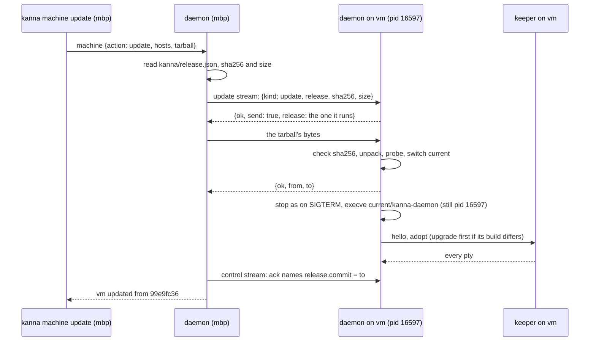
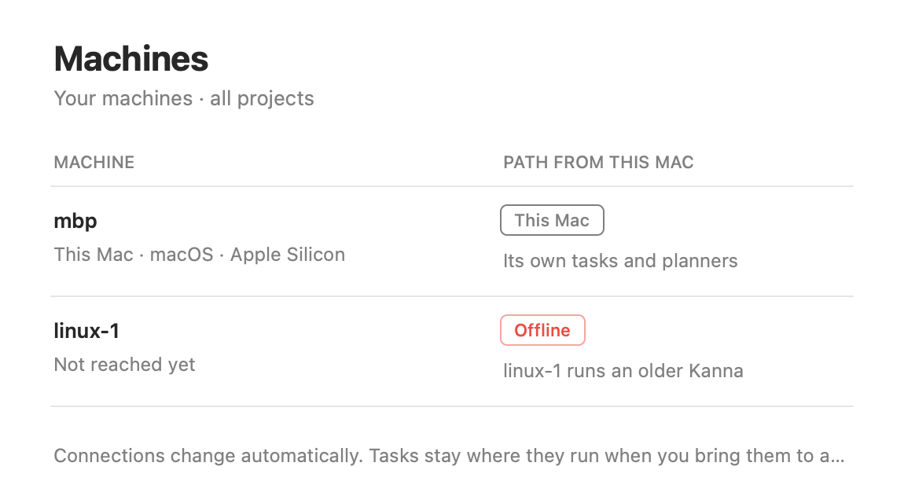

# Machines: One Commit on Every Machine

**Status:** built (slice 6, task "Machines 6") · **Part of:** [your machines](machines.md) §9, [setting up a Linux machine](machine-setup.md) · **Builds on:** [identity and pairing](machine-identity.md), [one link per machine](machine-links.md), [restarting the daemon](daemon-restart.md), [upgrading the keeper](keeper-upgrade.md)

`kanna machine update` puts one build of Kanna on every one of your Linux machines. Each machine's daemon takes the tarball over the link between daemons, installs it beside the one it runs, switches to it and restarts itself in place; the keeper keeps every terminal and agent running. Machines of different releases keep working together over a range of protocols, and Kanna.app names the fix when a machine has none in common with it.

## Contents

1. [The Linux tarball](#1-the-linux-tarball)
2. [Installs under /opt/kanna](#2-installs-under-optkanna)
3. [kanna machine update](#3-kanna-machine-update)
4. [The update stream](#4-the-update-stream)
5. [Restarting in place](#5-restarting-in-place)
6. [Protocols](#6-protocols)
7. [Not yet](#7-not-yet)
8. [Tested](#8-tested)

## 1. The Linux tarball

`scripts/build-linux.sh [production|staging|dev] [--arch x86_64|aarch64] [--out DIR]` builds it on the Mac (or on Linux): the daemon, keeper and CLI cross-compiled with Zig as C compiler and linker, for glibc 2.35 (Ubuntu 22.04 and later) at the `baseline` CPU (the R720s' Ivy Bridge), with debug info stripped. `KANNA_VERSION` sets the version. `scripts/release.sh` builds the x86_64 one after the DMGs, checks it was built from the release's commit, and publishes it with them.

```
Kanna-4.1.0-linux-x86_64.tar.gz        (Kanna-Staging-… on staging)
└── kanna/
    ├── kanna, kanna-daemon, kanna-keeper
    ├── kanna-skills/                    the skills the Mac has in Resources
    └── release.json                     {commit, version, channel, os, arch, protocols}
```

`release.json` is what a sender reads to know what it holds; `commit` is `<sha>` or `<sha>-dirty`. `scripts/server-setup.sh --tarball FILE` installs a tarball instead of building from the checkout, and its own builds write the same `release.json`.

## 2. Installs under /opt/kanna

```
/opt/kanna/
├── 341bbd52…/          one folder per commit, owned by the user Kanna runs as
├── 99e9fc36…/
├── current  -> 341bbd52…   the unit runs current/kanna-daemon
└── previous -> 99e9fc36…
```

A daemon can take updates only when it runs from such a folder: its binary is `<prefix>/<commit>/kanna-daemon` and `<prefix>/current` points at that folder (`Install::detect`). A daemon in Kanna.app, or one run from a build folder, refuses with `not_installed`. Installing a tarball:

| Step | Refused, and nothing switched, when |
|---|---|
| unpack into `<prefix>/.<commit>.new` | the tarball doesn't unpack, or lacks `kanna`, `kanna-daemon`, `kanna-keeper` or `release.json` |
| check `release.json` | its commit isn't the one announced |
| probe: run its `kanna-daemon --uses-keeper` | it doesn't run here (another architecture, a newer glibc) within 10 s |
| rename it to `<prefix>/<commit>` | (a `-dirty` commit already there is replaced: same name, other contents) |
| `previous` → the old `current`; `current` → the new one | each by renaming a new symlink over the old, so neither is ever missing |
| remove every other commit folder | |

Folder names must be a full commit (40 lowercase hex digits, optionally `-dirty`), so an update can't name a path outside the prefix.

## 3. kanna machine update

```sh
kanna machine update                                # this release, to every Linux machine
kanna machine update linux-1 --tarball target/release-linux/Kanna-4.1.0-linux-x86_64.tar.gz
```

- **What goes:** the tarball given, or this Kanna's own release: the daemon downloads `Kanna-VERSION-linux-x86_64.tar.gz` from the GitHub release `vVERSION` with curl, once, into its state folder's `releases/` (each download into a file of its own, renamed into place when complete, so two at once never mix). A dev build has no release, so it needs `--tarball`.
- **Where:** every one of your machines but this one, or the machines named. A machine whose capabilities name another OS or architecture is skipped (`macos …: Kanna.app updates it`); naming it makes that a failure.
- **How:** to every machine at once, each over an `update` stream (§4). A machine already running that commit says so and takes nothing.
- **Done** when the machine answers again at the new commit (it is dialed every 200 ms for up to 60 s), read from the ack of a control stream, or from the `other_protocol` refusal when the new build shares no protocol with this one. The reply lists each machine with `from`, `to`, the bytes sent and how long sending and restarting took; `kanna machine` shows each connected machine's version and commit.
- **Exit code** 1 when any machine failed or was named and skipped; the others are still updated.



## 4. The update stream

A stream kind of its own, `update`, beside the six of [machines §5](machines.md#5-the-app-link-over-the-network). It is the one way into an old daemon, so **its format never changes incompatibly** and it is not subject to protocol negotiation (§6): a daemon of any protocol takes it from any trusted peer.

| Line | Carries |
|---|---|
| header | `{kind: "update", protocols, release: {commit, version, channel, os, arch, protocols}, sha256, size}` |
| ack | `{ok: true, kind, name, release, send: true}`, or `current: true` when it runs that commit already, or a refusal |
| bytes | exactly `size` bytes of the tarball |
| reply | `{ok: true, from, to}`, then the receiver restarts; or a refusal |

Refusals: `unpaired`/`revoked` (as every stream), `not_installed`, `wrong_build` (another OS, architecture or channel: a production install never takes a staging build), `busy` (another update is being taken, or one was taken and the daemon is about to restart), `bad_request`, `bad_tarball` (the sha256 doesn't match), `install_failed` (§2). A daemon from before this slice answers `unknown_stream`, reported as "its Kanna predates kanna machine update: run scripts/server-setup.sh there once". Downgrades are allowed: the user named the build.

## 5. Restarting in place

Once the reply is sent, the daemon leaves its main loop the way a SIGTERM does (terminals saved, the keeper left running, the iroh endpoint closed) and `execve`s `<prefix>/current/kanna-daemon` with its own arguments and environment. The pid stays, so systemd sees no restart (`MainPID` unchanged) and needs nothing from the unit; every descriptor is close-on-exec. The new daemon then starts as after any restart ([restarting](daemon-restart.md)): it takes the daemon lock, connects to the keeper, upgrades the keeper in place when its build differs from `current/kanna-keeper` ([keeper upgrade §6](keeper-upgrade.md#6-who-triggers-it)), and takes back every pty. In the VM test the restart took 70 ms.

## 6. Protocols

`kanna_build::PROTOCOLS` is the range of protocols this build speaks, `[lo, hi]`, now `[1, 1]`; Kanna.app's `Protocols.mine` must be the same (a test in `kanna-build` checks). A change that old peers can't follow raises `hi`; dropping the oldest raises `lo`. Two ends work together at the highest protocol both speak.

- **Between daemons:** every stream header carries `protocols` (a daemon from before this slice sends none and counts as `[1, 1]`). The ack carries `protocol`, the one chosen, and `release`; the opener checks it speaks that protocol, and takes an ack without one (a daemon from before this slice) as protocol 1. With none in common the stream is refused with `other_protocol` and the receiver's `release`, and the caller reports, for example, `vm runs Kanna 4.0.0 (aaaaaaaa), protocol 2–3, and this machine speaks 1; this machine is older: update it, or run kanna machine update on vm`. `pair` and `update` streams aren't negotiated.
- **The app:** `app.hello` carries `protocols` and the daemon answers as [links §2](machine-links.md) says: with none in common, `other_protocol` with `mine`, `commit` and `version`, and the daemon **keeps running**. The Machines tab shows that machine as Offline, with a note that says which side is older and a tooltip that leads with the fix (`KannaMachines`'s `Protocols.otherProtocol`):

  

| Which side | Note | Tooltip |
|---|---|---|
| the machine is older | `linux-1 runs an older Kanna` | `kanna machine update linux-1 updates it. It runs 4.0.1 (d7cb0a1e), protocol 1; this Kanna speaks 2–3. Until then, linux-1's tasks keep their places on the Desk.` |
| this Kanna is older | `linux-1 runs a newer Kanna` | `Update this Kanna, or run kanna machine update on linux-1. It runs …` |

## 7. Not yet

- **Updating by itself** when a newer release is out: slice 6b ([setup §4](machine-setup.md#4-joining-and-updates)). Today an update happens when `kanna machine update` runs. The daemon already installs and restarts itself, so this needs only the trigger: a peer or the release site announcing a newer release of the same channel.
- **Fetching from a peer** that has the tarball, instead of the sender pushing it to each machine.
- **Macs** update with Kanna.app; a build Mac served by launchd ([build Macs](build-macs.md)) gets its own path.
- **aarch64 Linux releases:** `release.sh` publishes x86_64 only; `build-linux.sh --arch aarch64` builds one by hand.

## 8. Tested

- `cargo test -p kanna-net`: an update between two paired endpoints moves a fake install from commit A to B (current, previous, other folders removed) and waits for the machine to come back at B; a second update says it's already there; a build whose daemon doesn't run is refused and nothing is switched; another architecture and a Mac are skipped; a machine of protocol 2–3 refuses a protocol-1 caller with `other_protocol` and its fix, yet takes an update.
- `cargo test -p kanna --test machine`: two daemons on this Mac, one installed in a temporary `opt/<commit>`; `kanna machine update --tarball` moves it to another commit; the daemon restarts under the same pid and a terminal's shell keeps running.
- `cargo test -p kanna-daemon --test app_link`: an app of another protocol gets `other_protocol` with `mine`, `commit` and `version`, and the daemon keeps running.
- The picture above is the product: Kanna.app and its daemon built with protocols `[2, 2]` for the occasion, paired with a second daemon of today's `[1, 1]` on this Mac; the Machines tab's tooltip read "kanna machine update linux-1 updates it. It runs 0.1.0 (8031dc44), protocol 1; this Kanna speaks 2. Until then, linux-1's tasks keep their places on the Shelf."
- Between this Mac and an Ubuntu 26.04 arm64 lima VM (October 2026): `server-setup.sh --tarball` installed an aarch64 tarball built on the Mac (commit 99e9fc36); paired with a test daemon on the Mac through lima's loopback forward of UDP 7470 (a test daemon has no Local Network permission, [identity §2](machine-identity.md#2-pairing)); a terminal opened with `kanna --host vm open`; `kanna machine update --tarball` with a build of the next commit (341bbd52, version 0.1.1): the daemon kept pid 16597 and systemd's `MainPID`, the terminal's shell (pid 16768) kept running under the same keeper, `current` and `previous` switched, and the restart took 70 ms. Sending the 16 MB took 30 s that time, through lima's UDP forward; a second update with the final build (4a4e6b15) went over the direct path to the VM's address: 16 MB in 0.3 s, back in 0.2 s, the same shell and daemon pid, 99e9fc36 removed as neither current nor previous, and a repeat answered `already runs it`. The x86_64 tarball is built and checked by type, but not yet run on a server: the next test is a real x86_64 server.
