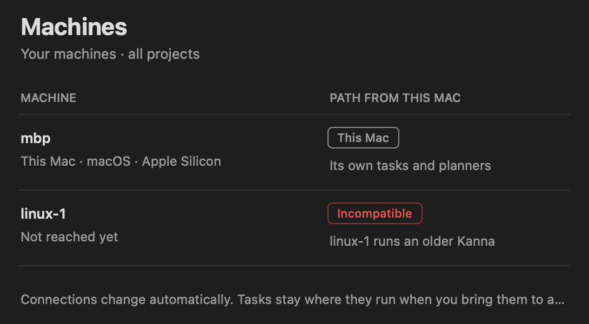

# Machines: Versions Across Machines

**Status:** built (slice 6, task "Machines 6"; `kanna machine update` removed by the task "Remove kanna machine update") · **Part of:** [your machines](machines.md) §9, [setting up a Linux machine](machine-setup.md) · **Builds on:** [identity and pairing](machine-identity.md), [one link per machine](machine-links.md)

Kanna releases a Linux tarball beside the DMGs, and you install it on your own Linux machines however you like: `scripts/server-setup.sh --tarball`, a package of your own, configuration management. Kanna doesn't update them for you. Every build speaks one protocol, and two machines work together only when theirs match. When they don't, the Machines tab shows the machine as Incompatible and says which side to update.

## Contents

1. [The Linux tarball](#1-the-linux-tarball)
2. [Protocols](#2-protocols)
3. [Why Kanna doesn't update your Linux machines](#3-why-kanna-doesnt-update-your-linux-machines)
4. [Tested](#4-tested)

## 1. The Linux tarball

`scripts/build-linux.sh [production|staging|dev] [--arch x86_64|aarch64] [--out DIR]` builds it on the Mac (or on Linux): the daemon, keeper and CLI cross-compiled with Zig as C compiler and linker, for glibc 2.35 (Ubuntu 22.04 and later) at the `baseline` CPU (the R720s' Ivy Bridge), with debug info stripped. `KANNA_VERSION` sets the version. `scripts/release.sh` builds the x86_64 one after the DMGs, checks it was built from the release's commit, and publishes it with them; an aarch64 one is built by hand with `--arch aarch64`.

```
Kanna-4.1.0-linux-x86_64.tar.gz        (Kanna-Staging-… on staging)
└── kanna/
    ├── kanna, kanna-daemon, kanna-keeper
    ├── planner.sh
    ├── kanna-skills/                    the skills the Mac has in Resources
    └── release.json                     {commit, version, channel, os, arch, protocol}
```

`release.json` says what the tarball holds; `commit` is `<sha>` or `<sha>-dirty`. `scripts/server-setup.sh --tarball FILE` checks it's for this OS and architecture and installs it ([setup §3](machine-setup.md#3-running-the-setup)); its own builds from a checkout write the same `release.json`.

## 2. Protocols

`kanna_build::PROTOCOL` is the one protocol this build speaks, now 5; Kanna.app's `Protocols.mine` must be the same (a test in `kanna-build` checks). Any change an older build can't follow raises it, and two ends work together only when theirs are equal. Nothing translates between protocols: you update the older side ([setup §4](machine-setup.md#4-joining-and-updating)).

- **Between daemons:** every stream header carries `protocol`, and the ack carries the receiver's `protocol` and `release`. If the header's protocol isn't the receiver's, the stream is refused with `other_protocol` and the receiver's `release`. The opener checks the ack's protocol is its own. Either way, the caller reports which side is older, for example `vm runs Kanna 4.2.0 (aaaaaaaa), protocol 5, and this machine speaks 4; this machine is older: update it`, or `…; it's older: update Kanna on vm`. A build from before protocol 4 sends `protocols`, a range, and no `protocol`, so it counts as older (`an older protocol`). `pair` streams aren't checked, so you can pair a machine before updating it. A daemon from slice 6 that still sends an `update` stream is answered `unknown_stream`.
- **The app:** `app.hello` carries `protocol` and the daemon answers as [links §2](machine-links.md#2-the-hello) says: if it's not the daemon's, `other_protocol` with the daemon's `protocol`, `commit` and `version`, and the daemon **keeps running**. The Machines tab shows that machine as **Incompatible** (in red, as Offline is), with a note that says which side is older and a tooltip that leads with the fix (`KannaMachines`'s `Protocols.otherProtocol`):

  

| Which side | Note | Tooltip |
|---|---|---|
| the machine is older | `linux-1 runs an older Kanna` | `Update Kanna on linux-1. It runs 4.0.1 (d7cb0a1e), protocol 3; this Kanna speaks 4. Until then, linux-1's tasks keep their places on the Desk.` |
| this Kanna is older | `linux-1 runs a newer Kanna` | `Update this Kanna. It runs …` |

**Why one protocol and not a range.** Protocols 2 and 3 were a range, `[2, 3]`: a build kept the older protocol's code path (output without `taken` acks, [input latency §4](input-latency.md#4-output-acks)) so that machines of either could keep working while you updated them. Decided with the user to drop that. Updating your machines is quick, and every range means keeping and testing the old path in Rust and Swift. The cost is that a protocol change cuts off each machine until you update it, and its tasks wait on the Desk until you do.

## 3. Why Kanna doesn't update your Linux machines

Slice 6 built `kanna machine update`: it pushed a tarball over an `update` stream to each Linux machine, whose daemon installed it in `/opt/kanna/<commit>`, switched `current` and `execve`d itself with its terminals kept. Slice 6b was to have daemons update themselves from a peer or the release site. Both are gone:

- **A machine of your own is yours to manage.** You install Kanna on it however you install anything else there; Kanna supporting one install layout it can rewrite would tie every machine to `/opt/kanna` and a daemon that replaces its own binaries.
- **Kanna Cloud's servers** get an internal tool of their own for installing and updating Kanna ([Cloud provisioning](cloud-provisioning.md)), not a command in the product.
- **When versions don't work together,** the Machines tab says so and which side to update (§2).

The removed code (`kanna_net::update`'s `Install` and `Tarball`, the daemon's restart in place) is in git history before the merge of "Remove kanna machine update", for the Cloud tool to start from.

## 4. Tested

- `cargo test -p kanna-net`: a machine of protocol 5 refuses a protocol-4 caller with `other_protocol` and "this machine is older: update it", and the other way round "it's older: update Kanna on mbp"; the message's wording for each side and for a build from before protocol 4 (`protocol::tests`).
- `cargo test -p kanna-daemon --test app_link`: an app sending the old range or another protocol gets `other_protocol` with the daemon's `protocol`, `commit` and `version`, and the daemon keeps running; `kanna --test machine` does the same over the network.
- `swift test --filter KannaMachinesTests`: the note and tooltip for each side.
- The picture above is the product: Kanna.app and its daemon of protocol 4, paired on this Mac with a daemon built from main before protocol 4 (range `[2, 3]`), which refuses the app's hello. The tooltip read "Update Kanna on linux-1. It runs 0.1.0 (e402250c), an older protocol; this Kanna speaks 4." (November 2026).
- `server-setup.sh --tarball` with an aarch64 tarball built on this Mac installed and ran in an Ubuntu 26.04 arm64 lima VM (October 2026). The x86_64 tarball is built and checked by type, but not yet run on a server.
