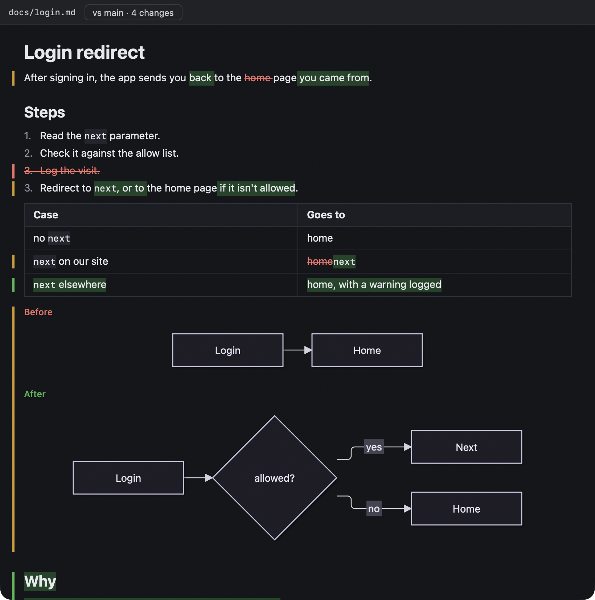
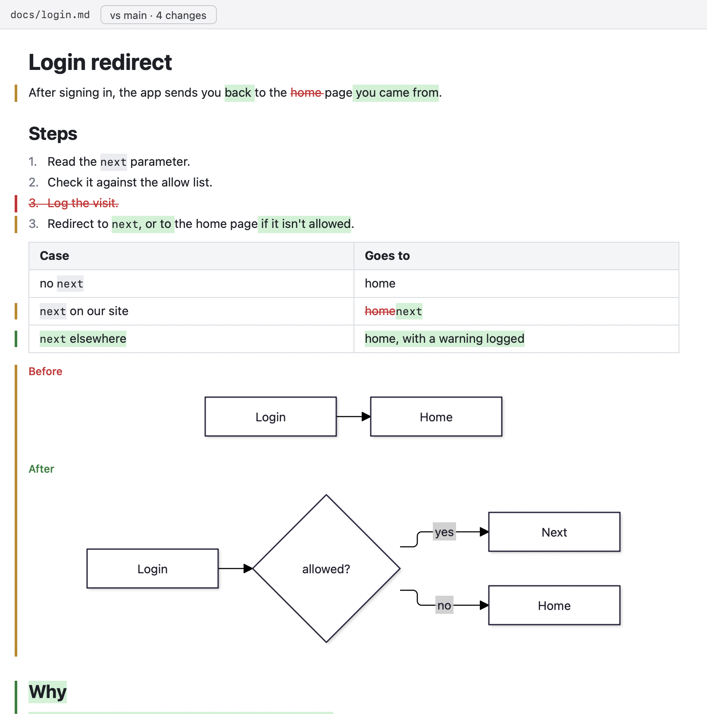
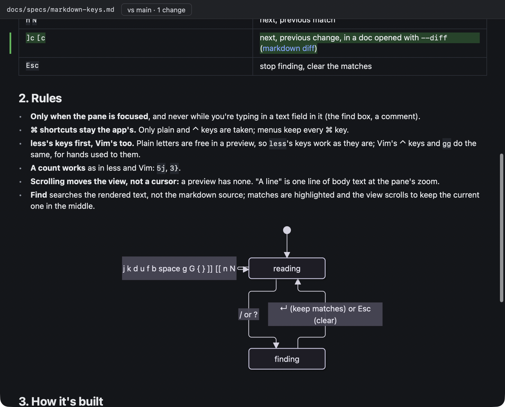
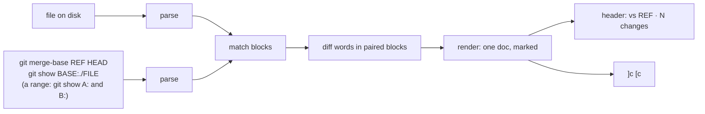

# Markdown Diff

**Status:** built (2026-10-16) · **Builds on:** [web, markdown and iOS panes](app-panes.md), [markdown keys](markdown-keys.md) · **Why:** agents [present their work](presenting.md) by opening the specs they changed, and you couldn't tell what changed without reading a raw diff of the markdown source

`kanna open md FILE --diff REF` opens the markdown pane with what changed in the doc since REF marked inline, in the rendered doc. It's a mode of the markdown pane, so everything else the pane does still works: it reloads as the file changes (the marks follow), takes [comments](doc-markup.md), zooms and takes the [keys](markdown-keys.md).

| Dark | Light |
|---|---|
|  |  |

A real one, this task's change to [markdown keys](markdown-keys.md), after `]c`:

## Contents

1. [Rules](#1-rules)
2. [What it's compared with](#2-what-its-compared-with)
3. [CLI and keys](#3-cli-and-keys)
4. [How it's built](#4-how-its-built)
5. [Glossary](#5-glossary)

## 1. Rules

- **Blocks first, then words.** The two versions are matched block by block (headings, paragraphs, list items, table rows, code blocks, diagrams). A block that's there in both, but not the same, is diffed word by word, so a reworded sentence shows its new words added and its old ones struck through, not a whole paragraph removed and another added.
- **Which blocks pair up.** Between two unchanged blocks, an old and a new block of the same kind pair up when they share at least 40% of their words. Lists, tables and quotes always pair, and their items, rows and paragraphs are matched inside them the same way. A block left unpaired is removed or added, and shows whole.
- **Diagrams and images** that changed show old above new, labelled Before and After.
- **A change** is a run of changed blocks with no unchanged block between them. The header counts them; `]c` and `[c` move between them.
- **Comments** anchor in the rendered text as usual; struck-through text is in it too.
- **Live** (except a range, [§2](#2-what-its-compared-with)): the marks are worked out again when the file changes, and when the commit it's compared with moves (a commit, a rebase, a merge of main), checked every 2 s.

## 2. What it's compared with

REF is any commit or branch, chosen by whoever opens the doc. It's compared as `git diff REF...` compares: from the [merge base](#5-glossary) of REF and HEAD to the file on disk, uncommitted changes included. So a branch's doc doesn't show what landed on main since it branched.

| REF | Shows |
|---|---|
| `main` (also a bare `--diff`, or `master` if there's no main) | everything this branch changed in the doc |
| `HEAD` | changes not committed yet |
| a commit or another branch | changes since it (since where it and HEAD meet) |
| `A..B`, two commits or branches (an empty side is HEAD) | the doc as it is in B, marked against A: compared directly, not from where they meet; read-only (below) |

A range shows a past version, not the file on disk, so it **doesn't reload** (an edit on disk, or B moving, changes nothing until it's opened again) and **takes no comments**: a comment's line would point into B's text, which the file may no longer have, so `kanna markup` refuses the pane and Comments stays off.

| Case | Result |
|---|---|
| The file is new since REF (or isn't in A) | all of it is added |
| The file isn't in B | `kanna open` fails: "notes.md isn't in work" |
| The file isn't in a git repo | `kanna open` fails: "notes.md isn't in a git repo, so it has nothing to be compared with" |
| REF (or A or B) isn't a commit | `kanna open` fails: `no commit or branch "nope" in its repo` |
| Either happens later (the branch is deleted) | the doc shows unmarked, the error in the header |

## 3. CLI and keys

| Command or key | Does |
|---|---|
| `kanna open md FILE --diff [REF]` | open the doc with its changes since REF marked (placement options as `kanna open md`) |
| `kanna open md FILE --diff A..B` | open the doc as it is in B, marked against A, read-only |
| `]c` `[c` | next, previous change; a count works (`3]c`) |
| click the header's "vs main · 7 changes" | next change |
| `kanna workspace list --json` | the pane's record has `diff: "main"` |
| `kanna raw '{"cmd":"debug.md","args":{"pane":"file-4"}}'` | for tests: `diff`, `changes` (the count), `diff_error`; `change: N` jumps N changes |

## 4. How it's built

| Part | Where |
|---|---|
| `--diff`: a bare one resolves to main or master | `crates/kanna/src/commands.rs` |
| `diff` in the pane's record, saved in `layout.json` | `crates/kanna-mux/src/pane.rs`, `state.rs`, `core.rs` |
| The old text, block and word diff | `apps/kanna/Sources/KannaMarkdown/MarkdownDiff.swift` |
| Rendering both versions into one doc, the marks | `MarkdownRenderer.swift`; the bars in `MarkdownLayoutManager.swift` |
| Header, reload, keys | `MarkdownPaneView.swift`, the header's chip in `KannaDocs/DocComments.swift` |

- **Matching** is a longest common subsequence of the blocks (as `git diff` matches lines), then, between each pair of matches, the best pairing of same-kind blocks by shared words. Words are matched the same way. Past 4 million cells either step gives up pairing: the blocks show removed and added.
- **The diff runs in the app** on the text the daemon sends ([file panes](file-panes.md)); the daemon only keeps REF in the record. The app still runs `git` (`/usr/bin/git`) in the file's folder for the base and a range's versions, which is to move to the daemon ([file panes §5](file-panes.md#5-not-in-this-change)).
- **Rendering:** the renderer walks the new doc with the diff's entries; a removed block is rendered from the old doc where it was, a changed one from both, merged word by word. Every changed block carries a `kanna.change` attribute (added, removed, changed); the bars and the count read it.
- **Tests:** `MarkdownDiffTests` (added, removed and reworded paragraphs, list items, table rows, headings, a changed diagram, a new file, the word diff, a range's two versions); `markdown_diff` in `scripts/e2e-kanna.sh` (a doc changed on a branch, the count before and after an edit, `]c` `[c`, `HEAD`, a new file, outside a repo, a bad REF, a range: B's text, no reload, no comments, a doc new in B, one missing from B).

The pane's [overview](markdown-overview.md) marks the changes down its right edge, in the bars' colours.

Separate from the [diff viewer](diff-viewer.md) (`kanna open diff`), whose `.md` files may later open in this mode.

## 5. Glossary

- **Merge base:** the newest commit both REF and HEAD come from: where a branch left main.
- **Change:** a run of changed blocks with no unchanged block between them.
