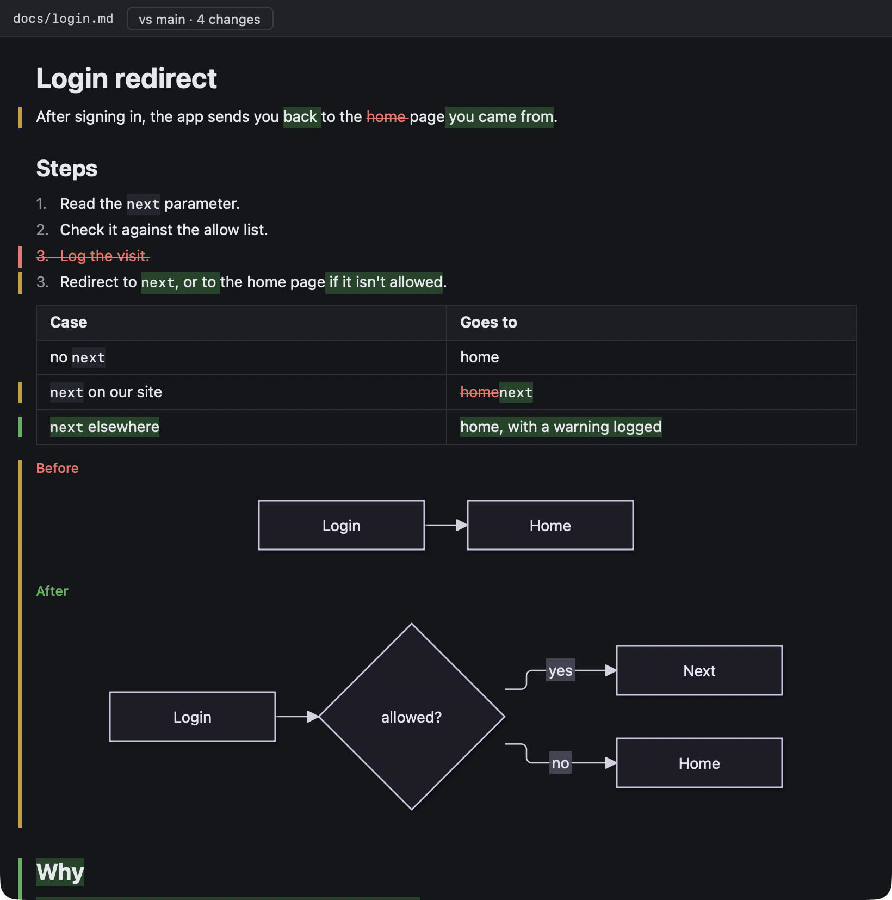
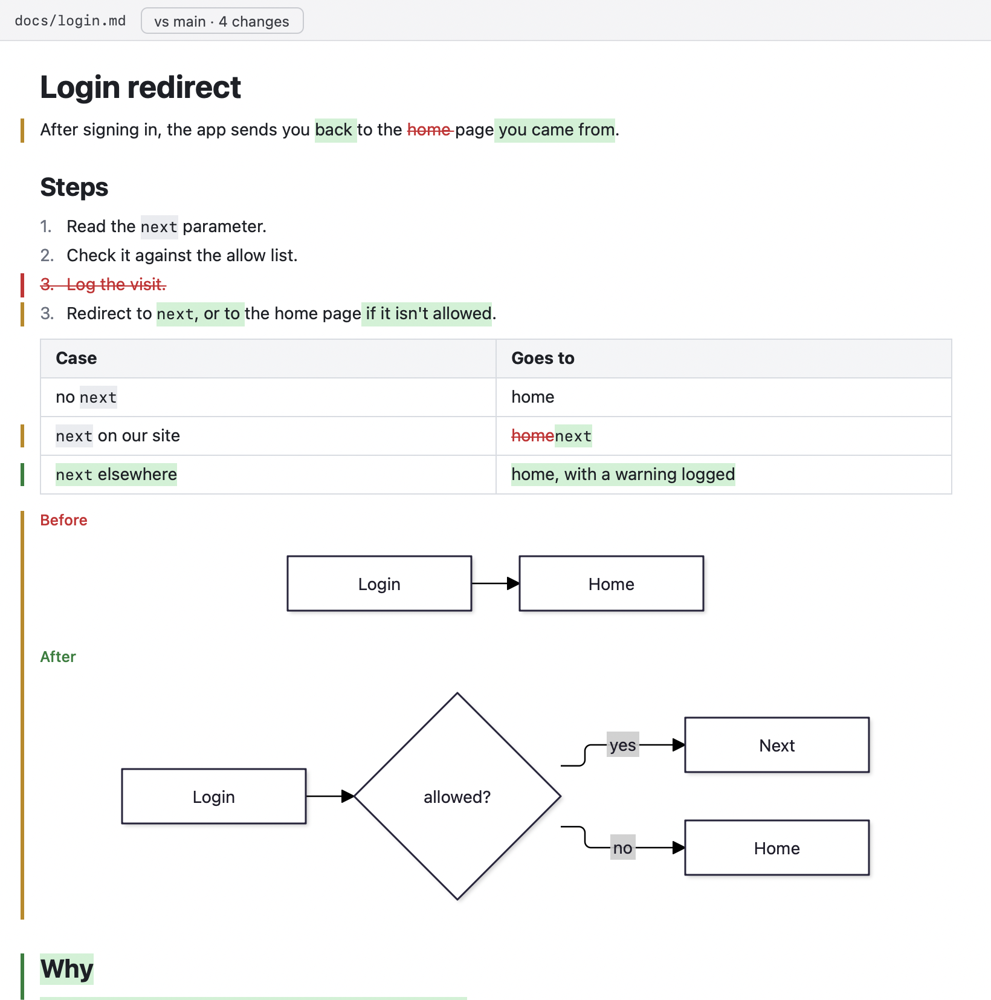
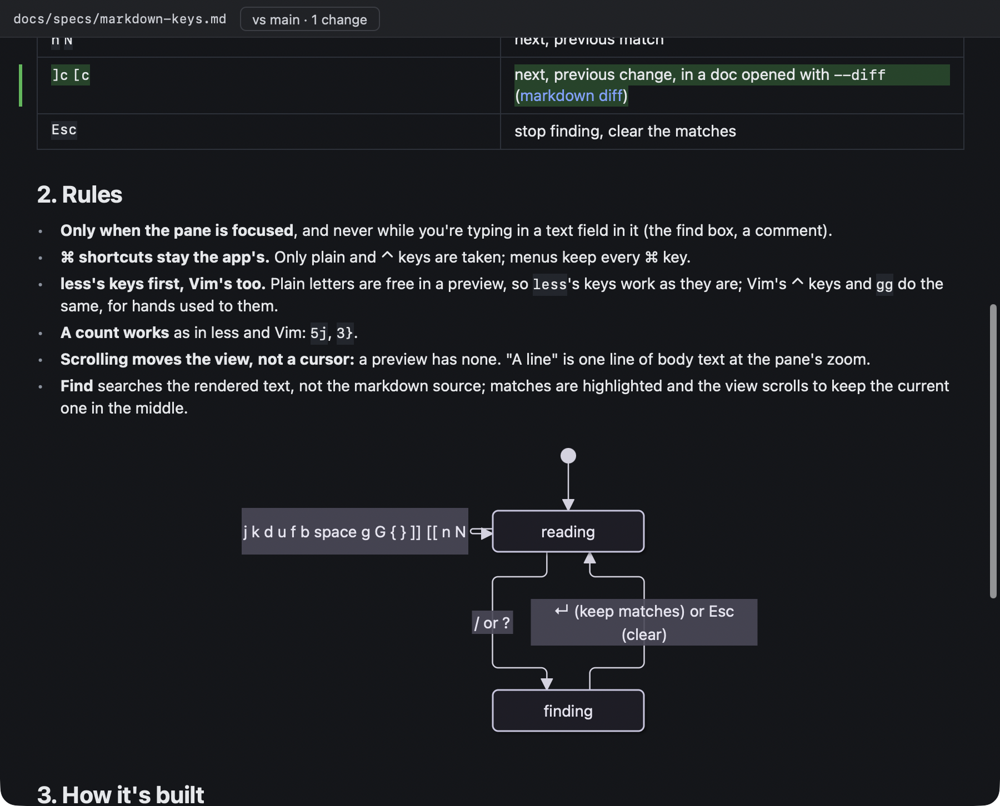
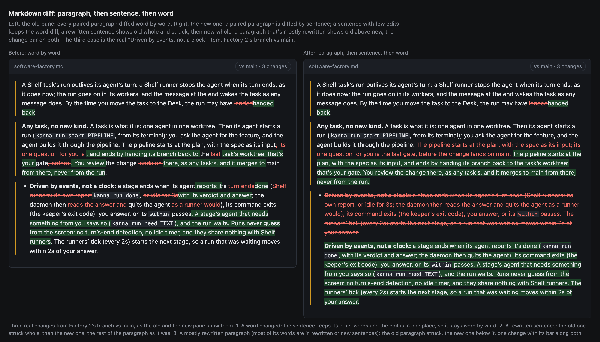
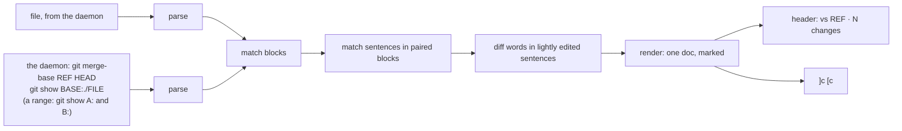

# Markdown Diff

**Status:** built (2026-10-16); sentences first (2026-11-02) · **Mockup:** [markdown-diff-sentences.html](../../references/mockups/markdown-diff-sentences.html) · **Builds on:** [web, markdown and iOS panes](app-panes.md), [markdown keys](markdown-keys.md) · **Why:** agents [present their work](presenting.md) by opening the specs they changed, and you couldn't tell what changed without reading a raw diff of the markdown source

`kanna open md FILE --diff REF` opens the markdown pane with what changed in the doc since REF marked inline, in the rendered doc. It's a mode of the markdown pane, so everything else the pane does still works: it reloads as the file changes (the marks follow), takes [comments](doc-markup.md), zooms and takes the [keys](markdown-keys.md).

| Dark | Light |
|---|---|
|  |  |

A real one, this task's change to [markdown keys](markdown-keys.md), after `]c`:

## Contents

1. [Rules](#1-rules)
2. [What it's compared with](#2-what-its-compared-with)
3. [CLI and keys](#3-cli-and-keys)
4. [How it's built](#4-how-its-built)
5. [Glossary](#5-glossary)

## 1. Rules

- **Blocks, then sentences, then words.** The two versions are matched block by block (headings, paragraphs, list items, table rows, code blocks, diagrams). A block that's there in both, but not the same, is diffed sentence by sentence, and a sentence with few edits word by word, so each change reads at the level it was made: a fixed word as a word, a rewritten sentence as a sentence, a rewritten paragraph as a paragraph ([§1.1](#11-sentences)).
- **Which blocks pair up.** Between two unchanged blocks, an old and a new block of the same kind pair up when they share at least 40% of their words. Lists, tables and quotes always pair, and their items, rows and paragraphs are matched inside them the same way. A block left unpaired is removed or added, and shows whole.
- **Diagrams and images** that changed show old above new, labelled Before and After.
- **A change** is a run of changed blocks with no unchanged block between them. The header counts them; `]c` and `[c` move between them.
- **Comments** anchor in the rendered text as usual; struck-through text is in it too.
- **Live** (except a range, [§2](#2-what-its-compared-with)): the marks are worked out again when the file changes, and when the commit it's compared with moves (a commit, a rebase, a merge of main), checked every 2 s.

### 1.1 Sentences

Word by word alone, a heavily rewritten paragraph comes out as alternating struck and added words, which can't be read. Three real changes, before (word by word) and after:

- **Sentences** end at `.` `?` `!` `:` or `·` followed by a space (outside brackets, and not after a one-letter word, as in "e.g."), and at a line break. Sentences the same in both versions match first; between them, an old and a new sentence pair up when the new one is a light edit of the old.
- **A light edit** keeps the word diff. It shares at least one word, and either its edits are in one place, or at least half its words are unchanged with the edits in at most two places, or at least 80% are unchanged with at most one place per 8 words (a word renamed through a long sentence). Words here are letters and digits; punctuation doesn't count.
- **A rewritten sentence**, one that isn't a light edit of any, shows whole: the old one struck, then the new one added. Sentences removed or added outright show the same way.
- **A rewritten paragraph**, where under half of its words (old and new) are in unchanged or lightly edited sentences, shows whole: the old paragraph struck, the new one below it, one change with the change bar on both. Only paragraphs (in a list item or a quote too); a heading or table cell shows its sentences inline.
- **The cut-offs** were tuned on the paragraphs changed in the last 60 commits to `docs/specs` (770 pairs): about one in eight shows whole.

## 2. What it's compared with

REF is any commit or branch, chosen by whoever opens the doc. It's compared as `git diff REF...` compares: from the [merge base](#5-glossary) of REF and HEAD to the file on disk, uncommitted changes included. So a branch's doc doesn't show what landed on main since it branched.

| REF | Shows |
|---|---|
| `main` (also a bare `--diff`, or `master` if there's no main) | everything this branch changed in the doc |
| `HEAD` | changes not committed yet |
| a commit or another branch | changes since it (since where it and HEAD meet) |
| `A..B`, two commits or branches (an empty side is HEAD) | the doc as it is in B, marked against A: compared directly, not from where they meet; read-only (below) |

A range shows a past version, not the file on disk, so it **doesn't reload** (an edit on disk, or B moving, changes nothing until it's opened again) and **takes no comments**: a comment's line would point into B's text, which the file may no longer have, so `kanna markup` refuses the pane and Comments stays off.

| Case | Result |
|---|---|
| The file is new since REF (or isn't in A) | all of it is added |
| The file isn't in B | `kanna open` fails: "notes.md isn't in work" |
| The file isn't in a git repo | `kanna open` fails: "notes.md isn't in a git repo, so it has nothing to be compared with" |
| REF (or A or B) isn't a commit | `kanna open` fails: `no commit or branch "nope" in its repo` |
| Either happens later (the branch is deleted) | the doc shows unmarked, the error in the header |

## 3. CLI and keys

| Command or key | Does |
|---|---|
| `kanna open md FILE --diff [REF]` | open the doc with its changes since REF marked (placement options as `kanna open md`) |
| `kanna open md FILE --diff A..B` | open the doc as it is in B, marked against A, read-only |
| `]c` `[c` | next, previous change; a count works (`3]c`) |
| click the header's "vs main · 7 changes" | next change |
| `kanna workspace list --json` | the pane's record has `diff: "main"` |
| `kanna raw '{"cmd":"debug.md","args":{"pane":"file-4"}}'` | for tests: `diff`, `changes` (the count), `diff_error`; `change: N` jumps N changes |

## 4. How it's built

| Part | Where |
|---|---|
| `--diff`: a bare one resolves to main or master | `crates/kanna/src/commands.rs` |
| `diff` in the pane's record, saved in `layout.json` | `crates/kanna-mux/src/pane.rs`, `state.rs`, `core.rs` |
| The old text, block and word diff | `apps/kanna/Sources/KannaMarkdown/MarkdownDiff.swift` |
| Rendering both versions into one doc, the marks | `MarkdownRenderer.swift`; the bars in `MarkdownLayoutManager.swift` |
| Header, reload, keys | `MarkdownPaneView.swift`, the header's chip in `KannaDocs/DocComments.swift` |

- **Matching** is a longest common subsequence of the blocks (as `git diff` matches lines), then, between each pair of matches, the best pairing of same-kind blocks by shared words. Sentences are matched the same way (equal first, then light edits between), and words within a light edit. It runs on the rendered text of the two blocks (`MarkdownDiff.edits`), which also says how much of the paragraph was kept, for the renderer to choose whole paragraphs. Past 4 million cells either step gives up pairing: the blocks show removed and added.
- **The diff runs in the app** on the texts the daemon sends: the file's, and with it the base's or a range's two versions, which the daemon reads with `git` in the file's folder and checks again every 2 s ([files and threads](files-and-threads.md#2-messages)).
- **Rendering:** the renderer walks the new doc with the diff's entries; a removed block is rendered from the old doc where it was, a changed one from both, merged word by word. Every changed block carries a `kanna.change` attribute (added, removed, changed); the bars and the count read it.
- **Tests:** `MarkdownDiffTests` (added, removed and reworded paragraphs, a typo fix word by word, a rewritten sentence whole, a removed last sentence, the rewritten "Driven by events" item old above new, list items, table rows, headings, a changed diagram, a new file, the word diff); `files.rs` (the base, a range's two versions, a bad REF); `markdown_diff` in `scripts/e2e-kanna.sh` (a doc changed on a branch, the count before and after an edit, `]c` `[c`, `HEAD`, a new file, outside a repo, a bad REF, a range: B's text, no reload, no comments, a doc new in B, one missing from B).

The pane's [overview](markdown-overview.md) marks the changes down its right edge, in the bars' colours.

Separate from the [diff viewer](diff-viewer.md) (`kanna open diff`), whose `.md` files may later open in this mode.

## 5. Glossary

- **Merge base:** the newest commit both REF and HEAD come from: where a branch left main.
- **Change:** a run of changed blocks with no unchanged block between them.
