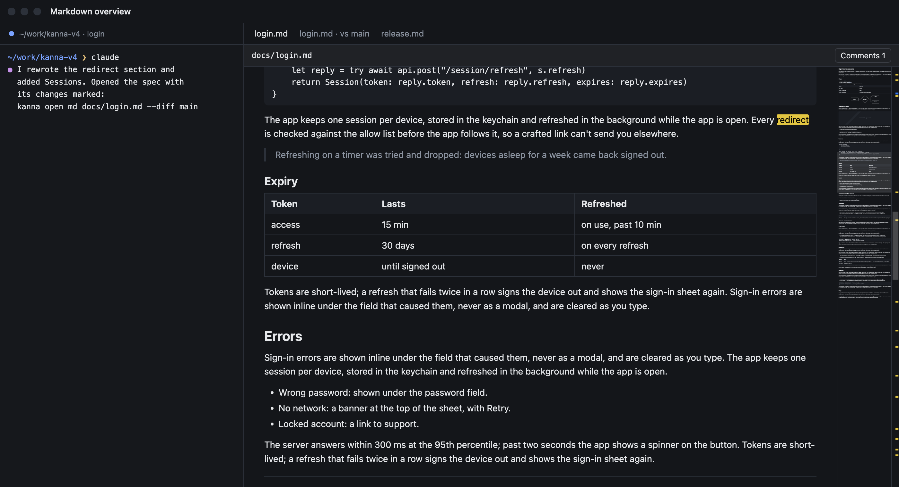
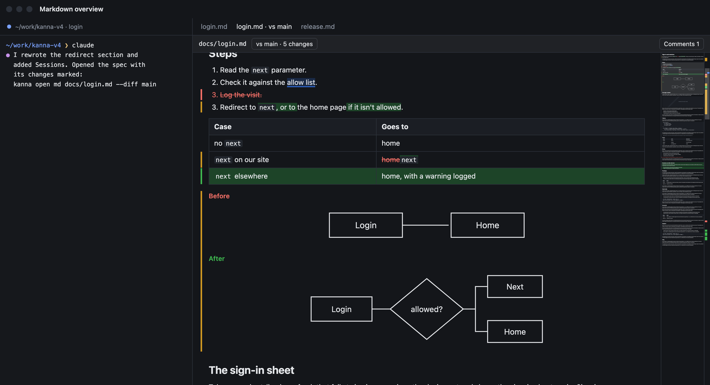
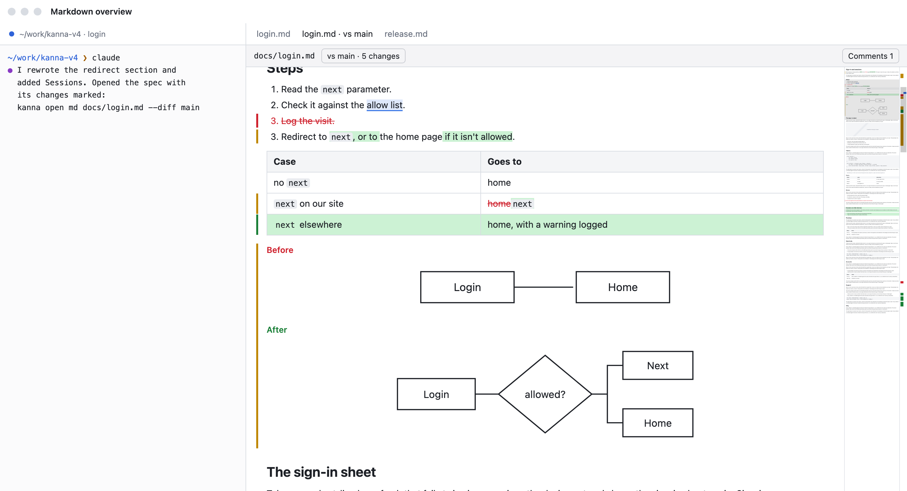
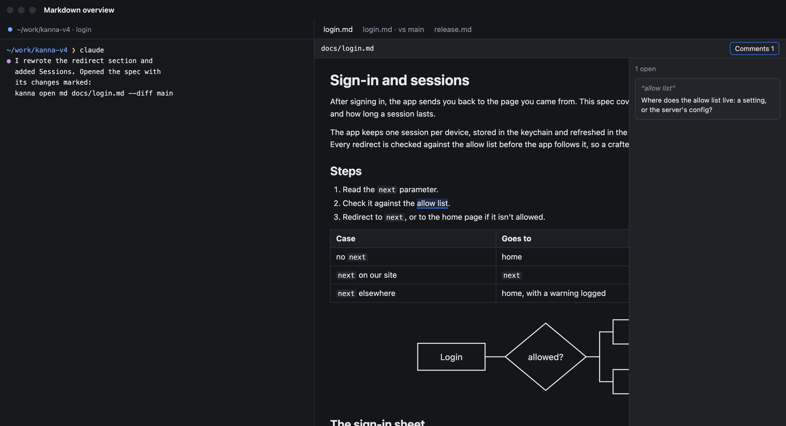
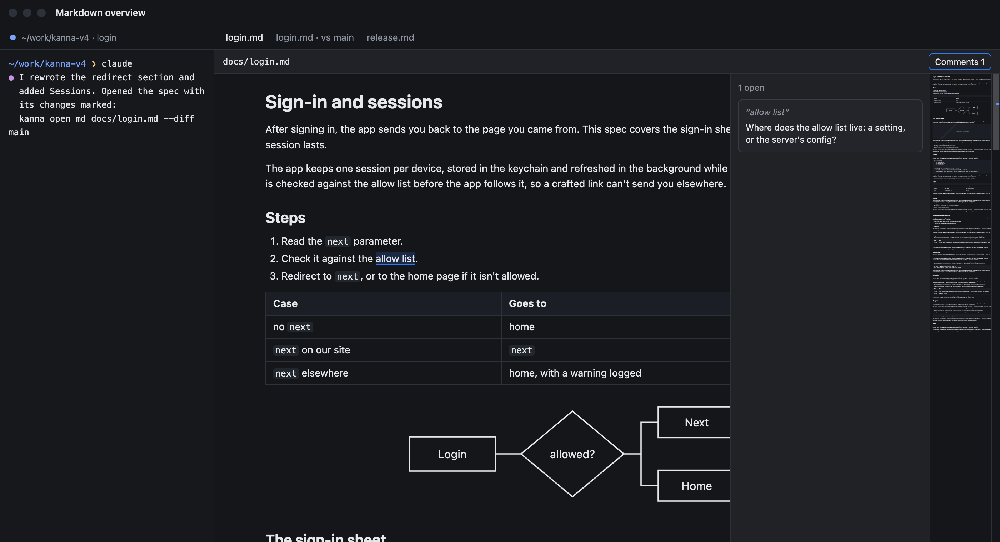
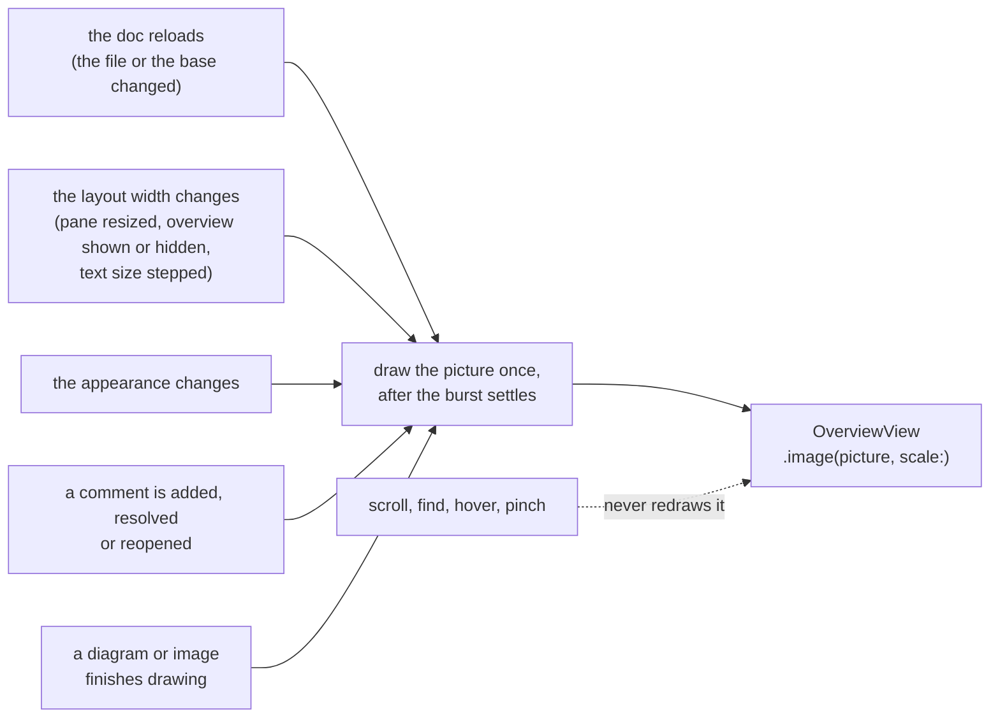

# Markdown Overview

**Status:** built · **Mockup:** [`references/mockups/markdown-overview.html`](../../references/mockups/markdown-overview.html) · **Builds on:** [overview](overview.md), [markdown diff](markdown-diff.md), [doc markup](doc-markup.md) · **Why:** specs are long, and an agent presenting its work opens them with `--diff`: you couldn't see where in the doc the changes and comments were, or get there in one click

The markdown pane, and its diff mode, get the [overview](overview.md) the code and diff panes have: the same `OverviewView`, given a picture of the **rendered page** shrunk, not of the markdown source, and the doc's marks. Everything the overview does it does here: click to jump, drag the box to scroll, the box while the pointer is over it, the marks column with the scroll thumb, hidden when the doc fits or the text beside it is too narrow, View › Overview.

| Markdown diff, dark | Light |
|---|---|
|  |  |

## Contents

1. [Rules](#1-rules)
2. [When it shows](#2-when-it-shows)
3. [The picture](#3-the-picture)
4. [How it's built](#4-how-its-built)

## 1. Rules

- **On every markdown pane,** plain, open for comments, and in diff mode (a range, `A..B`, too).
- **The thumbnail is the page as the pane draws it:** the text column, from the change bars on its left to its right edge, shrunk to the thumbnail's width (84 pt); the margins either side of the column are left out. Headings, code panels, tables, quotes, diagrams and images keep their shapes; text reads as grey lines, as in VS Code's minimap. A diff's change bars, added tints, struck-through text and Before and After diagrams are in it, and so are comment highlights.
- **A doc taller than the thumbnail** scrolls the thumbnail proportionally, as in [code panes](overview.md#1-rules).
- **Marks**, in the marks column, the whole doc at the pane's height:

| Mark | Where it comes from | Colour |
|---|---|---|
| Added | a block the diff added | the added bar's green |
| Removed | a block the diff removed (shown struck through) | the removed text's red |
| Changed | a block the diff changed, word by word, or a changed diagram or image (Before and After together) | the changed bar's amber |
| Comment | an open comment's highlighted text ([doc markup](doc-markup.md)); resolved ones aren't marked | the comment accent |
| Find hit | a find-bar match | the find colour |

  One mark per block, at the block's height, so a mark sits where its change bar does. Changes go in the left half, comments and hits in the right, as in code and diff panes.
- **Light and dark** follow the system: the picture is drawn again when the appearance changes.

## 2. When it shows

The overview's rule ([overview §3](overview.md#3-when-it-shows)), measured the markdown pane's way:

- **It fits:** the rendered doc, without the room left for scrolling past the end, fits the pane's height at the text size.
- **80 columns** of the body font: the width of the digit 0 in the 14 pt body font, times the pane's text size ([markdown zoom](markdown-zoom.md)); a pinch never shows or hides the overview. They're counted in the **text column** beside the overview, not the whole pane: the column is centred in what the overview leaves, with its 28 pt margins and at most 860 pt wide, as now. So in a wide pane the overview only takes margin, and the text doesn't move.
- **The comments list doesn't count:** it floats over the page ([comments overlay](comments-overlay.md)), so opening or closing it never shows or hides the overview.
- **View › Overview** turns it off here too.

## 3. The picture

- **Drawn when the page changes how it looks**, and only then: the doc reloads, the text re-lays out (its width changes), the appearance changes, or a comment's highlight changes. Diagrams and images are laid out and loaded while the doc renders, so they come in with the reload. Changes that come in a burst (a reload, then the layout it causes) make one picture: a change asks for a picture on the next turn of the run loop, and the picture is drawn only if its key differs from the last one's.
- **The whole page, measured once:** the content height is the text's used height after the whole text is laid out, never what AppKit has laid out so far. The viewport and the picture take that one height, and it is in the picture's key, so a picture drawn mid-layout (after a pane zoom or resize invalidates it) is drawn again when the height settles. Whenever the viewport's content height differs from the drawn picture's, the pane asks for a picture.
- **Never on scroll:** a scroll only moves the thumbnail and the box. Find hits and the selection aren't in the picture; hits are marks.
- **Zoom** ([markdown zoom](markdown-zoom.md)): a pinch magnifies the page without laying it out again, so it doesn't redraw the picture, only changes the box's size; a text-size step (⌘+, ⌘−, ⌘0) lays the page out again, so it draws a new picture and changes the column count.
- **One image** (`OverviewContent.image`, the interface's case for markdown): the page at the thumbnail's scale, at the screen's backing scale. A 50,000 pt doc makes a picture about 10,000 px tall and 170 px wide, under 7 MB.

## 4. How it's built

| Part | Where |
|---|---|
| The pane's side of the overview: the picture, the marks, the viewport, `onScroll`, the side-panel rule | `apps/kanna/Sources/KannaMarkdown/MarkdownPaneView.swift` and a new `MarkdownOverview.swift` |
| Drawing the page at the thumbnail's scale | `MarkdownLayoutManager.swift`: the backgrounds, blocks, comment highlights, change bars and glyphs (attachments with them) of the whole text, into a bitmap context scaled to the thumbnail |
| Comment marks: the open comments' ranges | `MarkdownPaneComments.swift`, from `KannaDocs` as the highlights are now |
| Find hits | the pane owns an `NSTextFinder`, as the code and diff panes do, instead of `usesFindBar`, so it has the matches; the three panes share its client, `TextFinderClient` (`KannaOverview`) |
| The column count | `OverviewLayout.shown` (`KannaOverview`), given the text column as the measure of the room beside the overview, which wants 80 columns in the text column (`MarkdownOverviewLayout`) |
| `KannaMarkdown` depends on `KannaOverview` | `apps/kanna/Package.swift` |

- **Marks are worked out with the picture,** from the text's attributes: each run of `kanna.change` (added, removed, changed) and each open comment's range, mapped to the y and height of its laid-out lines, in the text view's coordinates (the container's top inset included). Find hits are mapped when the find changes.
- **The picture's key** (`MarkdownPictureKey`) is a value with no AppKit in it: the text's revision, the layout width, the content height, whether it's dark, and the comment highlights (each range and kind). The pane draws a picture when the key changes; that rule is what the unit tests check.
- **The text column at a text size:** the page is laid out at the pane's width over the text size, so the column on screen is the laid-out column times the text size, but no wider than the room beside the panels less its 28 pt margins; it needs 80 times the digit's width times the text size. The page zoom isn't counted.
- **Debug:** `debug.md` gets `overview` as `debug.code` and `debug.diff` have it (shown, wanted, enabled, the box's `y` and height, the marks by kind, `content_height` and `picture_height`, the height in page points the picture covers), plus `pictures`, the count of pictures drawn, and `threads_shown`; it takes the same `overview_click`, `overview_drag`, `overview_hover` and `overview_enabled` arguments.
- **Tests:** `swift test`: the picture's key (a reload, a width change, a height change and an appearance change draw a new picture; a scroll, a find and a pinch don't), the marks' positions (an added heading, a removed list item, a changed table row and a comment each marked at their laid-out lines' y and height), the column count against the text column. E2e, in `scripts/e2e-kanna.sh` against a private instance: `markdown_overview` opens a long doc, reads `overview` (shown, the box), scrolls and pinches with `pictures` unchanged and the box smaller, steps the text size and sees a new picture, clicks and drags the thumbnail and the marks and reads the scroll, finds a word and reads the hit marks, changes the appearance and the width and sees new pictures, narrows the pane and sees it hide, opens a short doc and sees it hidden, turns comments on and reads the comment mark, checks the list changes neither the page nor the overview, and snapshots it light and dark, with and without the list; `markdown_diff_overview` opens a doc with `--diff main` and reads its added, removed and changed marks, then edits the doc and sees the marks and `pictures` follow; `markdown_overview_height` opens a long doc with diagrams plain and with `--diff main`, zooms the pane and the text in and out, and each time checks that the picture's height matches the content height and the document is at least as tall.
