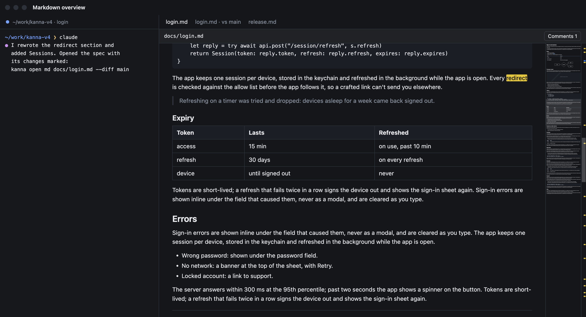
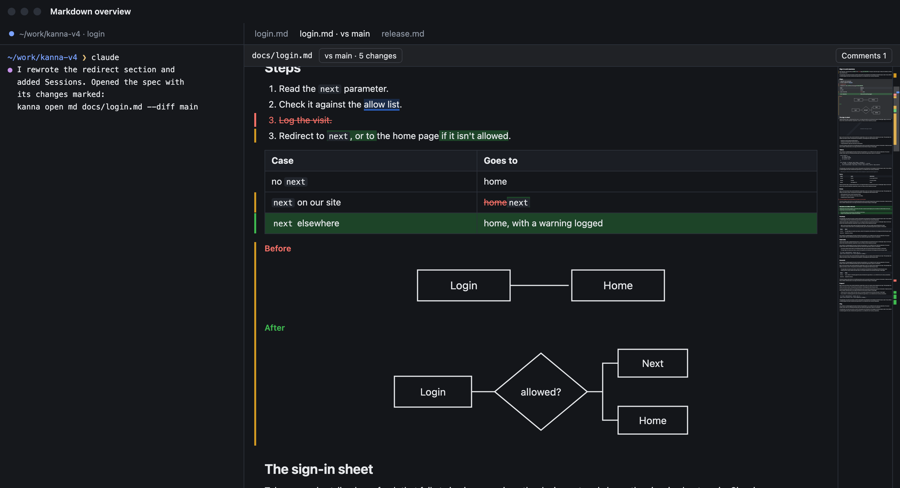
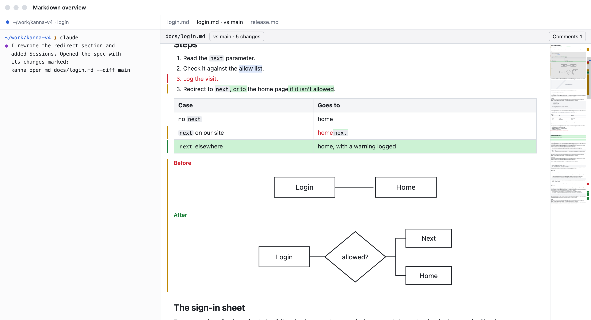
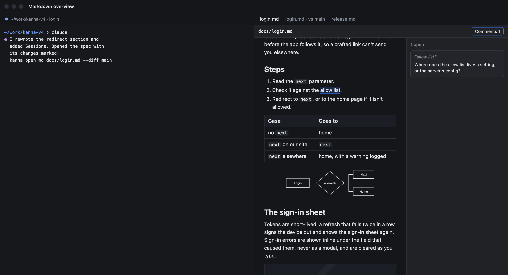
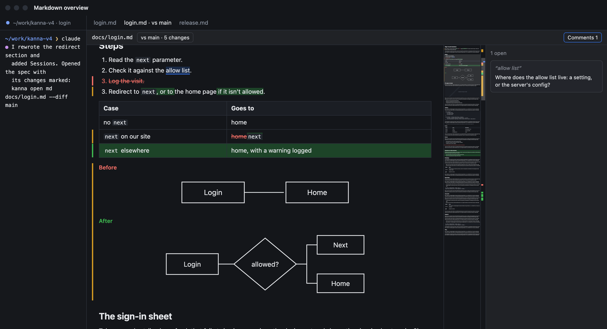
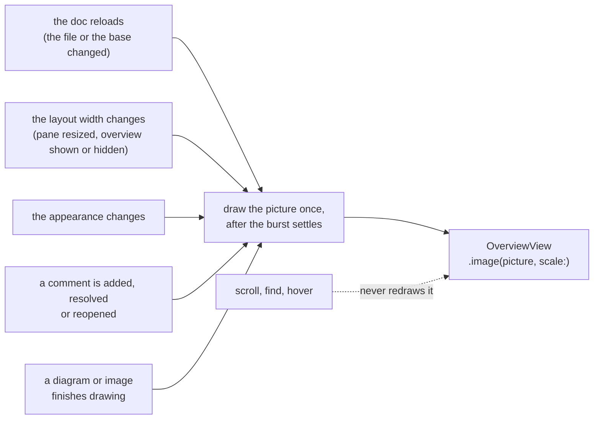

# Markdown Overview

**Status:** designed · **Mockup:** [`references/mockups/markdown-overview.html`](../../references/mockups/markdown-overview.html) · **Builds on:** [overview](overview.md), [markdown diff](markdown-diff.md), [doc markup](doc-markup.md) · **Why:** specs are long, and an agent presenting its work opens them with `--diff`: you couldn't see where in the doc the changes and comments were, or get there in one click

The markdown pane, and its diff mode, get the [overview](overview.md) the code and diff panes have: the same `OverviewView`, given a picture of the **rendered page** shrunk, not of the markdown source, and the doc's marks. Everything the overview does it does here: click to jump, drag the box to scroll, the box while the pointer is over it, the marks column with the scroll thumb, hidden when the doc fits or the text beside it is too narrow, View › Overview.

| Markdown diff, dark | Light |
|---|---|
|  |  |

## Contents

1. [Rules](#1-rules)
2. [When it shows](#2-when-it-shows)
3. [The picture](#3-the-picture)
4. [How it's built](#4-how-its-built)

## 1. Rules

- **On every markdown pane,** plain, open for comments, and in diff mode (a range, `A..B`, too).
- **The thumbnail is the page as the pane draws it:** the text column, from the change bars on its left to its right edge, shrunk to the thumbnail's width (84 pt); the margins either side of the column are left out. Headings, code panels, tables, quotes, diagrams and images keep their shapes; text reads as grey lines, as in VS Code's minimap. A diff's change bars, added tints, struck-through text and Before and After diagrams are in it, and so are comment highlights.
- **A doc taller than the thumbnail** scrolls the thumbnail proportionally, as in [code panes](overview.md#1-rules).
- **Marks**, in the marks column, the whole doc at the pane's height:

| Mark | Where it comes from | Colour |
|---|---|---|
| Added | a block the diff added | the added bar's green |
| Removed | a block the diff removed (shown struck through) | the removed text's red |
| Changed | a block the diff changed, word by word, or a changed diagram or image (Before and After together) | the changed bar's amber |
| Comment | an open comment's highlighted text ([doc markup](doc-markup.md)); resolved ones aren't marked | the comment accent |
| Find hit | a find-bar match | the find colour |

  One mark per block, at the block's height, so a mark sits where its change bar does. Changes go in the left half, comments and hits in the right, as in code and diff panes.
- **Light and dark** follow the system: the picture is drawn again when the appearance changes.

## 2. When it shows

The overview's rule ([overview §3](overview.md#3-when-it-shows)), measured the markdown pane's way:

- **It fits:** the rendered doc, without the room left for scrolling past the end, fits the pane's height.
- **80 columns** of the body font: the width of the digit 0 in the 14 pt body font, times the pane's zoom. They're counted in the **text column** beside the overview, not the whole pane: the column is centred in what the overview leaves, with its 28 pt margins and at most 860 pt wide, as now. So in a wide pane the overview only takes margin, and the text doesn't move.
- **The comments list goes first:** the list (`Comments`, [doc markup](doc-markup.md)) keeps its own rule (shown while the pane is at least twice its 280 pt), and the overview is only shown while the column beside both keeps its 80 columns. Narrowing the pane hides the overview, then the list; the list is what you opened on purpose, so it stays longer.
- **View › Overview** turns it off here too.

## 3. The picture

- **Drawn when the page changes how it looks**, and only then: the doc reloads, the text re-lays out (its width changes), the appearance changes, a comment's highlight changes, or an attachment (a diagram, an image) finishes drawing. Changes that come in a burst (a reload lays out, then its diagrams draw) make one picture.
- **Never on scroll:** a scroll only moves the thumbnail and the box. Find hits and the selection aren't in the picture; hits are marks.
- **Zoom** in the markdown pane magnifies the page without laying it out again, so it doesn't redraw the picture: it changes the box's size and the column count.
- **One image** (`OverviewContent.image`, the interface's case for markdown): the page at the thumbnail's scale, at the screen's backing scale. A 50,000 pt doc makes a picture about 10,000 px tall and 170 px wide, under 7 MB.

## 4. How it's built

| Part | Where |
|---|---|
| The pane's side of the overview: the picture, the marks, the viewport, `onScroll`, the side-panel rule | `apps/kanna/Sources/KannaMarkdown/MarkdownPaneView.swift` and a new `MarkdownOverview.swift` |
| Drawing the page at the thumbnail's scale | `MarkdownLayoutManager.swift`: the backgrounds, blocks, comment highlights, change bars and glyphs (attachments with them) of the whole text, into a bitmap context scaled to the thumbnail |
| Comment marks: the open comments' ranges | `MarkdownPaneComments.swift`, from `KannaDocs` as the highlights are now |
| Find hits | the pane owns an `NSTextFinder`, as the code and diff panes do, instead of `usesFindBar`, so it has the matches |
| The column count, the comments list giving way first | `OverviewLayout`'s side-panel rule (`KannaOverview`), with the comments list as a panel |
| `KannaMarkdown` depends on `KannaOverview` | `apps/kanna/Package.swift` |

- **Marks are worked out with the picture,** from the text's attributes: each run of `kanna.change` (added, removed, changed) and each open comment's range, mapped to the y and height of its laid-out lines, in the text view's coordinates (the container's top inset included). Find hits are mapped when the find changes.
- **The picture's key** is a value with no AppKit in it: the text's revision, the layout width, the appearance, the comments' revision and the attachments drawn. The pane draws a picture when the key changes; that rule is what the unit tests check.
- **Debug:** `debug.md` gets `overview` as `debug.code` and `debug.diff` have it (shown, wanted, enabled, the box's `y` and height, the marks by kind), plus `pictures`, the count of pictures drawn; it takes the same `overview_click`, `overview_drag`, `overview_hover` and `overview_enabled` arguments.
- **Tests:** `swift test`: the picture's key (a reload, a width change and an appearance change draw a new picture; a scroll, a find and a zoom don't), the marks' positions (an added heading, a removed list item, a changed table row and a comment each marked at their laid-out lines' y and height), the column count against the text column. E2e, in `scripts/e2e-kanna.sh` against a private instance: `markdown_overview` opens a long doc, reads `overview` (shown, the box), scrolls and reads the box again with `pictures` unchanged, clicks the thumbnail and reads the scroll, narrows the pane and sees it hide, opens a short doc and sees it hidden, and snapshots it light and dark; `markdown_diff_overview` opens a doc with `--diff main` and reads its added, removed and changed marks, then edits the doc and sees the marks and `pictures` follow.
