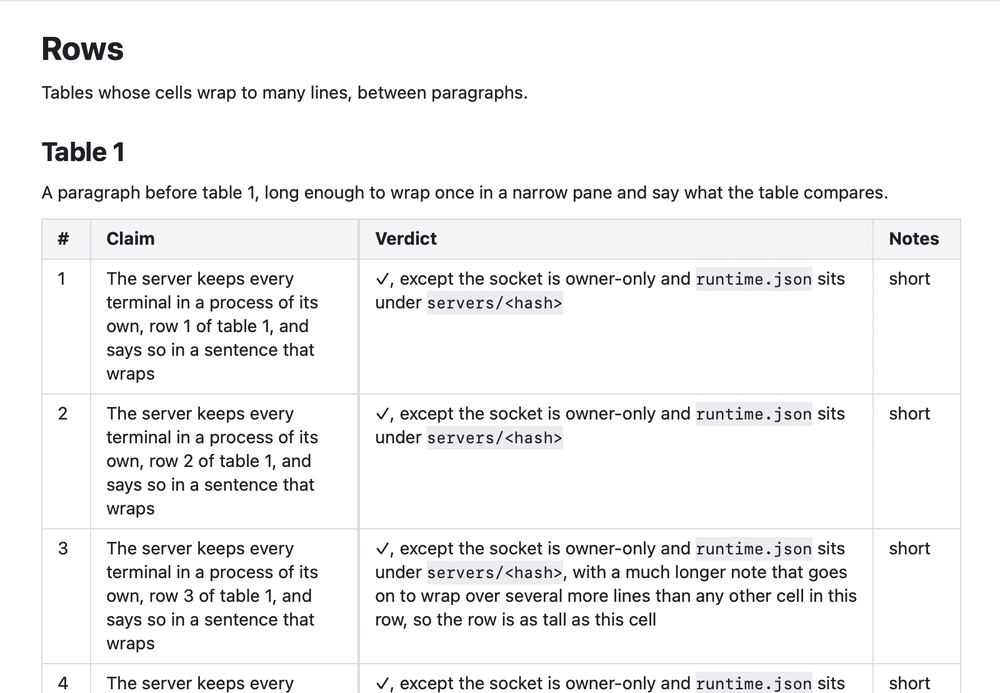

# Markdown Tables

**Status:** built · **Builds on:** [app panes](app-panes.md), [markdown overview](markdown-overview.md) · **Why:** in `docs/research/rex.md`, rows of wrapped cells drew clipped mid-text with empty gaps under them while scrolling, until a zoom redrew the pane; and every column got an equal share, so a column of row numbers took as much room as one of sentences

A markdown pane draws a table as a grid of cells, one row per table row, with its columns as wide as their text needs.

## Contents

1. [Rules](#1-rules)
2. [Why rows drew clipped](#2-why-rows-drew-clipped)
3. [How it's built](#3-how-its-built)

## 1. Rules

- **Rows.** Every row is exactly as tall as its tallest cell, with no text clipped and no gap under it, however the row comes into view: scrolling, jumping to a heading or a link, find, a doc opened partway down, a reload while scrolled, any zoom.
- **Columns follow their content.** A column's natural width is its widest cell on one line, plus the cell's padding.
  - When every column fits at its natural width, each has it, and the table is narrower than the text column.
  - When they don't, the table fills the text column. A column whose natural width is no more than an even share of the room left keeps it (a column of row numbers stays narrow), until none does; the rest share what's left in proportion to their natural widths, none narrower than 72 pt (or its natural width, if that's less).
  - When even the minimums don't fit, every column shrinks in proportion to them.
- **No sideways scrolling.** A table is never wider than the text column; its cells wrap instead, and a word too long for its cell breaks across lines.
- **The widths follow the pane:** resizing the pane, or a text-size step, plans the columns again for the new width, without a reload. A pinch never does: it zooms the page as laid out ([markdown zoom](markdown-zoom.md)).
- Header cells are bold on the panel colour; column alignment (`:-`, `:-:`, `-:`) aligns the cells' text. In a [markdown diff](markdown-diff.md) a changed row shows its old and new text in its cells, and its widths count both.

## 2. Why rows drew clipped

Lazy layout wasn't the cause: AppKit lays a table out a whole row at a time and the rows' heights were always right, which the unit test checks for scrolling, jumping and resizing. The fault was in drawing. A text view redraws only the strip scrolling uncovers, and asks the layout manager which glyphs are in it. That lookup assumes text runs top to bottom, but a row's cells sit side by side: the second cell's glyphs come after the first cell's last line, though they're higher up. A strip across the bottom of a row got the glyphs from there on, so the earlier cells' lower lines in it were never drawn. Zooming redrew the whole pane in one strip, which is why it fixed it.

So the markdown layout manager widens that glyph range to every whole table row the strip crosses. Drawing stays clipped to the strip, so a row drawn whole costs only its own glyphs.

## 3. How it's built

| Piece | File | Does |
|---|---|---|
| `MarkdownTable` | `apps/kanna/Sources/KannaMarkdown/MarkdownTable.swift` | an `NSTextTable` holding each column's natural width; places every cell at its column's offset and width for the width it's given, planned once per width |
| `ColumnPlan` | same | the column widths for a room, by the rules above |
| `MarkdownLayoutManager.glyphRange(forBoundingRect:…)` | `MarkdownLayoutManager.swift`, `MarkdownTable.swift` | widens the drawn range to whole table rows; the rows are found once per edit of the text |
| `MarkdownRenderer.table` | `MarkdownRenderer.swift` | builds the cells and measures each column's natural width |

- **Checks:** `MarkdownTableTests` lays out a long doc of tall tables by scrolling, by jumping into it with non-contiguous layout, and after a resize, and checks every row's drawn height, its cells' tops, the rows meeting with no gap, and the geometry matching a full layout; it checks that every strip the text view could redraw holds every line in it; and the column plan. e2e `markdown_tables` wheel-scrolls a long doc of tall tables at a text size below 100 %, screenshots each stop, forces a full layout with a text-size step up and back, and compares screenshots of the same stops (`KANNA_E2E_TABLES_DOC=FILE` runs it on another doc, such as `rex.md`). It ends with the screenshot this spec shows, in `target/e2e-kanna/markdown-tables.png`.
