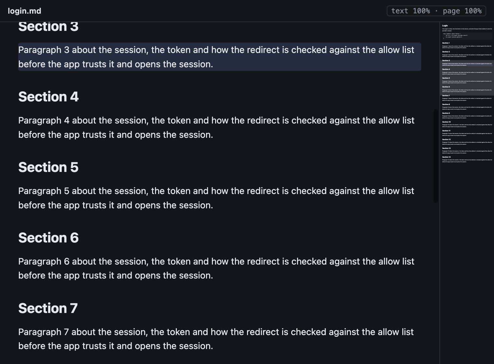
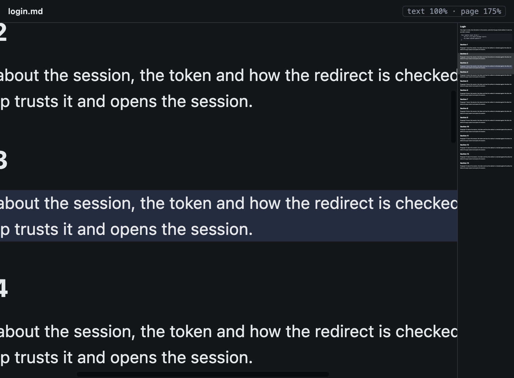
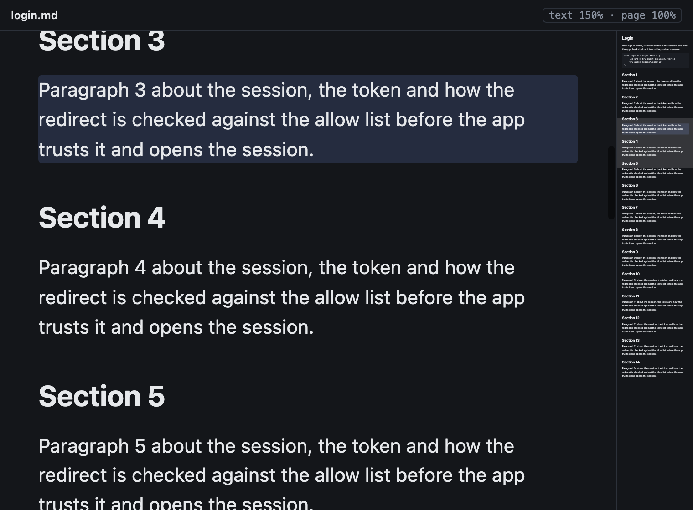

# Markdown Zoom

**Status:** built · **Mockup:** [`references/mockups/markdown-zoom.html`](../../references/mockups/markdown-zoom.html) · **Builds on:** [markdown overview](markdown-overview.md), [windows](windows.md#2-what-the-app-keeps) · **Why:** a pinch magnified the page, then on release the pane laid it out again at another width, so the wrap and margins changed and the page snapped to another zoom

A markdown pane has two zooms, each saved per pane:

- **Page zoom** (a pinch): a plain zoom of the whole page, like a PDF in Preview. The page is never laid out again: its wrap, margins and text size stay as they are at any zoom, and nothing moves on release.
- **Text size** (⌘+, ⌘−, ⌘0): steps through the text sizes; the page lays out again at the pane's width, so the text re-wraps to the pane, and the line you're reading stays at the top.

| Text size 100 %, page zoom 100 % | Pinched to 175 % | ⌘+ to 150 % |
|---|---|---|
|  |  |  |

## Contents

1. [Rules](#1-rules)
2. [How it's built](#2-how-its-built)
3. [Tests](#3-tests)

## 1. Rules

- **Pinch never lays out again.** The page keeps the width it was laid out at (the pane's width over the text size). Zoomed in, the page is wider and taller than the pane and scrolls both ways; zoomed out, it is narrower than the pane and centred. A pinch goes from 50 % to 400 %.
- **Text size steps** through 50, 67, 75, 80, 90, 100, 110, 125, 150, 175, 200, 250 and 300 %. A step lays the page out again at the pane's width over the new text size, so the text and its margins grow or shrink and the wrap fits the pane; the page zoom stays as it was.
- **The reading line stays put.** On a text-size step, the line at the top of the pane stays at the top ([scroll anchor](scroll-anchor.md)); the page scrolls sideways in proportion. A pane at the very top stays at the top.
- **⌘0 resets the text size** to 100 %. The page zoom stays; pinch back to undo it.
- **What the pane shows** is the page at the text size times the page zoom.
- **Saved per pane, separately.** Text size and page zoom are kept by pane in the app's `app-state.json` (`textSizes`, `pageZooms`; 1 isn't kept), and a pane opens at both. A markdown pane that goes back to a doc in its history gets the doc's scroll, text size and page zoom back.
- **The overview** ([markdown overview](markdown-overview.md)) follows both. Its box is the part of the page on screen, so a pinch changes the box's size. The picture is of the page as laid out, so a text-size step draws it again and a pinch doesn't. Whether it shows (the 80 columns, the doc fitting the pane) is measured at the text size, so a pinch never shows or hides it, which would change the page's width.

## 2. How it's built

| Part | Where |
|---|---|
| Text size, page zoom, the laid-out width, the reading line kept on a step | `MarkdownPaneView` (`KannaMarkdown`) |
| Overview rules at the text size | `MarkdownPaneView.sides` in `MarkdownOverview.swift` |
| Saved by pane | `Contents` (`textSize`, `pageZoom`, and back in history), `Physical` (`textSizes`, `pageZooms`) |

- **One magnification.** The scroll view's magnification is the text size times the page zoom. The text view is laid out at the scroll view's width over the text size, so a change in magnification alone (a pinch) leaves the layout alone. Its range is the text size times 50 % to 400 %.
- **A step** keeps the page zoom, sets the new magnification, lays out at once, and scrolls the [anchor](scroll-anchor.md) back to the top.
- **Saving.** The pane reports a change when a pinch ends (`didEndLiveMagnify`), after a step, and when the clip view moves outside a live pinch with the zoom changed (a smart zoom); the app saves both values.
- **Debug:** `debug.md` returns `zoom` (what the pane shows), `text_size`, `page_zoom`, `top_line` (the first character of the top line), `scroll_x`, and `lines` (each laid-out line's first character) with `lines: true`; it takes `zoom` (a text-size step: 1, −1, or 0 to reset) and `page_zoom`. `debug.pinch` returns `zooms`, `top_lines` and `layout_widths` after each step of the pinch.

## 3. Tests

- **E2e** (`scripts/e2e-kanna.sh`, private instance): `markdown_zoom` scrolls a long doc, pinches and releases, and checks the zoom and top line after release are the last step's, the laid-out width never changed and the line breaks are the same; then ⌘+ steps the text size, re-wraps (a narrower layout, new line breaks), keeps the page zoom and holds the reading line; then restarts the app and checks both come back, and ⌘0 resets the text size alone. `markdown_overview` pinches without a new picture and with a smaller box, and steps the text size with a new picture; `windows_tabs_ui` checks ⌘+ re-wraps.
