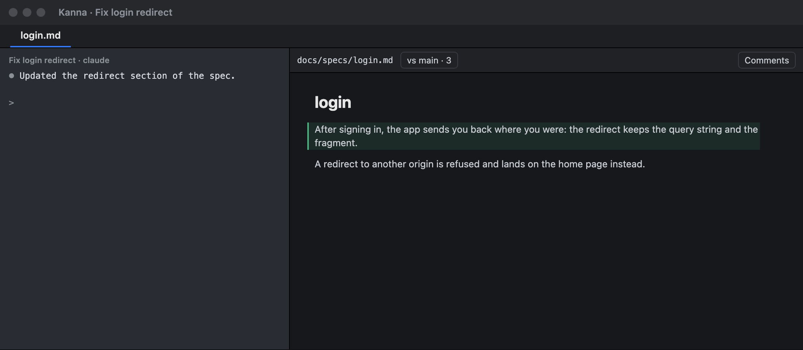
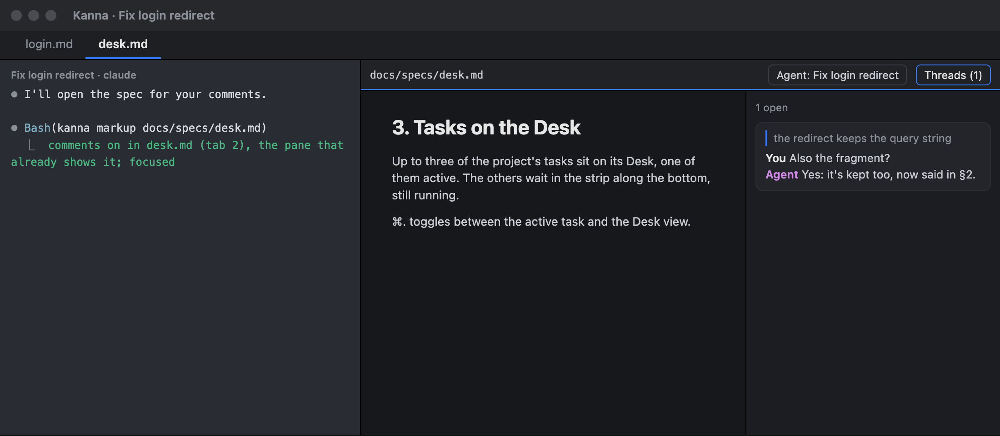
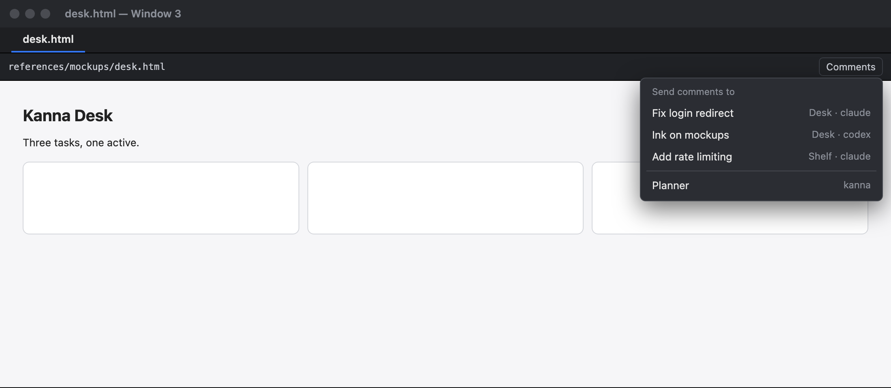
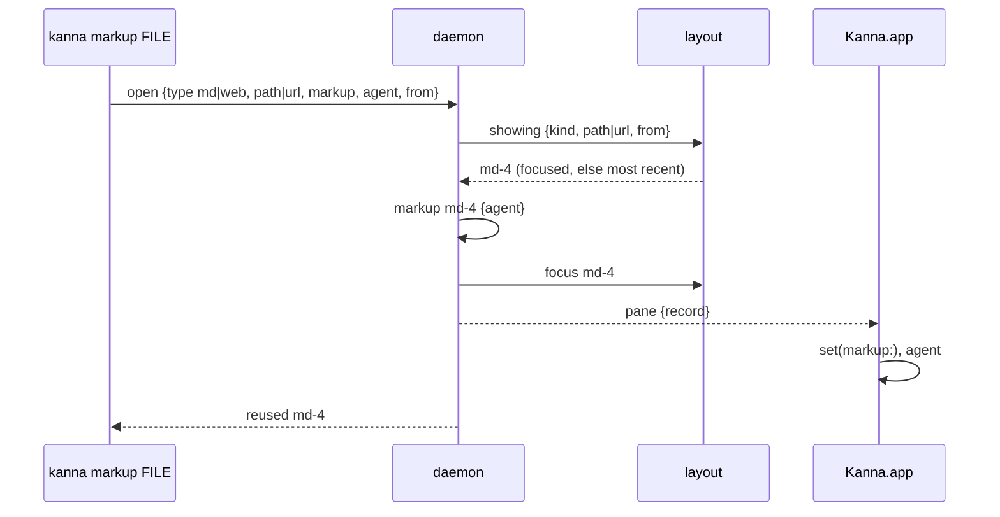

# Markup Toggle

**Status:** building · **Mockup:** [`references/mockups/markup-toggle.html`](../../references/mockups/markup-toggle.html) · **Part of:** [doc markup](doc-markup.md)

Two ways to turn comments on in a doc that's already open, instead of opening it again in a new pane: **Comments** in the doc's bar, and `kanna markup FILE` finding the pane that already shows FILE.

## Contents

1. [The bar](#1-the-bar)
2. [Where comments go](#2-where-comments-go)
3. [kanna markup FILE reuses an open pane](#3-kanna-markup-file-reuses-an-open-pane)
4. [How it's built](#4-how-its-built)
5. [Checks](#5-checks)

## 1. The bar



- **Every doc pane has the bar**: every markdown pane, and every web pane showing a local page (a `file:` URL), the only pages that take comments. A web pane on any other URL has no bar, as now.
- **Comments off:** the path, *vs main* when the doc's changes are marked, and **Comments**.
- **Clicking Comments** turns comments on in place, as `kanna markup PANE` does: same scroll, zoom and selection, the page not reloaded. Comments gives way to the agent and **Threads (N)**, N the open threads.



- **Threads (N)** shows and hides the comments: the thread list and the marks together. It's lit while they show. Hidden, the doc reads as if comments were off, but ⌘↵, ⌘-click and ⌘-drag still start a comment, which shows them again.
- **In a pane narrower than twice the list,** the list stays hidden when comments come on and the marks show; pressing Threads shows the list beside the doc, and pressing it again hides the list and the marks.
- **The agent** is named by what it is: the task's name for a task's agent, *Planner* for a planner, else the pane's name or ID.
- **Turning comments off** is the **Pane ▸ Comments** item (or `kanna markup PANE --off`): the agent and Threads go, Comments comes back, and the threads stay in their file for next time.
- **Pane ▸ Comments** does what the button does: on, it routes as the button does ([§2](#2-where-comments-go)); off, as above. Its check mark says whether comments are on.

## 2. Where comments go

Comments turned on from the bar or the menu go to the agent of the place the doc is in:

| The doc is in | Comments go to |
|---|---|
| a task's workspace (on a Desk, or on the Shelf) | the task's docked agent |
| a planner's workspace (the Desk view) | the planner |
| a free window | the agent its comments went to before, if that pane still runs; else you pick one |



- **Picking an agent:** Comments opens a menu, *Send comments to*, of every running agent: each Desk task's and running Shelf task's agent, by task name, with where it is (Desk, Shelf) and which agent it is, then each planner, by project. Picking one turns comments on, sent there; Esc or clicking away turns nothing on. With no agent running, the menu says so and turns nothing on.
- **The daemon decides**, so the button, the menu item and any later client route the same way: a `markup` request without an agent asks for the place's agent, and comes back `no_agent` when there's none to pick, for the app to ask.
- `kanna markup PANE` from a terminal is unchanged: comments go to that terminal (or `--to`).

## 3. kanna markup FILE reuses an open pane

`kanna markup FILE.md` or `kanna markup FILE.html`, run in a terminal, first looks for a pane **in that terminal's own workspace** that shows FILE: a markdown pane on that path, or a web pane on that file (any `#view`).

- **Found:** it turns comments on there, sent to the terminal (or `--to`), as `kanna markup PANE` does (scroll, zoom and selection kept), and focuses it, showing its tab. No new pane. It prints which pane it used:

```
$ kanna markup docs/specs/desk.md
comments on in md-4, which already shows docs/specs/desk.md (tab-12); focused
```

- **Two or more show it:** the focused one, else the one focused most recently.
- **None shows it:** a new pane, as before.
- **Only its own workspace.** Panes in other tasks' workspaces, other windows of the same project and the Desk view aren't looked at.
- **Placement asks for a new pane:** with `--tab`, `--split`, `--size`, `--window` or `--name`, it opens a new pane as before.
- A pane showing a past version (`--diff A..B`) takes no comments, so it's passed over.

The `kanna-markup` skill no longer tells agents to look for an open pane first: `kanna markup FILE` does.

## 4. How it's built



- **Finding the pane** is the layout's: `showing {from, among}` answers with the pane of `among` in the caller's workspace (or free window), the focused one first, then by focus history. A code pane's reuse (`kanna comment`, `kanna open code`) and tours still match by window.
- **Focus history:** each workspace keeps its panes in the order they were last focused (`Tabs.recent`), updated wherever focus moves, saved with the layout, and dropped as panes close.
- **Routing:** `markup {pane, route: true}` with no `agent` (the app's) takes the docked pane of the pane's workspace (`dock-of`, a task's agent or a planner's terminal), else the pane's own `agent` if that pane is running, else answers `no_agent`. The app then shows the menu, built from the published workspaces (dock panes that are running, with their task and its place), and asks again with the agent picked.
- **The bar** (`DocBar`) gets **Comments**, shown when comments are off, and Threads reads *Threads (N)*. A markdown pane always adds the bar. A web pane adds a bar of its own above the page when it shows a local page with comments off; with comments on, `PageMarkupView` has it, as now. The page's view isn't moved or reloaded when the bar comes or goes; only its frame changes.
- **Threads hides the marks:** the markdown pane's layout manager and the page's dots and outlines draw nothing while the comments are hidden; the threads and their anchors are kept, so showing them again doesn't read anything.

## 5. Checks

- **e2e `markup_reuse`:** a terminal opens a doc (`kanna open md`), scrolls it, opens another tab, then runs `kanna markup FILE`: the reply names the same pane, comments are on there, it's focused and its tab shown, it was read once, at the same scroll, and no pane was added. With two panes on the file, the more recently focused one is used; a pane in another task's workspace on the same file is ignored; `--tab` opens a new one. Same for a page.
- **e2e `markup_button`:** pressing Comments (through the app's debug press, as other buttons are) in a task's doc pane turns comments on with the task's agent; in the Desk view, with the planner; in a free window, `no_agent` makes the app show the menu, and picking an agent turns comments on with it. Threads hides and shows the list and marks; Pane ▸ Comments turns them off and the threads stay in the file.
