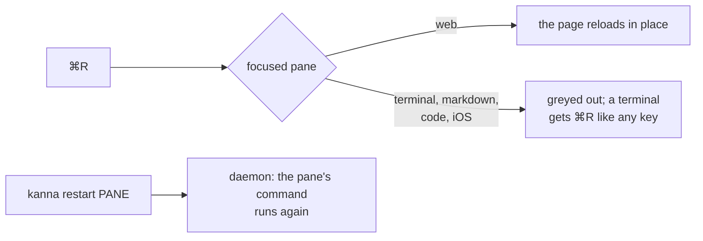

# Menus and shortcuts

**Status:** built; Reload replaces Restart (2026-10-14) · **Reference:** kmux ([`references/kmux`](../../references/kmux/docs/kmux-spec.md) §5) · **Part of:** [Windows, Tabs and Splits](windows.md)

Kanna's menus and shortcuts are kmux's ([its spec](../../references/kmux/docs/kmux-spec.md) §5), with the shortcut the user's Ghostty config binds to the same action where there is one (`new_split:right`, `goto_split:next`, `toggle_split_zoom`, `new_tab`, `next_tab`, `increase_font_size:1`, `copy_to_clipboard`, …):

## Contents

1. [The menus](#1-the-menus)
2. [Rules](#2-rules)
3. [Reload, not Restart](#3-reload-not-restart)

## 1. The menus

| Menu | Items |
|---|---|
| Kanna | Quit Kanna ⌘Q (no New Instance, unlike kmux) |
| File | New Desk ⌘N ([tasks](tasks.md#2-how-tasks-are-made)), Open Recent ▸ (recent projects, latest first, then Clear Menu: [recent projects](recent-projects.md)) |
| Edit | Undo ⌘Z, Redo ⇧⌘Z, Cut ⌘X, Copy ⌘C, Paste ⌘V, Select All ⌘A (sent to whatever has focus) |
| Pane | Split Right ⌘D, Split Down ⇧⌘D, New Web / iOS Pane Right and Below, New Markdown Pane Right… and Below…, Open URL… ⌘L, Back, Forward, Home ⇧⌘H, Next Pane ⌘], Previous Pane ⌘[, Zoom ⇧⌘↩, Move Pane to New Window, Reload ⌘R, Close Pane ⌘W |
| View | New Tab ⌘T, Next Tab ⇧⌘], Previous Tab ⇧⌘[ (from a Desk's docked pane they switch the shown tab and focus stays in the docked pane; from a tab's pane focus moves into the new tab), Zoom In ⌘+, Zoom Out ⌘−, Actual Size ⌘0 (a markdown or web pane's magnification, which scales the page without re-laying it out, or a terminal's font size; a pinch magnifies markdown and web panes too) |
| Window | New Window (no shortcut: ⌘N is New Desk), Close Window ⇧⌘W, Move Tab to New Window, Next Window ⌘\`, Previous Window ⇧⌘\`, and the list of windows |

## 2. Rules

- **Menu commands act on the window in front,** as in any Mac app: the window AppKit has as key, and that window's focused pane, so ⌘W in one window never reaches another's pane (a Desk's planning terminal included). The layout's key window is the fallback, for when AppKit has none (a `--bg` app, or the CLI driving it); bringing a window forward (a click, ⌘\`) makes it the layout's key at once too. Pane, tab and window cycling go in reading order and wrap; zoom is the window's mode: while it's on, the focused pane fills the window wherever focus goes, until ⇧⌘↩ ([zoom](zoom.md)). A new web pane starts with its URL selected for editing; a new markdown pane asks for a file; a new iOS pane opens Settings.
- **Ghostty keybindings** that no menu item takes reach the app as actions: `new_split`, `goto_split` (previous, left and up go back; the rest forward), `toggle_split_zoom`, `new_tab`, `goto_tab` (next, previous), `new_window`, `close_window`, `goto_window`, and `close_surface` (closes the pane). The pane the key was typed in is focused first. `GhosttyRuntime` passes them on (`onAction`, `onClose`); the app decides.
- **Right-clicking a pane** opens the Pane menu for it (it takes focus first): in a terminal unless its program uses the mouse, below WebKit's own items in a web pane, below the text items in a markdown pane, alone in an iOS pane.
- **Instances** ([CLI](instances.md)): unlike kmux, Kanna has no New Instance menu item: kmux used one to work on another project, and in Kanna that's a Desk (File → New Desk). Instances are a developer and testing tool, reached through dev builds and `kanna --instance`. An instance other than the default one shows its name in its window titles (`Tab 1 — w1 · work`) and at the top of the Kanna menu; the name comes from the socket's folder, as the daemon's does.
- **Greyed out** where an item doesn't apply to the focused pane: Reload, Open URL… on anything but a web pane; Home on anything but an iOS pane with its screen; Close Pane on a docked pane.

## 3. Reload, not Restart

The Pane menu has **Reload ⌘R**, for web panes only: it calls the page's own reload, so the pane stays on the page it's on. It replaced Restart ⌘R, which ended a pane's program and ran its command again; Kanna decided this first, and kmux followed (its PR #1).

- **Why no restart on a key:** in a terminal it would end an agent or a shell's program without asking. Restarting a command pane is `kanna restart`, which is deliberate.
- **A task's agent** restarts into its conversation: once it has started, its pane's command is the agent's resuming one ([which agents resume](tasks.md#which-agents-resume)).
- **An exited docked pane** comes back with `kanna restart` ([docked pane](docked-pane.md)).
