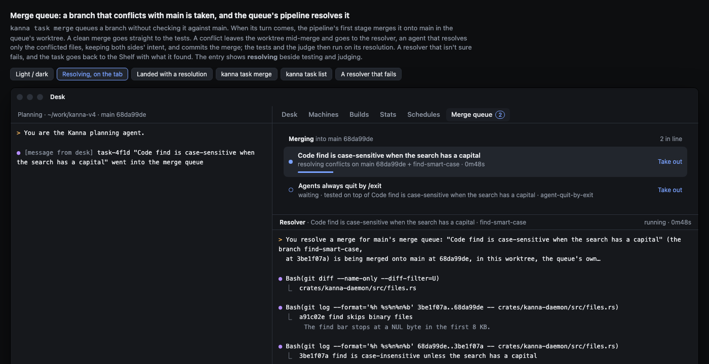
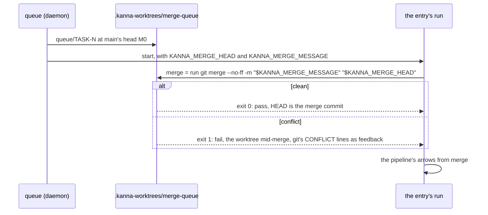
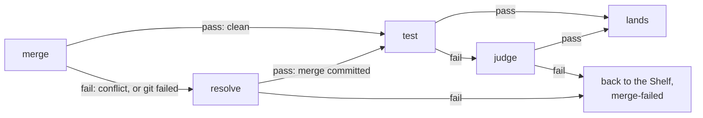
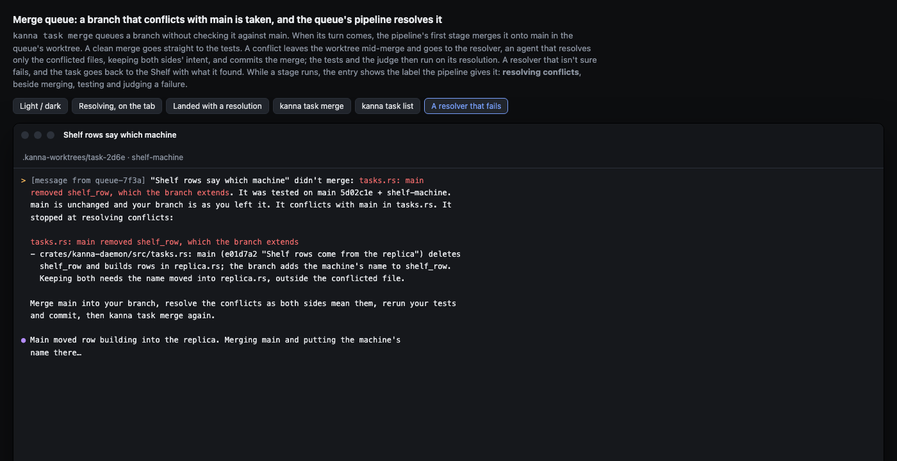
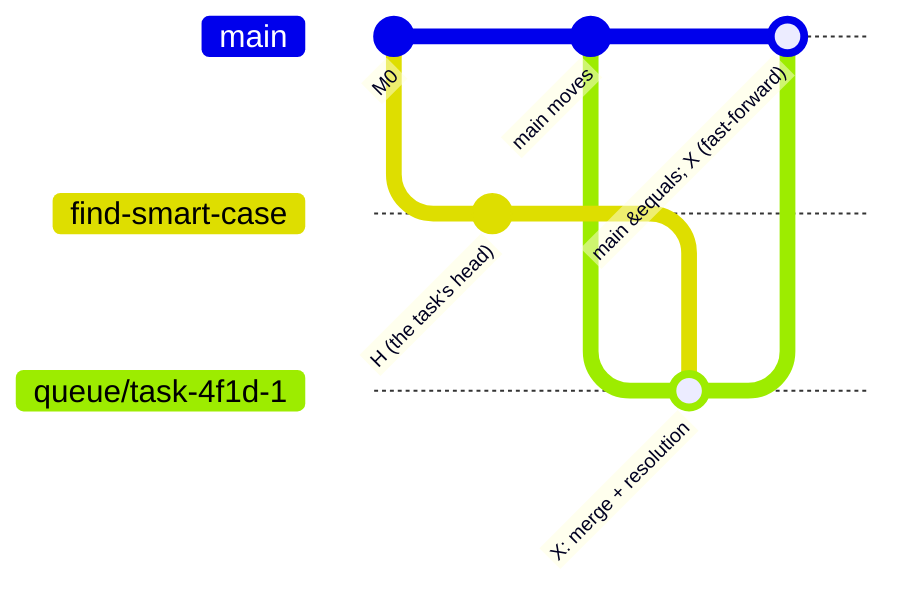
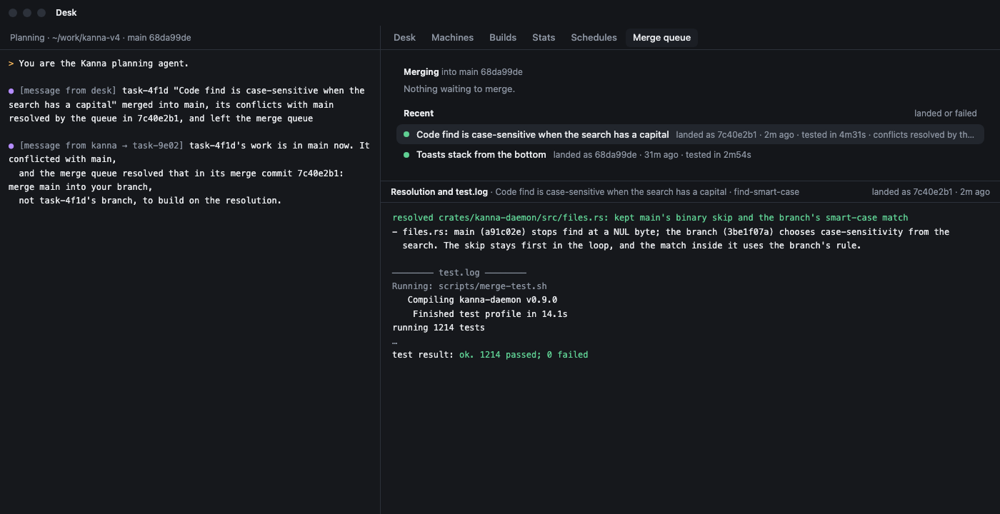

# Merge queue conflicts

Status: built in the daemon, the CLI and the app's Merge queue tab and Desk view. Tested by `cargo test -p kanna-daemon queue::` and e2e `merge_queue`. Mockup: [`references/mockups/merge-queue-conflicts.html`](../../references/mockups/merge-queue-conflicts.html). Part of the [merge queue](merge-queue.md); builds on [Kojo](kojo.md) and [runs](software-factory.md#61-sequential-runs-as-built).

The merge queue takes a branch whether or not it conflicts with main. Merging main into the queue's copy of the branch is the first stage of the queue's pipeline, so the repo's pipeline decides what a conflict leads to. Kanna's own pipeline hands a conflict to a fresh agent, the **resolver**, in the queue's worktree. The tests and the judge then run on its resolution, as they run on any merge.



## Contents

1. [What changed](#1-what-changed)
2. [The merge stage](#2-the-merge-stage)
3. [Kanna's pipeline](#3-kannas-pipeline)
4. [The resolver](#4-the-resolver)
5. [What lands, and who's told](#5-what-lands-and-whos-told)
6. [A repo's own pipeline](#6-a-repos-own-pipeline)
7. [Showing it](#7-showing-it)
8. [Tests](#8-tests)
9. [Later, and rejected](#9-later-and-rejected)

## 1. What changed

| | Before | Now |
|---|---|---|
| `kanna task merge` on a branch that conflicts with main | refused, naming the files | queued like any other, unchecked: the pipeline's merge stage is where a conflict is found |
| an entry whose turn comes after main moved into a conflict | failed by the daemon (`it conflicts with main in …`) | its pipeline's `merge` stage fails, and the pipeline's arrows decide what happens next |
| who merges | the daemon, before the run | the run's first stage, a command in the queue's worktree |

Uncommitted changes are still refused, because they aren't a conflict: they wouldn't land at all. `main-conflicts` ([task events](task-events.md)) still tells a ready task early that main moved into a conflict with it. The task can fix the conflict itself, or let the queue resolve it.

These stay in Kanna, not in the pipeline: landing exactly the commit the pipeline finished on, by fast-forward; one entry at a time per repo; and the entry's states on the Shelf and the Merge queue tab.

## 2. The merge stage



The merge stage is a plain `run` stage:

```
merge = run git merge --no-ff -m "$KANNA_MERGE_MESSAGE" "$KANNA_MERGE_HEAD"
```

A queue run gets two more variables beside every run's own ([Kojo §2](kojo.md#2-stages)): `KANNA_MERGE_HEAD`, the commit `kanna task merge` recorded, and `KANNA_MERGE_MESSAGE`, the merge commit's message. Its outcome is a run stage's verdict. A clean merge passes. A conflict fails, and leaves the worktree mid-merge, with the conflicted files unmerged and `MERGE_HEAD` set, for the next stage. Its feedback is git's output, whose `CONFLICT (content): Merge conflict in FILE` lines name the files. Any other failure of `git merge` fails the stage the same way, with git's message as its feedback.

Between stages a run leaves the worktree as it is, so a half-done merge reaches the next stage untouched. Only a `reset` arrow or a stage that times out resets it. When an entry ends, the queue aborts whatever merge is left in its worktree before the next entry starts.

How the merge is written in a pipeline:

| Option | For | Against |
|---|---|---|
| **`run git merge …` (chosen)** | the file says exactly what runs; nothing new in `runs.rs` but a run's own variables; a repo can add flags (`-X`, `--no-verify`) | the command is long, and a repo copies it from Kanna's pipeline |
| a command Kanna provides (`run kanna queue merge-main`) | short | hides what runs behind a name; one more CLI command and socket action for what one git command does |
| a stage kind (`merge = merge main`) | reads as a merge | Kojo refuses `merge main` for a reason ([Kojo §2](kojo.md#2-stages)); a new kind needs its own verdict, feedback and placement code in `runs.rs` |

## 3. Kanna's pipeline

With no `.kanna/pipelines/merge-queue.kojo`, the daemon generates this one from `merge.test` and `tasks.agent` (or `claude` when `tasks.agent` is a command):

```
merge   = run git merge --no-ff -m "$KANNA_MERGE_MESSAGE" "$KANNA_MERGE_HEAD"
resolve = claude prompt merge-resolve verdict
test    = run scripts/merge-test.sh
judge   = claude prompt merge-judge verdict
merge   -[pass]-> test
merge   -[fail]-> resolve
resolve -[pass]-> test
test    -[pass]-> done
test    -[fail]-> judge
judge   -[pass]-> done
```



- **A clean entry** runs `merge` and `test`, two commands, with no agent, as before.
- **A conflicting entry** runs the resolver. The tests run on what it committed, and the judge, if they fail, counts a failure that the resolution causes as the branch's. A bad resolution still has to pass both.
- **A failing resolver** has no arrow out, which ends a queue run as `failed` ([merge queue §4](merge-queue.md#4-failure)), and the task goes back to the Shelf.
- **The worst case** is two agent sessions an entry, the resolver and the judge.

## 4. The resolver

The resolver is a fresh session of the repo's default agent, as the judge is, in the queue's worktree, mid-merge. Its prompt is Kanna's `merge-resolve`, filled in with main and M0, the task's name, branch and head, and the queue branch. git's conflict lines come under `Feedback from merge`. A repo replaces it with its own `.kanna/prompts/merge-resolve.md`. The prompt tells it to:

1. **Learn each side's intent** before editing a conflicted file: the branch's log and diff for that file (`git log M0..HEAD -- FILE`, the commits of the task's branch), the commits on main that touch it (`git log HEAD..M0 -- FILE`), and `git log --merge -p` for both at once.
2. **Resolve only the conflicted files,** keeping both sides' intent, then `git add` them and commit the merge with `git commit --no-edit --cleanup=strip`. That keeps the queue's merge message and drops git's commented list of conflicts.
3. **Change nothing else:** no other file, no clean-up, no fix for what the tests would catch, no test run (the queue runs the tests next), no push, rebase, abort or new merge.
4. **Fail rather than guess:** when the two sides want incompatible things, when keeping both needs a change outside the conflicted files, or when it isn't confident it knows what either side meant. It leaves the worktree as it is.
5. **Answer** with a first line on the outcome (`resolved shared.txt: kept main's rename and the branch's new field`, or `shared.txt: main removed parse_old, which the branch extends`), then, for each file, what each side wanted and what it kept, or why both can't hold.

It reports with `kanna run done pass` or `fail`, like the judge. An ended turn without a verdict is carried on once, then pauses the entry as `needs you` ([merge queue §4.1](merge-queue.md#41-an-entry-that-needs-you)).

When it fails, the entry fails with the answer's first line as the reason. The task's `merge-failed` row shows that line. Its agent's message from the queue gives the whole answer under "It conflicts with main, and the queue's resolver didn't resolve it", and ends with what to do: merge main into the branch, resolve the conflicts as both sides mean them, rerun the tests and commit, then `kanna task merge` again. `mergeFailed` in `kanna task list --json` has `verdict: fail`, the `note`, and `stage: resolve`.



## 5. What lands, and who's told



- **What lands** is the commit the pipeline finished on, as before. The queue checks that it holds both M0 and the task's head H, then fast-forwards main to it. A resolution is part of the merge commit X on `queue/TASK-N`, so it's in main's history as that merge, with the queue's message (`Merge branch 'BRANCH': SUMMARY`). A pipeline that ends without the branch merged (the resolver passed without committing, or a repo's pipeline with no merge stage) fails the entry, saying so.
- **The entry keeps** `merge` (X), `resolved: true` and `resolution` (the resolver's answer) in its doc. The Merge queue tab shows a landed entry as `conflicts resolved by the queue`.
- **The task** is Done on landing, as before. Its own branch never gets the resolution: it still ends at H, which is in main, so Done removes the worktree and branch as merged. Nothing is written back to them.
- **The planner** hears it as Desk news: `merged into main, its conflicts with main resolved by the queue in X, and left the merge queue` when it lands, and `didn't merge (WHY): it's back on the Shelf, and its agent has the reason` when it fails.
- **Tasks stacked on it** hear `base-merged` as before, plus: `It conflicted with main, and the merge queue resolved that in its merge commit X: merge main into your branch, not BASE's branch, to build on the resolution.` Their branch holds H. When they merge, git uses H as the merge base and keeps main's resolution unless they changed the same lines too.



## 6. A repo's own pipeline

A repo's `.kanna/pipelines/merge-queue.kojo` decides what a conflict does. To merge the branch, it starts with the same `merge` stage. Kanna's `merge-resolve` prompt is offered to it, unless the repo has its own; `merge-judge` needs `merge.test`, so it's offered to Kanna's pipeline only.

**Fail on a conflict, as the queue did before:**

```
merge = run git merge --no-ff -m "$KANNA_MERGE_MESSAGE" "$KANNA_MERGE_HEAD"
test  = run scripts/merge-test.sh
merge -[pass]-> test
test  -[pass]-> done
```

With no arrow for `merge`'s fail, the entry fails. The queue sees the worktree mid-merge and gives the reason as `it conflicts with main in FILES`. The task's message says to merge main, resolve, rerun the tests and merge again, as the old refusal did.

**Ask you before a resolution lands:**

```
merge   = run git merge --no-ff -m "$KANNA_MERGE_MESSAGE" "$KANNA_MERGE_HEAD"
resolve = claude prompt merge-resolve verdict
ok      = ask "Land this resolution?"
test    = run scripts/merge-test.sh
merge   -[pass]-> test
merge   -[fail]-> resolve
resolve -[pass]-> ok
ok      -[pass]-> test
test    -[pass]-> done
```

The `ask` pauses the entry as `needs you`, with a toast and a message to the planner ([merge queue §4.1](merge-queue.md#41-an-entry-that-needs-you)). `git show HEAD` in the queue's worktree shows the resolution. Your yes runs the tests; a no ends the entry.

Anything else Kojo can say works too: a `run` stage that tries `git merge -X ours` first, a resolver on `codex:high`, or a `max 2` loop of resolver and tests. The rule that a stage running out of its `within` ends the entry ([merge queue §3](merge-queue.md#3-an-entrys-run)) applies to the resolver too.

## 7. Showing it

`resolving` sits beside `testing` and `judging` wherever those show. The entry's `stage` follows its run, and each surface names it:

| Where | `merge` | `resolve` | `test` | `judge` |
|---|---|---|---|---|
| `kanna task list`, Merging | merging | resolving | testing | judging |
| Merge queue tab, the entry's line | merging on main M0 + BRANCH | resolving conflicts on … | testing on … | judging a failure on … |
| Merge queue tab, the detail's title | Tests · | Resolver · | Tests · | Judge · |
| Desk view | merging on main + its branch | resolving … | testing … | judging … |

The phone doesn't show the merge queue.

## 8. Tests

`cargo test -p kanna-daemon queue::` checks:

- Kanna's pipeline: `merge` is its first stage with the command above; a pass goes to `test` with no resolver, a fail to `resolve`; the resolver's pass goes to `test`, its fail has no arrow; at most two agent sessions.
- The merge command, run with the two variables, merges the head with its message. On a conflict it fails and leaves the worktree mid-merge. `merge_commit` finds the merge that holds the resolution.
- The resolver's prompt: both sides' logs, only the conflicted files, the commit, failing rather than guessing.
- Outcomes: a resolver's fail ends the entry with its first line and `result.stage: resolve`; a resolution that passes the tests lands with `resolved` and `resolution`; a repo's pipeline that fails at `merge` fails the entry with `it conflicts with main in FILES`, and the half-done merge is aborted.

`cargo test -p kanna-daemon desk_news` checks the three news lines.

The e2e scenario `merge_queue` (with the mock agent, whose repo's `merge-resolve.md` runs `resolve.sh`, a resolver written in shell that keeps both sides of each conflicted file, or fails on `clash.txt`) checks that:

1. D, which conflicts with main in `shared.txt`, is taken, and the reply says an agent resolves it. It shows `resolving` in `kanna task list`, runs `merge:fail resolve:pass test:pass`, and lands. Main's `shared.txt` holds both sides, and main's head is D's merge, which the entry keeps with the resolver's answer.
2. G, whose resolver fails, is merge-failed with the resolver's first line. Its run stops at `resolve`, its agent gets the answer and what to do, and main doesn't have it.
3. H, under a repo pipeline that fails on a conflict, fails with `it conflicts with main in clash2.txt` after its `merge` stage alone, with no merge left in the queue's worktree.
4. A, B, C and E, which merge cleanly, run `merge` and then `test` with no resolver.

## 9. Later, and rejected

**Later: the task's own agent as the resolver.** It knows why its changes exist, so it would resolve better than a fresh agent. That means a stage kind that starts the task's own session in the queue's worktree, or hands the conflict to the task's worktree and waits for a new head. Both cut across the queue's rule that a queued task's agent has quit. Today a failing resolver hands the conflict back to that agent anyway, through `merge-failed`.

**The daemon merging and a pipeline only testing** was the queue before this. It meant no pipeline could change what a conflict does, and the refusal at `kanna task merge` sent every conflict back to a task agent, which had to merge main, rebuild and retest, often for a conflict a resolver handles in a minute.

**Refusing at `kanna task merge` and resolving only conflicts that come up in the queue** would treat the same conflict two ways, depending on whether main moved before or after the merge.

**Resolving in the task's worktree** would move the task's branch while its agent has quit, and a resolution that fails the tests would be left on it.
