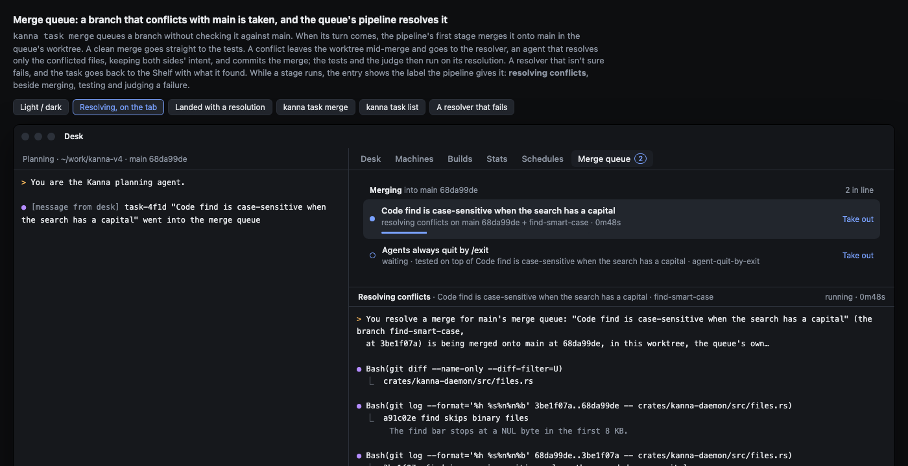
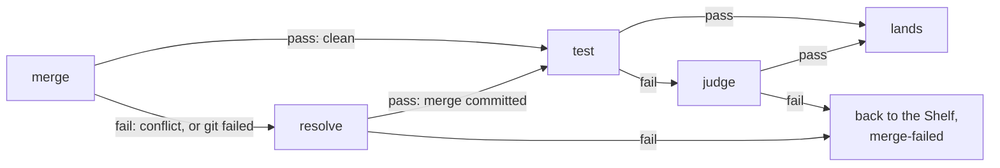
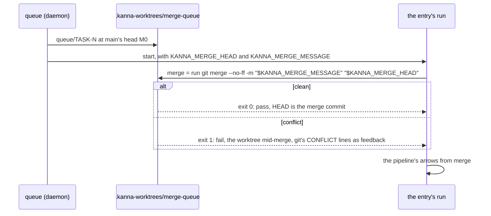
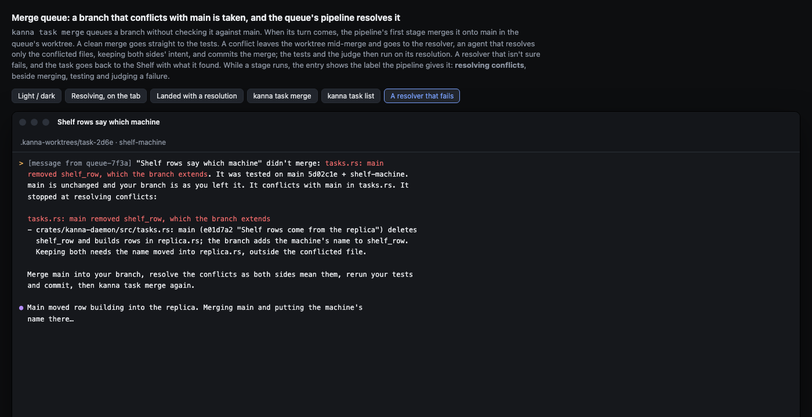
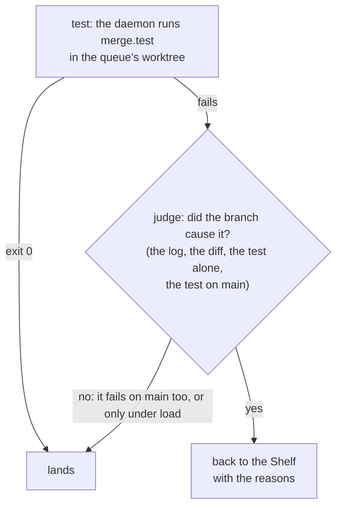
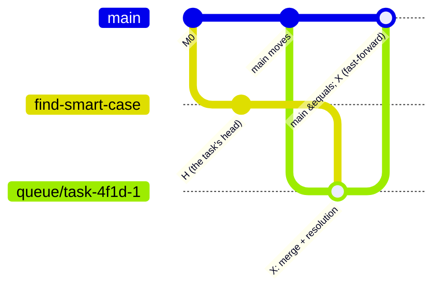
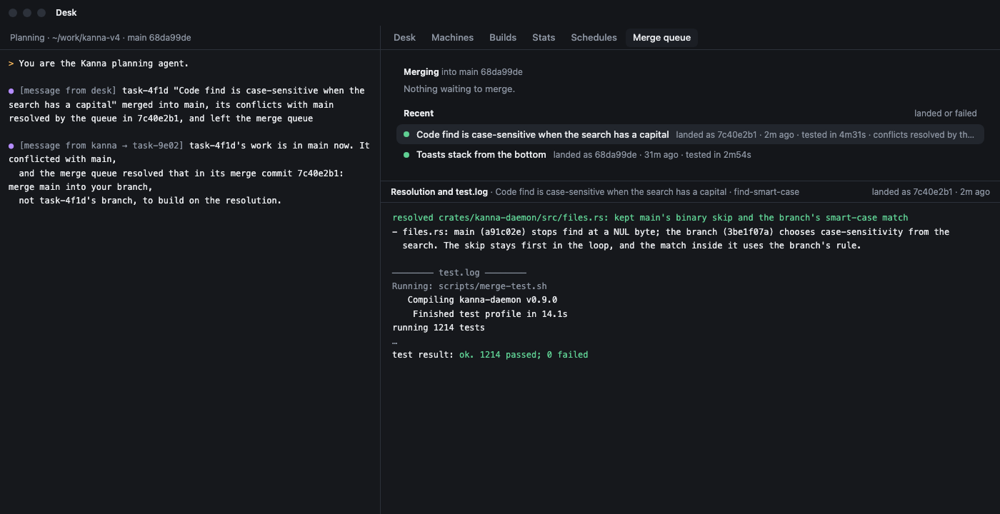

# The default merge-queue pipeline

Status: built. The file is [`crates/kanna-daemon/src/merge_queue/pipeline.kojo`](../../crates/kanna-daemon/src/merge_queue/pipeline.kojo), with its prompts `resolve.md` and `judge.md` beside it. Tested by `cargo test -p kanna-daemon queue::` and e2e `merge_queue`. Mockup: [`references/mockups/merge-queue-conflicts.html`](../../references/mockups/merge-queue-conflicts.html). Runs in the [merge queue](merge-queue.md), through its [pipeline interface](merge-queue.md#32-the-pipeline-interface); written in [Kojo](kojo.md).

The [merge queue](merge-queue.md) runs each entry through its repo's merge-queue pipeline. A repo without its own `.kanna/pipelines/merge-queue.kojo` gets this one: it merges the branch onto main, resolves any conflict with an agent, runs the repo's `merge.test`, and has an agent judge a failure. A clean entry whose tests pass spends no agent session. This repo's own setup of it is in [Kanna's merge pipeline](kanna-merge-pipeline.md).



## Contents

1. [The pipeline](#1-the-pipeline)
2. [The merge stage](#2-the-merge-stage)
3. [The resolver](#3-the-resolver)
4. [The tests and the judge](#4-the-tests-and-the-judge)
5. [What a resolution lands](#5-what-a-resolution-lands)
6. [Showing its stages](#6-showing-its-stages)
7. [Writing your own](#7-writing-your-own)
8. [Tests](#8-tests)
9. [Later, and rejected](#9-later-and-rejected)

## 1. The pipeline

The daemon builds `pipeline.kojo` in and starts it as it is, a plain Kojo file, as the entry's run. `agent` is the repo's `tasks.agent` ([Kojo §2](kojo.md#2-stages)), and the tests are `merge.test`, which the queue passes as `KANNA_MERGE_TEST` ([merge queue §3.2](merge-queue.md#32-the-pipeline-interface)):

```
merge   = run git merge --no-ff -m "$KANNA_MERGE_MESSAGE" "$KANNA_MERGE_HEAD" label "merging"
resolve = agent prompt merge-resolve verdict label "resolving conflicts"
test    = run sh -c "$KANNA_MERGE_TEST" label "testing"
judge   = agent prompt merge-judge verdict label "judging a failure"
merge   -[pass]-> test
merge   -[fail]-> resolve
resolve -[pass]-> test
test    -[pass]-> done
test    -[fail]-> judge
judge   -[pass]-> done
```



- **A clean entry** runs `merge` and `test`, two commands, with no agent.
- **A conflicting entry** runs the resolver. The tests run on what it committed, and the judge, if they fail, counts a failure that the resolution causes as the branch's. A bad resolution still has to pass both.
- **A failing resolver or judge** has no arrow out, which ends a queue run as `failed` ([merge queue §4](merge-queue.md#4-failure)), and the task goes back to the Shelf.
- **The worst case** is two agent sessions an entry, the resolver and the judge.

The pipeline needs `merge.test`: without it, and without a repo pipeline, `kanna task merge` is refused with how to set one. Any command works, since it runs whole as `sh -c "$KANNA_MERGE_TEST"`, `#` and line breaks included.

| Setting | Where | Is |
|---|---|---|
| `merge.test` | the repo's `.kanna/config.json` | the `test` stage's command, as `KANNA_MERGE_TEST` |
| `tasks.agent` | either `config.json` | the resolver's and the judge's agent |

## 2. The merge stage



The merge stage is a plain `run` stage that uses the queue's two variables, beside every run's own ([Kojo §2](kojo.md#2-stages)). Its outcome is a run stage's verdict. A clean merge passes. A conflict fails, and leaves the worktree mid-merge, with the conflicted files unmerged and `MERGE_HEAD` set, for the next stage. Its feedback is git's output, whose `CONFLICT (content): Merge conflict in FILE` lines name the files. Any other failure of `git merge` fails the stage the same way, with git's message as its feedback.

Between stages a run leaves the worktree as it is, so a half-done merge reaches the next stage untouched. Only a `reset` arrow or a stage that times out resets it. When an entry ends, the queue aborts whatever merge is left in its worktree before the next entry starts.

How a pipeline writes the merge:

| Option | For | Against |
|---|---|---|
| **`run git merge …` (chosen)** | the file says exactly what runs; nothing new in `runs.rs` but a run's own variables; a repo can add flags (`-X`, `--no-verify`) | the command is long, and a repo copies it from the default pipeline |
| a command Kanna provides (`run kanna queue merge-main`) | short | hides what runs behind a name; one more CLI command and socket action for what one git command does |
| a stage kind (`merge = merge main`) | reads as a merge | Kojo refuses `merge main` for a reason ([Kojo §2](kojo.md#2-stages)); a new kind needs its own verdict, feedback and placement code in `runs.rs` |

## 3. The resolver

The resolver is a fresh session of the repo's default agent, as the judge is, in the queue's worktree, mid-merge. Its prompt is Kanna's `merge-resolve`, filled in with main and M0, the task's name, branch and head, and the queue branch. git's conflict lines come under `Feedback from merge`. A repo replaces it with its own `.kanna/prompts/merge-resolve.md`. The prompt tells it to:

1. **Learn each side's intent** before editing a conflicted file: the branch's log and diff for that file (`git log M0..HEAD -- FILE`, the commits of the task's branch), the commits on main that touch it (`git log HEAD..M0 -- FILE`), and `git log --merge -p` for both at once.
2. **Resolve only the conflicted files,** keeping both sides' intent, then `git add` them and commit the merge with `git commit --no-edit --cleanup=strip`. That keeps the queue's merge message and drops git's commented list of conflicts.
3. **Change nothing else:** no other file, no clean-up, no fix for what the tests would catch, no test run (the queue runs the tests next), no push, rebase, abort or new merge.
4. **Fail rather than guess:** when the two sides want incompatible things, when keeping both needs a change outside the conflicted files, or when it isn't confident it knows what either side meant. It leaves the worktree as it is.
5. **Answer** with a first line on the outcome (`resolved shared.txt: kept main's rename and the branch's new field`, or `shared.txt: main removed parse_old, which the branch extends`), then, for each file, what each side wanted and what it kept, or why both can't hold.

It reports with `kanna run done pass` or `fail`, like the judge. An ended turn without a verdict is carried on once, then pauses the entry as `needs you` ([merge queue §4.1](merge-queue.md#41-an-entry-that-needs-you)).

When it fails, the entry fails with the answer's first line as the reason. The task's `merge-failed` row shows that line. Its agent's message from the queue says `It conflicts with main in FILES`, gives the whole answer under `It stopped at resolving conflicts:`, and ends with what to do: merge main into the branch, resolve the conflicts as both sides mean them, rerun the tests and commit, then `kanna task merge` again. `mergeFailed` in `kanna task list --json` has `verdict: fail`, the `note`, and `stage: resolve`.



## 4. The tests and the judge



**The tests.** The daemon runs `merge.test` itself, as a [`run` stage](kojo.md#2-stages): in a terminal of its own in the queue's worktree, with your login shell, its output in `.kanna/tmp/stage-1.log` there. The terminal belongs to the keeper, so the tests outlast a daemon restart; if the keeper is lost too, they run again ([keeper loss](keeper-loss.md)). Exit 0 lands the entry. The tests have no time limit: a hung run holds the queue until you take the entry out, and the tab shows how long it has run.

**The judge.** Main can have failing tests, both known failures and tests that fail only under load, so a failing entry is judged on what it breaks. The judge is a new session of `tasks.agent` in the queue's worktree, with the merge checked out; if `tasks.agent` is a command rather than an agent's name, the judge is `claude`. It starts only when the tests fail. Its prompt is Kanna's `merge-judge` prompt, filled in with main and M0, the branch, the merge X and the queue branch, followed by the end of the tests' output and the log's path. A repo can replace it with its own `.kanna/prompts/merge-judge.md`. It asks the judge to:

1. Decide for each failure whether the branch caused it, changing nothing in the worktree. It can read the branch's diff against M0, run the test again on its own, or check out M0 and run it there. A failure that also happens on main, or that passes when run alone, isn't the branch's. A build the branch breaks is.
2. Report `pass` if no failure is the branch's, and `fail` if any is.
3. Write an answer whose first line sums up the outcome, such as `broken_thing fails: the branch removed its fixture`, followed by each failure, whether it's the branch's, and how it knows.

**The verdict is a call.** The judge ends its judgement by running `kanna run done pass` or `kanna run done fail`, with its answer in the file its prompt names, and nothing else ends it: the queue reads no screen, and a turn that ends says nothing about the merge. A turn that ends without the call is carried on once, with a message that the judgement isn't reported and how to report it ([merge queue §4.1](merge-queue.md#41-an-entry-that-needs-you)).

A pass lands the entry, and the queue keeps the judge's answer in the entry's `answers`, as it keeps every agent stage's. A fail ends the entry, with the answer's first line as the reason ([merge queue §4](merge-queue.md#4-failure)). An entry whose tests passed has no answers.

**A long command.** The judge's own commands are short: one test, a diff. An agent's shell stops a command after about ten minutes, and what it leaves in the background ends with its turn. When the judge needs something longer, such as a build at M0 or the whole suite on main, it asks Kanna: `kanna run command 'COMMAND'` has the daemon run it in the queue's worktree and waits with the judge, and the judge's turn doesn't end ([run commands](run-commands.md)). The prompt says so, and never says to run something in the background.

A repo's own `merge-queue.kojo` is judged by its arrows instead, and has no judge unless it adds one.

## 5. What a resolution lands



- **What lands** is the commit the pipeline finished on ([merge queue §3](merge-queue.md#3-an-entrys-run)). The queue checks that it holds both M0 and the task's head H, then fast-forwards main to it. A resolution is part of the merge commit X on `queue/TASK-N`, so it's in main's history as that merge, with the queue's message (`Merge branch 'BRANCH': SUMMARY`). A pipeline that ends without the branch merged (the resolver passed without committing, or a repo's pipeline with no merge stage) fails the entry, saying so.
- **The entry keeps** `merge` (X), `resolved: true` (git, not the pipeline, says the branch conflicted with M0) and the resolver's answer in `answers`. The Merge queue tab shows a landed entry as `conflicts resolved by the queue`.
- **The task** is Done on landing, as before. Its own branch never gets the resolution: it still ends at H, which is in main, so Done removes the worktree and branch as merged. Nothing is written back to them.
- **The planner** hears it as Desk news: `merged into main, its conflicts with main resolved by the queue in X, and left the merge queue` when it lands, and `didn't merge (WHY): it's back on the Shelf, and its agent has the reason` when it fails.
- **Tasks stacked on it** hear `base-merged` as before, plus: `It conflicted with main, and the merge queue resolved that in its merge commit X: merge main into your branch, not BASE's branch, to build on the resolution.` Their branch holds H. When they merge, git uses H as the merge base and keeps main's resolution unless they changed the same lines too.



## 6. Showing its stages

Each stage's `label` is what the queue shows while it runs ([merge queue §3.2](merge-queue.md#32-the-pipeline-interface)): the file names them, and no surface knows a stage by its name.

| Where | Shows | `resolve`, say |
|---|---|---|
| `kanna task list`, Merging | the label | resolving conflicts |
| Merge queue tab, the entry's line | LABEL on main M0 + BRANCH | resolving conflicts on main 3c1d9e2a + BRANCH |
| Merge queue tab, the detail's title | Label · NAME · BRANCH | Resolving conflicts · NAME · BRANCH |
| Desk view | LABEL on main + its branch | resolving conflicts on main + its branch |
| the failed task's message | It stopped at LABEL: ANSWER | It stopped at resolving conflicts: … |

A repo's own pipeline labels its stages the same way; a stage without a label shows by its name.

## 7. Writing your own

A repo that writes its own `.kanna/pipelines/merge-queue.kojo` replaces this pipeline, and decides what a conflict does. Copying [`pipeline.kojo`](../../crates/kanna-daemon/src/merge_queue/pipeline.kojo) there is the place to start: it's valid as it is, and `kanna pipeline check merge-queue` checks it. To merge the branch, it uses the same `merge` stage, or any stage that leaves a commit holding both M0 and the branch. Kanna's `merge-resolve` and `merge-judge` prompts are offered to it, unless the repo has its own. Its tests can be any command; `KANNA_MERGE_TEST` is there when the repo also sets `merge.test`. This repo's own copy is in [Kanna's merge pipeline](kanna-merge-pipeline.md).

**Fail on a conflict, as the queue did before:**

```
merge = run git merge --no-ff -m "$KANNA_MERGE_MESSAGE" "$KANNA_MERGE_HEAD"
test  = run scripts/merge-test.sh
merge -[pass]-> test
test  -[pass]-> done
```

With no arrow for `merge`'s fail, the entry fails. The queue sees the worktree mid-merge and gives the reason as `it conflicts with main in FILES`. The task's message says to merge main, resolve, rerun the tests and merge again, as the old refusal did.

**Ask you before a resolution lands:**

```
merge   = run git merge --no-ff -m "$KANNA_MERGE_MESSAGE" "$KANNA_MERGE_HEAD"
resolve = agent prompt merge-resolve verdict label "resolving conflicts"
ok      = ask "Land this resolution?" label "waiting for your yes"
test    = run scripts/merge-test.sh
merge   -[pass]-> test
merge   -[fail]-> resolve
resolve -[pass]-> ok
ok      -[pass]-> test
test    -[pass]-> done
```

The `ask` pauses the entry as `needs you`, with a toast and a message to the planner ([merge queue §4.1](merge-queue.md#41-an-entry-that-needs-you)). `git show HEAD` in the queue's worktree shows the resolution. Your yes runs the tests; a no ends the entry.

Anything else Kojo can say works too: a `run` stage that tries `git merge -X ours` first, a resolver on `codex:high`, or a `max 2` loop of resolver and tests. The rule that a stage running out of its `within` ends the entry ([merge queue §3](merge-queue.md#3-an-entrys-run)) applies to the resolver too.

## 8. Tests

`cargo test -p kanna-pipe` checks that a stage of any kind can end with `label "TEXT"`, that an empty label or one that isn't last is refused, and that `agent` names an agent stage's agent. `cargo test -p kanna-daemon queue::` checks:

- The default pipeline, read from `pipeline.kojo`: each stage's label; `merge` is its first stage with the command in [2](#2-the-merge-stage); a pass goes to `test` with no resolver, a fail to `resolve`; the resolver's pass goes to `test`, its fail has no arrow; a test pass lands and only a fail reaches the judge; at most two agent sessions; no time limit on the tests, whatever `tasks.timeout` is; a repo's own pipeline takes precedence, and a timeout in it ends the entry.
- The merge command, run with the two variables, merges the head with its message. On a conflict it fails and leaves the worktree mid-merge. `merge_commit` finds the merge that holds the resolution.
- That the default pipeline is the file as it is, `agent` is the repo's `tasks.agent` (`claude` for a command), any `merge.test` (a `#`, line breaks, `within` and `on` in it) runs whole as the test stage, the judge's and the resolver's prompts, the kept log's text, the paused entry's news, and the reuse of the queue's worktree and its build folder.
- Outcomes: passing tests land with no answers; a judge's pass lands with its answer and label in `answers`, its fail ends the entry with the answer's first line; a resolver's fail ends it with its first line, `result.stage: resolve` and its label; a resolution that passes the tests lands with `resolved`, which git's `merge-tree` says on a real repo, and the resolver's answer; a repo's pipeline that fails at `merge` fails the entry with `it conflicts with main in FILES`, and the half-done merge is aborted; a timed-out stage of a repo's own pipeline says so; a judge that exits without a verdict fails the entry; a repo's own pipeline fails with its failed stage's output.

`cargo test -p kanna-daemon desk_news` checks the landed and failed news lines.

The e2e scenario `merge_queue` ([merge queue §8](merge-queue.md#8-tests)) runs the default pipeline on a mock repo. The repo's `merge.test` is `sh test.sh`, which runs a mock test binary, `bin/unit`, and its `tasks.timeout` is 5 seconds. `known_broken` fails once main has a `known-broken` file, `broken_thing` fails when the merge has a `broken` file, and `flaky_thing` fails in the full run and passes alone when the merge has a `flaky` file. The script also fails without naming a test when `needs-a.txt` is there without `a.txt`, sleeps 15 seconds once when `slow` is there, and records in `target/builds` whether it found `target/` warm. The repo's `.kanna/prompts/merge-judge.md` has the mock agent run `judge.sh`, a judge written in shell: it reads the failing tests from the log, runs each alone, runs it on main through `kanna run command` with a 1-second wait, and reports as Kanna's prompt asks. When the merge has a `waits` file, it first asks for a 4-second command and ends its turn. The repo's `merge-resolve.md` runs `resolve.sh`, a resolver written in shell that keeps both sides of each conflicted file, or fails on `clash.txt`. For the pipeline it checks that:

1. A and B, whose tests pass, land on `merge:run:pass test:run:pass` each, both commands, with no agent started, and A's tests, 15 seconds long under a 5-second `tasks.timeout`, run to their end.
2. After main gets `known-broken`, C (`broken`) fails because the judge blames `broken_thing` on the branch, with `broken_thing fails: the branch broke it`; its agent gets the judge's answer and the log's path, and the log is in its worktree. C's judge waited again (`--wait`) for a command that outlasted its first wait.
3. F (`waits`): its judge's turn ends while its command runs, the command still runs to its end, and the judge is carried on with its exit code. A turn with no verdict is carried on once; the second pauses F as `needs you`, and resumed with words, the judge passes it and F lands.
4. E (`flaky`) lands with the judge's answer `tests fail, none of them the branch's: known_broken fails on main too, flaky_thing passes alone`, and C's and E's runs each went from `merge` to `test` to `judge`.
5. D, which conflicts with main in `shared.txt`, is taken, and the reply doesn't mention it. It shows its label, `resolving conflicts`, in `kanna task list`, runs `merge:fail resolve:pass test:pass`, and lands. Main's `shared.txt` holds both sides, and main's head is D's merge, which the entry keeps, `resolved`, with the resolver's answer and label.
6. G, whose resolver fails, is merge-failed with the resolver's first line. Its run stops at `resolve`, its agent gets the answer and what to do, and main doesn't have it.
7. H, under a repo pipeline that fails on a conflict, fails with `it conflicts with main in clash2.txt` after its `merge` stage alone, with no merge left in the queue's worktree.

## 9. Later, and rejected

**Later: the task's own agent as the resolver.** It knows why its changes exist, so it would resolve better than a fresh agent. That means a stage kind that starts the task's own session in the queue's worktree, or hands the conflict to the task's worktree and waits for a new head. Both cut across the queue's rule that a queued task's agent has quit. Today a failing resolver hands the conflict back to that agent anyway, through `merge-failed`.

An agent running the tests, the tester, was how the queue was first built: one agent stage ran `merge.test` and judged the result. On kanna-v4 it couldn't finish. Its prompt allowed running the tests in the background and waiting; the agent did, and ended its turn to wait. The run read that as `stopped without reporting`, quit the agent, and the build died with it. A foreground command wasn't a way out either, since an agent's shell stops one after about ten minutes, less than a build after a big merge. It also spent a session on every entry, most of which pass.

A time limit on the tests (`merge.within`) was built and taken out. A build after a big merge is long, and a limit set for the usual case fails the entry that needs the time. Tests that hang hold the queue instead, the tab shows how long they've run, and Take out ends them. A repo that wants a limit writes its own `merge-queue.kojo` with `within` on a stage.

A green main as the bar, with known failures skipped by hand in `merge.test`, would block every entry but the one that fixes main, and the skip list goes stale.

Judging each test in the daemon would mean reading libtest's output, keeping main's results for each commit, failing an entry on tests that fail on the merge but not on main, and running each new failure again on its own. That's a lot of machinery for a decision an agent makes at once with the log, the diff and a shell, and it would read only libtest's output. The daemon reads one thing, the command's exit code.

If test results never blocked landing, a branch that breaks the build or a test would land.

Running main's tests in the background whenever main moves needs a terminal outside any task's workspace. The judge runs main's tests itself when a failure calls for it.

Refusing a conflicting branch at `kanna task merge` and resolving only conflicts that come up in the queue would treat the same conflict two ways, depending on whether main moved before or after the merge.

Resolving in the task's worktree would move the task's branch while its agent has quit, and a resolution that fails the tests would be left on it.
