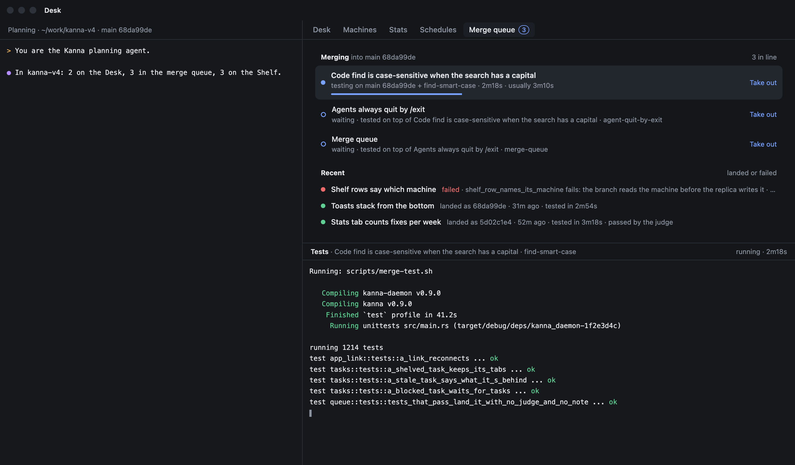
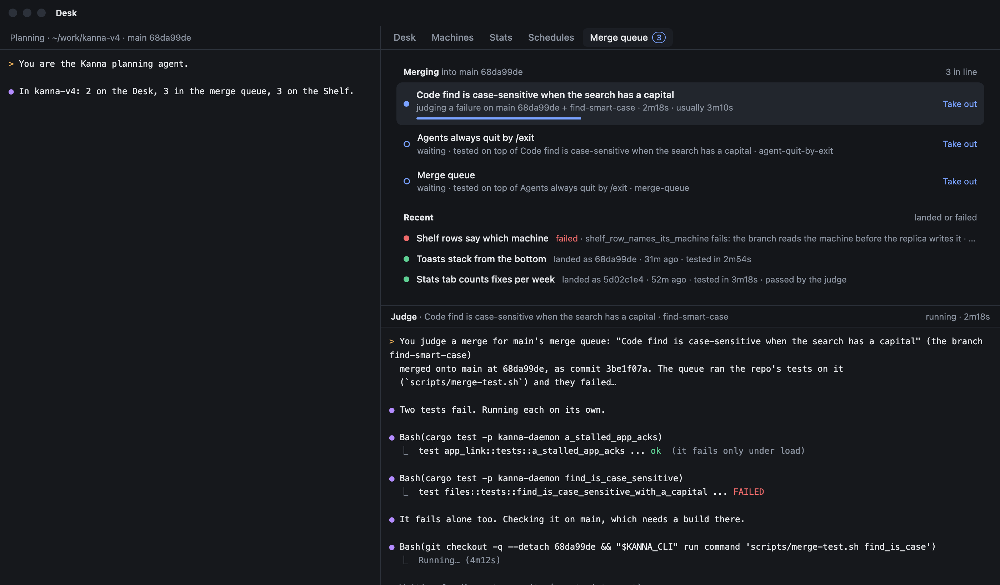
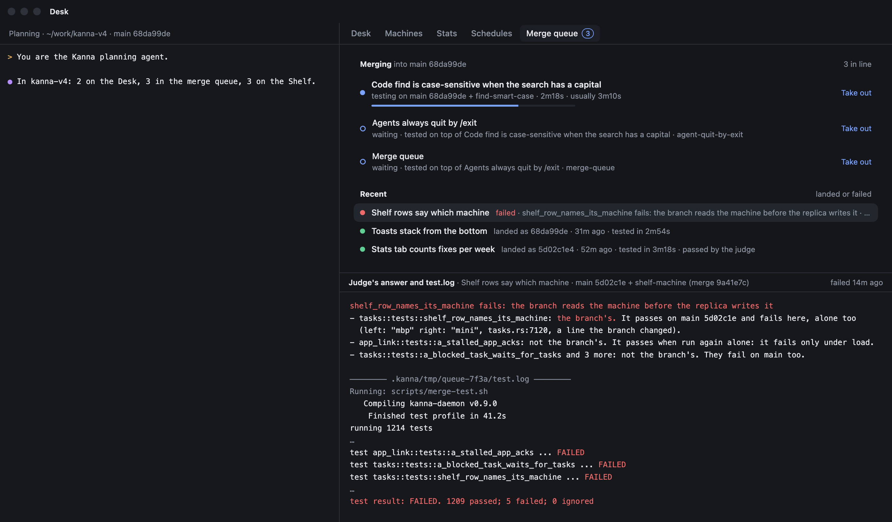
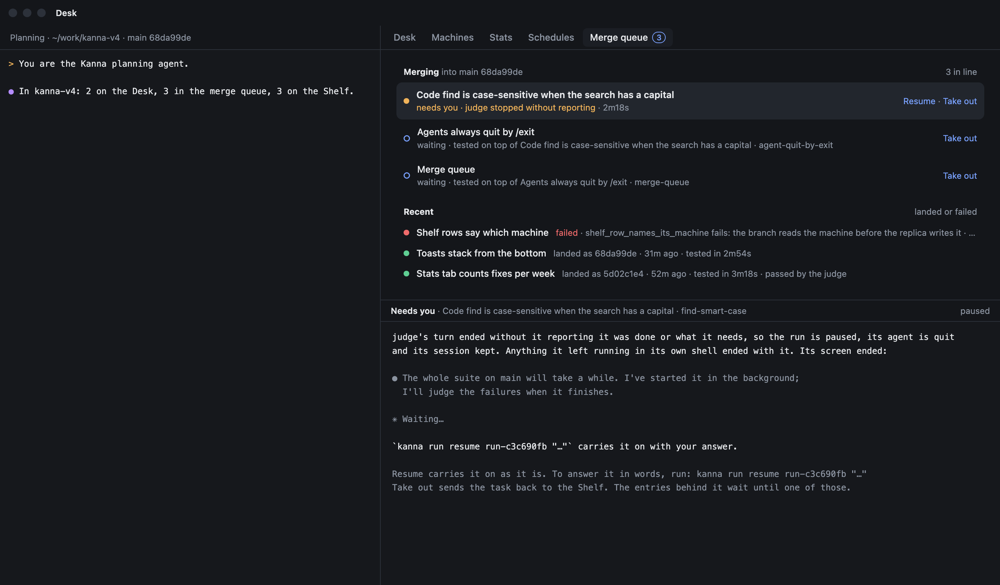
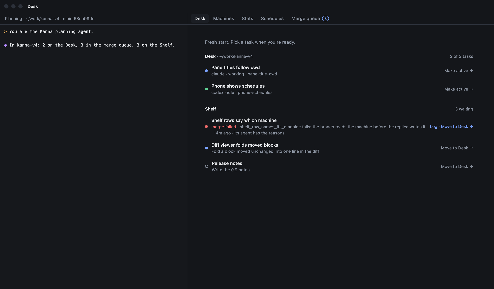
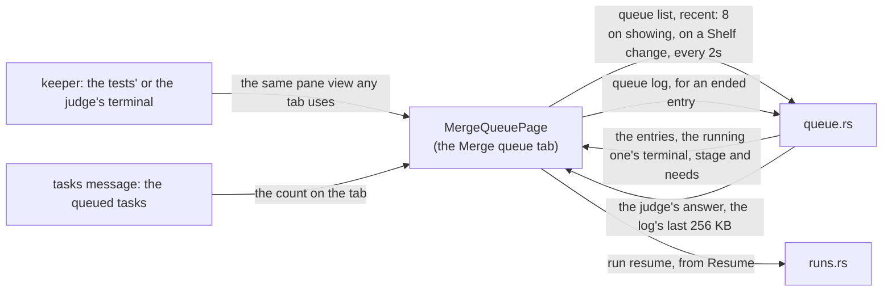

# Merge queue tab

**Status:** built · **Tested:** e2e `merge_queue` · **Mockup:** [`references/mockups/merge-queue.html`](../../references/mockups/merge-queue.html) · **Builds on:** [merge queue](merge-queue.md), [Desk view](desk-view.md), [machine links](machine-links.md#5-paths-the-machines-tab-and-offline)

**The window's fifth fixed tab shows the repo's merge queue and each entry's tests or judge at work.** The queue is the repo's machinery, so it has a tab of its own beside Desk, Machines, Stats and [Schedules](schedules-tab.md). It lists what's in line and what ended lately, and shows the picked entry's terminal or log. How the queue itself works is in [merge queue](merge-queue.md).

## Contents

1. [The tab](#1-the-tab)
2. [A picked entry](#2-a-picked-entry)
3. [The Desk tab](#3-the-desk-tab)
4. [How it's built](#4-how-its-built)
5. [Tests](#5-tests)
6. [Rejected](#6-rejected)

## 1. The tab

- **Fixed tab:** Merge queue comes after Schedules, with no close button, in Next and Previous Tab's order. Only the Desk view has it.
- **Count:** the tab's title counts the entries in line, whichever tab shows.
- **Repo:** the queue shown is the repo's that the window's Desk is on.
- **Merging:** the entries in queue order. The running one says `testing`, or `judging a failure` once its judge has started, the merge it's on and how long it has run. A waiting one says which entry it'll be tested on top of. A `landing` one that waits says why.
- **Needs you:** an entry whose run is paused says `needs you` and why, and has Resume beside Take out ([merge queue §4.1](merge-queue.md#41-an-entry-that-needs-you)). Resume runs `kanna run resume` on its run.
- **Take out:** runs `kanna task merge --cancel` on that entry's task.
- **Recent:** the last 8 entries that landed or failed, newest first. One the judge let through says `passed by the judge`.

## 2. A picked entry

Clicking an entry picks it, and the lower part of the tab shows it. The first entry is picked until you click another.

| The picked entry is | The tab shows |
|---|---|
| testing | the tests' terminal, live: `merge.test` running. You can type in it, as in any terminal |
| judging | the judge's terminal, live; while the judge waits on a command it asked Kanna for with its turn ended, that command's terminal |
| needs you | what the run said: what happened, the last lines of the judge's screen, and how to resume it or take it out |
| waiting | which entry it waits for |
| landing | that its tests are done, and what it waits for |
| failed or landed | the judge's answer if it had a judge, then the tests' log |

## 3. The Desk tab

The Desk tab shows no queued task: one shows only on the Merge queue tab, even while its agent is still ending its turn. A task whose merge failed is back on the Shelf, and its row has Log, which opens the Merge queue tab with that entry picked.

## 4. How it's built

- **Entries:** `MergeQueuePage.swift` asks the daemon for the repo's queue ([merge queue §6](merge-queue.md#6-how-its-built)) when the tab is shown, when the Shelf changes, and every 2 seconds while the tab shows.
- **Count:** from the task list's queued tasks, so it's right while another tab shows.
- **Terminal:** a stage's terminal is a background terminal of the task's workspace, which no window shows. The tab hosts that pane's view itself, the view a tab would use, and swaps it when the run goes from the tests to the judge. When the entry ends, the terminal closes and the tab shows the log.
- **Needs you:** the entry's `doc.needs` and `doc.told`, which the queue keeps while the run is paused. A paused entry has no terminal: its judge is quit until it's resumed.
- **Log:** asked for once per picked entry, from the copy the queue keeps in the repo's git folder.
- **Not built:** the mockup's progress bar and usual time.

## 5. Tests

The e2e scenario `merge_queue` ([merge queue §8](merge-queue.md#8-tests)) opens the repo's Desk and checks:

1. The window's tabs end with Merge queue, counting 2 in line while A tests and B waits. The Desk tab has only the Desk and Shelf groups, and A and B aren't on its Shelf.
2. The Merge queue tab lists A testing, then B waiting, and shows the terminal of A's tests. Clicking B shows that it waits for A, and clicking A shows the terminal again.
3. After C fails, the tab lists it under the entries that ended, the Log on C's Shelf row opens the tab with C picked, and the tab shows the judge's answer and the log with `test broken_thing ... FAILED`.
4. While F's run is paused, the tab says `needs you · judge stopped without reporting` on its row, and picking it shows no terminal and what the run said, with how to resume.
5. After E lands, the tab lists E, F, C, B and A, newest first, with no count, and clicking E shows its judge's note and its log, kept after E's worktree is gone.

## 6. Rejected

A Merging group in the Desk view, between the Desk and the Shelf, was how the queue first showed. The queue is the repo's machinery, where the Desk and Shelf hold work waiting for you, and a row there had nowhere to show its terminal.

A general Factory tab listing every run of the repo, with the queue first, would show a task's pipeline runs away from the task. Each task shows its own run in its Run tab ([software factory §4](software-factory.md#4-seeing-and-steering-a-run)).

Opening a stage's terminal as a tab of the task's workspace, as a task's run does for a stage, would show nothing: a queued task is off the Desk, so its workspace is in no window.
