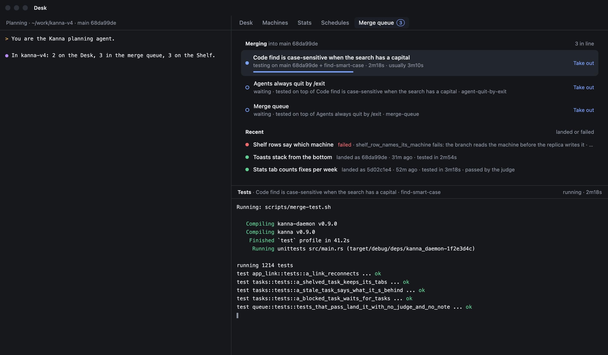
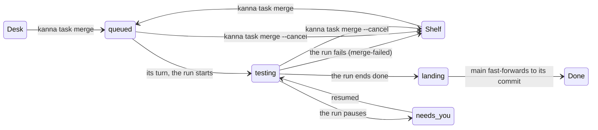
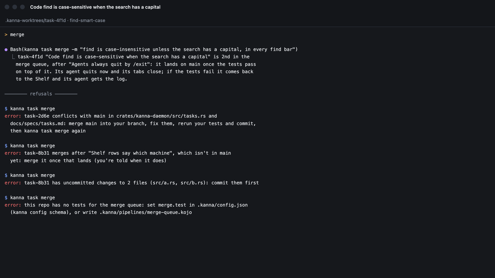
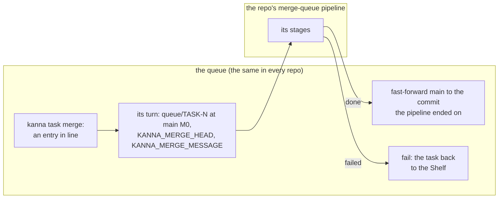
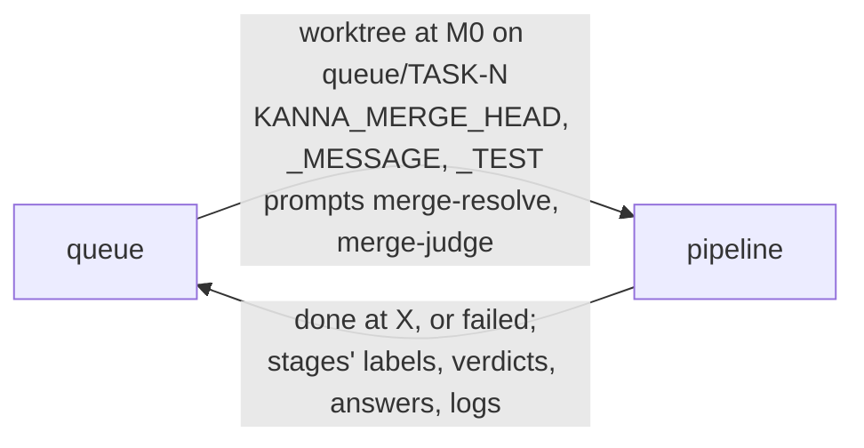
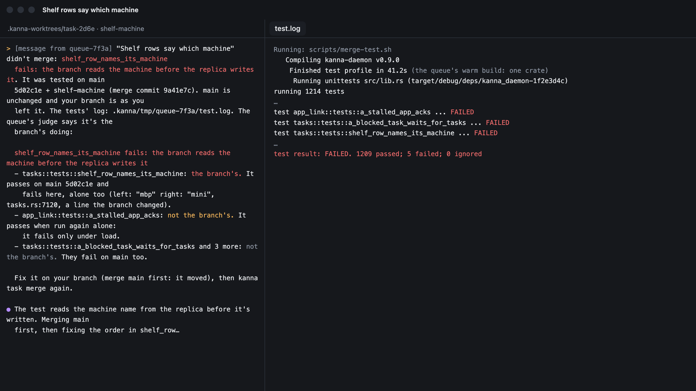
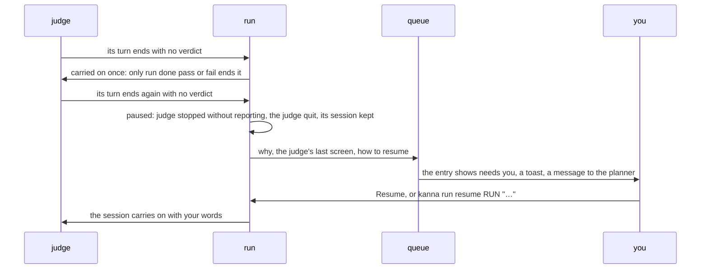
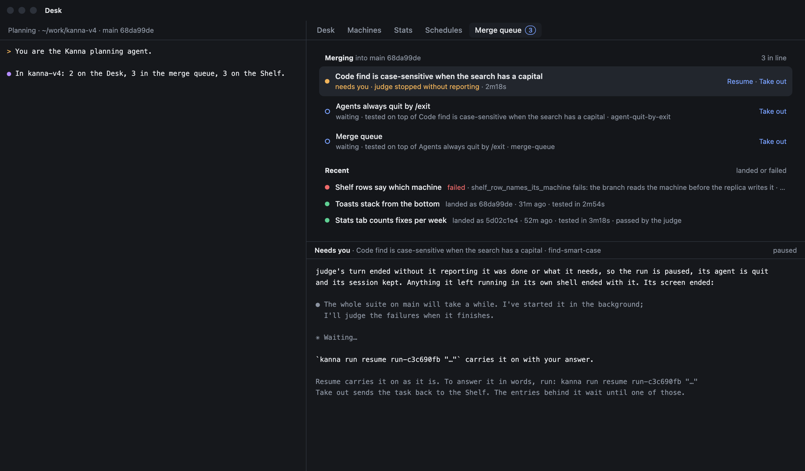
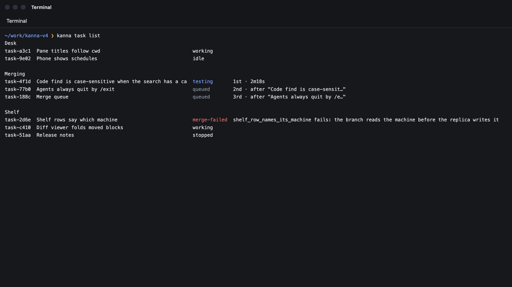

# Merge queue

Status: built in the daemon, the CLI and the window's [Merge queue tab](merge-queue-tab.md); the phone doesn't show the queue yet. Tested by `cargo test -p kanna-daemon queue::` and e2e `merge_queue`. Mockup: [`references/mockups/merge-queue.html`](../../references/mockups/merge-queue.html). What an entry's run does is its repo's pipeline's: the [default merge-queue pipeline](merge-queue-pipeline.md), or the repo's own; this repo's is [Kanna's merge pipeline](kanna-merge-pipeline.md). Builds on the [build store](build-store.md), [runs](software-factory.md#61-sequential-runs-as-built), [run commands](run-commands.md), [Kojo](kojo.md), [tasks](tasks.md), [stacked tasks](stacked-tasks.md) and [task events](task-events.md).

When you tell a ready task's agent to merge, it runs `kanna task merge`. The task leaves the Desk for its repo's merge queue, shown on the window's [Merge queue tab](merge-queue-tab.md), and its agent quits, so you don't wait. The queue takes one entry at a time per repo and runs the repo's merge-queue pipeline on it, in a worktree of its own, starting from main as it is now. If the pipeline ends on a commit that holds both main and the branch, main fast-forwards to it and the task is Done. If it fails, the task goes back to the Shelf and its agent gets the reason. The next entry starts from whatever landed. What the pipeline does (merge, resolve conflicts, test, judge a failure, ask you) is the repo's: `.kanna/pipelines/merge-queue.kojo`, or the [default pipeline](merge-queue-pipeline.md).

## Contents

1. [Why](#1-why)
2. [Merging a task](#2-merging-a-task)
3. [An entry's run](#3-an-entrys-run), with [the queue's worktree](#31-the-queues-worktree), [the pipeline interface](#32-the-pipeline-interface) and [landing](#33-landing)
4. [Failure](#4-failure), and [an entry that needs you](#41-an-entry-that-needs-you)
5. [Seeing the queue](#5-seeing-the-queue)
6. [How it's built](#6-how-its-built)
7. [CLI](#7-cli)
8. [Tests](#8-tests)
9. [Rejected](#9-rejected)

## 1. Why

Merging shouldn't take your time, and what lands on main should be what was tested. The queue tests each change once, where it lands, on top of everything that landed before it, while you work on something else.

Ready tasks aren't tested again each time main moves. A task hears when main moves into a conflict with it ([`main-conflicts`](task-events.md)), and its tests run once, in the queue.

Main fast-forwards to the exact commit that was tested. That's why the queue isn't a `merge main` stage gated by an `ask` ([software factory §8](software-factory.md#8-rejected)), which would land a run's branch you never had in your worktree.

## 2. Merging a task

The entry's state is `testing` from its turn to the run's end, whatever the pipeline's stages are; its `stage` names the stage running, which `kanna task list` and the tab show ([5](#5-seeing-the-queue)).

`kanna task merge [TASK] [-m MESSAGE]` runs from the task's terminal, where it means that task, or names a task, as the planner does when you tell it to merge one. It's refused in these cases, and says why:

| Refused when | It says |
|---|---|
| it `merges after` a task whose work isn't in main yet | which task, and that the task hears when it lands ([`base-merged`](task-events.md)) |
| its worktree has uncommitted changes to tracked files | the files, since they wouldn't land |
| the repo has no pipeline: no `.kanna/pipelines/merge-queue.kojo`, and no `merge.test` for the default one ([default pipeline §1](merge-queue-pipeline.md#1-the-pipeline)) | how to set one |
| it's in the queue already, hasn't started, or has nothing that isn't in main | which |

Nothing else is checked: a branch that conflicts with main is queued like any other, and the pipeline finds the conflict when its turn comes. `main-conflicts` ([task events](task-events.md)) still tells a ready task early that main moved into a conflict with it; the task can fix it itself, or let the queue's pipeline deal with it.

When the merge is accepted, the entry records the branch's head, and that commit is what lands. The merge also claims the task ready at that head, unless its agent claimed it there already ([stacked tasks](stacked-tasks.md#ready)), so the tasks waiting for it can start on its branch now, and Shelf runners pick them up. They're stacked on it, so the queue refuses them (`merges after`) until it lands. The task leaves the Desk or the Shelf. Its agent quits as it does at Done (its session is kept), its tabs close, and its place on the Desk frees up. Its worktree, branch and workspace stay, because the queue's terminal lives in that workspace. The task isn't Done until the entry lands, so it can still come back to the Shelf.

The merge commit's message is `-m MESSAGE`, or `Merge branch 'BRANCH': NAME` without one. The `kanna-tasks` skill tells the agent to pass a one-line summary of the work. Any number of a repo's tasks can be in its queue; they don't count against `shelf.runners` or the Desk's three places.

## 3. An entry's run

The queue is the mechanism that lines a repo's tasks up and runs each through the repo's merge-queue pipeline, a [Kojo](kojo.md) file. It does only the ends, the same in every repo:

- **Takes** an entry with `kanna task merge` ([2](#2-merging-a-task)).
- **Lines entries up,** one at a time per repo, oldest first.
- **Starts the entry's run** on a queue branch, `queue/TASK-N`, at main's head M0, in the queue's worktree ([3.1](#31-the-queues-worktree)), with what the [pipeline interface](#32-the-pipeline-interface) gives it.
- **Lands** the commit the run ended on, by fast-forward ([3.3](#33-landing)), or fails the entry ([4](#4-failure)).
- **Shows** the entry's states on the Shelf and the Merge queue tab ([5](#5-seeing-the-queue)).

Everything between is the pipeline's. The pipeline is the repo's `.kanna/pipelines/merge-queue.kojo` if it has one, so one project's queue can differ from another's; otherwise it's the [default merge-queue pipeline](merge-queue-pipeline.md), which merges, resolves a conflict, tests and judges a failure. Main itself moves only when an entry lands, so every entry starts on top of everything that landed before it.

### 3.1 The queue's worktree

Each repo has one worktree for its queue, `.kanna-worktrees/merge-queue`. The daemon makes it the first time the queue runs and uses it for every entry after that. It starts each entry with `git checkout -f -B queue/TASK-N M0` and `git clean -fd`, which keeps ignored files such as a build folder and `.kanna/tmp`. Because the worktree's path never changes, a pipeline's build can stay warm from one entry to the next: for this repo's, see [Kanna's merge pipeline](kanna-merge-pipeline.md).

The queue doesn't run in the task's own worktree, because that build is warm for the task's branch, which may be well behind main, and a merge checked out there would move the task's work. It doesn't use the main checkout either, because that's yours and may be busy.

Between stages a run leaves the worktree as it is, so whatever one stage leaves (a half-done merge, say) reaches the next untouched. When an entry ends, the queue aborts any merge left in its worktree before the next entry starts.

### 3.2 The pipeline interface

**What a run gets:**

- **The worktree,** on `queue/TASK-N` at M0, main's head when the entry's turn came.
- **Variables** beside every run's own ([Kojo §2](kojo.md#2-stages)): `KANNA_MERGE_HEAD`, the commit `kanna task merge` recorded, `KANNA_MERGE_MESSAGE`, the merge commit's message (`-m`, or `Merge branch 'BRANCH': NAME`), and `KANNA_MERGE_TEST`, the repo's `merge.test` when it has one.
- **Kanna's prompts** for its agent stages, unless the repo has its own in `.kanna/prompts/`: `merge-resolve` and `merge-judge` ([default pipeline](merge-queue-pipeline.md)). `kanna pipeline check merge-queue` counts them as there.
- **No time limit** but a stage's own `within` ([Kojo §3](kojo.md#3-attributes)). A stage that runs out of it ends the entry, whatever `fail` arrow leaves it.

**What the run owes:** it ends `done` on a commit X that holds both M0 and the entry's head, with its last stage not failed. That's how the queue knows the branch was merged; a run that ends anywhere else fails the entry, saying the pipeline didn't merge the branch.

**What the queue reads back,** from the run's stages:

| From | The queue |
|---|---|
| each stage's `label "…"` ([Kojo §3](kojo.md#3-attributes)) | read when the run starts; a stage is shown by its label, or by its name without one |
| the stage running | shows it as the entry's `stage` and `label` |
| the last failed stage, when the run fails | gives the reason: an agent stage's answer's first line, `LABEL timed out`, `it conflicts with main in FILES` when the worktree is left mid-merge, or the stage's output. An agent's whole answer goes to the task's agent, under `It stopped at LABEL:` |
| the last `run` stage that ended | keeps its log as the entry's log, `STAGE.log` |
| every agent stage that answered | keeps its answer, with its stage, label and verdict, in the entry's `answers` |
| `ask` stages, and agents that ask or stop without a verdict | pauses the entry as `needs you` ([4.1](#41-an-entry-that-needs-you)) |

The queue knows no stage by name: the words a stage shows are its pipeline's. What it knows of the merge it asks git, since every entry merges a branch onto main: whether the entry's head conflicts with M0 (`git merge-tree`). When it does, a failed entry's message names the files and says to merge main and resolve them, and a landed entry is marked `resolved`, which Desk news and the tasks stacked on it hear ([default pipeline §5](merge-queue-pipeline.md#5-what-a-resolution-lands)).

### 3.3 Landing

To land, the queue checks that main is still M0 and runs `git merge --ff-only` in the main checkout, so main and the checkout's files move together. If main moved under the run, because you merged by hand or pulled, the entry runs again from the new main, up to 3 times, and then fails with `main kept moving`. If the main checkout has local changes to files the merge changes, the entry waits as `landing`, names the files, and tries again every 30 seconds and whenever the repo's refs change. The entries behind it wait too.

After landing, the queue deletes `queue/TASK-N` and detaches its worktree. The task is Done, which removes its worktree and branch now that they're in main. The planner hears it as Desk news, and tasks stacked on it, those started while it was in the queue included, hear `base-merged`.

## 4. Failure

An entry fails when its pipeline fails: a stage fails with no arrow left (an agent stage, such as the default pipeline's resolver or judge, by reporting `fail`), or runs out of its `within`. It also fails when the run ends on a commit that doesn't hold both main and the branch ([3.2](#32-the-pipeline-interface)), when its run is stopped, or when main moves under it 3 times.

The run then ends with the outcome `failed`, not `stuck`, and the queue takes over. A task's own runs still stop as `stuck` when no arrow leaves a stage. Main doesn't move. The queue keeps `queue/TASK-N` for you to look at, detaches its worktree, and starts the next entry, so a failing entry never holds up the queue.

The task goes back to the Shelf, stopped, as `merge-failed`, with the reason, until it's merged again or Done. The ready claim the merge made drops, since the queue has just said the branch isn't ready to land; one its agent made before the merge stays. Tasks waiting for it that hadn't started are blocked again; those that had keep going, and go stale when the fix moves its branch. Its agent gets a message from the queue (`[message from queue-7f3a]`). The message says why the entry failed and on which merge, gives the path of the log of its last `run` stage, copied to the task's worktree as `.kanna/tmp/QUEUE/STAGE.log`, includes the whole answer of the agent stage that failed it, if one did, and says what to do next: merge main, fix it, and run `kanna task merge` again. Without an agent's answer, the message has the failed stage's output tail instead ([Kojo §5](kojo.md#5-inputs-and-outputs)). A stopped Shelf task runs for a message, so a [Shelf runner](shelf-runners.md) resumes the agent and it starts on the fix.

### 4.1 An entry that needs you

A queue run pauses when one of its agent stages asks for you (`kanna run need`), when it reaches an `ask`, or when an agent stage's turn ends twice with no verdict. The first such turn doesn't pause it: nobody is watching a queue run, so Kanna starts the agent's session again itself, saying that only `kanna run done pass` or `fail` ends its stage. The default pipeline's judge is the usual case, drawn here. A task's run tells the task's agent; a queue run has none, so the queue takes the news.

- **What it shows:** the entry stays first in line as `needs you` with the reason (`judge stopped without reporting`), on the [Merge queue tab](merge-queue-tab.md#2-a-picked-entry) and in `kanna task list`. Picked on the tab, it shows what the run said: what happened, the last lines of the judge's screen, and how to carry it on.
- **Who is told:** the app raises a toast (`“NAME” waits in the merge queue`, with the reason), and the repo's planning agent gets a message from the queue with the same text and both ways out. No task's agent is told: the entry's task has none running.
- **Ways out:** Resume on the tab, or `kanna run resume RUN "WORDS"`, starts the agent's session again with your words (`Carry on.` from the button). `kanna task merge --cancel` takes the entry out.
- **The queue waits:** the entries behind it wait until one of those, since the paused run holds the queue's worktree.
- **What ended with the agent:** the pause says that anything the agent left running in its own shell ended with it. A command it asked Kanna to run is different: if its turn ends while that runs, nothing pauses, and Kanna carries the agent on with the result when the command ends ([run commands](run-commands.md#3-a-turn-that-ends-first)).

## 5. Seeing the queue

The app shows the queue on the window's [Merge queue tab](merge-queue-tab.md): the entries in line, the ones that ended lately, and the picked entry's terminal or log. The Desk tab shows no queued task. A task whose merge failed is on the Shelf with a red dot and the reason.

`kanna task list` has a `Merging` section between `Desk` and `Shelf`, with the states `queued`, the running stage's label (or its name), `needs you` and `landing`, and a failed task on the Shelf as `merge-failed`. With `--json`, a queued task has `"queue": {"position", "state", "stage", "label", "needs", "run", "head", "since"}`, where `state` stays `testing` while the run goes, `stage` and `label` are the stage running, and `needs` is the reason it waits for you. A failed one has `"mergeFailed": {"why", "run", "log", "at", "verdict", "note", "stage"}`, where `verdict`, `note` and `stage` are the failing agent stage's. `kanna run list` lists queue runs with the rest. How each surface shows a stage is in [default pipeline §6](merge-queue-pipeline.md#6-showing-its-stages).

## 6. How it's built

`queue.rs` in the daemon owns each repo's queue, as `runs.rs` owns runs. It keeps the entries, starts the first entry's run, lands it or fails it, and tells the task. It steps on the same events as runs, on ref changes in the repo, and every 30 seconds while an entry is `landing`.

The entries are in the `merge_queue` table in `kanna.db` ([database](database.md)), ordered by `queued_at`, with the repo, task, head, state, run, attempt, M0, X and a doc for the reason, the log's path, an agent stage's answer, the run's stage and what it needs from you. A daemon restart reloads the live entries, and a `testing` entry's run carries on as any run does. A landing interrupted by a restart runs again safely, since it moves main only from M0.

An entry's run is an owned run of the repo's pipeline (or the default) in the queue's worktree, with the interface's prompts passed in the run's prompts (`Started.prompts`) and the merge's head and message in the run's own variables (`Started.env`). Each stage's terminal belongs to the keeper, so a daemon restart stops no stage. When the run ends, the queue reads the stages' verdicts and answers from `run_stages` ([3.2](#32-the-pipeline-interface)), and copies the last `run` stage's log to the task's worktree with the terminal's escapes and overwritten progress lines taken out.

A run's doc has an `owner`, which is empty for a task's run and `queue` for the queue's. `Runs::task_closed` stops only a task's runs, so a queue run outlives the task's agent and is stopped only by `--cancel` or its own end. A queue run's messages go to the queue rather than to an agent (`Runs::on_tell`), and each change of its stage or state reaches the queue too (`Runs::on_moved`), which keeps the entry's `stage` and `needs` in step ([4.1](#41-an-entry-that-needs-you)). The queue starts it with `Runs::start_owned`, and when it ends the run calls `Runs::on_end` with the branch's head or the reason. A queue run leaves its worktree in place, since the worktree belongs to the queue. Its terminal is a background terminal in the task's workspace, which is why the workspace stays until the entry lands or fails.

A queued task has `Entry.queued` set to the queue's id. It's held on the Shelf in the database, stopped, and listed under Merging, and runners, `start` and `pick` skip it. `Entry.merge_failed` holds a failure until the next `kanna task merge` or Done. The planner gets `merged` and `merge_failed` Desk news.

The `queue` command's `list` action gives a repo's entries, and with `recent: N` the live ones in order, then the last N that landed or failed, the testing one with its run's terminal. When a run ends, the queue also copies that log to `kanna/merge-queue/QUEUE.log` in the repo's git folder and keeps the newest 30, so the log outlasts the task's worktree, which Done removes. The `log` action returns an entry's kept answer and the last 256 KB of that copy. The [Merge queue tab](merge-queue-tab.md#4-how-its-built) reads both.

The `kanna-tasks` skill tells agents that merging means `kanna task merge` with `-m`, never a merge by hand, and what to do when the queue's message comes. The `kanna-planning` skill says that "merge X" means `kanna task merge X` and that queued tasks aren't finished.

## 7. CLI

| Command | Does |
|---|---|
| `kanna task merge [TASK] [-m MESSAGE]` | puts the task in its repo's merge queue ([2](#2-merging-a-task)) and prints its place |
| `kanna task merge --cancel [TASK]` | takes it out of the queue and back to the Shelf, stopped; a running entry's run is stopped and main isn't touched. The ready claim the merge made drops; one its agent made before stays |
| `kanna task list` | has the `Merging` section and the `merge-failed` state |
| `kanna task done TASK` on a queued task | takes it out of the queue, then Done, keeping its unmerged worktree |

An entry's run takes the `kanna run` commands any run does ([software factory §7](software-factory.md#7-cli)): its agent stages report with `kanna run done pass|fail`, ask with `kanna run need`, and run long commands with `kanna run command` ([run commands](run-commands.md)); you carry a paused entry on with `kanna run resume RUN [WORDS]` ([4.1](#41-an-entry-that-needs-you)). The settings an entry's run reads are its pipeline's: the default one's are in [default pipeline §1](merge-queue-pipeline.md#1-the-pipeline).

## 8. Tests

The e2e scenario `merge_queue` runs a private instance with a mock agent (`tools/mock-agent`) and a mock repo on the default pipeline, whose mock tests, judge and resolver are in [default pipeline §8](merge-queue-pipeline.md#8-tests). For the queue, it checks that:

1. A branch with uncommitted changes is refused, naming the file. A branch that conflicts with main is taken.
2. A (`slow`) and then B (`needs-a.txt`) land in order, B tested on top of A, and main's history reads B's merge, A's merge with its `-m` message, then main as it was.
3. A's agent quits when A is merged, and A still lands and is Done, with its queue branch deleted.
4. The daemon restarts while A's tests run, and A and B both land afterwards.
5. A failed entry (C) isn't in main; `kanna task list` shows it as `merge-failed` with the reason, `--json` has the verdict and the note, its agent gets the answer and the log's path, the log is in its worktree, and its run's outcome is `failed`.
6. A paused entry (F) shows `needs you` with the reason in `kanna task list` and on the tab, the entries behind it stay queued, and resumed with words it carries on and lands.
7. Across every entry, the queue's worktree found `target/` cold only once.
8. H, under the repo's own `merge-queue.kojo`, runs that pipeline instead of the default.

The same scenario checks the app's tab ([Merge queue tab §5](merge-queue-tab.md#5-tests)).

`cargo test -p kanna-daemon queue::` checks the queue's side: the repo's own pipeline taking precedence, a timeout ending the entry, the paused entry's news, the kept log's text, the reuse of the queue's worktree, landing only a commit that holds main and the head, the reasons read back from a failed run (an agent's answer, a timeout, a conflict left mid-merge, a stage's output), every agent's answer kept with its stage's label, and `resolved` read from git. `runs::` checks a stage's command and the feedback's log path ([run commands](run-commands.md#5-tests)). The default pipeline's own tests are in [default pipeline §8](merge-queue-pipeline.md#8-tests).

The e2e scenario `merge_claims_ready` checks that B, waiting for A, starts on A's branch while A, never claimed ready, is still testing, from a Shelf runner, and that B hears `base-merged` when A lands. `cargo test -p kanna-daemon merging_a_task_claims_it_ready` and `a_failed_or_cancelled_merge` check the claim the merge makes, a restart, landing, failure, cancel, the agent's own claim kept, and a dependent refused by the queue until its base lands.

## 9. Rejected

What the default pipeline does instead of other ways to test, judge and resolve is in [default pipeline §9](merge-queue-pipeline.md#9-later-and-rejected).

A fresh worktree for each entry would make every run a cold build, which for this repo takes longer than the tests.

Having the task's agent merge main, rebuild and test while you wait costs minutes of your time per merge, repeated each time main moves first.

Testing ready tasks again whenever main moves costs a test run for every ready task on every move of main, where the queue costs one per merge. Conflicts are covered by `main-conflicts`.

Making the task Done at `kanna task merge` would mean bringing a Done task back when its merge fails, after its workspace, which holds the run's terminal, is gone.

Keeping the merge in the daemon, ahead of the pipeline, kept a pipeline from landing anything but the merge it tested, but it left the queue no way to deal with a conflict but refuse it. The merge is now a stage, and the rule moved to landing: the queue lands only a commit that holds both main and the entry's head, and only the one the run finished on.

The queue knowing the default pipeline's stage names, to word `merging`, `resolving conflicts` and `judging a failure` and to tell a resolver's answer from a judge's, tied every queue to one pipeline: a repo's own stages showed by bare names and their answers were lost. The pipeline labels its stages instead, the queue keeps every agent's answer, and whether a branch conflicted comes from git.

Landing by moving the ref alone (`git update-ref`) would leave the main checkout's files out of step with main.

The queue refuses a stacked task (`merges after`) rather than queueing it behind its base. It could instead accept one whose bases are all ahead of it in the queue and fail it when a base fails.
