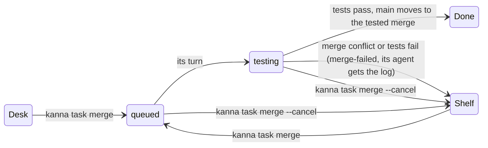
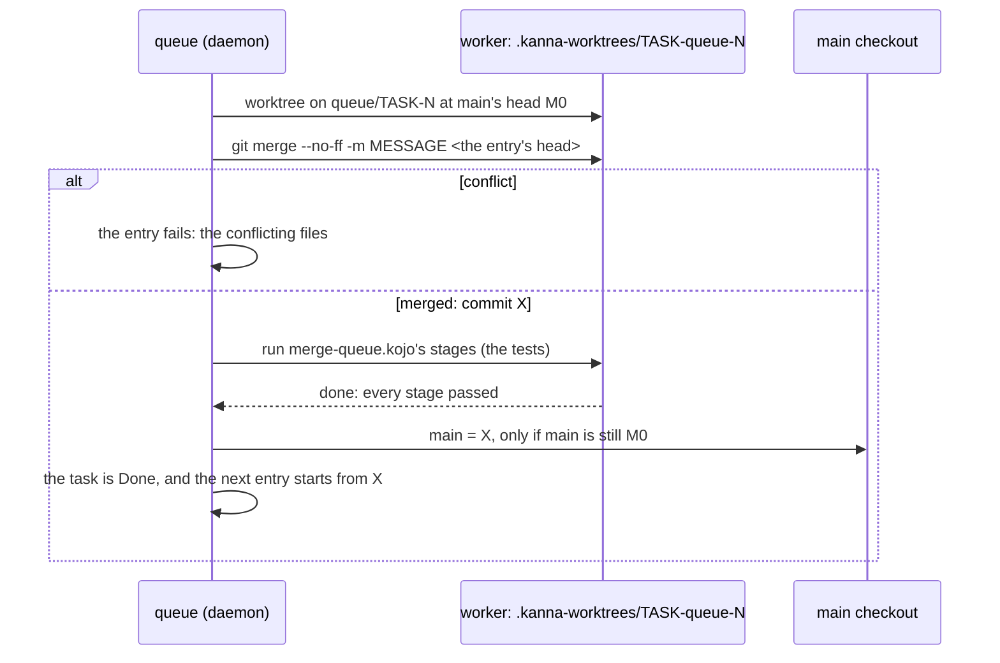

# Merge queue

**Status:** proposed · **Mockup:** [`references/mockups/merge-queue.html`](../../references/mockups/merge-queue.html) (Desk view, `kanna task list`, `kanna task merge`, a failed entry's log; `#light`) · **Builds on:** [software factory §6.1](software-factory.md#61-sequential-runs-as-built) (runs of `run` stages), [Kojo](kojo.md), [tasks](tasks.md), [stacked tasks](stacked-tasks.md), [task events](task-events.md)

When you tell a ready task's agent to merge, it runs `kanna task merge`. The task leaves the Desk for its repo's **merge queue** and its agent quits; you don't wait. The queue lands one entry at a time: it merges the branch onto main as main is now, runs the repo's tests on that merge, and moves main to it only if they pass. The next entry is merged on top of that. If an entry fails, the task goes back to the Shelf and its agent gets the log.


## Contents

1. [Why](#1-why)
2. [Merging a task](#2-merging-a-task)
3. [An entry's run](#3-an-entrys-run)
4. [Failure](#4-failure)
5. [Seeing the queue](#5-seeing-the-queue)
6. [How it's built](#6-how-its-built)
7. [CLI and settings](#7-cli-and-settings)
8. [Tests](#8-tests)
9. [Rejected](#9-rejected)

## 1. Why

Before the queue, "merge" meant the task's agent merged main into its branch, rebuilt, reran its tests, then merged into main, all while you waited. A task marked ready at 10:34 was merged at 13:32, after main had moved six times, and the merge took 2m20s of rebuilding and testing. The queue tests each change once, at the point where it lands. That cost grows linearly with merges.

- **Ready tasks aren't re-tested in the background each time main moves.** A task already hears when main moves into a conflict with it ([`main-conflicts`](task-events.md)). Its tests run once, in the queue.
- **You start the merge, and only tested code lands.** Main fast-forwards to the exact commit the tests passed on. This is why the queue isn't the rejected "`merge main` stage gated by an `ask`" ([software factory §8](software-factory.md#8-rejected)): that stage would land a run's branch that you never had in your worktree.

## 2. Merging a task



`kanna task merge [TASK] [-m MESSAGE]` runs from the task's terminal (it means that task) or names a task, for example when the planner runs it on your word. Each of these refuses, and says why:

| Refused when | Says |
|---|---|
| its branch conflicts with main now (`git merge-tree`, as [stacked tasks](stacked-tasks.md#ready) checks it) | the files, and to merge main, fix them, rerun the tests and merge again |
| it `merges after` a task whose work isn't in main yet | which task, and that the task hears when it lands ([`base-merged`](task-events.md)) |
| its worktree has uncommitted changes to tracked files | the files: they wouldn't land |
| the repo has no tests for the queue: no `merge.test` and no `.kanna/pipelines/merge-queue.kojo` | how to set one |
| it's in the queue already, hasn't started, or has no commits that aren't in main | which |


When the merge is accepted:

- **The entry records the branch's head now.** That commit is what lands, even if the branch moves later. A task in the queue has no agent to move it.
- **The task leaves the Desk or the Shelf.** Its agent quits as at Done (`Tasks::end_agent`: brought to rest, then `/exit`; its session is kept), its tabs close, and its place on the Desk frees up. Its worktree, branch and workspace stay: the queue's worker terminal lives in that workspace ([6](#6-how-its-built)).
- **The task isn't Done yet.** Done (teardown, then removing the worktree and branch once they're merged) runs when the entry lands. Until then the task can come back to the Shelf.
- **The merge commit's message** is `-m MESSAGE`, else `Merge branch 'BRANCH': NAME`. The `kanna-tasks` skill tells the agent to pass a one-line summary of the work, as merges on main read today.
- **Any number of a repo's tasks can be in its queue.** They don't count against `shelf.runners` or the Desk's three places.

## 3. An entry's run



- **Serial, per repo:** one entry runs at a time, oldest first. When an entry's turn starts, its branch is merged on a queue branch (`queue/TASK-N`, made at main's head in the worker), never into main itself. Main moves only at landing, by fast-forwarding to that tested merge. Since the entry before it either landed or left main alone, every entry is tested on top of everything that landed before it.
- **The merge is the daemon's, not a stage's.** A run's branch starts from the task's head ([software factory §6.1](software-factory.md#61-sequential-runs-as-built)); a queue run's branch starts from the merge commit X. The pipeline only tests, so no `merge-queue.kojo` can land a commit other than the one it tested, and Kojo's rule that there's no `merge main` stage still holds ([Kojo §2](kojo.md#2-stages)).
- **The pipeline** is the repo's `.kanna/pipelines/merge-queue.kojo` if it has one. Otherwise it's Kanna's own: one `run` stage that runs `merge.test`:

```
test = run <merge.test>
test -> done
```

- **A repo's own pipeline** may have any stages runs can do (today, `run` and agent stages with their loops), for example a check, a build, then e2e, or a fix stage that commits to the merge branch before the tests run again. What lands is the run's branch at `done`, and it lands only if it's a descendant of X.
- **Landing:** at `done` the queue moves main from M0 to the run's head. In the main checkout, if main is checked out there, that's `git merge --ff-only`; if not, it's `git update-ref refs/heads/main NEW M0`. Either way, main only moves if it's still at M0.
- **Main moved under the run** (you merged by hand, or pulled): the fast-forward is refused. The entry runs again from the new main, up to 3 times. After that it fails with `main kept moving`.
- **The main checkout's local changes stop the fast-forward** when they touch files the merge changes. The entry then waits as `landing`, naming the files, and tries again every 30s and whenever the repo's refs or index change. The queue behind it waits too, since the next entry has to be tested on top of this one.
- **After landing:** the worker's worktree and `queue/TASK-N` are removed, the task is Done (its teardown; its worktree and branch are removed now that they're in main), and the entry leaves the queue. The planner hears it as Desk news (`task-4f1d "Code find …" merged into main (5d02c1e) and left the merge queue`). Tasks stacked on it hear `base-merged` as before.

## 4. Failure

Any end other than `done` fails the entry: a merge conflict, a stage's fail with no arrow left, a stopped run, `within` passing, or main moving 3 times. Then:

- **Main doesn't move.** The worker's worktree is removed, and `queue/TASK-N` is kept for you to look at.
- **The next entry starts,** on main as it was.
- **The task goes back to the Shelf, stopped,** with the state `merge-failed` and why (`test failed: 2 of 1 214 · cargo test -p kanna-daemon`), until it's merged again or Done.
- **Its agent gets the log** as a message from the queue (`[message from queue-7f3a]`): what failed, on which merge, the failure lines first ([Kojo §5](kojo.md#5-inputs-and-outputs): the command's tail, failure lines first), the full log's path, and what to do (merge main, fix, `kanna task merge` again). A stopped Shelf task runs for a message, so a [Shelf runner](shelf-runners.md) resumes its conversation and it starts on the fix.


## 5. Seeing the queue

- **Desk view:** a **Merging** group between the Desk and the Shelf (picture at the top). Rows are in queue order, numbered. The running entry shows its stage, the merge it's testing, its time against the last landed entry's, and a bar. Waiting entries say what they'll be tested on top of. **Take out** is `kanna task merge --cancel`. **Show** brings the running stage's terminal into a tab of the Desk view's planner window (`kanna move TERMINAL --tab`). A task whose merge failed is on the Shelf, red, with **Log**.
- **`kanna task list`:** a `Merging` heading between `Desk` and `Shelf`. The states are `testing` (with the stage, if it isn't `test`), `landing` and `queued` (with its place and what it follows). A failed task is on the Shelf as `merge-failed`. `--json` adds `"queue": {"position", "state", "stage", "run", "head", "since"}`, or `"mergeFailed": {"why", "run", "log", "at"}`.


- **The phone's Shelf** shows the same group, read-only.
- **`kanna run list`** lists queue runs with the rest, with `queue` in place of a task's run number.

## 6. How it's built

- **`queue.rs` in the daemon** owns each repo's queue, in the same way `runs.rs` owns runs. It keeps the entries, starts the head entry's run, lands it or fails it, and tells the task. It steps on the same events as runs, plus ref changes in the repo and a 30s retry while an entry is `landing`.
- **Table `merge_queue`** in `kanna.db` ([database](database.md)): `id` (`queue-7f3a1c2e`), `repo`, `task`, `head` (the commit that lands), `message`, `by`, `queued_at`, `state` (`queued`, `testing`, `landing`, `landed`, `failed`, `cancelled`), `run`, `attempt`, `base` (M0), `merge` (X), `ended_at`, and `doc` (why, the log's path, the failure lines). The order is `queued_at`. A daemon restart reloads the live entries. A `testing` entry's run carries on as any run does: its `run` stage's exit file and log are on disk ([software factory §6.1](software-factory.md#61-sequential-runs-as-built)). If the daemon stopped between `done` and the fast-forward, the landing runs again, and it's safe to repeat: it moves main only from M0, and it's done once main contains X.
- **Runs gain an owner.** `runs.owner` is `task` (as today) or `queue`. `Runs::task_closed` stops only `task` runs: a queue run outlives the task's agent and the task's Done, and it's stopped only by `--cancel` or its own end. A queue run's messages (`tell`) go to the queue, not to a task's agent. The queue turns them into the task's message at the end. It's built through `Runs::start_owned(repo, task, worker, branch, pipeline)`: the queue makes the worktree and the merge, and the run takes it from there. At hand-back, a queue run calls back into the queue instead of messaging an agent.
- **The worker terminal** is a background terminal of the task's workspace, as for any run. That's why the workspace stays until the entry lands or fails.
- **Task state:** `Entry.queued` (`Some(queue id)`), which keeps the task off the Desk and the Shelf. `Entry.merge_failed` holds the failure until the next `kanna task merge` or Done. The app draws the Merging group from these through the task list it already gets. `tell_planner` adds `merged` and `merge_failed` Desk news.
- **Skills:** `kanna-tasks` says that merge means `kanna task merge` with `-m`, never merging by hand. It covers merging main first only for `conflicts`, and what to do on a queue message. `kanna-planning` says that "merge X" means `kanna task merge X`, and that queued tasks are under Merging, not finished.

## 7. CLI and settings

| Command | Does |
|---|---|
| `kanna task merge [TASK] [-m MESSAGE]` | Puts the task in its repo's merge queue: refusals in [2](#2-merging-a-task); prints its place and what it follows |
| `kanna task merge --cancel [TASK]` | Takes it out of the queue and back to the Shelf, stopped; a running entry's run is stopped and main isn't touched |
| `kanna task list` | Adds the `Merging` section and the `merge-failed` state |
| `kanna task done TASK` on a queued task | Takes it out of the queue as `--cancel` does, then Done (its unmerged worktree is kept) |

| Setting | Where | Is |
|---|---|---|
| `merge.test` | the repo's `.kanna/config.json` | the command Kanna's own `merge-queue.kojo` runs in the merge's worker, as a [task script](task-scripts.md) runs, under `tasks.timeout` unless `merge.within` is set |
| `merge.within` | the repo's `.kanna/config.json` | the test stage's `within` (default: `tasks.timeout`) |

## 8. Tests

- **`queue.rs` unit tests:** order, refusals (conflict, `merges after`, uncommitted, no tests, already queued), landing only from M0, a repeated landing, main moving and the attempt count, cancel at each state.
- **e2e `merge_queue`** on a private instance with a mock repo whose `merge.test` is a script that fails when a marker file is present:
  1. two merges land in order, and the second is tested on top of the first (its test checks that the first's file is in its worktree);
  2. a failing test returns the task to the Shelf as `merge-failed`, main is unchanged, and its agent (the mock agent) gets the queue's message with the log;
  3. a conflicting branch is refused, naming the file;
  4. the task's agent quits and its tabs close at `kanna task merge`, and its entry still lands, with the task Done after;
  5. the daemon restarts while the test stage runs (a `sleep`), and the entry carries on and lands.

## 9. Rejected

- **The agent merging main, rebuilding and testing while you wait** (before the queue): it took minutes of your time per merge and repeated work main had already moved past.
- **Re-testing ready tasks in the background whenever main moves:** this costs tests for every ready task on every move of main, while the queue costs one run per merge. Conflicts are covered by `main-conflicts`.
- **Done at `kanna task merge`:** a failure would then have to bring a Done task back. Its workspace, which holds the worker's terminal, would be gone, and so would its place among the Shelf's tasks. Done runs when the entry lands.
- **The merge as a `merge-queue.kojo` stage:** a repo's pipeline could then land something other than the merge it tested, or nothing at all.
- **Landing with `git push`-style ref updates only:** the main checkout's files would no longer match main. The fast-forward goes through the checkout whenever main is checked out there.
- **Queueing a stacked task behind its base:** for now, `merges after` is refused, as decided. A later change could accept it when every base is ahead of it in the queue, and fail it when its base fails.
