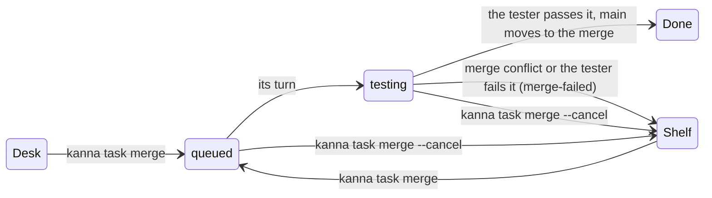
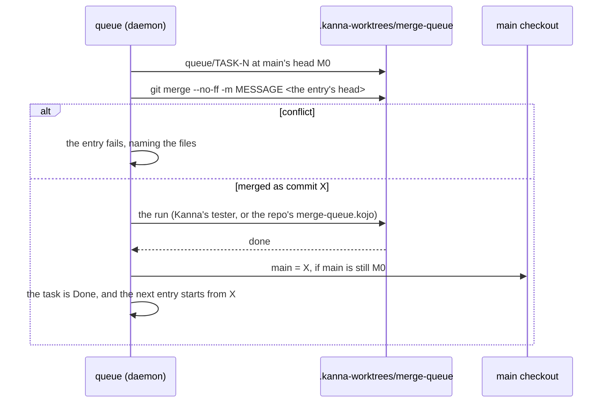
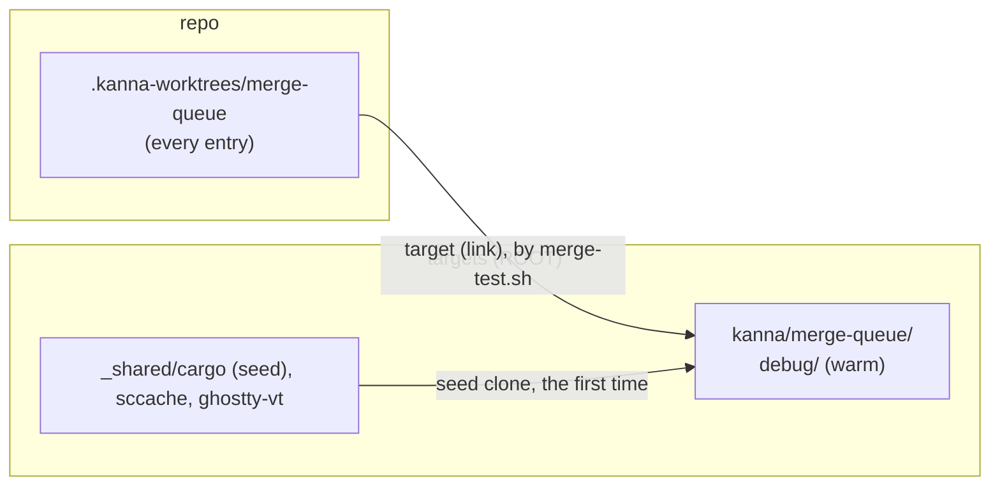
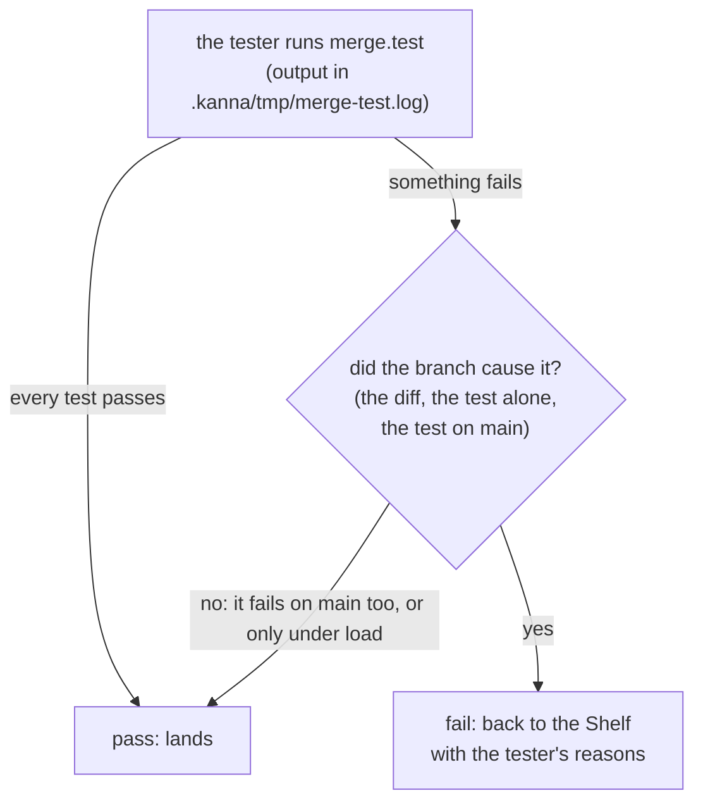
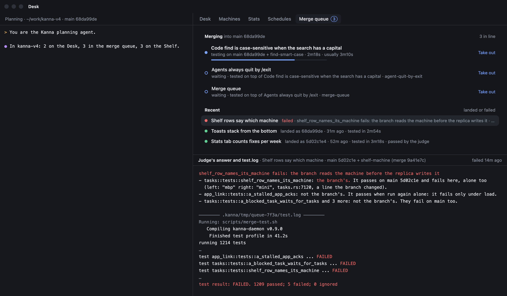
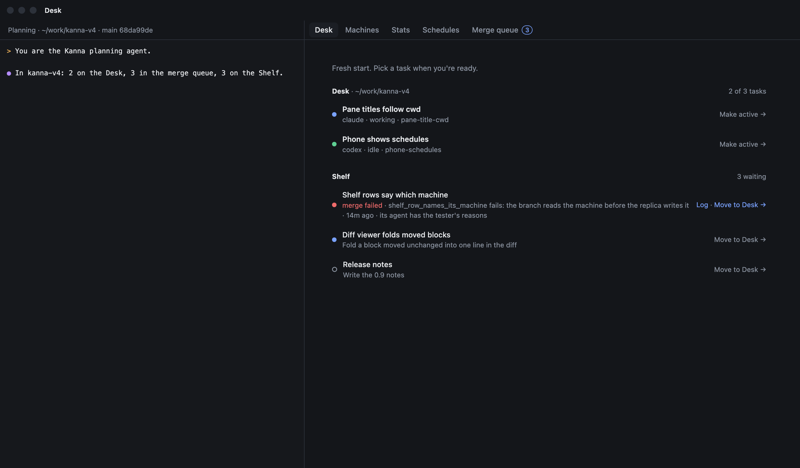
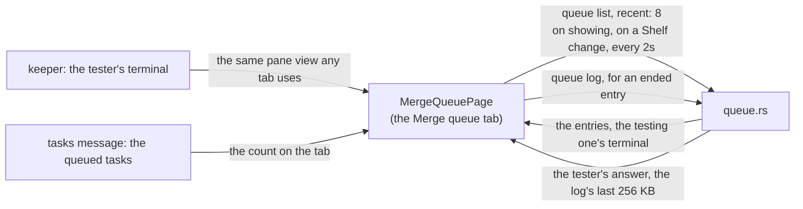

# Merge queue

Status: built in the daemon, the CLI and the window's Merge queue tab; the phone doesn't show the queue yet. Tested by `cargo test -p kanna-daemon queue::` and e2e `merge_queue`. Mockup: [`references/mockups/merge-queue.html`](../../references/mockups/merge-queue.html). Builds on the [build store](build-store.md), [runs](software-factory.md#61-sequential-runs-as-built), [Kojo](kojo.md), [tasks](tasks.md), [stacked tasks](stacked-tasks.md) and [task events](task-events.md).

When you tell a ready task's agent to merge, it runs `kanna task merge`. The task leaves the Desk for its repo's merge queue, shown on the window's Merge queue tab, and its agent quits, so you don't wait. The queue lands one entry at a time. It merges the branch onto main as main is now, has an agent run the repo's tests on that merge, and moves main to the merge unless the agent finds a failure the branch caused. The next entry is merged on top of that. If an entry fails, the task goes back to the Shelf and its agent gets the reasons and the log.


## Contents

1. [Why](#1-why)
2. [Merging a task](#2-merging-a-task)
3. [An entry's run](#3-an-entrys-run), with [the queue's worktree](#31-the-queues-worktree) and [the tester](#32-the-tester)
4. [Failure](#4-failure)
5. [Seeing the queue](#5-seeing-the-queue)
6. [How it's built](#6-how-its-built)
7. [CLI and settings](#7-cli-and-settings)
8. [Tests](#8-tests)
9. [Rejected](#9-rejected)

## 1. Why

Merging shouldn't take your time, and what lands on main should be what was tested. The queue tests each change once, where it lands, on top of everything that landed before it, while you work on something else.

Ready tasks aren't tested again each time main moves. A task hears when main moves into a conflict with it ([`main-conflicts`](task-events.md)), and its tests run once, in the queue.

Main fast-forwards to the exact commit that was tested. That's why the queue isn't a `merge main` stage gated by an `ask` ([software factory §8](software-factory.md#8-rejected)), which would land a run's branch you never had in your worktree.

## 2. Merging a task



`kanna task merge [TASK] [-m MESSAGE]` runs from the task's terminal, where it means that task, or names a task, as the planner does when you tell it to merge one. It's refused in these cases, and says why:

| Refused when | It says |
|---|---|
| the branch conflicts with main now (`git merge-tree`, as [stacked tasks](stacked-tasks.md#ready) checks it) | the files, and to merge main, fix them, rerun the tests and merge again |
| it `merges after` a task whose work isn't in main yet | which task, and that the task hears when it lands ([`base-merged`](task-events.md)) |
| its worktree has uncommitted changes to tracked files | the files, since they wouldn't land |
| the repo has no `merge.test` and no `.kanna/pipelines/merge-queue.kojo` | how to set one |
| it's in the queue already, hasn't started, or has nothing that isn't in main | which |


When the merge is accepted, the entry records the branch's head, and that commit is what lands. The task leaves the Desk or the Shelf. Its agent quits as it does at Done (its session is kept), its tabs close, and its place on the Desk frees up. Its worktree, branch and workspace stay, because the queue's terminal lives in that workspace. The task isn't Done until the entry lands, so it can still come back to the Shelf.

The merge commit's message is `-m MESSAGE`, or `Merge branch 'BRANCH': NAME` without one. The `kanna-tasks` skill tells the agent to pass a one-line summary of the work. Any number of a repo's tasks can be in its queue; they don't count against `shelf.runners` or the Desk's three places.

## 3. An entry's run



The queue runs one entry at a time per repo, oldest first. When an entry's turn comes, the daemon checks out a queue branch, `queue/TASK-N`, at main's head M0 in the queue's worktree, and merges the entry's head into it as commit X. Main itself moves only when the entry lands. Since the entry before either landed or left main alone, every entry is tested on top of everything that landed before it.

The daemon makes the merge, not a stage, so a pipeline can only test it and can't land anything else. Kojo still has no `merge main` stage ([Kojo §2](kojo.md#2-stages)).

The run is the repo's `.kanna/pipelines/merge-queue.kojo` if it has one. Otherwise it's Kanna's own pipeline, one agent stage, the tester ([3.2](#32-the-tester)):

```
test = <tasks.agent> prompt merge-test verdict [within <merge.within>s]
test -[pass]-> done
```

A repo's own pipeline can have any stages runs support, such as a check, a build and e2e, or a fix stage that commits to the queue branch. It lands the run's branch at `done`, and only if that branch descends from X and the last stage didn't fail.

To land, the queue checks that main is still M0 and runs `git merge --ff-only` in the main checkout, so main and the checkout's files move together. If main moved under the run, because you merged by hand or pulled, the entry runs again from the new main, up to 3 times, and then fails with `main kept moving`. If the main checkout has local changes to files the merge changes, the entry waits as `landing`, names the files, and tries again every 30 seconds and whenever the repo's refs change. The entries behind it wait too.

After landing, the queue deletes `queue/TASK-N` and detaches its worktree. The task is Done, which removes its worktree and branch now that they're in main. The planner hears it as Desk news, and tasks stacked on it hear `base-merged`.

### 3.1 The queue's worktree



Each repo has one worktree for its queue, `.kanna-worktrees/merge-queue`. The daemon makes it the first time the queue runs and uses it for every entry after that. It starts each entry with `git checkout -f -B queue/TASK-N M0` and `git clean -fd`, which keeps ignored files such as the build folder and `.kanna/tmp`. Because the worktree's path never changes, cargo's fingerprints stay valid, and a run rebuilds only the crates the merge changed.

The queue doesn't test in the task's own worktree, because that build is warm for the task's branch, which may be well behind main, and a merge checked out there would move the task's work. It doesn't use the main checkout either, because that build is yours and may be busy. The queue's build is warm for main as it last landed, which is the closest starting point for the next merge.

One build folder is safe here, though a `CARGO_TARGET_DIR` shared by task worktrees isn't ([build store §7](build-store.md#7-rejected)), because the queue runs one entry at a time and nothing else builds in its worktree.

This repo's `merge.test` is `scripts/merge-test.sh`. It sets up the build the way `build.sh` does: it links `target/` to `ROOT/kanna/merge-queue` on the build volume, links libghostty-vt from the store, starts from main's dependency seed the first time, and uses the compile cache ([build store](build-store.md)). Then it runs `cargo test --workspace --no-fail-fast`. The daemon knows nothing of this; it only keeps the worktree's path the same. The build folder can be [evicted](build-store.md#5-eviction) like any other when the volume runs low, except while a run is using it, and the next run starts it from the seed again.

On this repo, the queue's first build from the seed took 6m08s for 28 crates, and a build after a change to `kanna-daemon` took 12s for one crate.

### 3.2 The tester

Main can have failing tests, both known failures and tests that fail only under load. So an entry is judged on what it breaks, not on whether every test passes.



The tester is a new session of `tasks.agent` in the queue's worktree, with the merge checked out. If `tasks.agent` is a command rather than an agent's name, the tester is `claude`. Its prompt is Kanna's `merge-test` prompt, filled in with `merge.test`, main and M0, the branch, the merge X and the queue branch. A repo can replace it with its own `.kanna/prompts/merge-test.md`.

The prompt asks the tester to do the following:

1. Run `merge.test` with all its output in `.kanna/tmp/merge-test.log`, allowing for it to take many minutes, and change nothing in the worktree.
2. If anything fails, decide for each failure whether the branch caused it. It can read the branch's diff against M0, run the test again on its own, or check out M0 and run it there. A failure that also happens on main, or that passes when run alone, isn't the branch's. A build the branch breaks is.
3. Report `pass` if no failure is the branch's, and `fail` if any is.
4. Write an answer whose first line sums up the outcome, such as `broken_thing fails: the branch removed its fixture`, followed by each failure, whether it's the branch's, and how it knows.

A pass lands the entry, and the queue keeps the tester's answer as the entry's note (`doc.result`, `{"verdict": "pass", "note"}`). A fail ends the entry, with the answer's first line as the reason ([4](#4-failure)).

The tester has no time limit unless the repo sets `merge.within`; `tasks.timeout` doesn't apply to the queue. If it runs out of time, the entry fails with `the tests timed out`.

A repo's own `merge-queue.kojo` is judged by its arrows instead, and has no tester unless it adds one.

## 4. Failure

An entry fails when its branch doesn't merge, when a stage fails with no arrow left (for Kanna's pipeline, when the tester reports `fail`), when its run is stopped or runs out of time, or when main moves under it 3 times.

The run then ends with the outcome `failed`, not `stuck`, and the queue takes over. A task's own runs still stop as `stuck` when no arrow leaves a stage. Main doesn't move. The queue keeps `queue/TASK-N` for you to look at, detaches its worktree, and starts the next entry, so a failing entry never holds up the queue.

The task goes back to the Shelf, stopped, as `merge-failed`, with the reason, until it's merged again or Done. Its agent gets a message from the queue (`[message from queue-7f3a]`). The message says why the entry failed and on which merge, gives the path of the tests' log, copied to the task's worktree as `.kanna/tmp/QUEUE/test.log`, includes the tester's whole answer, and says what to do next: merge main, fix it, and run `kanna task merge` again. For a repo's own pipeline, the message has the failed stage's output tail instead of the tester's answer ([Kojo §5](kojo.md#5-inputs-and-outputs)). A stopped Shelf task runs for a message, so a [Shelf runner](shelf-runners.md) resumes the agent and it starts on the fix.


## 5. Seeing the queue

The queue has its own fixed tab in the window, Merge queue, after Desk, Machines, Stats and [Schedules](schedules-tab.md) (the picture at the top). The tab's title counts the entries in line. The Desk tab shows no queued task: one shows only on the Merge queue tab, even while its agent is still ending its turn. The queue is the repo's, the one the window's Desk is on.

The tab lists the entries in queue order under Merging. The running one says `testing`, the merge it's testing and how long it has run. Waiting entries say which entry they'll be tested on top of, and a `landing` entry that's waiting says why. Take out runs `kanna task merge --cancel`. Under Recent are the last 8 entries that landed or failed, newest first.

Clicking an entry picks it, and the lower part of the tab shows it. The first entry is picked until you click another.

| The picked entry is | The tab shows |
|---|---|
| testing | its tester's terminal, live: the tester running `merge.test`. You can type in it, as in any terminal |
| waiting | which entry it waits for |
| landing | that its tests are done, and what it waits for |
| failed or landed | the tester's answer, then the tests' log |

| A failed entry, picked | The Desk tab |
|---|---|
|  |  |

A task whose merge failed is on the Shelf with a red dot and the reason. Its row has Log, which opens the Merge queue tab with that entry picked. The mockup also has a progress bar and the usual time, which aren't built yet.

`kanna task list` has a `Merging` section between `Desk` and `Shelf`, with the states `testing`, `landing` and `queued`, and a failed task on the Shelf as `merge-failed`. With `--json`, a queued task has `"queue": {"position", "state", "stage", "run", "head", "since"}` and a failed one has `"mergeFailed": {"why", "run", "log", "at", "verdict", "note"}`, where `verdict` and `note` are the tester's. `kanna run list` lists queue runs with the rest.


## 6. How it's built

`queue.rs` in the daemon owns each repo's queue, as `runs.rs` owns runs. It keeps the entries, starts the first entry's run, lands it or fails it, and tells the task. It steps on the same events as runs, on ref changes in the repo, and every 30 seconds while an entry is `landing`.

The entries are in the `merge_queue` table in `kanna.db` ([database](database.md)), ordered by `queued_at`, with the repo, task, head, state, run, attempt, M0, X and a doc for the reason, the log's path and the tester's note. A daemon restart reloads the live entries, and a `testing` entry's run carries on as any run does. A landing interrupted by a restart runs again safely, since it moves main only from M0.

The tester's run is an owned run of Kanna's one-stage pipeline in the queue's worktree, with its prompt passed in the run's prompts (`Started.prompts`). Its session's terminal belongs to the keeper, so a daemon restart doesn't stop it. When it ends, the queue reads the stage's verdict and answer from `run_stages` and copies `.kanna/tmp/merge-test.log` to the task's worktree.

A run's doc has an `owner`, which is empty for a task's run and `queue` for the queue's. `Runs::task_closed` stops only a task's runs, so a queue run outlives the task's agent and is stopped only by `--cancel` or its own end. A queue run's messages go to the queue rather than to an agent. The queue starts it with `Runs::start_owned`, and when it ends the run calls `Runs::on_end` with the branch's head or the reason. A queue run leaves its worktree in place, since the worktree belongs to the queue. Its terminal is a background terminal in the task's workspace, which is why the workspace stays until the entry lands or fails.

A queued task has `Entry.queued` set to the queue's id. It's held on the Shelf in the database, stopped, and listed under Merging, and runners, `start` and `pick` skip it. `Entry.merge_failed` holds a failure until the next `kanna task merge` or Done. The planner gets `merged` and `merge_failed` Desk news.



The app's Merge queue tab (`MergeQueuePage.swift`) asks the daemon for the repo's queue with the `queue` command's `list` action and `recent: 8`: the live entries in order, then the last 8 that landed or failed, each with its doc, and the testing one with its run's terminal. It asks when the tab is shown, when the Shelf changes, and every 2 seconds while the tab shows. The count on the tab comes from the task list, so it's right while another tab shows.

The tester's terminal is a background terminal of the task's workspace, which no window shows. The tab hosts that pane's view itself, the view a tab would use, so the terminal is live and takes typing. When the entry ends, the terminal closes and the tab shows the log instead.

So the log outlasts the task's worktree, which Done removes, the queue also copies it to `kanna/merge-queue/QUEUE.log` in the repo's git folder when the run ends, and keeps the newest 30. The `queue` command's `log` action returns an entry's tester's answer and the last 256 KB of that copy.

The `kanna-tasks` skill tells agents that merging means `kanna task merge` with `-m`, never a merge by hand, and what to do when the queue's message comes. The `kanna-planning` skill says that "merge X" means `kanna task merge X` and that queued tasks aren't finished.

## 7. CLI and settings

| Command | Does |
|---|---|
| `kanna task merge [TASK] [-m MESSAGE]` | puts the task in its repo's merge queue ([2](#2-merging-a-task)) and prints its place |
| `kanna task merge --cancel [TASK]` | takes it out of the queue and back to the Shelf, stopped; a running entry's run is stopped and main isn't touched |
| `kanna task list` | has the `Merging` section and the `merge-failed` state |
| `kanna task done TASK` on a queued task | takes it out of the queue, then Done, keeping its unmerged worktree |

| Setting | Where | Is |
|---|---|---|
| `tasks.agent` | either `config.json` | the tester's agent |
| `merge.test` | the repo's `.kanna/config.json` | the command the tester runs; this repo's is `scripts/merge-test.sh` |
| `merge.within` | the repo's `.kanna/config.json` | the tester's time limit, none by default |

## 8. Tests

The e2e scenario `merge_queue` runs a private instance with a mock agent (`tools/mock-agent`) and a mock repo. The repo's `merge.test` is `sh test.sh`, which runs a mock test binary, `bin/unit`. Its test `known_broken` always fails, `broken_thing` fails when the merge has a `broken` file, and `flaky_thing` fails in the full run and passes alone when the merge has a `flaky` file. The script also fails without naming a test when `needs-a.txt` is there without `a.txt`, sleeps 8 seconds once when `slow` is there, and records in `target/builds` whether it found `target/` warm. The repo's `.kanna/prompts/merge-test.md` has the mock agent run `judge.sh`, a tester written in shell that runs the tests, runs each failing test alone and on main, and reports as Kanna's prompt asks.

The scenario checks these things:

1. A branch that conflicts with main, and one with uncommitted changes, are refused, naming the file.
2. A (`slow`) and then B (`needs-a.txt`) land in order, B tested on top of A, and main's history reads B's merge, A's merge with its `-m` message, then main as it was.
3. A's agent quits when A is merged, and A still lands and is Done, with its queue branch deleted.
4. The daemon restarts while A's tester is running its tests, and A and B both land afterwards.
5. A and B land even though `known_broken` fails on every merge.
6. C (`broken`) fails because the tester blames `broken_thing` on the branch. C isn't in main, `kanna task list` shows it as `merge-failed` with `broken_thing fails: the branch broke it`, `--json` has the verdict and the note, its agent gets the tester's answer and the log's path, the log is in its worktree, and its run's outcome is `failed`.
7. E, queued behind C, lands after C fails.
8. E lands with the note `tests fail, none of them the branch's: known_broken fails on main too, flaky_thing passes alone`.
9. Across every entry, the queue's worktree found `target/` cold only once.
10. In the app, the window's tabs end with Merge queue, counting 2 in line while A tests and B waits. The Desk tab has only the Desk and Shelf groups, and A and B aren't on its Shelf.
11. The Merge queue tab lists A testing, then B waiting, and shows the terminal of A's tester. Clicking B shows that it waits for A, and clicking A shows the terminal again.
12. After C fails, the tab lists it under the entries that ended, the Log on C's Shelf row opens the tab with C picked, and the tab shows the tester's answer and the log with `test broken_thing ... FAILED`.
13. After E lands, the tab lists E, C, B and A, newest first, with no count, and clicking E shows its tester's note and its log, kept after E's worktree is gone.

`cargo test -p kanna-daemon queue::` checks Kanna's pipeline (an agent stage with a verdict, `within` only from `merge.within`, and the repo's own pipeline taking precedence), the tester's prompt, the reuse of the queue's worktree and its build folder, and the outcomes: a pass lands with the note, a fail ends the entry with the answer's first line, a timeout says so, and a repo's own pipeline fails with its failed stage's output.

`cargo test -p kanna-daemon` checks the `merge` settings in the schema against what the daemon reads.

## 9. Rejected

A Merging group in the Desk view, between the Desk and the Shelf, was how the queue first showed. The queue is the repo's machinery, not work waiting for you, and a row there had nowhere to show its terminal.

A general Factory tab listing every run of the repo, with the queue first, would show a task's pipeline runs away from the task. Each task shows its own run in its Run tab ([software factory §4](software-factory.md#4-seeing-and-steering-a-run)).

Opening the tester's terminal as a tab of the task's workspace, as a task's run does for a stage, would show nothing: a queued task is off the Desk, so its workspace is in no window.

A fresh worktree for each entry would make every run a cold build of every crate, which takes longer than the tests.

A green main as the bar, with known failures skipped by hand in `merge.test`, would block every entry but the one that fixes main, and the skip list goes stale.

Judging each test in the daemon would mean reading libtest's output, keeping main's results for each commit, failing an entry on tests that fail on the merge but not on main, and running each new failure again on its own. That's a lot of machinery for a decision an agent makes at once with the log, the diff and a shell, and it would read only libtest's output.

If test results never blocked landing, a branch that breaks the build or a test would land.

Running main's tests in the background whenever main moves needs a terminal outside any task's workspace. The tester runs main's tests itself when a failure calls for it.

Having the task's agent merge main, rebuild and test while you wait costs minutes of your time per merge, repeated each time main moves first.

Testing ready tasks again whenever main moves costs a test run for every ready task on every move of main, where the queue costs one per merge. Conflicts are covered by `main-conflicts`.

Making the task Done at `kanna task merge` would mean bringing a Done task back when its merge fails, after its workspace, which holds the run's terminal, is gone.

Making the merge a stage of `merge-queue.kojo` would let a repo's pipeline land something other than the merge it tested.

Landing by moving the ref alone (`git update-ref`) would leave the main checkout's files out of step with main.

The queue refuses a stacked task (`merges after`) rather than queueing it behind its base. It could instead accept one whose bases are all ahead of it in the queue and fail it when a base fails.
