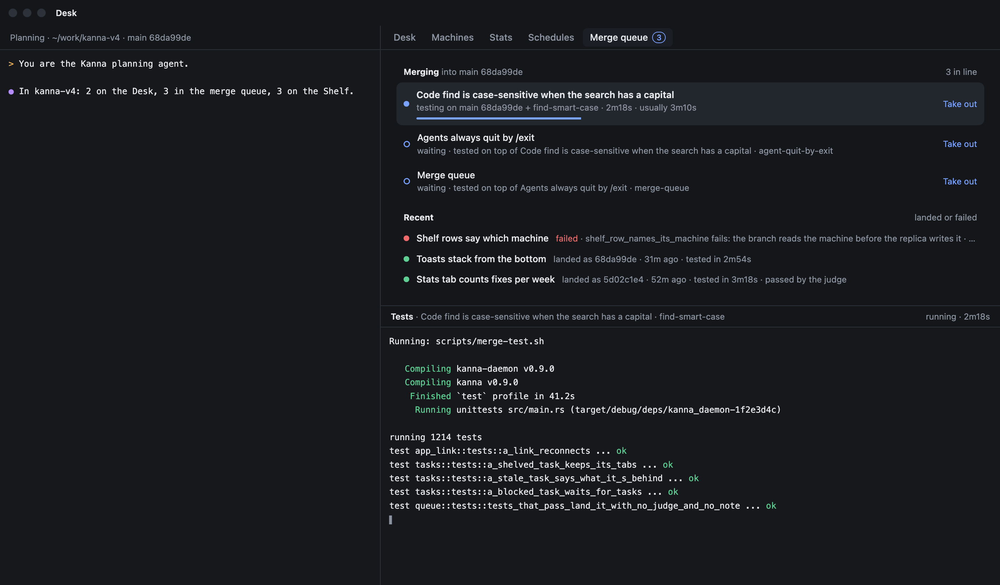
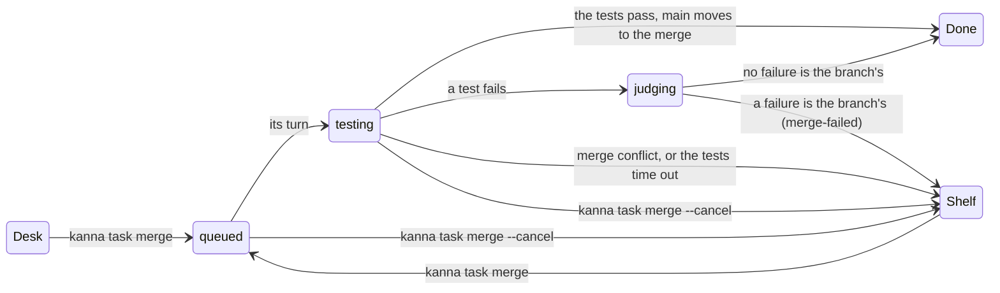
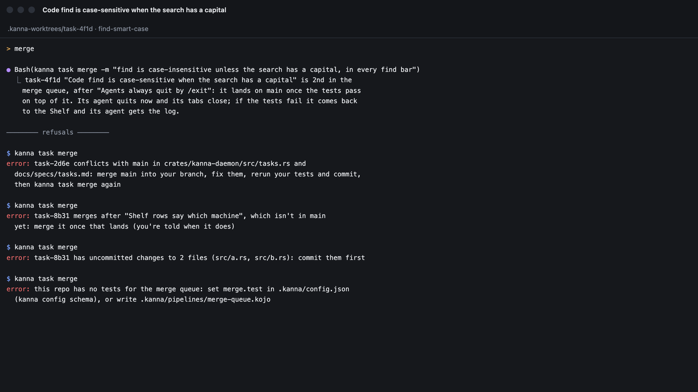
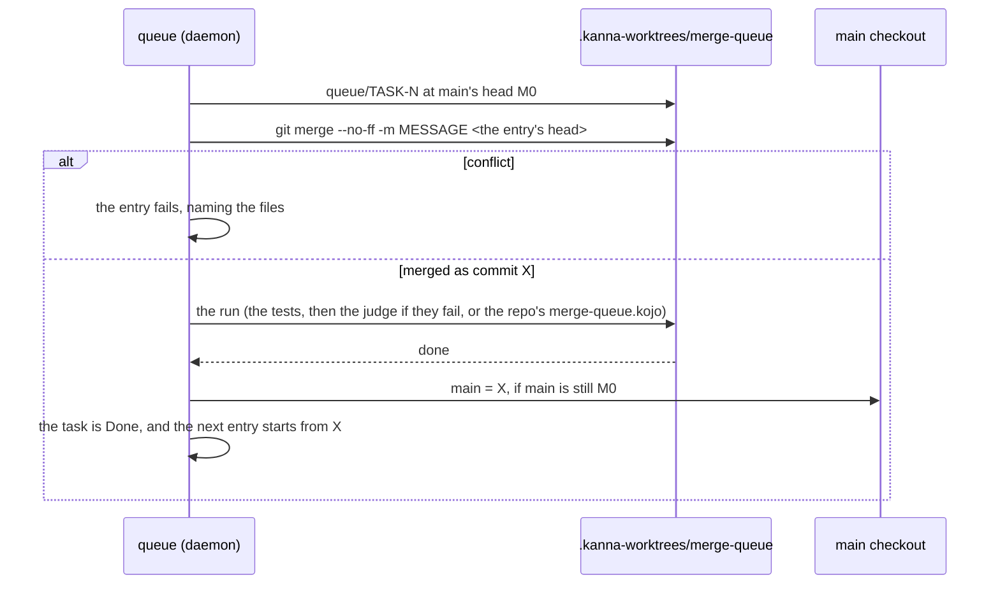
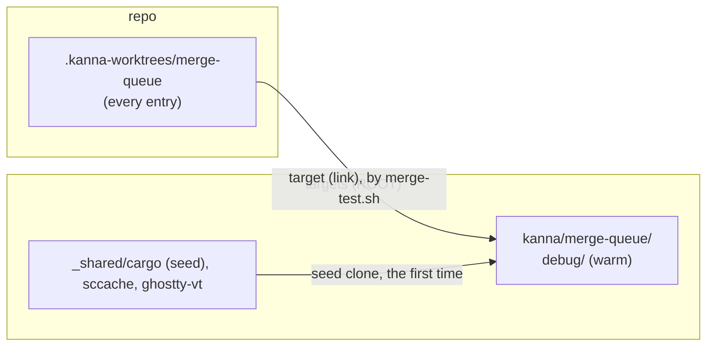
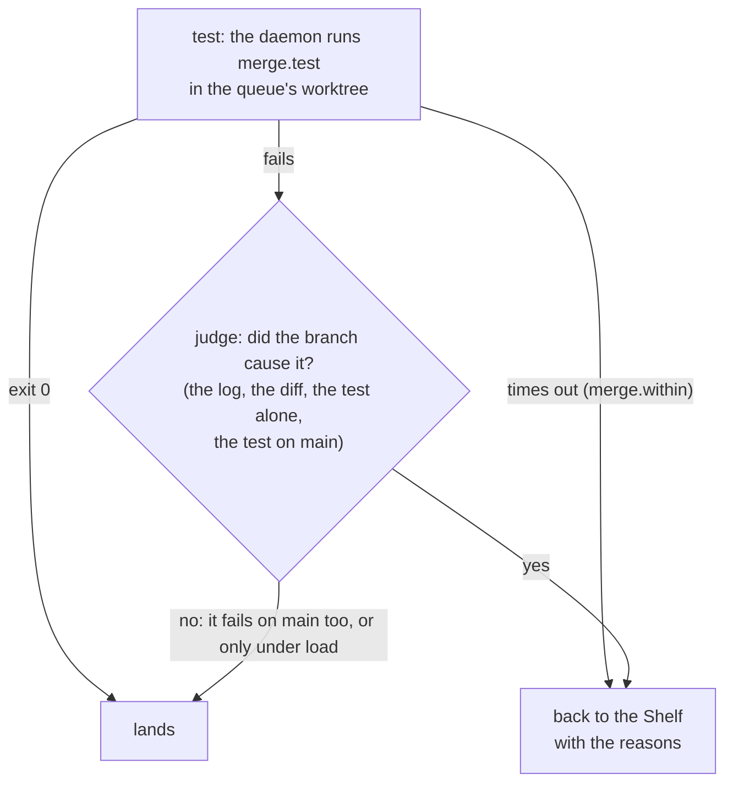
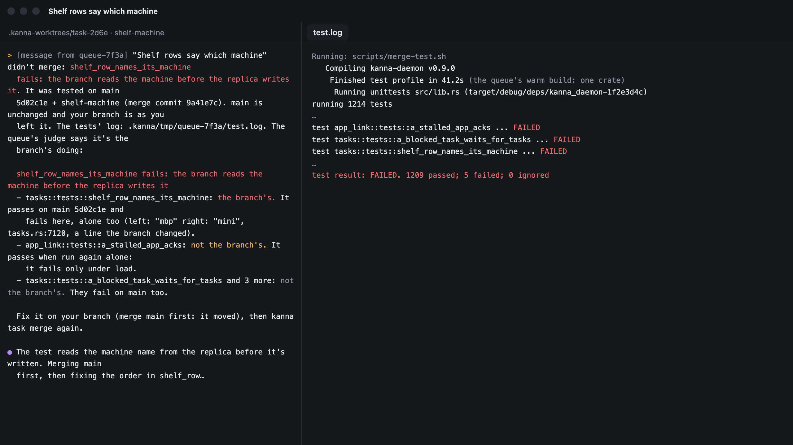
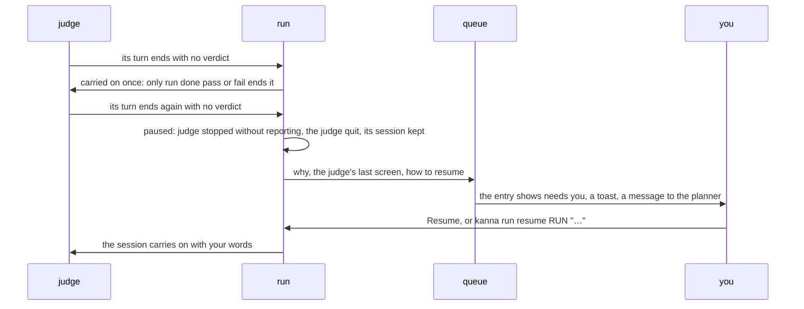
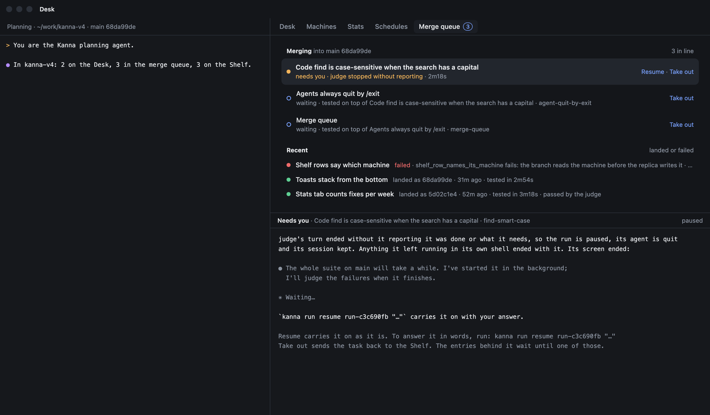
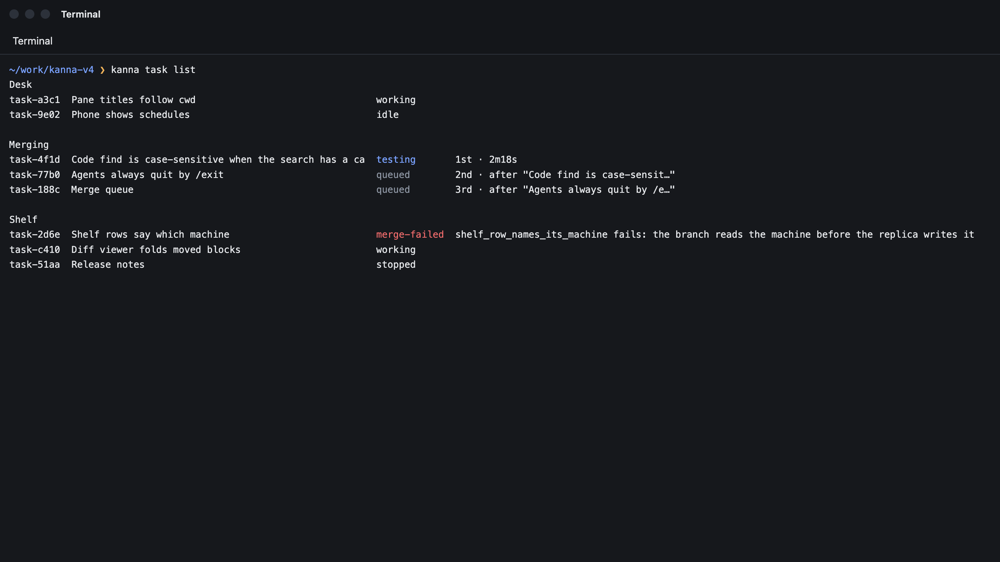

# Merge queue

Status: built in the daemon, the CLI and the window's [Merge queue tab](merge-queue-tab.md); the phone doesn't show the queue yet. Tested by `cargo test -p kanna-daemon queue::` and e2e `merge_queue`. Mockup: [`references/mockups/merge-queue.html`](../../references/mockups/merge-queue.html). Builds on the [build store](build-store.md), [runs](software-factory.md#61-sequential-runs-as-built), [run commands](run-commands.md), [Kojo](kojo.md), [tasks](tasks.md), [stacked tasks](stacked-tasks.md) and [task events](task-events.md).

When you tell a ready task's agent to merge, it runs `kanna task merge`. The task leaves the Desk for its repo's merge queue, shown on the window's [Merge queue tab](merge-queue-tab.md), and its agent quits, so you don't wait. The queue lands one entry at a time. It merges the branch onto main as main is now, and the daemon runs the repo's tests on that merge. If they pass, main moves to the merge, with no agent and no tokens spent. If they fail, an agent, the judge, reads the log and decides whether the branch caused any failure: if none, the merge still lands; if one, the task goes back to the Shelf and its agent gets the judge's reasons and the log. The next entry is merged on top of whatever landed.



## Contents

1. [Why](#1-why)
2. [Merging a task](#2-merging-a-task)
3. [An entry's run](#3-an-entrys-run), with [the queue's worktree](#31-the-queues-worktree) and [the tests and the judge](#32-the-tests-and-the-judge)
4. [Failure](#4-failure), and [an entry that needs you](#41-an-entry-that-needs-you)
5. [Seeing the queue](#5-seeing-the-queue)
6. [How it's built](#6-how-its-built)
7. [CLI and settings](#7-cli-and-settings)
8. [Tests](#8-tests)
9. [Rejected](#9-rejected)

## 1. Why

Merging shouldn't take your time, and what lands on main should be what was tested. The queue tests each change once, where it lands, on top of everything that landed before it, while you work on something else.

Ready tasks aren't tested again each time main moves. A task hears when main moves into a conflict with it ([`main-conflicts`](task-events.md)), and its tests run once, in the queue.

Main fast-forwards to the exact commit that was tested. That's why the queue isn't a `merge main` stage gated by an `ask` ([software factory §8](software-factory.md#8-rejected)), which would land a run's branch you never had in your worktree.

## 2. Merging a task



`kanna task merge [TASK] [-m MESSAGE]` runs from the task's terminal, where it means that task, or names a task, as the planner does when you tell it to merge one. It's refused in these cases, and says why:

| Refused when | It says |
|---|---|
| the branch conflicts with main now (`git merge-tree`, as [stacked tasks](stacked-tasks.md#ready) checks it) | the files, and to merge main, fix them, rerun the tests and merge again |
| it `merges after` a task whose work isn't in main yet | which task, and that the task hears when it lands ([`base-merged`](task-events.md)) |
| its worktree has uncommitted changes to tracked files | the files, since they wouldn't land |
| the repo has no `merge.test` and no `.kanna/pipelines/merge-queue.kojo` | how to set one |
| `merge.test` can't be a pipeline's command: it has a `#` or a line break, or ends in `within N` or `on NAME` | to put it in a script |
| it's in the queue already, hasn't started, or has nothing that isn't in main | which |



When the merge is accepted, the entry records the branch's head, and that commit is what lands. The task leaves the Desk or the Shelf. Its agent quits as it does at Done (its session is kept), its tabs close, and its place on the Desk frees up. Its worktree, branch and workspace stay, because the queue's terminal lives in that workspace. The task isn't Done until the entry lands, so it can still come back to the Shelf.

The merge commit's message is `-m MESSAGE`, or `Merge branch 'BRANCH': NAME` without one. The `kanna-tasks` skill tells the agent to pass a one-line summary of the work. Any number of a repo's tasks can be in its queue; they don't count against `shelf.runners` or the Desk's three places.

## 3. An entry's run



The queue runs one entry at a time per repo, oldest first. When an entry's turn comes, the daemon checks out a queue branch, `queue/TASK-N`, at main's head M0 in the queue's worktree, and merges the entry's head into it as commit X. Main itself moves only when the entry lands. Since the entry before either landed or left main alone, every entry is tested on top of everything that landed before it.

The daemon makes the merge, not a stage, so a pipeline can only test it and can't land anything else. Kojo still has no `merge main` stage ([Kojo §2](kojo.md#2-stages)).

The run is the repo's `.kanna/pipelines/merge-queue.kojo` if it has one. Otherwise it's Kanna's own pipeline, a command stage and an agent stage ([3.2](#32-the-tests-and-the-judge)):

```
test  = run <merge.test> [within <merge.within>s]
judge = <tasks.agent> prompt merge-judge verdict
test  -[pass]-> done
test  -[fail]-> judge
judge -[pass]-> done
```

A repo's own pipeline can have any stages runs support, such as a check, a build and e2e, or a fix stage that commits to the queue branch. It lands the run's branch at `done`, and only if that branch descends from X and the last stage didn't fail.

Two rules hold for every queue run, Kanna's pipeline or the repo's own. A `run` stage with no `within` has no time limit: `tasks.timeout`, which bounds a task's run, doesn't apply. A stage that times out ends the entry, whatever `fail` arrow leaves it.

To land, the queue checks that main is still M0 and runs `git merge --ff-only` in the main checkout, so main and the checkout's files move together. If main moved under the run, because you merged by hand or pulled, the entry runs again from the new main, up to 3 times, and then fails with `main kept moving`. If the main checkout has local changes to files the merge changes, the entry waits as `landing`, names the files, and tries again every 30 seconds and whenever the repo's refs change. The entries behind it wait too.

After landing, the queue deletes `queue/TASK-N` and detaches its worktree. The task is Done, which removes its worktree and branch now that they're in main. The planner hears it as Desk news, and tasks stacked on it hear `base-merged`.

### 3.1 The queue's worktree



Each repo has one worktree for its queue, `.kanna-worktrees/merge-queue`. The daemon makes it the first time the queue runs and uses it for every entry after that. It starts each entry with `git checkout -f -B queue/TASK-N M0` and `git clean -fd`, which keeps ignored files such as the build folder and `.kanna/tmp`. Because the worktree's path never changes, cargo's fingerprints stay valid, and a run rebuilds only the crates the merge changed.

The queue doesn't test in the task's own worktree, because that build is warm for the task's branch, which may be well behind main, and a merge checked out there would move the task's work. It doesn't use the main checkout either, because that build is yours and may be busy. The queue's build is warm for main as it last landed, which is the closest starting point for the next merge.

One build folder is safe here, though a `CARGO_TARGET_DIR` shared by task worktrees isn't ([build store §7](build-store.md#7-rejected)), because the queue runs one entry at a time and nothing else builds in its worktree.

This repo's `merge.test` is `scripts/merge-test.sh`. It sets up the build the way `build.sh` does: it links `target/` to `ROOT/kanna/merge-queue` on the build volume, links libghostty-vt from the store, starts from main's dependency seed the first time, and uses the compile cache ([build store](build-store.md)). Then it runs `cargo test --workspace --no-fail-fast`. The daemon knows nothing of this; it only keeps the worktree's path the same. The build folder can be [evicted](build-store.md#5-eviction) like any other when the volume runs low, except while a run is using it, and the next run starts it from the seed again.

On this repo, the queue's first build from the seed took 6m08s for 28 crates, and a build after a change to `kanna-daemon` took 12s for one crate.

### 3.2 The tests and the judge



**The tests.** The daemon runs `merge.test` itself, as a [`run` stage](kojo.md#2-stages): in a terminal of its own in the queue's worktree, with your login shell, its output in `.kanna/tmp/stage-1.log` there. The terminal belongs to the keeper, so the tests outlast a daemon restart. Exit 0 lands the entry. Nothing bounds the tests unless the repo sets `merge.within`; running out of it fails the entry with `the tests timed out`, and no judge starts.

**The judge.** Main can have failing tests, both known failures and tests that fail only under load, so a failing entry is judged on what it breaks. The judge is a new session of `tasks.agent` in the queue's worktree, with the merge checked out; if `tasks.agent` is a command rather than an agent's name, the judge is `claude`. It starts only when the tests fail. Its prompt is Kanna's `merge-judge` prompt, filled in with `merge.test`, main and M0, the branch, the merge X and the queue branch, followed by the end of the tests' output and the log's path. A repo can replace it with its own `.kanna/prompts/merge-judge.md`. It asks the judge to:

1. Decide for each failure whether the branch caused it, changing nothing in the worktree. It can read the branch's diff against M0, run the test again on its own, or check out M0 and run it there. A failure that also happens on main, or that passes when run alone, isn't the branch's. A build the branch breaks is.
2. Report `pass` if no failure is the branch's, and `fail` if any is.
3. Write an answer whose first line sums up the outcome, such as `broken_thing fails: the branch removed its fixture`, followed by each failure, whether it's the branch's, and how it knows.

**The verdict is a call.** The judge ends its judgement by running `kanna run done pass` or `kanna run done fail`, with its answer in the file its prompt names, and nothing else ends it: the queue reads no screen, and a turn that ends says nothing about the merge. A turn that ends without the call is carried on once, with a message that the judgement isn't reported and how to report it ([4.1](#41-an-entry-that-needs-you)).

A pass lands the entry, and the queue keeps the judge's answer as the entry's note (`doc.result`, `{"verdict": "pass", "note"}`). A fail ends the entry, with the answer's first line as the reason ([4](#4-failure)). An entry whose tests passed has no note.

**A long command.** The judge's own commands are short: one test, a diff. An agent's shell stops a command after about ten minutes, and what it leaves in the background ends with its turn. When the judge needs something longer, such as a build at M0 or the whole suite on main, it asks Kanna: `kanna run command 'COMMAND'` has the daemon run it in the queue's worktree and waits with the judge, and the judge's turn doesn't end ([run commands](run-commands.md)). The prompt says so, and never says to run something in the background.

A repo's own `merge-queue.kojo` is judged by its arrows instead, and has no judge unless it adds one.

## 4. Failure

An entry fails when its branch doesn't merge, when the judge reports `fail`, when a stage times out or fails with no arrow left, when its run is stopped, or when main moves under it 3 times.

The run then ends with the outcome `failed`, not `stuck`, and the queue takes over. A task's own runs still stop as `stuck` when no arrow leaves a stage. Main doesn't move. The queue keeps `queue/TASK-N` for you to look at, detaches its worktree, and starts the next entry, so a failing entry never holds up the queue.

The task goes back to the Shelf, stopped, as `merge-failed`, with the reason, until it's merged again or Done. Its agent gets a message from the queue (`[message from queue-7f3a]`). The message says why the entry failed and on which merge, gives the path of the tests' log, copied to the task's worktree as `.kanna/tmp/QUEUE/test.log`, includes the judge's whole answer, and says what to do next: merge main, fix it, and run `kanna task merge` again. Without a judge's answer (a timeout, a repo's own pipeline), the message has the failed stage's output tail instead ([Kojo §5](kojo.md#5-inputs-and-outputs)). A stopped Shelf task runs for a message, so a [Shelf runner](shelf-runners.md) resumes the agent and it starts on the fix.



### 4.1 An entry that needs you

A queue run pauses when its judge asks for you (`kanna run need`), when a repo's own pipeline reaches an `ask`, or when the judge's turn ends twice with no verdict. The first such turn doesn't pause it: nobody is watching a queue run, so Kanna starts the judge's session again itself, saying that only `kanna run done pass` or `fail` ends the judgement. A task's run tells the task's agent; a queue run has none, so the queue takes the news.



- **What it shows:** the entry stays first in line as `needs you` with the reason (`judge stopped without reporting`), on the [Merge queue tab](merge-queue-tab.md#2-a-picked-entry) and in `kanna task list`. Picked on the tab, it shows what the run said: what happened, the last lines of the judge's screen, and how to carry it on.
- **Who is told:** the app raises a toast (`“NAME” waits in the merge queue`, with the reason), and the repo's planning agent gets a message from the queue with the same text and both ways out. No task's agent is told: the entry's task has none running.
- **Ways out:** Resume on the tab, or `kanna run resume RUN "WORDS"`, starts the judge's session again with your words (`Carry on.` from the button). `kanna task merge --cancel` takes the entry out.
- **The queue waits:** the entries behind it wait until one of those, since the paused run holds the queue's worktree.
- **What ended with the judge:** the pause says that anything the judge left running in its own shell ended with it. A command it asked Kanna to run is different: if its turn ends while that runs, nothing pauses, and Kanna carries the judge on with the result when the command ends ([run commands](run-commands.md#3-a-turn-that-ends-first)).



## 5. Seeing the queue

The app shows the queue on the window's [Merge queue tab](merge-queue-tab.md): the entries in line, the ones that ended lately, and the picked entry's terminal or log. The Desk tab shows no queued task. A task whose merge failed is on the Shelf with a red dot and the reason.

`kanna task list` has a `Merging` section between `Desk` and `Shelf`, with the states `testing`, `judging`, `needs you`, `landing` and `queued`, and a failed task on the Shelf as `merge-failed`. With `--json`, a queued task has `"queue": {"position", "state", "stage", "needs", "run", "head", "since"}`, where `state` stays `testing` while the run goes, `stage` is `test` or `judge` and `needs` is the reason it waits for you. A failed one has `"mergeFailed": {"why", "run", "log", "at", "verdict", "note"}`, where `verdict` and `note` are the judge's. `kanna run list` lists queue runs with the rest.



## 6. How it's built

`queue.rs` in the daemon owns each repo's queue, as `runs.rs` owns runs. It keeps the entries, starts the first entry's run, lands it or fails it, and tells the task. It steps on the same events as runs, on ref changes in the repo, and every 30 seconds while an entry is `landing`.

The entries are in the `merge_queue` table in `kanna.db` ([database](database.md)), ordered by `queued_at`, with the repo, task, head, state, run, attempt, M0, X and a doc for the reason, the log's path, the judge's note, the run's stage and what it needs from you. A daemon restart reloads the live entries, and a `testing` entry's run carries on as any run does. A landing interrupted by a restart runs again safely, since it moves main only from M0.

An entry's run is an owned run of Kanna's two-stage pipeline in the queue's worktree, with the judge's prompt passed in the run's prompts (`Started.prompts`). Each stage's terminal belongs to the keeper, so a daemon restart stops neither the tests nor the judge. When the run ends, the queue reads the stages' verdicts and the judge's answer from `run_stages`, and copies the `test` stage's log to the task's worktree with the terminal's escapes and overwritten progress lines taken out.

A run's doc has an `owner`, which is empty for a task's run and `queue` for the queue's. `Runs::task_closed` stops only a task's runs, so a queue run outlives the task's agent and is stopped only by `--cancel` or its own end. A queue run's messages go to the queue rather than to an agent (`Runs::on_tell`), and each change of its stage or state reaches the queue too (`Runs::on_moved`), which keeps the entry's `stage` and `needs` in step ([4.1](#41-an-entry-that-needs-you)). The queue starts it with `Runs::start_owned`, and when it ends the run calls `Runs::on_end` with the branch's head or the reason. A queue run leaves its worktree in place, since the worktree belongs to the queue. Its terminal is a background terminal in the task's workspace, which is why the workspace stays until the entry lands or fails.

A queued task has `Entry.queued` set to the queue's id. It's held on the Shelf in the database, stopped, and listed under Merging, and runners, `start` and `pick` skip it. `Entry.merge_failed` holds a failure until the next `kanna task merge` or Done. The planner gets `merged` and `merge_failed` Desk news.

The `queue` command's `list` action gives a repo's entries, and with `recent: N` the live ones in order, then the last N that landed or failed, the testing one with its run's terminal. When a run ends, the queue also copies the tests' log to `kanna/merge-queue/QUEUE.log` in the repo's git folder and keeps the newest 30, so the log outlasts the task's worktree, which Done removes. The `log` action returns an entry's judge's answer and the last 256 KB of that copy. The [Merge queue tab](merge-queue-tab.md#4-how-its-built) reads both.

The `kanna-tasks` skill tells agents that merging means `kanna task merge` with `-m`, never a merge by hand, and what to do when the queue's message comes. The `kanna-planning` skill says that "merge X" means `kanna task merge X` and that queued tasks aren't finished.

## 7. CLI and settings

| Command | Does |
|---|---|
| `kanna task merge [TASK] [-m MESSAGE]` | puts the task in its repo's merge queue ([2](#2-merging-a-task)) and prints its place |
| `kanna task merge --cancel [TASK]` | takes it out of the queue and back to the Shelf, stopped; a running entry's run is stopped and main isn't touched |
| `kanna task list` | has the `Merging` section and the `merge-failed` state |
| `kanna task done TASK` on a queued task | takes it out of the queue, then Done, keeping its unmerged worktree |

An entry's run takes the `kanna run` commands any run does ([software factory §7](software-factory.md#7-cli)). These are the ones the queue relies on:

| Command | Who | Does |
|---|---|---|
| `kanna run done pass` | the judge | ends the judgement: no failure is the branch's, so the merge lands, with its answer kept as the entry's note |
| `kanna run done fail` | the judge | ends the judgement: a failure is the branch's, so the task goes back to the Shelf with its answer |
| `kanna run command COMMAND`, `--wait` | the judge | has Kanna run a long command in the queue's worktree and waits for it ([run commands](run-commands.md)) |
| `kanna run need TEXT` | the judge | pauses the entry as `needs you` with what it needs |
| `kanna run resume RUN [WORDS]` | you, or the planner when you say | carries a paused entry's judge on with your words ([4.1](#41-an-entry-that-needs-you)) |
| `kanna run show RUN`, `kanna run log RUN` | anyone | the run's stages and verdicts, and its events |

| Setting | Where | Is |
|---|---|---|
| `tasks.agent` | either `config.json` | the judge's agent |
| `merge.test` | the repo's `.kanna/config.json` | the command the daemon runs on each merge; this repo's is `scripts/merge-test.sh` |
| `merge.within` | the repo's `.kanna/config.json` | the tests' time limit in seconds, none by default |

## 8. Tests

The e2e scenario `merge_queue` runs a private instance with a mock agent (`tools/mock-agent`) and a mock repo. The repo's `merge.test` is `sh test.sh`, which runs a mock test binary, `bin/unit`, and its `tasks.timeout` is 5 seconds. `known_broken` fails once main has a `known-broken` file, `broken_thing` fails when the merge has a `broken` file, and `flaky_thing` fails in the full run and passes alone when the merge has a `flaky` file. The script also fails without naming a test when `needs-a.txt` is there without `a.txt`, sleeps 15 seconds once when `slow` is there, and records in `target/builds` whether it found `target/` warm. The repo's `.kanna/prompts/merge-judge.md` has the mock agent run `judge.sh`, a judge written in shell: it reads the failing tests from the log, runs each alone, runs it on main through `kanna run command` with a 1-second wait, and reports as Kanna's prompt asks. When the merge has a `waits` file, it first asks for a 4-second command and ends its turn.

The scenario checks these things:

1. A branch that conflicts with main, and one with uncommitted changes, are refused, naming the file.
2. A (`slow`) and then B (`needs-a.txt`) land in order, B tested on top of A, and main's history reads B's merge, A's merge with its `-m` message, then main as it was.
3. A and B, whose tests pass, land on one command stage each, with no agent started.
4. A's tests, 15 seconds long under a 5-second `tasks.timeout`, run to their end.
5. A's agent quits when A is merged, and A still lands and is Done, with its queue branch deleted.
6. The daemon restarts while A's tests run, and A and B both land afterwards.
7. After main gets `known-broken`, C (`broken`) fails because the judge blames `broken_thing` on the branch. C isn't in main, `kanna task list` shows it as `merge-failed` with `broken_thing fails: the branch broke it`, `--json` has the verdict and the note, its agent gets the judge's answer and the log's path, the log is in its worktree, and its run's outcome is `failed`.
8. C's judge waited again (`--wait`) for a command that outlasted its first wait.
9. F (`waits`): its judge's turn ends while its command runs, the command still runs to its end, and the judge is carried on with its exit code. Its turn then ends with no verdict, and it's carried on once more, told that only the call ends its judgement. When that turn ends with no verdict too, F shows `needs you` with the reason in `kanna task list` and on the tab, its entry says what happened, and E stays queued behind it. Resumed with words, the judge passes it and F lands.
10. E (`flaky`) lands with the note `tests fail, none of them the branch's: known_broken fails on main too, flaky_thing passes alone`, and C's and E's runs each went from `test` to `judge`.
11. Across every entry, the queue's worktree found `target/` cold only once.

The same scenario checks the app's tab ([Merge queue tab §5](merge-queue-tab.md#5-tests)).

`cargo test -p kanna-daemon queue::` checks Kanna's pipeline (a command stage that lands on a pass and reaches the judge only on a fail, `within` only from `merge.within`, no limit from `tasks.timeout`, a timeout ending the entry, and the repo's own pipeline taking precedence), a `merge.test` a pipeline would cut short, the judge's prompt, the kept log's text, the paused entry's news, the reuse of the queue's worktree and its build folder, and the outcomes: passing tests land with no note, a judge's pass lands with its note, its fail ends the entry with the answer's first line, a timeout says so, a judge that exits without a verdict fails the entry, and a repo's own pipeline fails with its failed stage's output. `runs::` checks a stage's command and the feedback's log path ([run commands](run-commands.md#5-tests)).

`cargo test -p kanna-daemon` checks the `merge` settings in the schema against what the daemon reads.

## 9. Rejected

An agent running the tests, the tester, was how the queue was first built: one agent stage ran `merge.test` and judged the result. On this repo it couldn't finish. Its prompt allowed running the tests in the background and waiting; the agent did, and ended its turn to wait. The run read that as `stopped without reporting`, quit the agent, and the build died with it. A foreground command wasn't a way out either, since an agent's shell stops one after about ten minutes, less than a build after a big merge. It also spent a session on every entry, most of which pass.

A judge for a timeout too would spend a session on an entry that has already used its whole limit, and then run with no limit of its own.

A fresh worktree for each entry would make every run a cold build of every crate, which takes longer than the tests.

A green main as the bar, with known failures skipped by hand in `merge.test`, would block every entry but the one that fixes main, and the skip list goes stale.

Judging each test in the daemon would mean reading libtest's output, keeping main's results for each commit, failing an entry on tests that fail on the merge but not on main, and running each new failure again on its own. That's a lot of machinery for a decision an agent makes at once with the log, the diff and a shell, and it would read only libtest's output. The daemon reads one thing, the command's exit code.

If test results never blocked landing, a branch that breaks the build or a test would land.

Running main's tests in the background whenever main moves needs a terminal outside any task's workspace. The judge runs main's tests itself when a failure calls for it.

Having the task's agent merge main, rebuild and test while you wait costs minutes of your time per merge, repeated each time main moves first.

Testing ready tasks again whenever main moves costs a test run for every ready task on every move of main, where the queue costs one per merge. Conflicts are covered by `main-conflicts`.

Making the task Done at `kanna task merge` would mean bringing a Done task back when its merge fails, after its workspace, which holds the run's terminal, is gone.

Making the merge a stage of `merge-queue.kojo` would let a repo's pipeline land something other than the merge it tested.

Landing by moving the ref alone (`git update-ref`) would leave the main checkout's files out of step with main.

The queue refuses a stacked task (`merges after`) rather than queueing it behind its base. It could instead accept one whose bases are all ahead of it in the queue and fail it when a base fails.
