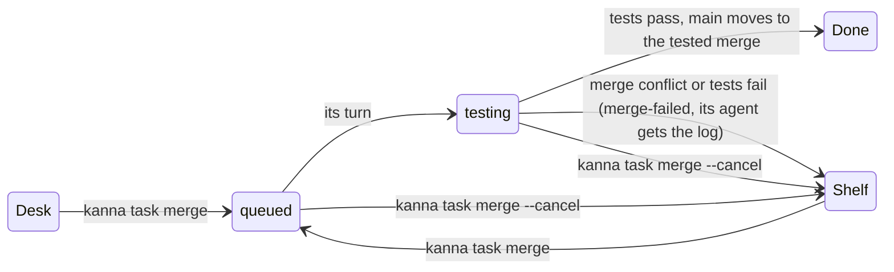
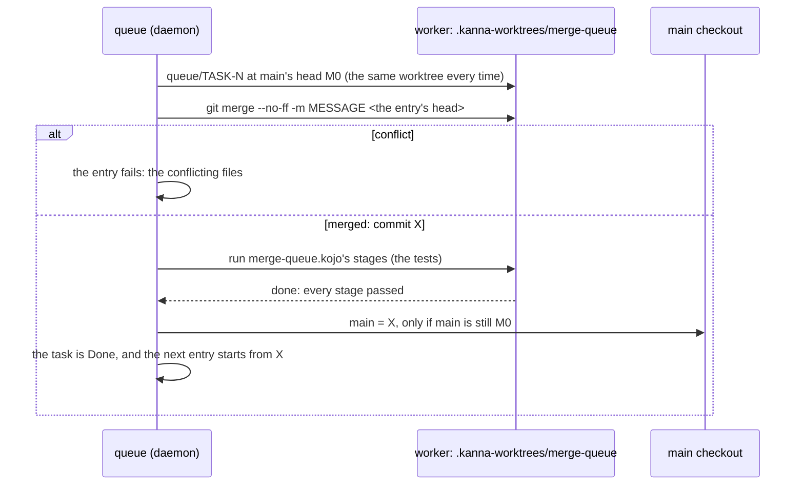
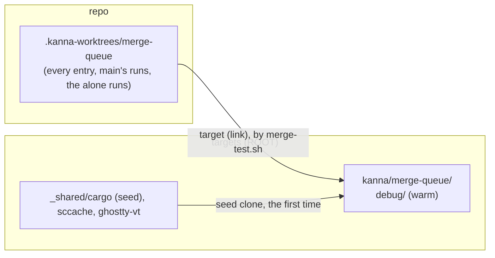
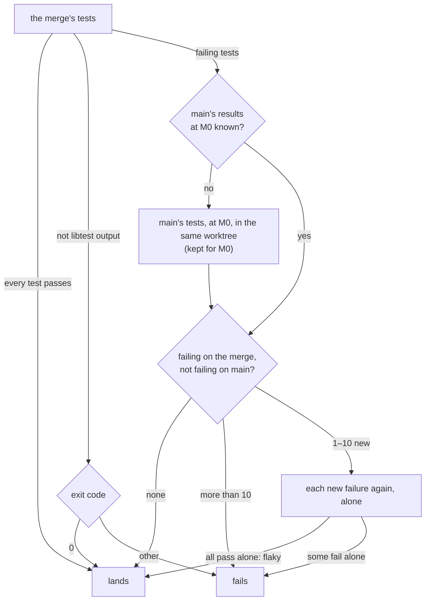

# Merge queue

**Status:** built (daemon, CLI, Desk view; the phone's Shelf doesn't show the queue yet) · **Tested:** `cargo test -p kanna-daemon queue:: test_results::`, e2e `merge_queue` · **Mockup:** [`references/mockups/merge-queue.html`](../../references/mockups/merge-queue.html) (Desk view, `kanna task list`, `kanna task merge`, a failed entry's log; `#light`) · **Builds on:** [build store](build-store.md), [software factory §6.1](software-factory.md#61-sequential-runs-as-built) (runs of `run` stages), [Kojo](kojo.md), [tasks](tasks.md), [stacked tasks](stacked-tasks.md), [task events](task-events.md)

When you tell a ready task's agent to merge, it runs `kanna task merge`. The task leaves the Desk for its repo's **merge queue** and its agent quits; you don't wait. The queue lands one entry at a time: it merges the branch onto main as main is now, runs the repo's tests on that merge, and moves main to it only if they pass. The next entry is merged on top of that. If an entry fails, the task goes back to the Shelf and its agent gets the log.

Every entry is tested in the repo's one queue worktree, whose build stays warm, so a run rebuilds only what the merge changed ([3.1](#31-one-warm-worktree-per-repo)). Tests are judged against main's own results, not against a green main: an entry fails only on a test that passes on main and fails on the merge, and a new failure that passes when run again alone is flaky, not a failure ([3.2](#32-judged-against-main)).


## Contents

1. [Why](#1-why)
2. [Merging a task](#2-merging-a-task)
3. [An entry's run](#3-an-entrys-run): [one warm worktree](#31-one-warm-worktree-per-repo), [judged against main](#32-judged-against-main)
4. [Failure](#4-failure)
5. [Seeing the queue](#5-seeing-the-queue)
6. [How it's built](#6-how-its-built)
7. [CLI and settings](#7-cli-and-settings)
8. [Tests](#8-tests)
9. [Rejected](#9-rejected)

## 1. Why

Before the queue, "merge" meant the task's agent merged main into its branch, rebuilt, reran its tests, then merged into main, all while you waited. A task marked ready at 10:34 was merged at 13:32, after main had moved six times, and the merge took 2m20s of rebuilding and testing. The queue tests each change once, at the point where it lands. That cost grows linearly with merges.

- **Ready tasks aren't re-tested in the background each time main moves.** A task already hears when main moves into a conflict with it ([`main-conflicts`](task-events.md)). Its tests run once, in the queue.
- **You start the merge, and only tested code lands.** Main fast-forwards to the exact commit the tests passed on. This is why the queue isn't the rejected "`merge main` stage gated by an `ask`" ([software factory §8](software-factory.md#8-rejected)): that stage would land a run's branch that you never had in your worktree.

## 2. Merging a task



`kanna task merge [TASK] [-m MESSAGE]` runs from the task's terminal (it means that task) or names a task, for example when the planner runs it on your word. Each of these refuses, and says why:

| Refused when | Says |
|---|---|
| its branch conflicts with main now (`git merge-tree`, as [stacked tasks](stacked-tasks.md#ready) checks it) | the files, and to merge main, fix them, rerun the tests and merge again |
| it `merges after` a task whose work isn't in main yet | which task, and that the task hears when it lands ([`base-merged`](task-events.md)) |
| its worktree has uncommitted changes to tracked files | the files: they wouldn't land |
| the repo has no tests for the queue: no `merge.test` and no `.kanna/pipelines/merge-queue.kojo` | how to set one |
| it's in the queue already, hasn't started, or has no commits that aren't in main | which |


When the merge is accepted:

- **The entry records the branch's head now.** That commit is what lands, even if the branch moves later. A task in the queue has no agent to move it.
- **The task leaves the Desk or the Shelf.** Its agent quits as at Done (`Tasks::end_agent`: brought to rest, then `/exit`; its session is kept), its tabs close, and its place on the Desk frees up. Its worktree, branch and workspace stay: the queue's worker terminal lives in that workspace ([6](#6-how-its-built)).
- **The task isn't Done yet.** Done (teardown, then removing the worktree and branch once they're merged) runs when the entry lands. Until then the task can come back to the Shelf.
- **The merge commit's message** is `-m MESSAGE`, else `Merge branch 'BRANCH': NAME`. The `kanna-tasks` skill tells the agent to pass a one-line summary of the work, as merges on main read today.
- **Any number of a repo's tasks can be in its queue.** They don't count against `shelf.runners` or the Desk's three places.

## 3. An entry's run



- **Serial, per repo:** one entry runs at a time, oldest first. When an entry's turn starts, its branch is merged on a queue branch (`queue/TASK-N`, made at main's head in the queue's worktree), never into main itself. Main moves only at landing, by fast-forwarding to that tested merge. Since the entry before it either landed or left main alone, every entry is tested on top of everything that landed before it.
- **The merge is the daemon's, not a stage's.** A run's branch starts from the task's head ([software factory §6.1](software-factory.md#61-sequential-runs-as-built)); a queue run's branch starts from the merge commit X. The pipeline only tests, so no `merge-queue.kojo` can land a commit other than the one it tested, and Kojo's rule that there's no `merge main` stage still holds ([Kojo §2](kojo.md#2-stages)).
- **The pipeline** is the repo's `.kanna/pipelines/merge-queue.kojo` if it has one. Otherwise it's Kanna's own: one `run` stage that runs `merge.test`:

```
test = run <merge.test>
test -[pass]-> done
```

- **A repo's own pipeline** may have any stages runs can do (today, `run` and agent stages with their loops), for example a check, a build, then e2e, or a fix stage that commits to the merge branch before the tests run again. What lands is the run's branch at `done`, and it lands only if it's a descendant of X and the run's last visit didn't fail: a pipeline whose arrow takes a fail to `done` fails the entry instead.
- **Main** is the branch the main checkout has checked out, as everywhere else in Kanna ([task events](task-events.md)).
- **Landing:** at `done` the queue checks that main is still at M0 and that the run's head descends from X, then runs `git merge --ff-only` in the main checkout, so main and the checkout's files move together.
- **Main moved under the run** (you merged by hand, or pulled): the fast-forward is refused. The entry runs again from the new main, up to 3 times. After that it fails with `main kept moving`.
- **The main checkout's local changes stop the fast-forward** when they touch files the merge changes. The entry then waits as `landing`, naming the files, and tries again every 30s and whenever the repo's refs or index change. The queue behind it waits too, since the next entry has to be tested on top of this one.
- **After landing:** `queue/TASK-N` is removed (the queue's worktree stays, detached), the task is Done (its teardown; its worktree and branch are removed now that they're in main), and the entry leaves the queue. The planner hears it as Desk news (`task-4f1d "Code find …" merged into main (5d02c1e) and left the merge queue`). Tasks stacked on it hear `base-merged` as before.

### 3.1 One warm worktree per repo

A queue run used to make a fresh worktree per entry, with an empty `target/`: a cold build of this repo took longer than the test stage's 600s, and every run stopped while it was still compiling dependencies.



- **One worktree, kept:** `.kanna-worktrees/merge-queue`, made the first time the repo's queue runs and reused by every entry after it. An entry starts with `git checkout -f -B queue/TASK-N M0` and `git clean -fd` there, then the merge. Ignored files stay: the build folder and `.kanna/tmp`. Its path never changes, so cargo's fingerprints stay valid and a run rebuilds only the crates the merge changed. At an entry's end the worktree is detached and left as it is.
- **It needs no lock of its own:** the queue runs one entry at a time per repo, and main's runs and the alone runs ([3.2](#32-judged-against-main)) are steps of the running entry, in the same worktree. That's why one build folder works here, where a `CARGO_TARGET_DIR` shared by concurrent task worktrees was ruled out ([build store §7](build-store.md#7-rejected)): nothing else builds in it at the same time, and its source only ever moves forward from main.
- **This repo's build store:** `merge.test` is `scripts/merge-test.sh`, which does what `build.sh` does for cargo and nothing else: `kanna_targets` links `target/` to `ROOT/kanna/merge-queue` on the build volume, `kanna_ghostty_vt` links libghostty-vt from the store, `kanna_cargo_seed` clones main's dependency seed the first time, and the compile cache serves the rest ([build store](build-store.md)). Then `cargo test --workspace --no-fail-fast`. The daemon knows nothing of this layout; it only keeps the worktree's path stable.
- **Evicted like any build folder:** `ROOT/kanna/merge-queue` is a candidate for [eviction](build-store.md#5-eviction) when the volume runs low, except while a run is in it. The next run starts it from the seed again.
- **Measured** (this repo, external SSD): the queue's first build, from the seed, 6m08s (28 crates); after a change to `kanna-daemon`, 12s (1 crate). Before, in a fresh worktree with no seed, one build took 38 minutes and every queue run timed out at 600s. `tasks.timeout` and `merge.within` are unchanged.

### 3.2 Judged against main

Once main had any failing test, nothing could land but a commit that fixed everything on main, and the repo kept a hand-written skip list in `merge.test`. The queue now keeps main's results per test and per commit, and an entry fails only on what it breaks.



- **Per-test results** come from libtest's output (`cargo test`): `Running SOURCE (BINARY)` starts a binary's tests, `test NAME ... ok|FAILED` is a result, `test result:` ends the binary. A test is named `NAME (CRATE SOURCE)` (`queue::tests::x (kanna_daemon src/lib.rs)`), since names repeat across binaries. A binary that started but never printed `test result:` (it crashed) is one failing result, `CRATE SOURCE: didn't finish`. Ignored tests aren't results. Libtest's JSON output needs nightly, so the text is read. Output with no libtest lines (any other `merge.test`) is judged by its exit code, as before. Another runner's results (`scripts/e2e-kanna.sh`'s scenarios) can be added as a second reader in `test_results.rs` that yields the same names and pass/fail.
- **`--no-fail-fast`:** without it cargo stops at the first failing binary, and every test after it would be missing.
- **Main's results** are kept in `kanna.db` by repo, commit and `merge.test` command: the names that passed, failed and were flaky. They're kept for every merge the queue tests, so when an entry lands, main's results at its commit are already known and nothing runs again. Only when main moved some other way (a hand merge, a pull) and an entry's merge has failing tests does the queue run `merge.test` on M0 first: the merge's run comes first, since an entry whose tests all pass never needs main's. The Desk's row says `testing main … first: its results aren't known yet`, and the agent's message says main's tests ran.
- **New failures:** tests that fail on the merge and don't fail on main (passing there, or new). Tests that fail on main too don't count against the entry. An entry that fixes some of main's failures lands, and its result names them (`fixes 2 of main's`).
- **Flaky:** each new failure (at most 10; more and the entry fails as it is) runs once more, alone, in the same worktree: its binary run directly with `--exact NAME --test-threads 1`, in its package's folder. One that passes alone isn't a failure: the result names it flaky, `passes alone, fails under load`, which is today's common case. A doc test, or a binary that didn't finish, can't run alone and stays a failure. Main's results at the merge count a flaky test as passing.
- **The result** is the entry's `doc.result` (`tests`, `new`, `flaky`, `known`, `fixed`) and, when it fails, its `why`: `1 new failure: steady (unit src/lib.rs); 1 flaky test (passes alone, fails under load): …; 3 failures already on main`. That `why` is what `kanna task list` and the Desk's red row show; `--json`'s `mergeFailed` adds `new`, `flaky`, `onMain` and `fixed`. The agent's message adds, for each new failure, its own lines from the log (`---- NAME stdout ----`), and how many of the merge's failures fail on main too.
- **A repo's own `merge-queue.kojo`** is judged by its arrows, as before: per-test results apply to Kanna's pipeline from `merge.test`.

## 4. Failure

Any end other than `done` fails the entry: a merge conflict, a stage's fail with no arrow left, a stopped run, `within` passing, or main moving 3 times. For Kanna's own pipeline, a failed `test` stage fails the entry only with new failures ([3.2](#32-judged-against-main)). Then:

- **The run ends `failed`.** A queue run's stage that fails with no arrow left ends the run there, with the outcome `failed` and why `test failed`, and the queue takes it from there. It isn't `stuck`: that's for a task's run, where the task's agent decides what to do. A task's runs are unchanged.
- **Main doesn't move.** `queue/TASK-N` is kept for you to look at, and the queue's worktree is detached.
- **The next entry starts,** on main as it was: a failing entry never holds up the queue.
- **The task goes back to the Shelf, stopped,** with the state `merge-failed` and why (`1 new failure: …; 4 failures already on main`), until it's merged again or Done.
- **Its agent gets the log** as a message from the queue (`[message from queue-7f3a]`): what failed (the new failures, the flaky tests, how many fail on main too), on which merge, each new failure's own lines (or, for output that isn't libtest's, [Kojo §5](kojo.md#5-inputs-and-outputs)'s tail, failure lines first), the logs' paths in its worktree (`.kanna/tmp/QUEUE/test.log`, `main.log`, `alone.log`), and what to do (merge main, fix, `kanna task merge` again). A stopped Shelf task runs for a message, so a [Shelf runner](shelf-runners.md) resumes its conversation and it starts on the fix.


## 5. Seeing the queue

- **Desk view:** a **Merging** group between the Desk and the Shelf (picture at the top). A queued task shows there only, even while its agent is still ending its turn: it isn't also on the Desk as a task running on the Shelf. Rows are in queue order, numbered. The running entry shows its stage (testing, `testing main … first`, or `running its new failures again, each alone`), the merge it's testing and how long it has run; waiting entries say what they'll be tested on top of; a `landing` entry that waits says why. **Take out** is `kanna task merge --cancel`. A task whose merge failed is on the Shelf with a red dot and `merge failed · why`. Not built yet, from the mockup: the progress bar against the last landed entry's time, **Show** (the running stage's terminal in a tab; `kanna move TERMINAL --tab` does it today) and **Log**.
- **`kanna task list`:** a `Merging` heading between `Desk` and `Shelf`. The states are `testing` (with the stage, if it isn't `test`), `landing` and `queued` (with its place and what it follows). A failed task is on the Shelf as `merge-failed`. `--json` adds `"queue": {"position", "state", "stage", "run", "head", "since"}`, or `"mergeFailed": {"why", "run", "log", "at", "new", "flaky", "onMain", "fixed"}`.


- **`kanna run list`** lists queue runs with the rest, with `queue` in place of a task's run number.

## 6. How it's built

- **`queue.rs` in the daemon** owns each repo's queue, in the same way `runs.rs` owns runs. It keeps the entries, starts the head entry's run, lands it or fails it, and tells the task. It steps on the same events as runs, plus ref changes in the repo and a 30s retry while an entry is `landing`.
- **Table `merge_queue`** in `kanna.db` ([database](database.md)): `id` (`queue-7f3a1c2e`), `repo`, `task`, `head` (the commit that lands), `message`, `by`, `queued_at`, `state` (`queued`, `testing`, `landing`, `landed`, `failed`, `cancelled`), `run`, `attempt`, `base` (M0), `merge` (X), `ended_at`, and `doc` (why, the log's path, the failure lines). The order is `queued_at`. A daemon restart reloads the live entries. A `testing` entry's run carries on as any run does: its `run` stage's exit file and log are on disk ([software factory §6.1](software-factory.md#61-sequential-runs-as-built)). If the daemon stopped between `done` and the fast-forward, the landing runs again, and it's safe to repeat: it moves main only from M0, and it's done once main contains X.
- **`test_results.rs`** reads libtest's output into named results and writes the alone run's script; table `test_results` (`repo`, `commit_id`, `command`, `at`, `doc`: `passed`, `failed`, `flaky`) keeps them per commit. A queue entry's `doc.phase` says which of its runs is going (`merge`, `main`, `alone`); each is an owned run of a one-stage pipeline in the queue's worktree, so a daemon restart carries it on like any run.
- **Runs gain an owner.** A run's doc has `owner`: none (a task's run, as before) or `queue`. `Runs::task_closed` stops only `task` runs: a queue run outlives the task's agent and the task's Done, and it's stopped only by `--cancel` or its own end. A queue run's messages (`tell`) go to the queue, not to a task's agent. The queue turns them into the task's message at the end. It's built through `Runs::start_owned(Started { … owner: Some("queue") })`: the queue makes the worktree and the merge, and the run takes it from there. At hand-back or stop, a queue run calls `Runs::on_end` (set by the queue) with the branch's head or why, instead of messaging an agent, and leaves its worktree alone: the queue's worktree is the queue's.
- **The worker terminal** is a background terminal of the task's workspace, as for any run. That's why the workspace stays until the entry lands or fails.
- **Task state:** `Entry.queued` (`Some(queue id)`): the task is held on the Shelf in the database, stopped, with its workspace, but listed under Merging, and runners, `start` and `pick` skip it. `Entry.merge_failed` holds the failure until the next `kanna task merge` or Done. The app draws the Merging group from these through the task list it already gets. `tell_planner` adds `merged` and `merge_failed` Desk news.
- **Skills:** `kanna-tasks` says that merge means `kanna task merge` with `-m`, never merging by hand. It covers merging main first only for `conflicts`, and what to do on a queue message. `kanna-planning` says that "merge X" means `kanna task merge X`, and that queued tasks are under Merging, not finished.

## 7. CLI and settings

| Command | Does |
|---|---|
| `kanna task merge [TASK] [-m MESSAGE]` | Puts the task in its repo's merge queue: refusals in [2](#2-merging-a-task); prints its place and what it follows |
| `kanna task merge --cancel [TASK]` | Takes it out of the queue and back to the Shelf, stopped; a running entry's run is stopped and main isn't touched |
| `kanna task list` | Adds the `Merging` section and the `merge-failed` state |
| `kanna task done TASK` on a queued task | Takes it out of the queue as `--cancel` does, then Done (its unmerged worktree is kept) |

| Setting | Where | Is |
|---|---|---|
| `merge.test` | the repo's `.kanna/config.json` | the command Kanna's own `merge-queue.kojo` runs in the queue's worktree, as a [task script](task-scripts.md) runs, under `tasks.timeout` unless `merge.within` is set; libtest output is judged per test ([3.2](#32-judged-against-main)). This repo's: `scripts/merge-test.sh` |
| `merge.within` | the repo's `.kanna/config.json` | the test stage's `within` (default: `tasks.timeout`) |

## 8. Tests

e2e `merge_queue`, on a private instance with a mock repo whose `merge.test` is `sh test.sh`, which prints libtest's output for a mock binary `bin/unit`: `known_broken` always fails (main's known failure), `broken_thing` fails when a `broken` file is in the merge, `flaky_thing` fails under the full run and passes alone when `flaky` is there. It also fails, with no libtest output, when `needs-a.txt` is there without `a.txt`, sleeps 8s once when `slow` is there, and notes in `target/builds` whether it found `target/` warm.

1. **Refusals:** a branch that conflicts with main names the file; uncommitted changes name the file.
2. **Two merges land in order, the second tested on top of the first:** A (`slow`) then B (`needs-a.txt`); main's first-parent history reads B's merge, A's merge (with A's `-m` message), then main as it was.
3. **The agent quits while its entry still lands:** A's agent is running when it's merged; it stops, and A still lands and is Done, its queue branch removed.
4. **A daemon restart mid-entry:** the daemon restarts while A's test sleeps; A and B both land after it.
5. **Entries land while main has a known failing test:** A and B land though `known_broken` fails on every merge; main's tests run once (for A, whose main had no results), never again.
6. **A new failure refuses the entry, named:** C (`broken`) fails, isn't in main, `kanna task list` shows C as `merge-failed` with `1 new failure: broken_thing (unit src/lib.rs); 1 failure already on main` (and `--json`'s `mergeFailed` the same), its agent is sent the log with `---- broken_thing stdout ----` as a message from the queue, the log is kept in its worktree, and its run's outcome is `failed`.
7. **A failing entry frees the queue:** E, queued behind C, lands after C fails.
8. **Flaky:** E's `flaky_thing` fails in the full run and passes alone: E lands, its result names it flaky.
9. **Warm builds:** across every entry and main's run, the queue's worktree found `target/` cold once.

`cargo test -p kanna-daemon queue::` checks the queue's worktree is reused with its build folder, and the judging: a known failure lands, a new one refuses with the test named, passing alone is flaky, other output goes by the exit code. `test_results::` checks reading cargo's output (several binaries, a crash, doc tests, ignored tests) and running one test alone from its binary in its package.

`cargo test -p kanna-daemon` checks the `merge` settings in the schema against what the daemon reads.

## 9. Rejected

- **A fresh worktree per entry** (before [3.1](#31-one-warm-worktree-per-repo)): every run was a cold build.
- **A green main as the bar, with known failures skipped by hand in `merge.test`:** a failure on main blocked every entry but the one that fixed it, and the skip list went stale both ways.
- **Running main's tests in the background whenever main moves:** after a landing they're already known (the landed merge was tested), and a run started outside an entry has no task's workspace to put its terminal in. Main's tests run only when an entry's merge fails tests and main's results at its base aren't known.
- **Retrying a whole failing run:** it doubles the run's time to learn what one test alone answers.
- **The agent merging main, rebuilding and testing while you wait** (before the queue): it took minutes of your time per merge and repeated work main had already moved past.
- **Re-testing ready tasks in the background whenever main moves:** this costs tests for every ready task on every move of main, while the queue costs one run per merge. Conflicts are covered by `main-conflicts`.
- **Done at `kanna task merge`:** a failure would then have to bring a Done task back. Its workspace, which holds the worker's terminal, would be gone, and so would its place among the Shelf's tasks. Done runs when the entry lands.
- **The merge as a `merge-queue.kojo` stage:** a repo's pipeline could then land something other than the merge it tested, or nothing at all.
- **Landing by moving the ref alone** (`git update-ref`): the main checkout's files would no longer match main.
- **Queueing a stacked task behind its base:** for now, `merges after` is refused, as decided. A later change could accept it when every base is ahead of it in the queue, and fail it when its base fails.
