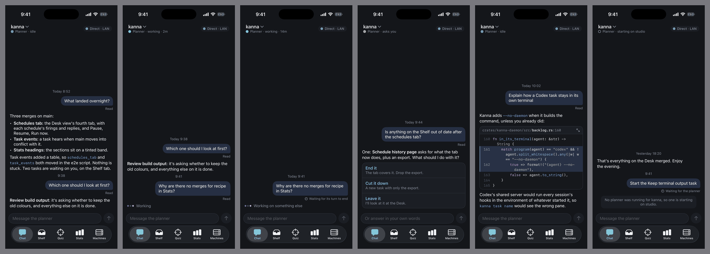
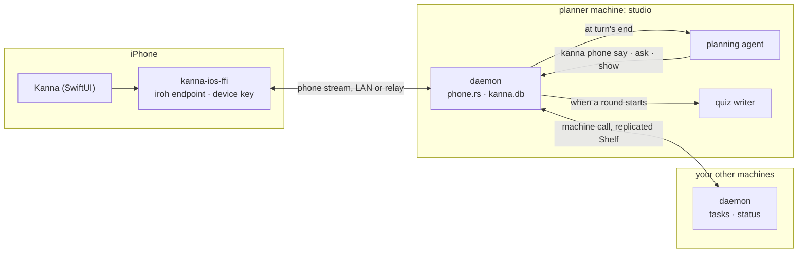
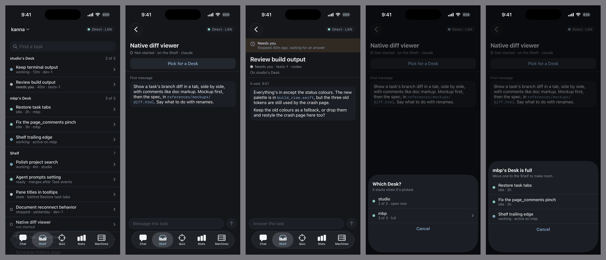
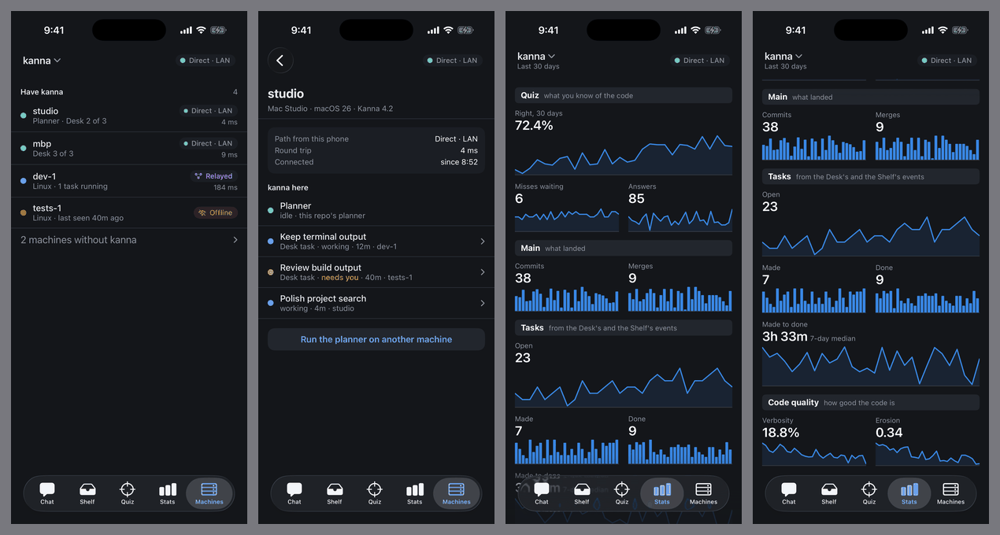
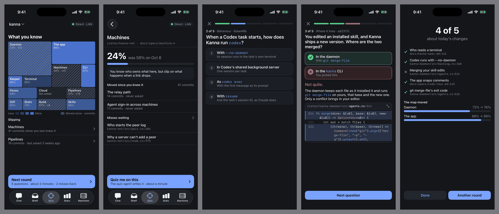
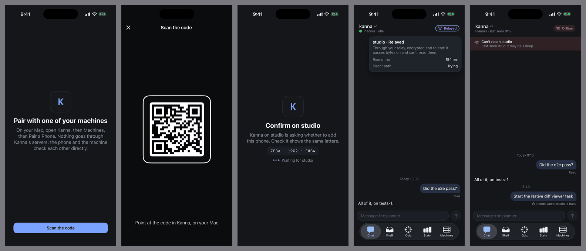

# Kanna on the Phone

**Status:** slices 1 to 3 built, the rest planned · **Parts:** [link and pairing](mobile-link.md), [chat and the planner](mobile-chat.md), [Shelf](mobile-shelf.md), [Machines and Stats](mobile-machines.md), [quiz](mobile-quiz.md) · **Mockup:** [`references/mockups/mobile.html`](../../references/mockups/mobile.html) · **Prototype:** [`references/prototypes/mobile`](../../references/prototypes/mobile/README.md) · **Builds on:** [your machines](machines.md), [agent messaging](agent-messaging.md), [planning terminal](planning-agent.md)

A native SwiftUI iPhone app that lets you steer a repo from your pocket by talking to its planning agent. You chat with **the repo's planner, one repo at a time**, and it answers through the `kanna` CLI, so there is one agent and never a second cook in the kitchen. You see only what it chooses to tell you: no tool calls, no terminal, no noise.

Around the chat are four tabs: the **Shelf** to read tasks, message them and pick them; **Stats** and **Machines** for the repo; and **Quiz**, a gamified map of what you know of the code. There's no code reader: ask the planner to explain something or quiz you, and the code appears in the chat.

Pictures are the prototype's, on fixtures, in dark mode; `screenshots/` there compares each with the mockup.



## Contents

1. [Rules](#1-rules)
2. [How it fits together](#2-how-it-fits-together)
3. [Screens](#3-screens)
4. [Decisions](#4-decisions)
5. [What depends on a real iPhone](#5-what-depends-on-a-real-iphone)
6. [Risks](#6-risks)
7. [Rejected](#7-rejected)
8. [Glossary](#8-glossary)
9. [Build order](#9-build-order)

## 1. Rules

- **One agent.** The chat is with the repo's planner. Everything risky goes through it: it can say no, and the Mac's terminal shows the whole exchange.
- **No noise.** Only what the planner sends with `kanna phone` shows in the chat, and a task's page shows what it sends the same way, or its last words.
- **One repo at a time.** Every tab belongs to the repo named at the top.
- **The phone runs nothing.** It's a device in your peer log with a narrow role: it holds no tasks and has no terminals.
- **What's new shows when you open it.** No push notifications in the first version.
- **Pick, message and read.** Those are the only task actions. New, start, stop, done, shelve and merge are asked of the planner.

## 2. How it fits together



- **The planner machine** of a repo holds its chat, quiz and Stats ([chat §1](mobile-chat.md#1-the-planner-machine)), and it's the only machine the phone connects to for that repo. The Shelf's records are there already; for what only a task's own machine knows, it asks that machine ([Shelf §1](mobile-shelf.md#1-the-list-and-a-task)).
- **One link at a time,** on a stream kind of the phone's own ([link §3](mobile-link.md#3-the-phone-stream)), open while the app is in the foreground. Switching to a repo with another planner machine moves the link there.

## 3. Screens

| Tab | Holds | Spec |
|---|---|---|
| Chat | The conversation, the planner's status, code cards, questions, round cards | [chat](mobile-chat.md) |
| Shelf | The repo's tasks; a task's messages, last words and Pick | [Shelf](mobile-shelf.md) |
| Quiz | The mastery map, subsystems, rounds | [quiz](mobile-quiz.md) |
| Stats | The daemon's `stats` reply for the repo, redrawn for a thumb | [Machines and Stats §7](mobile-machines.md#7-stats), [Stats §2](stats.md#2-the-numbers) |
| Machines | The repo's machines, each one's path from the planner machine and what's on it; *Run the planner here* | [Machines and Stats](mobile-machines.md) |









- **Stats** draws whatever `sections` and `tiles` the reply has. A chart kind it doesn't know shows the tile's number alone, because phones update later than daemons.
- **The chip** at the top of every tab says how the phone reaches the planner machine: *Direct · LAN*, *Direct · internet*, *Relayed*, *Offline: machine asleep* or *Offline: no network*. The Mac hides this in a tooltip; a phone has no hover and changes networks all day.
- **Light and dark** follow the system.

## 4. Decisions

D1 to D13 are the mockup's; the [prototype's README](../../references/prototypes/mobile/README.md#the-decisions-for-the-spec-task) has how each came out in its flows.

| | Decision | Settled as | Designed in |
|---|---|---|---|
| D1 | Which planner | One planner machine per repo, kept in the replicated Shelf, changed from a machine's page | [chat §1](mobile-chat.md#1-the-planner-machine) |
| D2 | Where a started planner runs | With no window, on the planner machine; a Desk adopts it | [chat §4](mobile-chat.md#4-a-planner-with-no-window) |
| D3 | Interrupting the planner | No: the phone says it's waiting | [chat §3](mobile-chat.md#3-the-conversation) |
| D4 | A pick to a closed Mac | Works. The claim was the daemon's already; what's missing is the limit across machines | [Shelf §2](mobile-shelf.md#2-pick) |
| D5 | A task's last words | The daemon keeps them, read from the agent's session | [Shelf §3](mobile-shelf.md#3-last-words) |
| D6 | Task actions | Pick, message and read. Pick shows only for Shelf tasks. A message to a task that hasn't started goes with its first message | [Shelf §1, §4](mobile-shelf.md#4-a-message-to-a-task-that-hasnt-started) |
| D7 | Offline | Read what's cached, play rounds, queue messages for a day, then *A day old, not sent* with Discard and Keep waiting. Pick stays off | [link §5](mobile-link.md#5-offline) |
| D8 | Subsystems and mastery | A map in the quiz store; recency-weighted right answers, shrunk towards unknown | [quiz §3](mobile-quiz.md#3-subsystems-and-mastery) |
| D9 | Code | Wrap by default, with a toggle on the full screen | [chat §2](mobile-chat.md#2-what-the-planner-sends) |
| D10 | Streak or points | Neither: the map is the score | §7 |
| D11 | When a streak breaks | Falls away. Mac rounds count towards the map | [quiz §3](mobile-quiz.md#3-subsystems-and-mastery) |
| D12 | Rounds written ahead | Starting a round starts writing the next | [quiz §1](mobile-quiz.md#1-rounds-written-ahead) |
| D13 | A phone in the peer log | Its own device key and a `phone` role; the Mac shows the code | [link §1–2](mobile-link.md#1-a-phone-in-the-peer-log) |

## 5. What depends on a real iPhone

Nobody has run the prototype on a real iPhone, and it has no networking at all. Slice 1 started with these, on [a probe](../../references/prototypes/phone-probe/README.md#results): iroh runs on an iPhone (with `fast-apple-datapath` off there, since it calls a private API), the app comes back in under 100 ms, the camera scans, and the LAN is reached with a [Bonjour service of our own](mobile-link.md#4-the-path), because iroh's records don't resolve.

| Depends on a phone | Why the Simulator can't say | If it fails |
|---|---|---|
| iroh and `kanna-net` built for `aarch64-apple-ios` | The Simulator is a Mac process with a Mac network stack. `fast-apple-datapath` has only run on Macs here | Drop that feature; then a thin native transport |
| Reaching the LAN without multicast | Raw multicast on iOS takes an entitlement Apple must grant, and iroh's mDNS uses raw multicast. The design uses addresses plus `NWBrowser` on a service the daemon publishes ([link §4](mobile-link.md#4-the-path)). Publishing with `mdns-sd` from Linux is untested | Addresses only, until the relay |
| Coming back from the background | iOS suspends the app and its sockets. The target is a usable link within a second on the LAN | A longer visible reconnect; the chat still reads from cache |
| Hole punching from cellular | [fleet-net](../../references/prototypes/fleet-net/README.md#results-and-slice-contract) measured a laptop. Carrier NAT may leave a phone always relayed | Relayed is the normal path away; put a relay near you ([remote terminals §5](remote-terminals.md#5-local-echo)) |
| The Local Network prompt | Only shows on a device, and a refusal has to leave relay working | Say so on the chip, and offer Settings |
| Scanning, and a refused camera | No camera in the Simulator | |
| The feel | Dragging the keyboard away, the floating tab bar, haptics, press-and-drag on charts, hanging indents at real size | Adjust in the app, port to the prototype |
| Battery | An iroh endpoint in the foreground, with a relay connection | Close links on idle |

Signing needs a team set in Xcode and `CODE_SIGNING_ALLOWED` removed ([README](../../references/prototypes/mobile/README.md#run-it)).

## 6. Risks

- **A phone can instruct an agent that skips permission prompts.** The stream is narrow, but a message to the planner is as strong as typing at it. So the device key needs the phone unlocked, and any machine can revoke it ([link §1](mobile-link.md#1-a-phone-in-the-peer-log)).
- **Agent usage:** each round the phone plays costs an agent run to write the next one, on your account ([quiz §1](mobile-quiz.md#1-rounds-written-ahead)).
- **Session files:** last words read a format each agent owns and can change ([Shelf §3](mobile-shelf.md#3-last-words)).
- **A sleeping planner machine:** the phone connects to nothing else for that repo, so it shows what's cached and queues, even with your other machines awake. A machine that stays awake is the better planner machine, and *Run the planner here* moves it.

## 7. Rejected

- **The app link on the phone:** it carries terminals and layouts the phone never shows, and it would give a phone `send`.
- **A second agent for the phone:** two agents would disagree about the repo, which is the problem this app's one-agent rule exists to avoid.
- **Showing the planner's terminal or transcript:** that's the noise. The planner says what matters.
- **An app key certified by one machine** (the stopgap for D13): it needs pairing with each machine, and dies with that machine.
- **A code reader:** reading code is the planner's and the quiz's way in, with an explanation attached.
- **Streak or points:** a daily streak punishes taking weekends off; points are a second number that only goes up.

## 8. Glossary

| Term | Meaning |
|---|---|
| **Planner machine** | The machine whose planner the phone talks to for a repo |
| **Phone stream** | The `kanna/1` stream kind a phone opens to a daemon |
| **Last words** | The final text of a task's last turn, kept by the daemon |
| **Windowless planner** | A planning agent the daemon started with no Desk window showing it |
| **Quiz writer** | The agent that writes the next round ahead, on the planner machine |
| **Map** | The Quiz tab's tiles, one per subsystem, shaded by mastery |
| **Mastery** | How well your answers say you know a subsystem, 0 to 100 |
| **Moved** | Commits in a subsystem on main since your last right answer there |

## 9. Build order

Each slice is one task, is usable alone, and leaves `main` releasable. Each goes through every layer at once, top down, and is compared with the prototype. A slice's tests run a headless phone (`tools/phone-client`, a small Rust client of the phone stream) against a private daemon with the mock agent, as `scripts/e2e-kanna.sh phone_*`, and the prototype's `FlowTests` port to the real app on a fixture backend.

| # | Slice | Builds | Proves | After |
|---|---|---|---|---|
| 1 | **Pairing and chat on the LAN** | The real-iPhone checks in §5. `apps/kanna-ios`, `kanna-ios-ffi`, the `phone` role, the QR pairing, the `phone` stream, `phone.rs`, `kanna phone`, the planning skill's part, the windowless planner, `kanna machine serve` | The whole path on real hardware: scan a code, ask the planner something with its Desk closed, read its answer, code card included | |
| 2 | **Shelf** | The Shelf tab, `task.*`, last words, `claim` in the replica and the limit across machines, a message going with a first message | Tasks can be read and steered from the phone, and a pick lands on a closed Mac | 1 |
| 3 | **Machines and Stats** | Both tabs, *Run the planner here*, the repo switcher across planner machines | Several machines read as one repo; the planner can move | 1 |
| 4 | **Quiz** | The Quiz tab, the writer, `quiz_ready`, the map, mastery, offline rounds | A round starts with no wait and plays on a train; answers move the map, on Mac rounds too | 1 |
| A | **Away from the LAN** | The relay, its token, `NWPathMonitor`, the queue's day limit | Everything already built works from a café and from cellular, and the chip tells the truth | 1, and [Relay: run ours on the e2-micro](remote-terminals.md#3-your-relay) |

Slice A can land any time after slice 1; the rest go in order.

**Building the app:**

```sh
scripts/build-ios-ffi.sh
cd apps/kanna-ios && xcodegen generate
xcodebuild test -project Kanna.xcodeproj -scheme Kanna -destination 'platform=iOS Simulator,name=iPhone 17'
```

- **`FlowTests`** run the prototype's flows against `FixtureBackend`, with `-fixture YES`.
- **`DeviceTests`** run on a real iPhone against a real daemon. `testScanAskAnswer` skips without `TEST_RUNNER_KANNA_ASK`, `TEST_RUNNER_KANNA_ANSWER` and `TEST_RUNNER_KANNA_REPO`; the answer must be words the question doesn't contain, or the test finds its own bubble. `testShelf` skips without `TEST_RUNNER_KANNA_TASK` and `TEST_RUNNER_KANNA_REPO`, and with `TEST_RUNNER_KANNA_TELL` and `TEST_RUNNER_KANNA_DESK` also messages and picks that task. `testMachinesAndStats` skips without `TEST_RUNNER_KANNA_REPO` and `TEST_RUNNER_KANNA_MACHINE`, and with `TEST_RUNNER_KANNA_MOVE_TO` also moves the planner.
- **`Store`** holds what the views read, over a `Backend`: `LiveBackend` on the Rust library, `FixtureBackend` for tests. SwiftData keeps the chat and the queue.

**Where the code goes:**

| Code | Place |
|---|---|
| The app | `apps/kanna-ios/` (SwiftUI, XcodeGen `project.yml`), views ported from the prototype, which stays the [reference](../../references/prototypes/mobile/README.md) |
| Its Rust | `crates/kanna-ios-ffi`, a static library of `kanna-net`, `kanna-syntax` and `kanna-merman` as an XCFramework |
| Daemon | `crates/kanna-daemon/src/phone.rs`, with `quiz.rs` and `tasks.rs` |
| Peer log and streams | `crates/kanna-net` |
| CLI | `crates/kanna/src/commands/phone.rs`, and `quiz` |
| Skills | `kanna-planning` for `kanna phone`, `kanna-quiz` for the writer |
