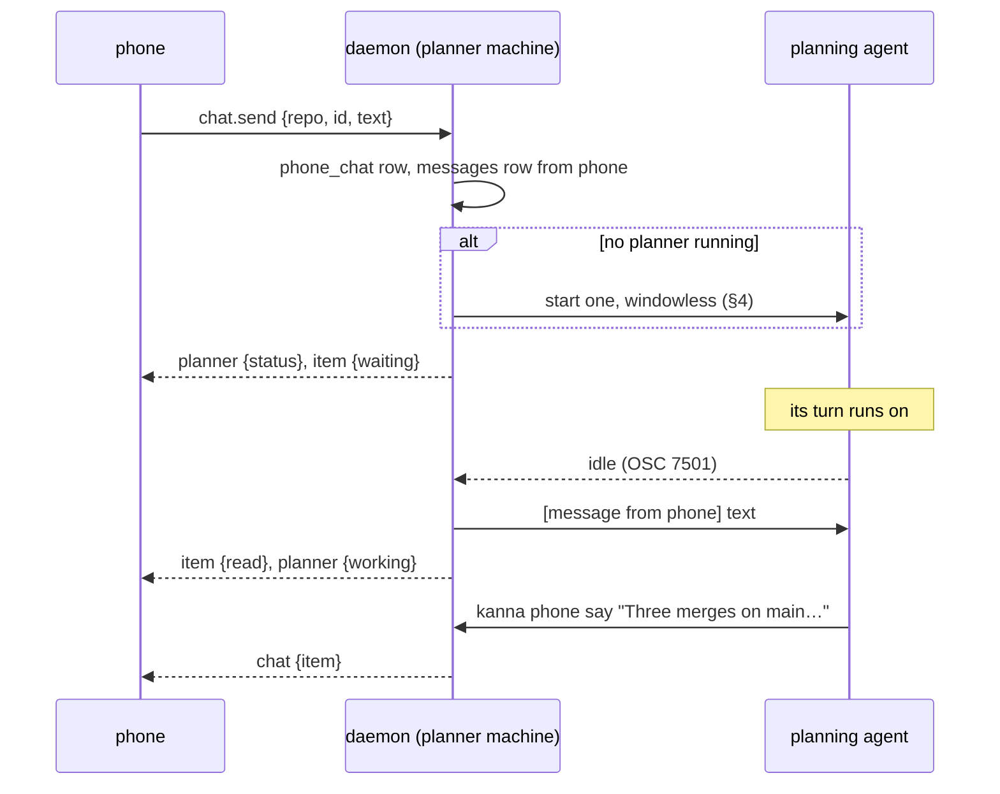
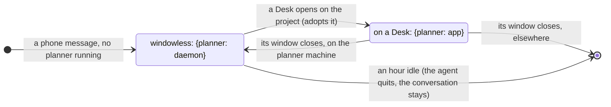

# Phone: Chat and the Planner

**Status:** chat on the LAN built ([slice 1](mobile-app.md#9-build-order)); the replicated planner machine and moving it built ([slice 3](mobile-machines.md)) · **Part of:** [Kanna on the phone](mobile-app.md) · **Builds on:** [agent messaging](agent-messaging.md), [planning terminal](planning-agent.md), [planner resume](planner-resume.md), [replicated Shelf](machine-tasks.md)

The phone's chat is a relay to the repo's planning agent. A message from the phone reaches the planner through [agent messaging](agent-messaging.md) at its turn's end, and the planner answers with `kanna phone`. Those answers are all the phone shows, and the daemon keeps them, so a phone that was away reads what it missed.

## Contents

1. [The planner machine](#1-the-planner-machine)
2. [What the planner sends](#2-what-the-planner-sends)
3. [The conversation](#3-the-conversation)
4. [A planner with no window](#4-a-planner-with-no-window)
5. [Store and tests](#5-store-and-tests)
6. [Rejected](#6-rejected)

## 1. The planner machine

A repo has one planner machine for the phone. It holds the chat, the quiz and Stats for that repo.

- **Kept** as a field of a project's record in the [replicated Shelf](machine-tasks.md#1-the-replicated-shelf), task `project:IDENTITY`, field `planner`, last writer wins ([the record](mobile-machines.md#1-the-project-record)). It's replicated because a second phone must meet the same planner, and there's [one planner per project](kanna-cloud.md#the-shelf-in-the-cloud) on any account.
- **Chosen by the first message:** [the order in Machines and Stats §2](mobile-machines.md#2-which-machine-a-repos-planner-is-on): a machine that has run a planner on the repo, else one with a clone. The chat says where (*No planner was running for kanna, so one is starting on studio*).
- **Moved** with *Run the planner here*, on a machine's page (`planner.move`), through whichever machine the phone can reach: the record replicates, so the old planner machine can be asleep. The new machine starts or finds its own planner, and its chat starts empty there; the phone keeps what it had and marks the place with a line: *The planner is on dev-1 now. It doesn't know this conversation.* A Mac's Desk keeps its own planner: this only says which one the phone talks to.
- **Which planner, on a machine with several windows:** the terminal in the [`planners`](database.md#planners) row, else the first running, as `kanna task send planner` finds it.

## 2. What the planner sends

| Command | Shows | Notes |
|---|---|---|
| `kanna phone say TEXT` | A message | Markdown: paragraphs, lists, bold, inline code |
| `kanna phone ask TEXT --choice 'LABEL\|WHY'…` | A question with choices | Returns at once. The tap arrives as a new message; typing in the box answers it too |
| `kanna phone show FILE:LINE[-LAST] [--commit C] [--hot N-M]` | A code card | Lines read from your `HEAD` unless `--commit` says otherwise, kept with the item, at most 200 |
| `kanna phone history [--last N]` | Nothing | The phone conversation so far, for a resumed planner |

- **Only the repo's planner and its tasks' agents** may run them: from any other terminal they're refused (`not_an_agent`). A task's go to [its own page](mobile-shelf.md#3-what-a-task-says), not this chat. This is the [same kind of check as `by`](agent-messaging.md#2-delivery), a rule for agents and not a security boundary.
- **The code card keeps its text and commit,** so it stays true after main moves and reads offline. The phone highlights it with `kanna-syntax`, wraps at spaces with a hanging indent, and tapping a line sends a question about it (*Ask about line 161*), which arrives with `file:line@commit`. The full screen is the same lines, larger, with Wrap.
- **A round card** comes from `kanna quiz ahead`, not from `kanna phone` ([quiz §1](mobile-quiz.md#1-rounds-written-ahead)).

**What the planner is told** goes in the `kanna-planning` skill: a message starting `[message from phone]` came from the user on their phone, who can't see this terminal. Answer only with `kanna phone`. Use `kanna phone ask`, never your question tool, since nobody is at the terminal. Keep it short. Say something unasked only when they asked to be told. Reading tasks, starting them and everything else works as usual.

## 3. The conversation

**Status** comes from the agent's [status](agent-status.md#1-states) and the messages table:

| The phone says | When |
|---|---|
| Idle | The planner reports idle, nothing waits |
| Working · 2m | A turn runs, and it's on the phone's message |
| Working on something else · 14m | A turn runs with the phone's message still waiting: you're at the Mac, or it's a task's message |
| Asks you | The last item is an unanswered `ask` |
| Needs you at studio | It reports `blocked`, with its [last words](mobile-shelf.md#3-last-words); the phone can't answer an approval |
| Starting on studio | Windowless planner starting (§4) |
| Not running | No planner runs on the machine: your next message starts one (§4) |

**Rules:**

- **No interrupting.** A message [reaches the agent](agent-messaging.md#2-delivery) like any other, and shows *Waiting for its turn to end* until it's delivered. An answer the planner gave before then counts: the chat doesn't nudge it for silence. A Stop button could end work you started at the Desk and can't see from here.
- **Sent by the phone, delivered as `phone`:** `messages.from` is `phone`, the prompt reads `[message from phone] TEXT`, and its permission class is the recipient's, [as for a message from you](agent-messaging.md#2-delivery).
- **Once:** `chat.send` carries the phone's UUID, and a repeat is answered with the same item.
- **Receipts** are the phone's item against `messages.delivered`: *Read* means the agent took it.
- **A turn that ends with no reply:** if a phone message was taken and the turn ended with nothing sent, the daemon leaves the planner one `[message from kanna]`: *The phone is waiting: answer with kanna phone say*. If that turn ends silent too, the chat shows *The planner finished without answering*.
- **The Mac sees everything:** the messages and the `kanna phone` commands are in the planner's terminal. What you type at the Mac doesn't go to the phone.
- **Agents that take messages:** Claude and Codex, [as for every message](agent-messaging.md#1-sending). Another agent as planner shows a *can't take messages* line.

## 4. A planner with no window

Today a planner lives in a Desk window, and the app asks for it. The phone needs one with Kanna.app closed.

- **Started by the daemon** as a workspace with no task, `where: {"planner": "daemon"}`, through the same `planner.sh` and [`comeback`](planner-resume.md#3-how-its-built), in the repo's main checkout. The script takes the agent from `KANNA_PLANNER_AGENT` instead of asking: the project's kept one, else `planning.agent`, else `tasks.agent`. Status, delivery and `kanna task` work as for a Shelf task, which runs with no app already.
- **It resumes the project's conversation,** which is why the phone's planner knows what you did at the Desk.
- **A Desk adopts it:** `tasks plan` from the app finds the repo's windowless planner, claims it for that app and shows it, instead of [starting a second conversation](planner-resume.md#1-when-it-resumes).
- **Closing a window** on the repo's planner machine leaves its planner windowless (`tasks let-go`, which the app sends in place of `close`). Elsewhere it ends, as before. A machine is the planner machine for a repo once a phone has talked to it there: it has `phone_chat` rows.
- **An hour idle with no app,** Kanna ends it with [its quit keys](shelf-runners.md#2-how-its-built). The next message starts it again from the conversation.
- **Starting can fail silently:** an agent reports no status while it [asks to trust a folder](agent-status.md#2-kannas-agents). With no report 60 s after starting, the chat says *The planner couldn't start on studio; open the repo there once*.
- **No daemon, no planner:** a Mac's daemon outlives the app but not a restart, so a Mac that serves your phone runs it from launchd, with [`kanna machine serve`](machines.md#5-the-app-link-over-the-network), which isn't built yet and comes in [slice 1](mobile-app.md#9-build-order).
- **Schedules and Desk news** reach a windowless planner like any other while it runs. Nothing starts one but the phone.

## 5. Store and tests

**`phone_chat`** in `kanna.db`: one row per item.

| Column | Holds |
|---|---|
| `repo`, `seq` | The key; `seq` counts up per repo, and `chat.read {after}` reads from it, as an offset does for terminals |
| `at` | When |
| `kind` | `me`, `say`, `ask`, `show`, `round`, `sys` |
| `client` | The phone's UUID, for `me` |
| `message` | → `messages.id`, for `me` |
| `doc` | The text, choices and the choice made, or the card's lines and commit |

**Tests:** e2e `phone_chat` on a private instance with the mock agent as claude and as codex: a headless phone sends with the planner busy, idle and absent; the reply arrives through `kanna phone`; a resend delivers once; a task agent is refused; a silent turn is nudged once; a windowless planner is adopted by a Desk and goes windowless again.

## 6. Rejected

- **Reading the planner's replies from its terminal or transcript:** the agent decides what's worth saying, which is how the user gets no noise. It's also what the user asked for.
- **`kanna phone ask` blocking until the tap:** a phone may not answer for hours, and [nobody waits on an answer](agent-messaging.md#1-sending).
- **A task answering the phone itself:** it answers in its own chat, and the phone reads its [last words](mobile-shelf.md#3-last-words).
- **Replicating the chat to every machine:** only the phone reads it, and the phone keeps its own copy.
- **Carrying the conversation when the planner moves:** an agent's session stays on its machine. A handoff like [a task's](task-transfer.md#4-the-handoff) can come later if moving turns out to be common.
