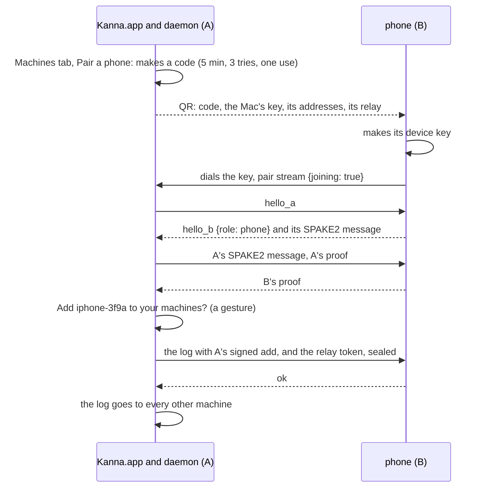
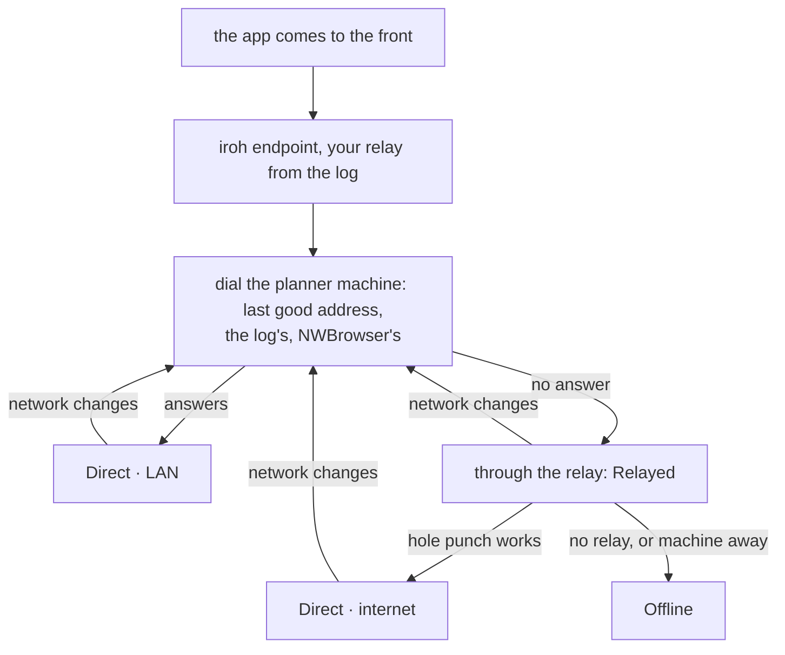

# Phone: Link and Pairing

**Status:** LAN built ([slice 1](mobile-app.md#9-build-order)); the relay and more than one machine aren't · **Part of:** [Kanna on the phone](mobile-app.md) · **Builds on:** [identity and pairing](machine-identity.md), [one link per machine](machine-links.md), [remote terminals §3](remote-terminals.md#3-your-relay)

How a phone becomes yours and reaches your machines. It pairs once, with any one machine, and from then on can reach any of them, though it holds one link at a time, to the current repo's planner machine: on the LAN directly, away through your relay, moving to a direct path when one opens. This holds no account and needs no server of Kanna's, as for [your machines](machines.md#1-rules).

## Contents

1. [A phone in the peer log](#1-a-phone-in-the-peer-log)
2. [Pairing](#2-pairing)
3. [The phone stream](#3-the-phone-stream)
4. [The path](#4-the-path)
5. [Offline](#5-offline)
6. [Rejected](#6-rejected)

## 1. A phone in the peer log

A phone has its own Ed25519 device key, which is its iroh endpoint, and an `add` in the signed log with `role: "phone"`. An entry with no role is a machine, so nothing already in a log changes.

| A `phone` entry | Rule |
|---|---|
| Is dialed | never: the phone dials out. `View::machines()` leaves phones out, so sync, grants, runners, takeover and the app's links never see one |
| Signs an `add` | invalid: only machines add |
| Signs a `revoke` | valid only of its own key: *Forget this phone* |
| Is revoked | by any machine, with no gesture, as for a machine; its streams end at once |
| Named | `iphone-3f9a`, from its key, since [a name can't come back with another key](machine-identity.md#3-the-peer-log), even a revoked one, and a phone that pairs again has a new key |
| Shows | under Phones in `kanna machine list` and the Mac's Machines tab, with Revoke |

- **The key** is in the Keychain, `WhenPasscodeSetThisDeviceOnly`, so it needs the phone unlocked and never goes to a backup. The Secure Enclave doesn't hold Ed25519.
- **A key left by a deleted app:** the Keychain outlives the app. A first launch that finds a key checks the log on connecting, and on `revoked` makes a new one and starts at pairing.
- **The phone keeps the log,** which it gets at pairing and swaps on each hello, and checks it with `kanna-net` as any machine does. That's how it knows your machines and their addresses and relay.
- **The domain stays `kanna/machines/1`:** `role` is a new field in an entry's signed body. A new domain would make every machine pair again.
- **The relay token** isn't in the log. The phone gets it sealed in the pairing handoff and again in `hello` ([remote terminals §3](remote-terminals.md#3-your-relay)). It's one shared token, so revoking a lost phone should go with rotating it; `kanna machine revoke` says so.

## 2. Pairing

The Mac shows the code, since the phone has the camera. The code travels in a QR, never typed. The proof is [the same SPAKE2 exchange](machine-identity.md#2-pairing); only who makes the secret and who dials change.

- **Who opens the stream** is now separate from who speaks first: with `joining`, the dialer is B. The code is 128 random bits, since nobody types it.
- **`kanna phone pair`** shows the same QR in a terminal, for a Linux machine you're logged in to. Adding still takes a gesture in a Kanna.app, so a machine with no app refuses (`gesture_required`).
- **The gesture stays on the Mac.** The phone waits on *Confirm on the Mac*.
- **Pair with another machine,** at the foot of the repo sheet, forgets this machine, its chat and the key, and goes back to pairing. Revoking from the Mac does the same to a phone when it next dials.
- **One log per install:** dev, staging and production Kannas are separate logs, so the phone app has a build per channel ([build channels](build-channels.md)).

Mockup of the Mac's side: `#pair-mac` in [`mobile.html`](../../references/mockups/mobile.html).

## 3. The phone stream

A new stream kind, `phone`, opened by a key with the `phone` role. It stays out of `KINDS`, which `machine ping` opens on every machine. A phone's key may open no other kind, and a machine's or app's key may not open this one. That check is at the stream's header, like `sync`'s, and matters because a phone has no certificate, the mark that today tells an app from a daemon.

- **Why its own kind:** the phone needs a dozen requests, not the app link's terminals, layouts and `send`. A second app link would also meet `app_attached` and would have to lift the one-app limit, which the phone no longer needs.
- **Its bytes** are JSON lines: `{id, cmd, args}` answered by `{id, ok, …}`, and notices with no `id` that the daemon pushes while the stream is open.
- **Its own version:** the header carries `phone: N` in place of the [one protocol per build](machine-versions.md#2-protocols). A phone updates through the App Store, later than a Mac and out of step with it, so a Mac update mustn't make the phone Incompatible. The stream changes by adding fields, which both sides ignore when they don't know them. A breaking change raises N; a daemon serves its last two, and the phone says which side to update.

| Request | Does | Spec |
|---|---|---|
| `hello` | The machine's name and capabilities, its projects, the log, the relay and token | |
| `chat.read {repo, after}`, `chat.send`, `chat.choose` | The conversation | [chat §3](mobile-chat.md#3-the-conversation) |
| `planner.move {repo, machine}` | Sets the planner machine | [chat §1](mobile-chat.md#1-the-planner-machine) |
| `tasks.list {repo}`, `task.read`, `task.send`, `task.pick` | The Shelf | [Shelf](mobile-shelf.md) |
| `stats {repo}` | The [same reply](stats.md#4-adding-a-metric) as `kanna stats --json` | |
| `quiz.map`, `quiz.rounds`, `quiz.answer`, `quiz.ahead` | The Quiz tab | [quiz §2](mobile-quiz.md#2-the-stream) |

Notices: `chat {repo, item}`, `planner {repo, status, since}`, `tasks {repo}`, `quiz {repo}`.

- **`repo` is a project's identity** (`url:host/path`, [links §4](machine-links.md#4-projects-desks-and-claims)); each daemon turns it into its own clone's path.

## 4. The path

- **One link, to the planner machine.** `hello` lists your projects and each one's planner machine, from the replica. Switching to a repo on another planner machine moves the link. If it can't be reached, the phone dials the other machines in the log only for the Machines tab, so you can *Run the planner here* ([chat §1](mobile-chat.md#1-the-planner-machine)).
- **Foreground only.** Going to the background closes the links and the endpoint. Coming back opens them, reads from the last `seq`, and shows the cache until then. This is what iOS allows without push.
- **LAN first, with no multicast.** Raw multicast takes an Apple entitlement, so the phone dials the last good address, the log's `addrs` and what `NWBrowser` finds, under `NSBonjourServices` and `NSLocalNetworkUsageDescription`.
- **A Bonjour service of our own.** Each daemon publishes `_kanna-phone._udp`, its port and, as the instance name, its key in lowercase base32. iroh's `_kanna._udp` records can be listed but [never resolve](../../references/prototypes/phone-probe/README.md#results), on an iPhone or a Mac. On macOS the daemon registers with the system's `DNSServiceRegister`: a responder of its own, as `mdns-sd` runs, isn't seen even by the same Mac. On Linux, where no responder can be counted on, it uses `mdns-sd`. Bonjour only finds the address; the link is iroh's.
- **Relay second.** The endpoint uses the relay in the log, with an empty relay map otherwise, as every Kanna endpoint does. A phone reaches `https://relay.kanna.build:8444` like any machine ([remote terminals §3](remote-terminals.md#3-your-relay)); nothing on the relay changes. A chat message is small enough that a relay's 320 ms from Japan doesn't matter, so the phone never needs a relay of its own.
- **Direct whenever it can.** iroh moves a connection to a direct path by itself; `NWPathMonitor` tells it the network changed.
- **The chip** reads `path(key)` for the planner machine ([links §5](machine-links.md#5-paths-the-machines-tab-and-offline)), and `NWPathMonitor` tells *no network* from *machine asleep*.

## 5. Offline

- **Reads** come from the app's own store (SwiftData): the chat, the Shelf, Stats, the map, as last seen, with *last seen 9:12*.
- **Messages queue on the phone** with a UUID chosen when written, so sending twice can't deliver twice. Unsent after 24 hours, one asks *A day old, not sent*, with Discard and Keep waiting. The planner machine being reachable with no planner isn't offline ([chat §4](mobile-chat.md#4-a-planner-with-no-window)).
- **Rounds on the phone play offline;** answers wait the same way, with no day limit ([quiz §2](mobile-quiz.md#2-the-stream)).
- **Pick stays off,** since it depends on what the Desk holds now.

## 6. Rejected

- **A link to every machine,** as Kanna.app has (before): it only saved a hop for live task status, which the planner machine can fetch with `machine call`. A phone sends no keystrokes, so the hop that [Machines rejected for the app](machines.md#12-rejected) costs it nothing.
- **A relay only Kanna Cloud provides:** the phone away from the LAN would need an account. Your own relay does the job, free.
- **Background connections:** iOS doesn't keep them. Push comes later, [through Cloud's directory](kanna-cloud.md#7-directory-and-relays).
- **The phone showing the code and the Mac scanning:** the Mac may have no camera, and typing a code on a phone is what the QR replaces.
- **A signing role:** a stolen phone adding a machine is the one thing a narrow role must rule out.
