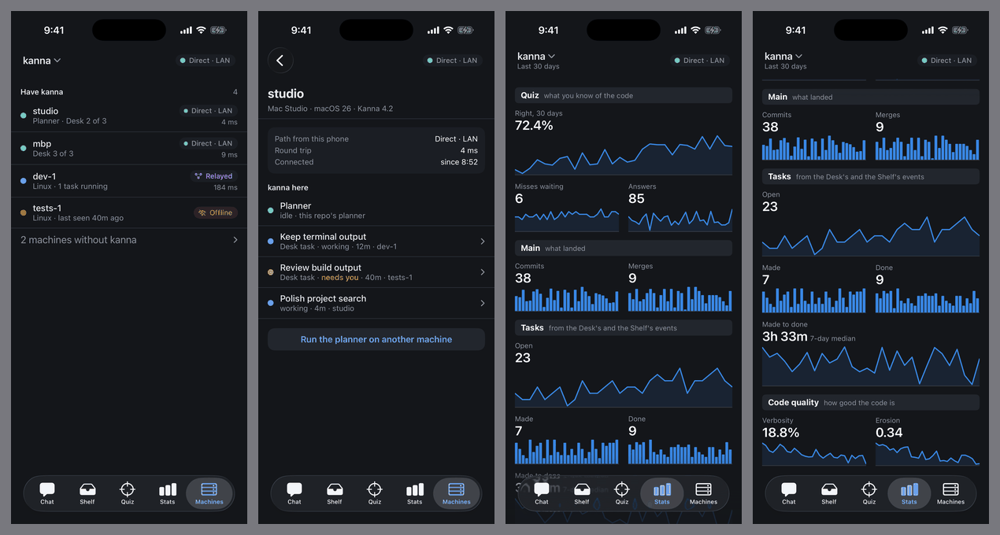
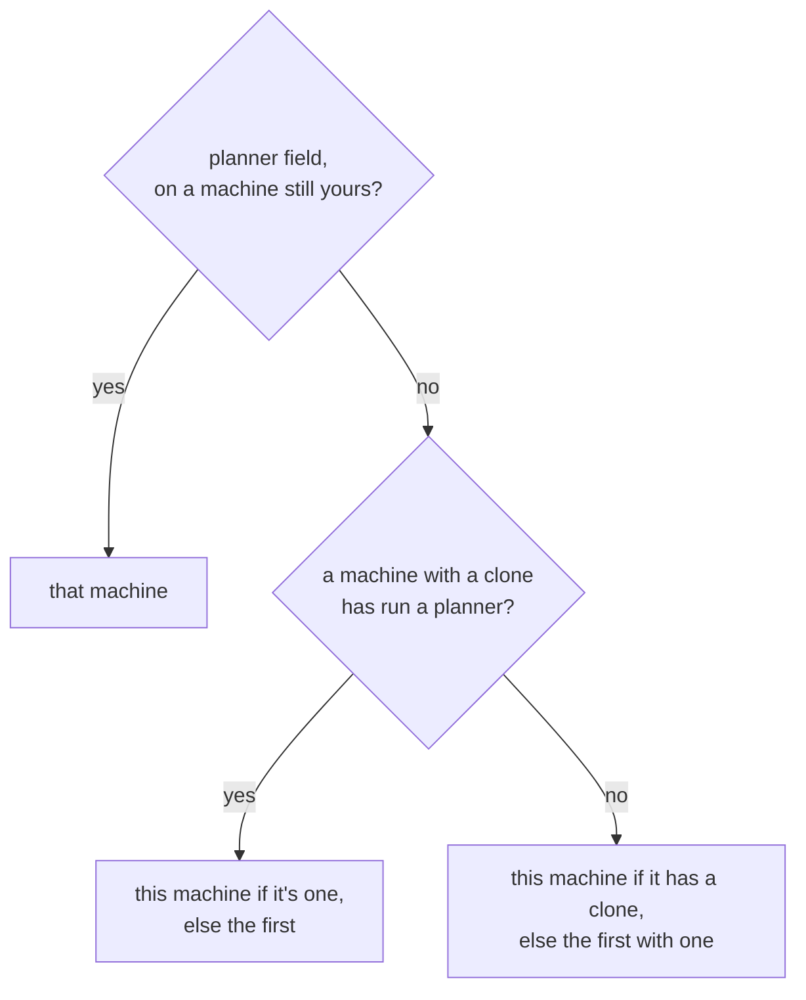
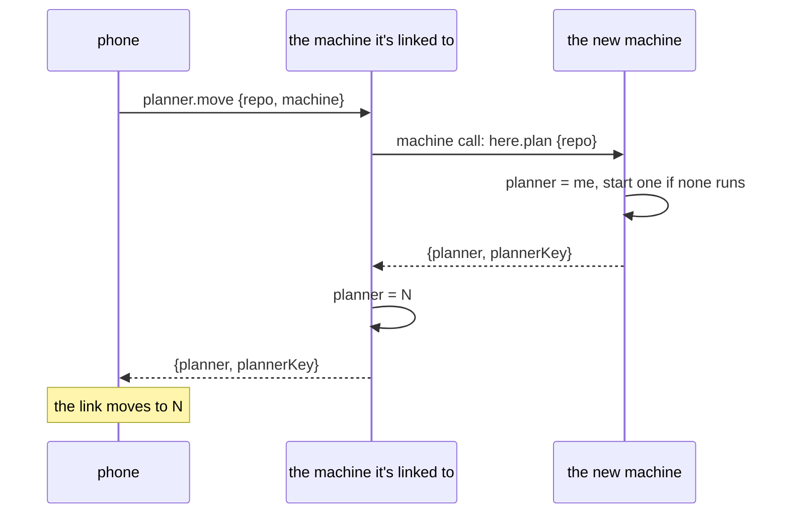

# Phone: Machines, Stats and the Planner's Machine

**Status:** built on the LAN ([slice 3](mobile-app.md#9-build-order)) · **Tested:** e2e `phone_machines` (two daemons, the mock as claude), `tasks`/`phone.rs` unit tests, `FlowTests` on the fixture backend, and by hand on a real iPhone against real daemons on a MacBook Pro and a Mac Studio, with the planner moved to each. `DeviceTests.testMachinesAndStats` is written but hasn't run: XCUITest timed out enabling automation mode on that phone · **Part of:** [Kanna on the phone](mobile-app.md) · **Builds on:** [chat §1](mobile-chat.md#1-the-planner-machine), [replicated Shelf](machine-tasks.md#1-the-replicated-shelf), [Stats](stats.md)

Several machines read as one repo on the phone. Each daemon says what it has clones of in the replicated Shelf, so `hello` answers at once from any machine, including for machines that are asleep. The link goes to one machine at a time, and it moves to whichever machine runs the current repo's planner.

## Contents

1. [The project record](#1-the-project-record)
2. [Which machine a repo's planner is on](#2-which-machine-a-repos-planner-is-on)
3. [The link moves](#3-the-link-moves)
4. [Moving the planner](#4-moving-the-planner)
5. [The chat across machines](#5-the-chat-across-machines)
6. [Machines](#6-machines)
7. [Stats](#7-stats)
8. [Rejected](#8-rejected)

## 1. The project record

A project is a record in the replicated Shelf: task `project:IDENTITY`, birth `project`. Each field is last-writer-wins on its own, so two machines writing different fields never collide.

| Field | Written by | Holds |
|---|---|---|
| `name` | any machine with a clone | The folder's name |
| `clone:KEY` | that machine | `true`, or null once the clone is gone |
| `ran:KEY` | that machine | `true` once it has run a planner on the repo |
| `planner` | the first message, and a move | The key of the planner machine |

- **Published** by a look at `projects list` when the daemon starts, when a project is added, every minute, and at each `hello`. A write only happens when a field changes, so an idle machine adds nothing to the log, which is never compacted.
- **Inert to tasks:** a record with no `state` is passed over by everything that walks the Shelf.

## 2. Which machine a repo's planner is on

The first message on a repo with no `planner` writes the machine that took it. This drops two steps of [chat §1](mobile-chat.md#1-the-planner-machine)'s first design: "the one running a planner" is folded into "has run one", since only `ran:` replicates, and "first reachable" into "first", since `hello` asks nobody. A wrong guess reads Offline, and Machines moves it.

## 3. The link moves

- **`hello`** lists every project with its `planner` and `plannerKey`, and `machines`: each one's name, key and addresses, which the phone keeps. `status` comes only for repos whose planner is on the machine that answered; for others the phone keeps what it last knew.
- **Switching repo** to another planner machine closes the link and opens one there, as coming back from the background does: the endpoint restarts, so nothing lingers on the old machine.
- **A `projects` notice** says the records changed, and the phone reads `hello` again. A planner that moved takes the link with it.
- **A planner machine that can't be reached:** the phone dials the others, in `hello`'s order, and stays on the first that answers. The chip stays Offline and the chat queues, since only the planner machine has the chat, but the Machines tab reads through that machine and can move the planner. While on such a link it asks `machines` on each 5 s poll, and goes back when the planner machine is up.
- **A message queued for a repo** waits until the link is to that repo's planner machine. A daemon that's no longer the planner refuses `chat.send` with `moved`; the phone reads `hello`, follows, and sends again.

## 4. Moving the planner

- **`no_clone`** if the machine has no clone. The phone offers only machines that have one and are up.
- **Linked through another machine,** the phone tries the planner machine itself: at once when its network changes, then every 30 s. It doesn't go by what the other machine says, since that machine can be wrong about it, or on an older build.
- **With no link at all,** every machine reads *Offline*: the Machines tab keeps its last page, but that's what one machine said then, not what the phone reaches now.
- **It works with the old planner machine asleep,** since the phone goes through any machine it can reach.
- **A planner machine's daemon runs in the user's login session,** from Kanna.app or launchd (`kanna machine serve`). Started over SSH, the login keychain is locked and `claude` reports it isn't logged in.
- **The old planner keeps running.** A Mac's Desk keeps its planner, as [chat §1](mobile-chat.md#1-the-planner-machine) says: this only changes which one the phone talks to.

## 5. The chat across machines

Each machine's `phone_chat` counts its own `seq`, so the phone keeps a chat per machine, tagged by name (`Item.machine`, not on the wire), and shows them merged by time. The line *The planner is on dev-1 now. It doesn't know this conversation.* is derived where the machine changes, and isn't stored. A question from an earlier machine shows without its choices: the planner that asked isn't listening.

## 6. Machines

`machines {repo}` answers from whichever machine the phone is linked to.

| Field | Holds |
|---|---|
| `from` | The machine that answered: paths are from there |
| `machines[]`: `name`, `key`, `me` | Who |
| `os`, `arch`, `cores`, `version` | From the log; `version` from the machine itself, so only when it answered |
| `has`, `planner` | From the project record |
| `up` | It answered `here.machine` within 3 s, or it's `me` |
| `path`, `lan`, `ms` | The selected path from `from`, as `machine list` shows |
| `since`, `seen` | When it came up and when it last answered, in this daemon's memory: a restart forgets them, and the phone keeps the page |

- **The list** is the machines with a clone, with those without one behind a row. Task counts and Desks come from the Shelf the phone already holds.
- **A machine's own row** shows the phone's path to it, for the machine it's linked to, and the path from `from` for the rest.
- **Mockup's *Connected since*** is the first answer this daemon saw.

## 7. Stats

`stats {repo}` is the [same reply](stats.md#4-adding-a-metric) as `kanna stats --json`, read from the planner machine, kept for offline, asked when the tab shows and every minute while it does. A sampler catching up can take a while, so the phone waits for it.

- **Tiles:** a span of 4 or more, `ranked` and `list` take the full width, the rest two to a row.
- **Charts:** `line`, `columns`, `flow`'s line and `dots`' median as sparklines or bars, with a press-and-drag readout from `what` and `days`; `ranked` and `list` as rows, the first five. **Any other kind shows the tile's number alone,** because phones update later than daemons.
- **Sections** with no tiles show `empty` or `placeholder`.

## 8. Rejected

- **Asking each machine for its projects at `hello`:** a sleeping machine costs every connect the 3 s wait, and its repos vanish from the list while it's asleep.
- **A list of machines in one field:** two machines adding themselves at once would lose one under last-writer-wins. A field per machine can't.
- **Carrying the old chat to the new machine:** it stays on the phone. The [session stays on its machine](mobile-chat.md#6-rejected), so the new planner couldn't use it.
- **A second stream beside the first:** one link is the rule ([link §4](mobile-link.md#4-the-path)), and a restart of the endpoint is under a second.
- **`machine ping` for the round trip:** it opens every stream kind on every machine. The selected path's RTT is already there.
