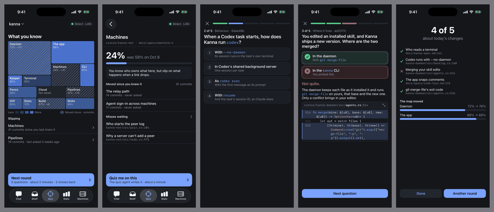
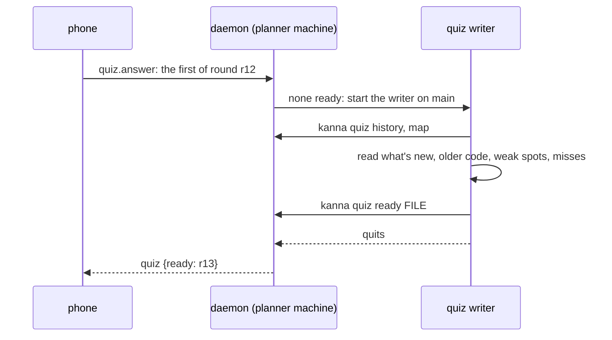

# Phone: Quiz

**Status:** planned · **Part of:** [Kanna on the phone](mobile-app.md) · **Builds on:** [quiz](quiz.md), [quiz results](database.md#quiz-results), [Stats](stats.md)

On the Mac a quiz is a conversation with an agent. On the phone it's a round you can start at once: its questions were written ahead into the daemon, the app renders them, and a map of the code shows what you know. Rounds on the phone play offline. The kinds, the explanations and the misses coming back are [the Mac's](quiz.md#3-questions). There's no streak and no points: the map is the score.



## Contents

1. [Rounds written ahead](#1-rounds-written-ahead)
2. [The stream](#2-the-stream)
3. [Subsystems and mastery](#3-subsystems-and-mastery)
4. [Rejected](#4-rejected)

## 1. Rounds written ahead



- **Starting a round starts writing the next,** so one is nearly always ready, and nothing runs for rounds nobody plays. One ready round per repo at most. An empty store (a first launch) starts one when the Quiz tab opens.
- **The writer is a lead with no window,** as a [windowless planner](mobile-chat.md#4-a-planner-with-no-window) is: `where: {"quiz": "daemon"}`, in the main checkout on main, told *You are the Kanna quiz writer*. It's not a task: no Shelf place, no runner, not in `kanna task list`. It changes nothing in the repo and quits when it's done, with [the agent and prompts setting](quiz.md#4-the-skill) a Quiz window's has.
- **What it covers:** what's new since the last round first, then older code, weak subsystems and misses, so there's always something to ask. The `kanna-quiz` skill gets a *Writing ahead* part; the Mac's asking stays as it is.
- **`kanna quiz ready FILE`** takes a round as JSON and the daemon checks it: five questions, a known kind, one right answer, lines that exist at `head`. A refused round is told to the writer, which fixes it.
- **A quiz on demand:** *Quiz me on this* on a subsystem, or *quiz me on the relay stuff* in chat (the planner runs `kanna quiz ahead --about TEXT`), queues a writer with that subject, and a round card comes into the chat when it's in.
- **The cost:** the next round is written before this round's answers are in, so a miss comes back a round later and the notes lag by one. *Another round* reads *Writing…* until it's ready.
- **A round's code:** each question carries the lines it needs, so a miss shows them offline. Spot-the-bug's lines are in the question.
- **Drawings:** three mermaid sources. The phone lays them out with `kanna-merman` and draws the scene in SwiftUI, which is new code; the Mac's diagram view can't be reused.

**`quiz_ready`:** `repo`, `round` (→ `quiz_rounds.id`), `written`, `doc` (the questions), `taken`. A round is made in `quiz_rounds` when it's written, and its answers are ordinary [`quiz_answers`](database.md#quiz-results).

## 2. The stream

| Request | Does |
|---|---|
| `quiz.map {repo}` | The map: each subsystem with lines, mastery, moved, notes |
| `quiz.rounds {repo}` | Rounds ready and unfinished, with their questions |
| `quiz.answer {round, n, pick, again}` | One answer. Keyed by (round, n), so a sync after a train ride can't count twice |
| `quiz.ahead {repo, about}` | Asks for a round on a subject |

- **Offline:** the phone keeps the ready round, plays it, and sends its answers when it next connects. Closing a round halfway keeps its place.
- **All on the planner machine,** so answers from the phone and the Mac meet there. A planner move leaves the map behind, as [quiz results](database.md#quiz-results) aren't replicated; [Stats across machines](stats.md#1-the-page) has the same limit.

## 3. Subsystems and mastery

**Only five real answers exist so far** (one round, 3 November 2026), so the numbers below are starting values, not tuned ones. The formula takes real history once there is some; look again at 50 answers. The prototype's numbers are invented.

**A subsystem** is a named set of paths, in a map of 6 to 12. Stats' [areas](stats.md#2-the-numbers) stay as they are; they're a file's first two folders and can't join a crate to its specs.

```json
{"subsystems": [
  {"name": "Machines", "paths": ["crates/kanna-net/**", "docs/specs/machine*.md", "docs/specs/remote-terminals.md"]},
  {"name": "Desk", "paths": ["crates/kanna-daemon/src/tasks.rs", "docs/specs/desk*.md"]}]}
```

- **Written by the quiz writer,** on its first run and when a new top folder appears, with `kanna quiz map FILE`. First match wins; a file matching none counts as Other, which shows only if it's more than a tenth of the code.
- **Kept in the quiz store,** `quiz_map` in `kanna.db`. A file in the repo would need a commit on main from an agent running unattended, and [a quiz changes nothing](quiz.md#2-rules).
- **An answer's subsystem comes from its `file`,** worked out when it's read, so past answers and Mac rounds count at once, and a new map needs no migration.

| Number | Is |
|---|---|
| **Mastery** | Over a subsystem's answers, each weighted `w = 0.5^(age in days / 30)`: `100 × Σ(w × right) / (Σw + 2)`. The 2 keeps one lucky answer from reading 100%. No answers reads *Not asked* |
| **Shades** | Below 40, 40, 60, 80 and up, as the prototype draws |
| **Moved** | `git rev-list --count LAST..main -- PATHS`, LAST being the commit of your last right answer there; from the first commit in the window if there is none |
| **Slipping** | Moved 10 or more and mastery below 50, the list under the map |
| **Tile size** | Lines of code in the subsystem at main |

- **Worked out by the daemon** in `quiz.rs`, from `quiz_answers` at each request. Lines and moved are per-commit, so they go in [the sampler](stats.md#3-where-they-come-from) as a `subsystems` metric, read from git's objects.
- **The phone only draws them,** laying tiles out by size, so a change of formula needs no app update.
- **Mac rounds count** towards the map, from the same table, and only the phone shows it. The Mac's round still [says only this round](quiz.md#2-rules), and the skill keeps *No score to protect*.

**Notes on you:** a few plain lines per subsystem on where you're strong and weak, in `quiz_notes`. The writer reads them before a round and rewrites them with `kanna quiz notes FILE` after one. A subsystem's page shows its part.

## 4. Rejected

- **A daemon that writes questions itself:** [already rejected](quiz.md#6-rejected), and it stands. The writer is an agent reading the code.
- **Writing rounds whenever main moves:** that's the [background cost the Mac rejected](quiz.md#6-rejected). Rounds here are written only because you just played one.
- **The map as a repo file:** see §3.
- **Folders as subsystems:** tiles named `crates/kanna-net` say less than *Machines*, and split code from its specs.
- **A streak, or points:** [Kanna on the phone §7](mobile-app.md#7-rejected).
- **Drawings as images the writer renders:** the writer may be on a Linux machine with no display and no renderer; mermaid source is what the Mac's quiz already has.
