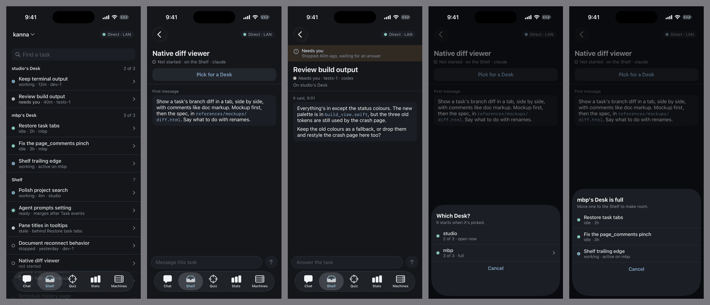
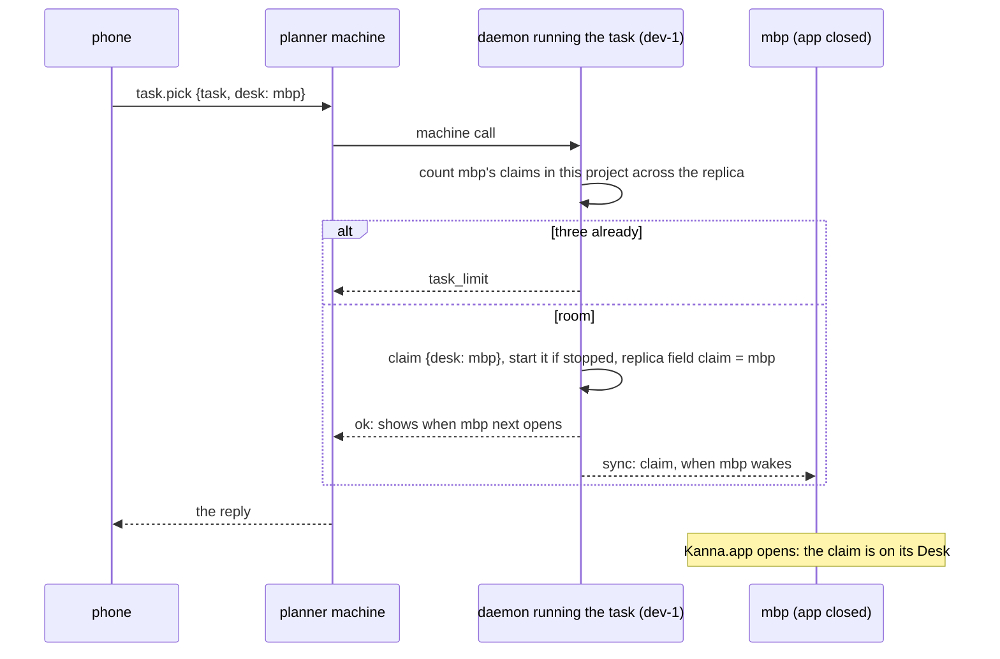

# Phone: the Shelf

**Status:** built on the LAN ([slice 2](mobile-app.md#9-build-order)); a planner's last words aren't · **Tested:** e2e `phone_shelf` (one daemon, the mock as claude), `real_agent_last_words` (real claude and codex), `crates/kanna/tests/machines_shelf.rs` (two daemons), `kanna-detect` `last_words`, `FlowTests` on the fixture backend, `DeviceTests.testShelf` on a real iPhone · **Part of:** [Kanna on the phone](mobile-app.md) · **Builds on:** [each app's Desks](app-desk.md), [tasks across machines](machine-tasks.md), [agent messaging](agent-messaging.md), [Shelf runners](shelf-runners.md)

The phone shows the repo's tasks wherever they run, and does three things with them: **pick**, **message** and **read**. Anything else, you ask the planner. A pick lands on a Mac whose app is closed, a task that needs you says why, and a message to a task that hasn't started goes with its first message.

## Contents

1. [The list and a task](#1-the-list-and-a-task)
2. [Pick](#2-pick)
3. [Last words](#3-last-words)
4. [A message to a task that hasn't started](#4-a-message-to-a-task-that-hasnt-started)
5. [Rejected](#5-rejected)

## 1. The list and a task

- **`tasks.list {repo}`** to the planner machine: the Shelf's [replicated records](machine-tasks.md#1-the-replicated-shelf) hold every task's name, state, owner and claim. Live status isn't in them, since each change would be a write that's [never compacted](machine-tasks.md#1-the-replicated-shelf), so the daemon asks each owner with [`machine call`](machines.md#5-the-app-link-over-the-network) and merges the replies. A machine it can't reach shows its tasks as last known, from the records, with `unreachable`. The reply also holds `desks` (§2) and the names of the five tasks `done` last.
- **`task.read {task}`** answered by the machine that runs the task, through the planner machine: the first message, the messages in and out, last words, what it waits for, its branch.
- **`task.send {task, id, text}`** leaves a message from `user`, since you wrote it, through [`kanna task send`'s path](agent-messaging.md#1-sending): it wakes a stopped Shelf task, and waits on a Desk task you stopped. `id` is chosen on the phone, so sending twice delivers once. The thread shows the same receipts as the chat.
- **Fresh while you look:** the daemon sends `tasks {repo}` within a second of a change here, and the phone also lists again every 5 s while the Shelf tab shows, since another machine's status has no notice.
- **Pick shows only for Shelf tasks.** A task already on a Desk can't be picked.

## 2. Pick

**A claim is already the daemon's.** `where: {desk: app}` is on the task's workspace in the `kanna.db` of the machine that runs it, and [`tasks pick {task, app}`](app-desk.md#3-commands) needs no app attached. `app-state.json` keeps only order and last active, and on launch the app takes in claims it doesn't know (`Physical.keep`). So a pick already reaches a closed Mac. Three things are missing.

| Missing | Today | Change |
|---|---|---|
| **The limit across machines** | `Tasks::room` counts claims on this daemon, so mbp could hold three here and three on dev-1 | A `claim` field on the replicated record, the Desk's machine name, written with each claim and each shelve. `room` adds the claims other machines' tasks hold for the project and Desk |
| **A Desk the phone can name** | A local claim is `mac`; a remote one is the device's name | The boundary translates: `desk` is a device name, and a daemon turns its own into `mac`. Nothing already stored changes |
| **Knowing the Desks** | Only an attached app is known | Desks are your machines whose capabilities say `macos`, open or not. The sheet says *shows when it next opens* for a Mac with no app attached |

- **The sheet** asks which Mac only when there's more than one. A full Desk offers which of its tasks to move to the Shelf, from the phone's own list: `task.pick {…, room: TASK}` shelves that task and picks this one, as one request, and the limit doesn't count `room`, whose shelve may not have synced yet. Shelving isn't an action of its own on the phone.
- **A task on a machine the planner machine can't reach** can't be picked: its owner has to start it. The row says so.
- **Two picks at once while apart** can make four. The Desk shows four, and the next pick is refused; nothing is thrown away.
- **Desk news:** a pick from the phone tells the planner, [as any change it didn't make](desk-news.md).
- **What stays the app's:** the active task, the order and which window shows what ([app-desk §2](app-desk.md#2-rules)).

## 3. Last words

*Needs you* is no use without what the agent said, and that's in its terminal, not its messages. The daemon keeps the final text of each task's last turn, and the question if it's asking one.

- **When:** at each turn's end, and when its status goes to `needs-you` ([agent status](agent-status.md#3-the-report-osc-7501)), and again 2 s later, since an agent can report before its session file has the turn.
- **Where from:** the agent's own session, which Kanna already finds to resume it ([planner resume §2](planner-resume.md#2-each-agent)). A reader per agent in `kanna-detect`, next to the quit files:

| Agent | Reads |
|---|---|
| claude | The session's JSONL under `~/.claude/projects`: the last assistant text, or a pending question tool's input |
| codex | Its rollout file, running or stopped: the last `agent_message` or assistant message, or a pending `request_user_input` |
| opencode | Its database, as for resume |
| agy | Nothing: the phone shows the status alone |

- **Kept** in `last_words` in `kanna.db`: who, when, whether it's a question, text, the last 8 KB. One row per task, replaced each turn, and it lives as long as the task.
- **For a planner too (not built):** the row is keyed by `who`, so a planner's can sit beside the tasks' and *Needs you at studio* can have words.
- **Best effort:** a reader that fails (a new session format, say) logs it and keeps the last row. The phone then shows the status alone. e2e `real_agent_last_words` runs real claude and codex against the mock model, so a format change fails a test.
- **Plain text on the phone:** it's an agent's output, shown as text with no links acted on. The phone shows them unless the task is working.

## 4. A message to a task that hasn't started

**Before this:** the message was queued and the task wasn't woken for it (`candidates` wakes only a task with a folder or pane). It was delivered at the end of the first turn, after the agent had done the whole job without it, and a task granted to another machine left it behind in the old daemon's `messages` table.

**Decision:** it goes with the first message.

- **A `notes` field** on the task's replicated record takes the text, so a grant or takeover carries it. `task.send` and `kanna task send` both write there when the task is `waiting`.
- **The first prompt** is the first message, then each note as `[message from SENDER] TEXT`, in order. The first message itself stays as written. `kanna task messages` lists the notes too.
- **It doesn't start the task:** a message doesn't jump the queue, [as for a stopped task](agent-messaging.md#3-stopped-tasks), and a blocked task stays blocked.
- **The phone says** *Waits until it starts*, then *Read* once the task has started.

The planner still can't change a first message; a task whose whole brief is wrong is made again, [as the skill says](../../.agents/kanna-skills/skills/kanna-tasks/SKILL.md#add-tasks-to-the-shelf).

## 5. Rejected

- **Greying out closed Macs** (the stopgap for D4): it makes Pick useless when you most want it.
- **Moving a Desk's order and active task to the daemon:** those are [how one app presents its work](app-desk.md#5-rejected), and the phone doesn't show them.
- **Last words from the screen:** the daemon has it, but a TUI's screen is chrome, wrapped lines and spinners.
- **Last words from `kanna task send`:** a task would have to remember to report, which [agents are told not to](agent-messaging.md#1-sending).
- **Starting a task from the phone:** ask the planner, who can check what it waits for.
- **Delivering a note at the first turn's end,** as today: the agent does the whole job before it reads *don't forget X*.
