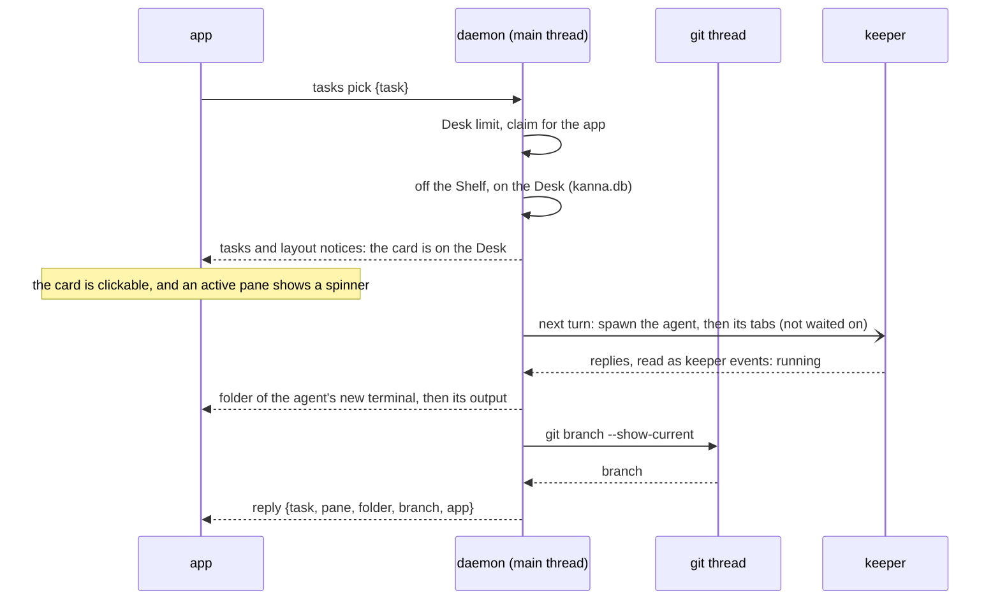

# Moving to the Desk at Once

**Status:** built · **Changes:** [tasks](tasks.md#8-how-its-built), [each app's Desks](app-desk.md) · **Builds on:** [presentation layers](presentation-layers.md)

Clicking a stopped task on the Shelf (Move to Desk, `kanna task pick`, the socket's `tasks pick`) moves it to the Desk **the moment it's clicked**, and its card can be made active right away. Its agent and tabs start behind it. Before, the Desk changed only once the daemon had restarted the agent and every tab terminal and run `git branch --show-current` on its main thread, so a stopped task with tabs took a noticeable while to appear.

In the daemon, the Shelf is `shelf` and the Desk's tasks `desk`, as everywhere ([internal names](internal-names.md)).

## Contents

1. [Order of a move to the Desk](#1-order-of-a-move-to-the-desk)
2. [Rules](#2-rules)
3. [How it's built](#3-how-its-built)
4. [Tested](#4-tested)
5. [Not yet](#5-not-yet)

## 1. Order of a move to the Desk

## 2. Rules

- **The Desk changes first.** The daemon checks the limit, claims the task for the app, takes it off the Shelf and records it on the Desk, and publishes that, before it starts anything.
- **No starting state.** The card looks like any Desk task's while its agent starts.
- **Make it active at once.** Which task is active is the app's, so a card can be made active while its terminals start. A pane whose terminal hasn't started yet shows a spinner until it has.
- **A failed start stays on the Desk.** The reply carries the error, and the Desk's note shows it (`noted` in `Desk.swift`), as it does for a refused move. Nothing goes back to the Shelf.
- **The reply waits for the work:** `kanna task pick` still answers once the agent and tabs run, with the agent's new terminal and the branch, so the CLI reports a failed start.
- **The daemon's main thread never runs git** for a move to the Desk or a start: the branch comes from a thread, as the worktree does (`make_worktree`), and a worktree's git folder (where its setup and teardown records are) is read from its `.git` file, not asked of `git rev-parse`.
- **The app redraws once per change,** however many messages it takes: the `tasks` and `layout` notices of one move are drawn together, and only the Desk view's rows that changed are rebuilt.

## 3. How it's built

- **`release`** (a task held on the Shelf): after the claim, `started` takes it off the Shelf, saves it on the Desk and publishes it. The agent's restart (`revive`: the agent, then `core.wake` for its tabs) runs on the daemon loop's **next turn** (`Event::Turn`), so the layout's flush at the top of the loop sends the Desk change before the restart's keeper round trips.
- **A fresh or moved task** (`launch`) opens its agent with `wait: false`, publishes, then looks up the branch only if `make_worktree` didn't already give it.
- **Branch lookups** read the worktree's `HEAD`, without running git.
- **A restarted terminal's folder:** a restart keeps the agent's pane ID ([durable panes](durable-panes.md)), and the app files Desk cards by that pane's folder, so the card stays under its project.
- **The spinner:** a terminal pane the app has no started terminal for yet (`PaneView.waiting`) shows a small spinner, gone once its terminal attaches or the pane shows a message.
- **Keeper spawns don't wait:** the restart sends its spawns and the loop goes on; each terminal starts when the keeper's reply comes back, so a busy or paused keeper doesn't hold up the Desk or anything else ([spawns without waiting](async-spawns.md)).
- **The app's refreshes are deferred:** a daemon notice (`layout`, `tasks`, `status`, `folder`, `pane`, `start`) marks the app as needing a refresh (`refreshSoon`), and a run-loop observer refreshes once before the main thread sleeps, ahead of AppKit's drawing in the same pass. A command (from the CLI or the daemon) refreshes first if one is due, so it reads current state.
- **`DeskView.lay` keeps unchanged rows:** a Desk or Shelf row whose task, width and state are the same is moved, not rebuilt, so only a new or changed row is drawn again.
- **The app reads the daemon's lines** by searching only the bytes just read for the newline (`memchr`), so a large `tasks` notice (every Shelf task's first message) costs one pass, not one per read.
- **daemon.log lines have a time** (`2026-10-19 16:33:53.542 kanna-daemon: …`, local time to the millisecond): the daemon's `log!` stamps each line, and a panic's first line is stamped too. A move to the Desk logs `TASK is on mac's Desk, and its agent and tabs start`, then `TASK's agent and tabs started`.

## 4. Tested

- **Daemon** (`tasks.rs`, `a_stopped_task_is_on_the_desk_before_its_agent_has_started_again`): a stopped task held on the Shelf is moved to the Desk while its agent's terminal is kept starting; it's off the Shelf, on the Desk and claimed by the app, while the agent is still starting and the reply is still waiting, which comes once the agent runs.
- **e2e `pick_at_once`:** a stopped task with two terminal tabs, clicked on the app's Shelf, is on the app's Desk within 200ms (about 50ms here). Its card, made active at once, shows it with its agent resuming and both tabs running, and no note. daemon.log's lines carry the time.
- With the mock agent, restarting an agent and two tabs takes about 8ms on a quiet machine, so the e2e also passes on the old order. The daemon test is what pins the order.
- **e2e `perf_intervals`:** with 50 tasks on the Shelf (first messages of about 2,700 characters each, like the real ones), `click.pick.shown` for a stopped task is at most 100ms, a bound with room for a loaded machine.
- **`task_scripts.rs`**, `a_worktrees_git_folder_is_found_without_running_git`: the git folder read from `.git` is the one `git rev-parse --absolute-git-dir` names, for the main checkout, a linked worktree and a folder inside it.
- **e2e `pick_keeper_paused`:** the same with the run's own keeper paused (`SIGSTOP`): on the Desk within 200ms, and `kanna task list` answers meanwhile ([spawns without waiting](async-spawns.md#4-tested)).

### Readings with fifty Shelf tasks

`debug.perf` after one `debug.click` on a stopped Shelf task, on a private instance with 49 more Shelf tasks carrying the repo's real first messages (2026-10-31, dev app, release daemon, a loaded machine):

| | Before | After |
|---|---|---|
| `click.pick.shown` | 163ms | 18–31ms |
| daemon's `tasks pick` | 70ms, 42ms of it two `git rev-parse` in `again()` | 5ms |
| `tasks` notice read by the app | 16ms after it was sent | 2ms |
| app refreshes | 4 (`message.tasks`, `message.layout` twice, the click), 11–14ms each | 2, 5ms each |
| `DeskView.lay` | 9ms, 50 rows rebuilt and redrawn | 1ms, 1 new row |

With a debug daemon, as the main checkout's dev build has, `click.pick.shown` is 14–18ms after.

What was slow:

- **git on the daemon's main thread:** `again()` (the restart command) and the Shelf's `described()` (every Shelf task, on every change) ran `git rev-parse --absolute-git-dir` to find each worktree's setup and teardown records, about 20ms a call. The Shelf view alone took 40–80ms per change for each stopped task with a worktree, and every `tasks list` and `tasks new` paid it for the whole Shelf: with 55 tasks, 20 of them stopped with worktrees, and a debug daemon, they took 750–1000ms (1.2–1.4s in the dev Kanna's daemon.log); after, `tasks list` is under 50ms and `tasks new` 50–60ms.
- **`short()`** copied every open task, first messages and all, for each task the Shelf view described.
- **The app's reader** searched the whole buffer for a newline after every read, quadratic in the length of the 127kB `tasks` line.
- **Each daemon notice refreshed and re-laid the whole Desk view**, then AppKit redrew all 50 new rows, three times per click.

## 5. Not yet

- **A task with no worktree yet** reaches the Desk once `git worktree add` (on a thread) is done, since its agent needs its folder to start in.
- **Other crates' log lines** (`kanna-mux:`, `kanna-detect:`) aren't stamped: they print with `eprintln!` from their own crates.
