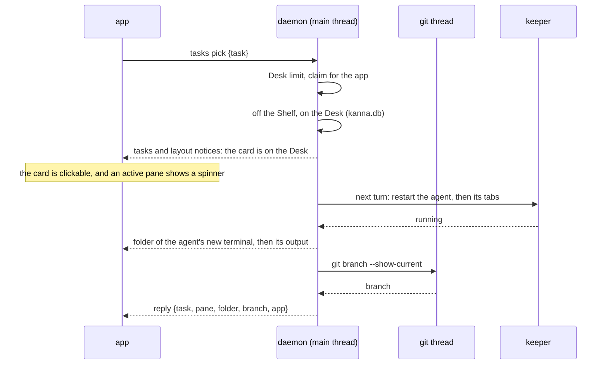

# Moving to the Desk at Once

**Status:** built · **Changes:** [tasks](tasks.md#8-how-its-built), [each app's Desks](app-desk.md) · **Builds on:** [presentation layers](presentation-layers.md)

Clicking a stopped task on the Shelf (Move to Desk, `kanna task pick`, the socket's `tasks pick`) moves it to the Desk **the moment it's clicked**, and its card can be made active right away. Its agent and tabs start behind it. Before, the Desk changed only once the daemon had restarted the agent and every tab terminal and run `git branch --show-current` on its main thread, so a stopped task with tabs took a noticeable while to appear.

In the daemon, the Shelf is `shelf` and the Desk's tasks `desk`, as everywhere ([internal names](internal-names.md)).

## Contents

1. [Order of a move to the Desk](#1-order-of-a-move-to-the-desk)
2. [Rules](#2-rules)
3. [How it's built](#3-how-its-built)
4. [Tested](#4-tested)
5. [Not yet](#5-not-yet)

## 1. Order of a move to the Desk

## 2. Rules

- **The Desk changes first.** The daemon checks the limit, claims the task for the app, takes it off the Shelf and records it on the Desk, and publishes that, before it starts anything.
- **No starting state.** The card looks like any Desk task's while its agent starts.
- **Make it active at once.** Which task is active is the app's, so a card can be made active while its terminals start. A pane whose terminal hasn't started yet shows a spinner until it has.
- **A failed start stays on the Desk.** The reply carries the error, and the Desk's note shows it (`noted` in `Desk.swift`), as it does for a refused move. Nothing goes back to the Shelf.
- **The reply waits for the work:** `kanna task pick` still answers once the agent and tabs run, with the agent's new terminal and the branch, so the CLI reports a failed start.
- **The daemon's main thread never runs git** for a move to the Desk or a start: the branch comes from a thread, as the worktree does (`make_worktree`).

## 3. How it's built

- **`release`** (a task held on the Shelf): after the claim, `started` takes it off the Shelf, saves it on the Desk and publishes it. The agent's restart (`revive`: the agent, then `core.wake` for its tabs) runs on the daemon loop's **next turn** (`Event::Turn`), so the layout's flush at the top of the loop sends the Desk change before the restart's keeper round trips.
- **A fresh or moved task** (`launch`) opens its agent with `wait: false`, publishes, then looks up the branch only if `make_worktree` didn't already give it.
- **Branch lookups** go to a thread and come back as `Event::Branch`; the reply waits on them, the Desk doesn't.
- **A restarted terminal's folder:** a restart gives the agent a new terminal ID ([IDs](presentation-layers.md#3-ids)), and the app files Desk cards by their terminal's folder. The daemon sends the app the new ID's folder as the ID changes, not once the terminal has started, so the card is filed under its project at once.
- **The spinner:** a terminal pane the app has no started terminal for yet (`PaneView.waiting`) shows a small spinner, gone once its terminal attaches or the pane shows a message.
- **daemon.log lines have a time** (`2026-10-19 16:33:53.542 kanna-daemon: …`, local time to the millisecond): the daemon's `log!` stamps each line, and a panic's first line is stamped too. A move to the Desk logs `TASK is on mac's Desk, and its agent and tabs start`, then `TASK's agent and tabs started`.

## 4. Tested

- **Daemon** (`tasks.rs`, `a_stopped_task_is_on_the_desk_before_its_agent_has_started_again`): a stopped task held on the Shelf is moved to the Desk while its agent's terminal is kept starting; it's off the Shelf, on the Desk and claimed by the app, while the agent is still starting and the reply is still waiting, which comes once the agent runs.
- **e2e `pick_at_once`:** a stopped task with two terminal tabs, clicked on the app's Shelf, is on the app's Desk within 200ms (about 50ms here). Its card, made active at once, shows it with its agent resuming and both tabs running, and no note. daemon.log's lines carry the time.
- With the mock agent, restarting an agent and two tabs takes about 8ms on a quiet machine, so the e2e also passes on the old order. The daemon test is what pins the order.

## 5. Not yet

- **Keeper spawns are synchronous:** every terminal start is a request to the keeper that the daemon's main thread waits on. It's normally a few milliseconds, and it now comes after the Desk change. Making spawns asynchronous is its own task.
- **A task with no worktree yet** reaches the Desk once `git worktree add` (on a thread) is done, since its agent needs its folder to start in.
- **Other crates' log lines** (`kanna-mux:`, `kanna-detect:`) aren't stamped: they print with `eprintln!` from their own crates.
