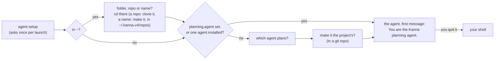

# New Desk

**Status:** built (2026-10-14) · **Tests:** `crates/kanna-daemon/src/backlog.rs` (unit), `scripts/e2e-kanna.sh` `desk_backlog`, `desk_by_path`, `new_desk`, `planner_choice`, `real_agent_planners`, `path_reuses_desk` · **Mockup:** [`references/mockups/desk.html`](../../references/mockups/desk.html) (Simulate: no tasks, first launch, Installed, Forget the project's planner; ⌘N) · **Part of:** [Desk](desk.md), [planning terminal](planning-agent.md) · **Builds on:** [agent setup](agent-setup.md), [settings](settings.md), [tasks](tasks.md#which-agents-resume)

What happens when a Desk window opens with nothing in it: where it opens, and how its planning terminal gets you to a planning agent, in the right project.

**Done when** a new Desk in `~` asks where, and moves to the folder, clones the repo or makes the named project; a new Desk on a repo asks which agent, starts the agent you pick, and that agent uses the kanna-planning skill, with Claude and with Codex; and a new Desk on a project whose planner is set starts it without asking.

## Contents

1. [When one opens](#1-when-one-opens)
2. [Its planning terminal](#2-its-planning-terminal)
3. [How it's built](#3-how-its-built)
4. [Tests](#4-tests)
5. [Rejected](#5-rejected)

## 1. When one opens

| How | Its folder |
|---|---|
| Kanna opens with nothing | the shell's folder Kanna was started from (`kanna …`, passed as `KANNA_START_DIR`), else `~` (started from Finder), which asks where ([2](#2-its-planning-terminal)) |
| File → New Desk (⌘N) | `~`, as `kanna ~` would, and its planning terminal asks where, offering your [recent projects](recent-projects.md) ([2](#2-its-planning-terminal)) |
| File → Open Recent | the project chosen, as `kanna PATH` ([recent projects](recent-projects.md)) |
| `kanna PATH` | PATH, unless a Desk is on PATH's project already: then that Desk comes forward and nothing opens. The window keeps that project across a relaunch, until a task from another project is pulled onto it |

- **It shows the Shelf:** the planning terminal on the left, the full Shelf of the folder's repo on the right ([planning terminal](planning-agent.md#1-when-it-shows)). The title bar says Shelf; there's no folder picker.
- **⌘N always means New Desk.** New Window (a plain terminal window) keeps its menu item, without a shortcut. There's no New Instance: another project is what a Desk is for.

## 2. Its planning terminal

- **It runs Kanna's planner script once:** when the Desk opens, or when its terminal is restarted (`kanna restart`). Each run comes back to the project's planning conversation, if it has one ([planner resume](planner-resume.md)).
- **Agent setup first:** `kanna agents setup --ask` and `update --ask` ([agent setup](agent-setup.md#3-asking)).
- **In `~`, it asks where first:** `Folder, repo or name:`, or with recent projects, those numbered and `Folder, repo, name or number [1]:`, where Return takes 1 ([recent projects](recent-projects.md)). Otherwise read in this order:
  | You type | It |
  |---|---|
  | a git URL (`https://…`, `git@…`, `ssh://…`) | clones it into `~/.kanna-v4/repos/NAME` (the repo's name), or opens that clone if it's there |
  | an existing folder (`~/work/kmux`, `../app`) | moves there |
  | `owner/repo` that isn't a folder | clones it from GitHub with `gh repo clone`, as above; without `gh`, it says to give the URL |
  | a name (letters, digits, `.`, `-`, `_`) | makes `~/.kanna-v4/repos/NAME`, empty, or opens it if it's there |

  A clone that fails, a missing folder or a `NAME` in `repos` that's another repo is said, and it asks again. Then the terminal moves, the header and Shelf follow, and the agent and the shell you're left in are there. Anywhere else (`kanna PATH`, a shell's folder), it doesn't ask.
- **A clone is a project like any other:** its own `.kanna/config.json` may already set `planning.agent`, and then nothing is asked. It clones with your git and `gh`, so their credentials apply.
- **A new project isn't a repo yet:** Kanna makes only the folder. The planning agent sees an empty folder and, with the kanna-new-project skill, decides with you what it is, then runs `git init` and a first commit when you agree ([tasks](tasks.md#1-what-a-task-is)).
- **The agents to choose from** are the agents Kanna knows that your shell finds, in the `AGENTS` table's order; Return takes the first.
- **No question** when the folder's `planning.agent` is set ([settings](settings.md)) or only one agent is installed. With none, it says so and you're in your shell.
- **Make it the project's:** yes writes `planning.agent` to the repo's `.kanna/config.json`, part of the repo, so every new Desk on the project, yours or anyone's, starts that agent. Not offered outside a git repo (`~`). No saves nothing, and the next Desk asks again.
- **The agent starts as you'd start it,** in the terminal's folder, resuming the project's planning conversation ([planner resume](planner-resume.md)), else new with `You are the Kanna planning agent.` as its first message, so it answers at once with what's running and waiting (in `~`, which new project). It doesn't ask permission, as a task's agent doesn't. Codex runs with `--no-daemon` ([tasks](tasks.md#8-how-its-built)).
- **Quit it and you're in your shell,** with a line giving the command that starts it again, resuming its conversation. Anything you start there is yours.

## 3. How it's built

- **`task desk` finds the project's Desk first,** in the layout (`desk_on` in `kanna-mux/src/desk.rs`), which has every window and its panes' live folders: PATH's project root (the main repo for a worktree, symlinks resolved; `project()` in `kanna-mux/src/core.rs`) against each Desk's, which is its docked task's folder, else its planning terminal's, else the folder it was opened on, as the Shelf decides. Of several, the key one, else the one used last. A plain terminal window isn't a Desk. It replies with the window and `new`; the found one becomes key, so the app brings it to the front. New Desk (⌘N) passes `new` to always open one.
- **The app asks for a planning terminal** (`backlog` `plan`) with the window's folder and the bundle's `planner.sh`; `task desk` makes the window, with a folder or none (started from Finder).
- **`planner.sh`, in `Kanna.app/Contents/Resources`,** copied there by `scripts/build-kanna-app.sh`. It replaces `getting-started.md`.
- **The daemon passes it what it needs** (`planner_command` in `backlog.rs`): the `kanna` beside the daemon, the repos folder, and each agent Kanna knows as a name, the program the script looks for, and the command that starts it with the planner's first message, built from the `AGENTS` table as a task's agent is (its flag for not asking permission, its first-message flag, [its app-server](codex-app-server.md) for Codex). Once the script has the folder and the agent, it asks the daemon for the command to run instead (`backlog` `planner`), which resumes the project's conversation ([planner resume](planner-resume.md#3-how-its-built)); the passed one is for when the daemon doesn't answer. The script knows no agent itself.
- **The script reads `planning.agent` itself,** once it's in the folder (the repo's `.kanna/config.json`, then yours, with `jq`), since in `~` the folder isn't known until you answer.
- **The terminal's command** is the [settings](settings.md) exports, then `planner.sh …`, which ends by starting your login shell (with Kanna's zsh integration put back) in the folder it chose. Moving reports the new folder as the shell would (OSC 7), so the window follows before any prompt. It runs in your interactive login shell like any command ([command shell](command-shell.md)), so `command -v` finds what your `.zshrc` sets up (nvm's codex).
- **Writing the setting** uses `jq` on the repo's `.kanna/config.json` (making it with `"version": 1` if it's missing), keeping its other keys in their order, as pretty JSON. `jq`, not `plutil`, because the planning terminal also runs on Linux servers ([your machines](machines.md)): macOS has it at `/usr/bin/jq` from 15, Kanna's minimum, and `server-setup.sh` installs it. It won't write through a symlink, and text from a repo or your answers is printed without control characters, so a cloned repo can't redirect the write or drive the terminal.
- **For tests only:** `KANNA_PLANNING_AGENTS` (programs, space-separated) replaces the agents a planning terminal offers, so e2e never starts your own claude or codex unless a scenario gives them; the repos folder follows `KANNA_AGENTS_HOME`.
- **No marker variable:** the planning terminal has `KANNA_TERMINAL` and `KANNA_SOCKET` like every Kanna terminal, and no `KANNA_PLANNER`; the daemon knows which pane is a window's planner.

## 4. Tests

- **Unit (`backlog.rs`):** the planning terminal's command for each agent; `planner.sh` run with stand-in agents: asks where only in `~`, moves to a folder, clones a URL (a local bare repo) and `owner/repo` (a stand-in `gh`), makes a named project, all under a stand-in `~/.kanna-v4/repos`, refuses a missing folder, asks which agent with two, not with one or with `planning.agent` set, writes the setting on yes and keeps the file's other keys, says so with none.
- **e2e (`scripts/e2e-kanna.sh`):** `planner_choice`: a new Desk asks, yes makes the agent the project's, the next new Desk starts it straight away, quitting leaves the shell, and a ⌘N Desk in `~` moves to a folder and starts it there. `real_agent_planners`: the real claude and codex against the mock model (`tools/agent-harness`) each receive `You are the Kanna planning agent.` as their first message. `desk_backlog`, `desk_by_path`, `new_desk`: setup, then where, in `~`. `path_reuses_desk`: `kanna PATH` twice gives one window, a subfolder and a folder in a worktree find it, another project opens another, and the found Desk is key.
- **Unit (`kanna-mux/src/owner.rs`):** a Desk on a project already open is brought forward: by its folder, planning terminal or docked task; not a plain window; the key one, else the one used last; `new` always opens.

## 5. Rejected

- **`kanna PATH --new`** for a second Desk on a project: a project has one Desk.
- **A `kanna plan` command:** it only makes sense inside a planning terminal, not as a general command.
- **Telling it in launch instructions** (`claude --append-system-prompt`, `codex -c developer_instructions`): started without a message, an agent waits silently, and each agent needs its own flag.
- **Remembering your answer without asking:** you choose per Desk, and save it for the project only when you say so.
- **Printing getting-started text** (before): the agent itself says what's running and waiting.
- **Guessing a folder** (the latest parked or backlog task's repo) when Kanna starts with none: there's no project concept yet; the folder is where Kanna was started, else your home folder, and you `cd`.
- **A folder picker dialog for New Desk:** the planning terminal takes a folder or a name.
- **Leaving the folder to you** (`cd` before starting your agent, as before): the script starts the agent at once, so in `~` it asks where first.
- **The agent moving to the project:** an agent can't change its terminal's folder, so the window and the shell you're left in would stay in `~`.
