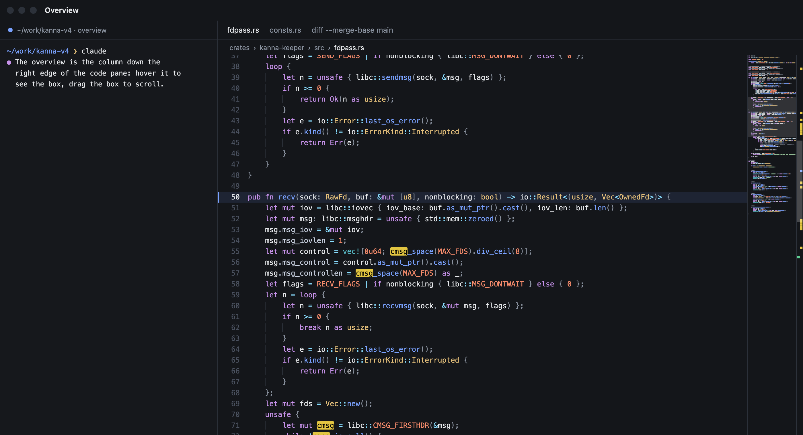
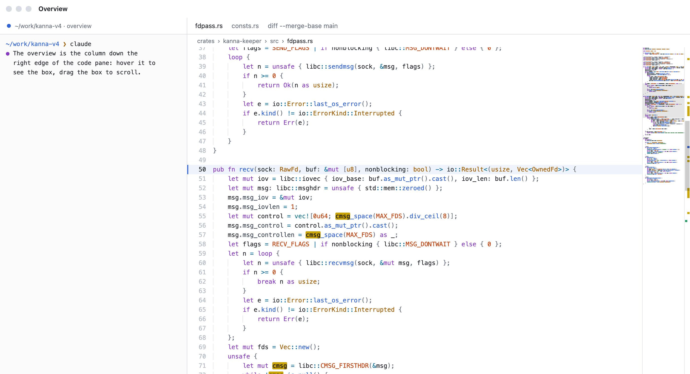
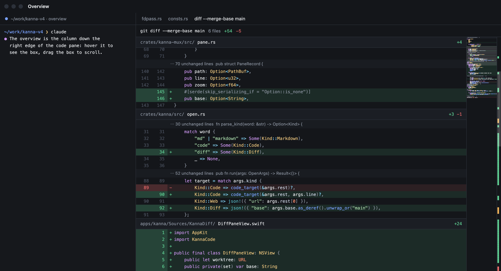
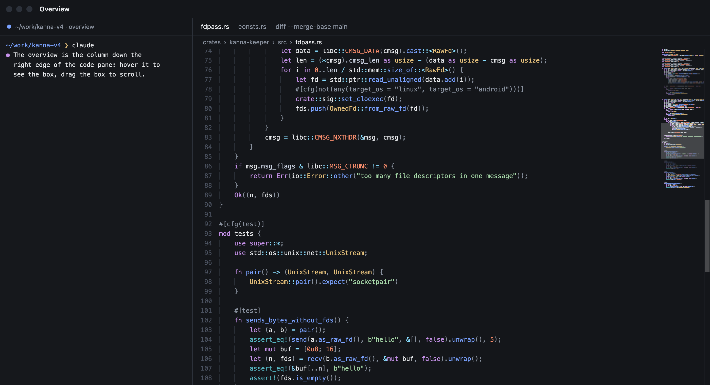
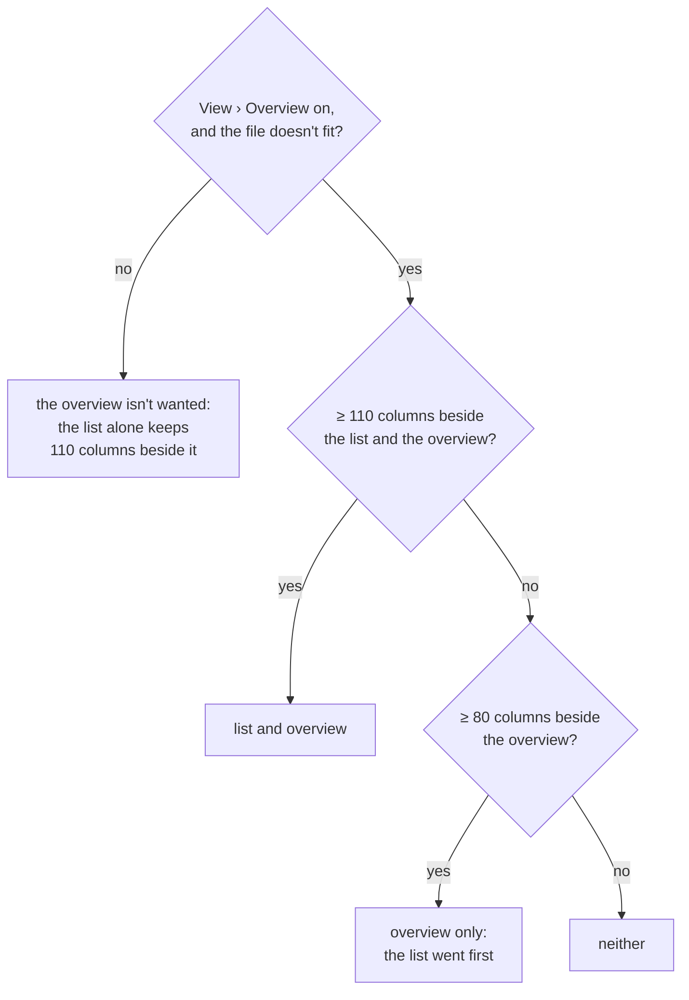
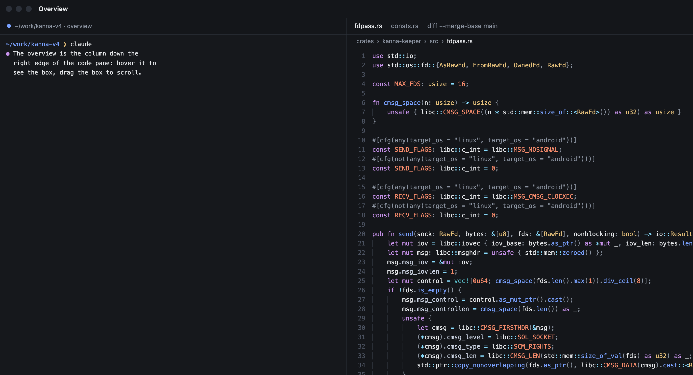
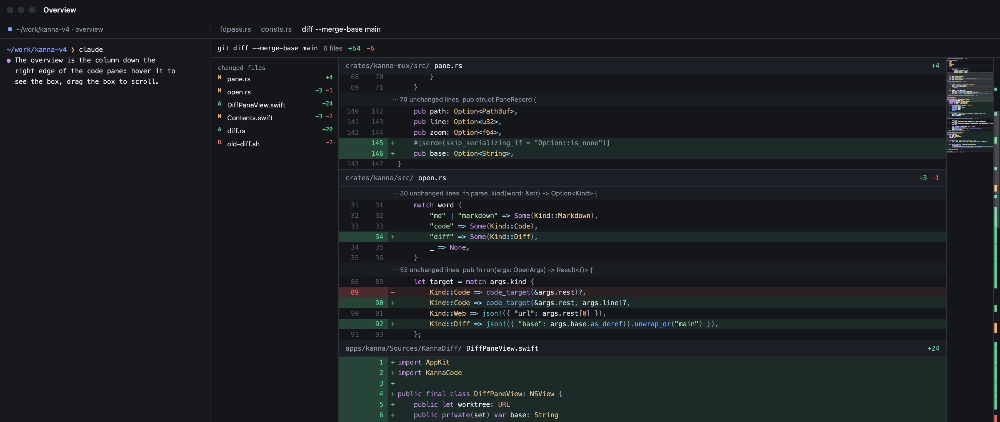
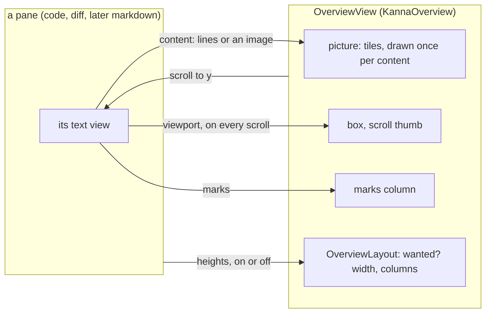

# Overview

**Status:** built · **Mockup:** [`references/mockups/overview.html`](../../references/mockups/overview.html) · **Look:** VS Code's minimap ([`overview-vscode.png`](../../references/mockups/overview-vscode.png)) · **Used by:** [code viewer](code-viewer.md), [diff viewer](diff-viewer.md); markdown next

The **overview** is a thumbnail of the whole file down the right edge of a pane: every line in tiny glyphs in the pane's colours, the part on screen as a box, and a thin column of marks (changes, comments, find hits). It shows where you are in a long file and what's where, and takes you there with a click. It's one view, `OverviewView`, that every pane with an overview uses: the pane supplies a picture of its content, its marks and what's on screen; the overview draws them and handles the mouse.

## Contents

1. [Rules](#1-rules)
2. [Mouse](#2-mouse)
3. [When it shows](#3-when-it-shows)
4. [Pane and overview](#4-pane-and-overview)
5. [How it's built](#5-how-its-built)
6. [Glossary](#6-glossary)

## 1. Rules

- **On every code and diff pane** by default; markdown and markdown diff panes get it next, through the same interface.
- **The thumbnail** draws each line at 2 pt high, at any zoom, its text as tiny glyphs in the pane's syntax colours, with the line's background (a diff's added and removed tints, a comment's tint, a file header, a fold). A line longer than the thumbnail is cut off.
- **A file taller than the thumbnail** scrolls the thumbnail with the text, proportionally, as VS Code does: at the top of the file it shows the top, at the end the end.
- **The box** shades the lines on screen. It shows while the pointer is over the overview and while you drag.
- **The marks column** maps the whole file to the pane's height, whatever its length, so every mark is always in view. Changes go in its left half, comments and find hits in its right half:

| Mark | Code pane | Diff pane |
|---|---|---|
| Added | — | added lines, in the added colour |
| Removed | — | removed lines, in the removed colour |
| Changed | lines changed on disk since the last reload, in the changed colour | removed lines followed by added ones, in the modified colour (`M`'s) |
| Comment | lines with a comment, in the comment colour | the same, once diff panes take comments |
| Find hit | lines with a find match | the same |

- **The scroll thumb** is drawn in the marks column, over the marks, while the pointer is over the overview, while you drag, and for a second after scrolling. The pane's own vertical scroller is hidden while the overview shows; it comes back when the overview hides.
- **Light and dark** follow the system, as every pane does; the picture is drawn again when the appearance changes.

- **In a diff pane** the thumbnail draws the diff as the pane lays it out: file headers, folds, added and removed lines. In Split it draws the old side and the new side each in half the thumbnail.

## 2. Mouse

| You | Does |
|---|---|
| Point at the overview | shows the box and the scroll thumb |
| Click the thumbnail outside the box | scrolls so the clicked line is in the middle of the pane; holding on drags from there |
| Drag the box | scrolls; the box follows the pointer, the end of its travel is the end of the file |
| Click or drag in the marks column | the same, against the whole file mapped to the pane's height |
| Scroll wheel over the overview | scrolls the pane, as over the text |

## 3. When it shows

- **It fits:** the file's lines, without the room left for scrolling past the end, fit the pane's height.
- **Side panels, one rule.** The overview is one of the pane's side panels, with the diff pane's file list ([`DiffAside`](diff-viewer.md#2-rules)). Each panel wants a number of columns of text beside all the panels shown: the file list 110, the overview 80, counted in the font's character width at the pane's current size, so it follows zoom. While any shown panel lacks its columns, the first in order is dropped: the file list, then the overview.
- **Narrowing only hides.** While the overview is wanted, the list counts the overview's width even when the overview itself is too narrow to show, so the list never comes back as the overview goes: from wide to narrow it's list and overview, the overview alone, then neither.
- **In Split** the columns are counted across both sides, as the file list's are.
- **View › Overview** turns it off and on for every pane at once, and is kept across relaunches with the app's other view state ([what the app keeps](windows.md#2-what-the-app-keeps)): `app-state.json` gets `"overview": false` while it's off.

## 4. Pane and overview

Everything is in the pane's **document coordinates**: points down the full height of its laid-out content.

| The pane gives | Type | When |
|---|---|---|
| Its content | `.text([OverviewText], lineHeight:)`: per side (one, or two in Split) the highlighted text and each line's `y`, `height`, character range and background colour; or `.image(CGImage, scale:)` of the whole page, for markdown | when the text, its highlighting, the font size or a comment changes |
| Its marks | `[OverviewMark]`: `y`, `height`, kind (`added`, `removed`, `changed`, `comment`, `hit`) and colour, in the pane's own colours | when a mark changes |
| Its viewport | `OverviewViewport`: the document's height (with the room past the end), the content's height (without it), the visible `y` and height | on every scroll and resize |

| The overview gives | |
|---|---|
| `onScroll(y)` | the document `y` to put at the top of the pane; the pane scrolls itself |
| `OverviewLayout.decide(...)` | whether the overview is wanted (on, and the content doesn't fit); which side panels show is then the pane's one rule over its panels, with the overview's width and its 80 columns |
| `debugState` | for `debug.code` and `debug.diff`'s `overview`: shown, wanted, enabled, the thumbnail's offset, the box's `y` and height, the top, the marks by kind, the tiles drawn; their `overview_click`, `overview_marks_click`, `overview_drag: [from, to]`, `overview_hover` and `overview_enabled` arguments drive it |

The mapping between the pane and the thumbnail is `OverviewGeometry`, a value with no AppKit in it, so the click and drag mapping and the layout are unit-tested on their own.

## 5. How it's built

- **A new Swift target, `KannaOverview`** (`apps/kanna/Sources/KannaOverview`), AppKit only; `KannaCode` and `KannaDiff` depend on it, and `KannaMarkdown` will.
- **Fast on large files.** The picture is drawn once per content, font-size or appearance change, into tiles 256 pt tall (128 lines) that are made as they come into view and kept; a scroll only moves the thumbnail and the box. The pane hands over a copy of its highlighted text and one `OverviewLine` per line (its place and character range); the tiles read the colours from the text when they're drawn. Content changes that come in a burst (the diff pane highlights one file at a time) are coalesced into one rebuild.
- **Glyphs:** each character is a block one point wide in its run's colour, letters and digits stronger than punctuation, as the mockup draws; spaces are gaps, so indentation and line shapes read as in VS Code.
- **Side panels:** the overview's rule joins the diff pane's `DiffAside` as one rule for every pane's side panels, moved to `KannaOverview` so the code pane (overview only) and later the markdown pane use it too.
- **The setting** is the app's (`Physical`, beside the text sizes, read into `OverviewSetting.enabled` at launch); View › Overview is a checked menu item, and every pane listens for `OverviewSetting.changed` and lays itself out again.
- **Find hits in the diff pane** need the matches, which NSTextView's own find bar keeps to itself, so each diff column owns an `NSTextFinder`, as the code pane does, and draws its matches.
- **Checks:** `swift test` for `OverviewLayout` and the side-panel rule (fits, the 80-column cutoff at several font sizes, the list giving way first, and a sweep from wide to narrow that only ever hides) and `OverviewGeometry` (click to centre, drag across a short and a tall file, the marks column's mapping); e2e: the code and diff scenarios in `scripts/e2e-kanna.sh` read `overview` from `debug.code` and `debug.diff` (shown, box), scroll and read the box again, narrow the pane and see it hide, and snapshot it light and dark.

## 6. Glossary

| Term | Meaning |
|---|---|
| **overview** | The thumbnail and its marks column together; VS Code calls them the minimap and the overview ruler |
| **thumbnail** | The shrunk picture of the whole content |
| **box** | The shaded part of the thumbnail that's on screen |
| **marks column** | The thin column beside the thumbnail: the whole file's marks, at the pane's height, with the scroll thumb |
| **document coordinates** | Points from the top of the pane's laid-out content, not of the window |
