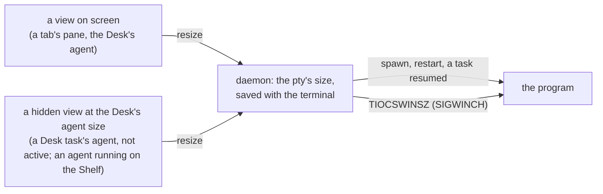

# Pane sizes

**Status:** built · **Tested:** e2e `pane_sizes`, `cargo test -p kanna-daemon --test restart` (a terminal started again after a restart keeps its size without its screen) · **Builds on:** [app link](app-link.md), [restarting the daemon](daemon-restart.md), [desk](desk.md)

A terminal's program always sees the size of the view it's shown in, or would be shown in: across a relaunch of the app, a restart of the daemon, and for an agent you haven't looked at yet. A full-screen program such as Claude lays out what it prints at the size it has when it prints it, so a wrong size, even for a moment, stays in its scrollback.

## 1. Where a size comes from

- **A view asks for the size it has.** Ghostty makes a surface at 800×600 pixels before the view gives it its own size; a resize request for any size but the view's is dropped, so the program gets one SIGWINCH, for the right size, not one for a passing size and another for the right one.
- **Tasks not shown have a view too.** Each Desk window holds, hidden, the agent of every task of its project on the Desk but not active and every one running on the Shelf, laid out where it would be as the active task (its dock's edge and width, below the header, above the strip). Its surface is attached as if shown, so the agent starts, runs and comes back at the Desk's size, and follows the window when it's resized. A stopped Shelf task has none; it starts again at the size it last had.
- **The daemon keeps the size.** A terminal started again (`restart`, a task resumed) starts at its last size. `terminals.json` saves it with each terminal (`cols`, `rows`), so it survives a daemon restart even if the screen's file is lost.
- **A relaunch changes nothing.** The pty keeps its size while the app is away; the app's views ask for the same size, and the daemon, seeing no change, sends no SIGWINCH.

## 2. What still starts at 80×24

A terminal the daemon has never had a size for (a new pane, a Shelf task's first start) starts at 80×24 and takes its view's size as soon as the app has made the view, a few milliseconds later; with no app attached, when it attaches. A pane in a tab that hasn't been shown since launch keeps whatever size its pty has.
