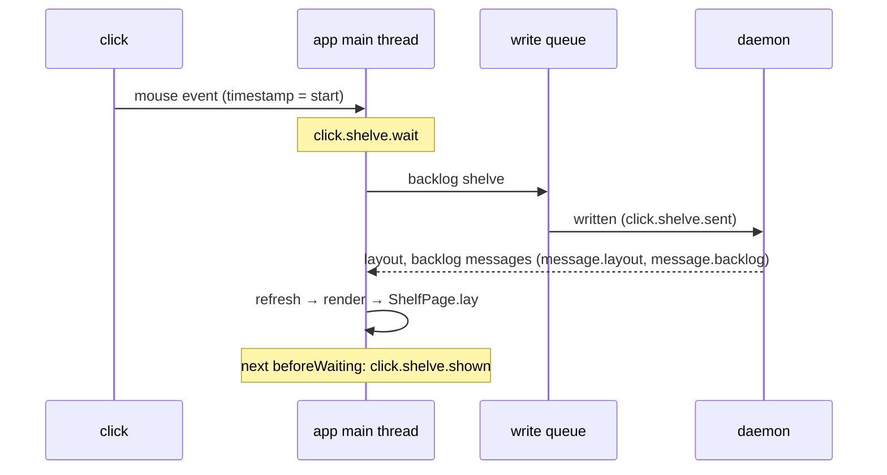

# Performance Monitoring

**Status:** built · **Builds on:** [architecture](architecture.md), [app link](app-link.md) · **Measures:** [shelving at once](shelve-latency.md)

Kanna.app measures where its main thread's time goes, from inside. Measuring from outside skews the result: polling `debug.desk` 50 times a second encodes every backlog task's first message on the main thread, the thread being measured. So the app marks its own work as **intervals**, notices when its main thread stops answering (a **hang**), and keeps the recent numbers in a small ring buffer that `debug.perf` reads. The daemon logs any request it takes over 50ms to handle.

Signposts and the hang detector are in every build (they cost a few nanoseconds each); `debug.perf` is in debug builds only (`KANNA_DEBUG=1`), like every `debug.*` command.

## Contents

1. [What is measured](#1-what-is-measured)
2. [Hangs](#2-hangs)
3. [Reading it](#3-reading-it)
4. [How it's built](#4-how-its-built)
5. [Tested](#5-tested)
6. [Glossary](#6-glossary)

## 1. What is measured

Each interval is an `OSSignposter` interval (subsystem `dev.kanna.app`, a category per area) and a sample in `debug.perf`, under the name in the table. A label (a message type, a command's name) is part of the name in `debug.perf` and the signpost's message in Instruments.

| Name in `debug.perf` | Category | From → to |
|---|---|---|
| `click.shelve.wait` | click | a click on a backlog task (the mouse event's time) → the app handling it |
| `click.shelve.sent` | click | the click → its `backlog shelve` request written to the daemon's socket |
| `click.shelve.shown` | click | the click → the Shelf drawn with the task on it and off the backlog |
| `click.shelve.failed` | click | the click → the daemon refusing it |
| `click.pull.wait`, `click.pull.shown` | click | a click on a Shelf card (strip or Shelf page) → handled; → the Desk drawn showing it |
| `message.TYPE` | daemon | handling one daemon message: `layout`, `backlog`, `status`, `diff`, `output`, `reply`, … |
| `command.NAME` | commands | one app command (`Commands.handle`), from the CLI or the daemon, e.g. `command.debug.click` |
| `refresh`, `render` | render | `AppController.refresh` and its `render` of every window |
| `WindowController.render` | render | one window's render |
| `ShelfPage.lay` | shelf | rebuilding the Shelf page; its detail is the row count (`42 rows`) |
| `markdown.check`, `markdown.load` | markdown | a markdown pane's comments check (every 0.5s) and drawing the text the daemon sent ([file panes](file-panes.md)) |
| `hang` (event) | hang | a main-thread hang, with what was open |

A click's times start at the mouse event's own timestamp, so time the event spent queued behind a busy main thread counts (that is `wait`). A `debug.click` makes its event inside its own command, so its `wait` is always 0. "Drawn" is the main run loop's next `beforeWaiting` after the change, past Core Animation's commit.



## 2. Hangs

The main thread **hangs** when one stretch of work between two run-loop transitions takes over **100ms**.

- Two run-loop observers on the main thread stamp the time at every transition (first in order on wake, last in order before sleeping), and clear it while the run loop sleeps. No timer runs on the main thread.
- A watchdog on a utility queue looks every 50ms. When the stamp is over 100ms old, it notes the intervals open at that moment. When it's over 1s old, it logs once that the main thread hasn't answered (for a hang that never ends).
- When the stretch ends, the main thread records the hang: its length, the intervals the watchdog saw open (or, if the hang was too short for it to see, those open since before the hang), and the longest intervals that ran inside it.
- Each hang is logged to `os_log` (category `hang`, an error), to the app's stderr (`app.log` in e2e runs), and is kept in `debug.perf`'s last 20 hangs.

```
kanna: the main thread hung 312ms; open: message.layout, refresh, render; ran: ShelfPage.lay (40 rows) 290ms
```

**The daemon** logs each request (from a client or the app) whose handling on its main loop takes over 50ms, to `daemon.log`: `kanna-daemon: backlog shelve from the app took 72ms`. Work the request hands to other threads isn't counted.

## 3. Reading it

**`debug.perf`** (debug builds): per interval name, `count` (since the last reset), `recent` (samples kept, up to 200), `p50`, `p95`, `max` and `last` in ms over the recent samples, and the last sample's `detail`; then the last hangs, newest first, and what's open now. `{"reset": true}` clears it first.

```sh
kanna raw '{"cmd":"debug.perf","args":{"reset":true}}'   # then click
kanna raw '{"cmd":"debug.perf"}'
kanna raw '{"cmd":"debug.hang","args":{"ms":300}}'      # a hang on purpose
```

**Instruments:** profile Kanna.app with the *os_signpost* instrument (or *Logging* with signposts); intervals show as lanes per category under `dev.kanna.app`, so a click lines up against the messages, renders and `ShelfPage.lay` it waited for. *Hangs* and *Time Profiler* show the same window's stacks.

**Log stream:**

```sh
log stream --predicate 'subsystem == "dev.kanna.app" AND category == "hang"'          # hangs as they happen
log show --last 10m --signpost --predicate 'subsystem == "dev.kanna.app" AND category == "click"'   # signposts afterwards
```

## 4. How it's built

- **`KannaPerf`** (Swift module, used by the app and `KannaMarkdown`): `Perf.begin/end/mark/measure` make signpost intervals and record samples in a `Book` behind a `Mutex`: one ring of 200 samples per name, the open intervals, the last 20 hangs. Nothing is computed until `debug.perf` asks. `HangWatch` holds the observers and the watchdog.
- **Clicks** (`Clicks.swift`): a backlog click remembers the Shelf's tasks at that moment; it's shown at the first `ShelfPage.lay` where the task is off the backlog and a new task is on the Shelf (a Shelf card's ID is its agent's pane, not the task's). A pull is shown when a window renders with that task docked.
- **Sent** is a callback the daemon connection's write queue runs after writing the request.
- **The daemon** times each request's handling in its main loop (`timed` in `main.rs`).

## 5. Tested

- `KannaPerfTests`: percentiles and the ring, a hang naming what was open and what ran, a hang the watchdog missed.
- First reading (2026-10-21, dev build, 40 backlog tasks with 82k characters of first messages, one `debug.click` on a backlog task): `click.shelve.sent` 0.2ms, `click.shelve.shown` 141ms; in between `message.layout` 14ms, `message.backlog` 14ms and `message.status` 40ms, each a full `refresh` that ran `ShelfPage.lay` (40 rows, 12–33ms) again; no hang over 100ms.
- e2e `perf_intervals`: a backlog click records `click.shelve.wait`, `.sent` and `.shown` with the messages, renders and `ShelfPage.lay`; a Shelf card click records `click.pull.shown`; `debug.hang` 300ms shows in `debug.perf` and in the app's log with `command.debug.hang` open.

## 6. Glossary

| Term | Meaning |
|---|---|
| **Signpost** | An `os_signpost` mark; an interval is a begin and end pair Instruments draws on a timeline. |
| **Interval** | A named stretch of work, as a signpost and as a sample in `debug.perf`. |
| **Hang** | Over 100ms of main-thread work between two run-loop transitions. |
| **p50, p95** | The time half, and 95 in 100, of the recent samples took at most. |
