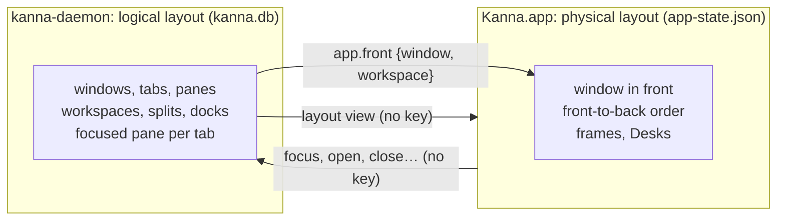
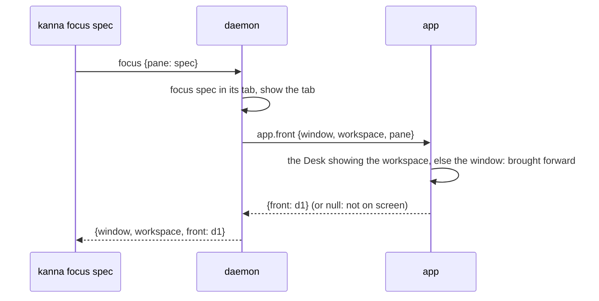

# The app owns the physical layout

**Status:** built (2026-10-28), in Kanna · **Builds on:** [the CLI acts on its caller](cli-caller.md), [windows](windows.md), [each app's Desk and Shelf](app-desk.md) · **Why:** two copies of which window is in front, the daemon's key window and AppKit's, drifted apart on 2026-10-28 and ⌘W closed a pane in the wrong window

The layout has two owners. The **daemon** owns the **logical layout**: windows, tabs, panes, workspaces, splits and docks, and which pane is focused in each tab. The **app** owns the **physical layout**: which window is in front, the front-to-back order, and each window's frame. Each fact has one owner, so there's nothing to keep in step.

## Contents

1. [What each side keeps](#1-what-each-side-keeps)
2. [Bringing a window forward](#2-bringing-a-window-forward)
3. [The window in front, in the app](#3-the-window-in-front-in-the-app)
4. [A request that names no window](#4-a-request-that-names-no-window)
5. [Kanna comes in front of another app only when you ask](#5-kanna-comes-in-front-of-another-app-only-when-you-ask)
6. [How it's built](#6-how-its-built)

## 1. What each side keeps

| | Daemon | App |
|---|---|---|
| Windows, tabs, panes, workspaces, splits, docks | its model, saved in `kanna.db` | draws them from the `layout` view |
| The focused pane, the shown tab, zoom | its model | draws them |
| Which window is in front, and the order | — | AppKit, and its own record, `order` in `app-state.json` |
| Window frames, dock widths, Desks | — | `app-state.json`, as before ([windows §2](windows.md#2-what-the-app-keeps)) |

- **The daemon has no key window:** none in its model, the view it publishes, `list` replies or the saved layout. An older saved layout's `key` is ignored on load and not written back.
- **The app doesn't tell the daemon its key window.** A window becoming key (a click, ⌘\`, a new window) changes only the app's record.
- **Only Kanna changes.** kmux keeps its key window; `--mux kmux` and kmux's protocol cases still see one there ([workspaces §8](workspaces.md#8-backport-to-kmux)).

## 2. Bringing a window forward

`kanna focus` changes the logical focus and then asks the app to bring its window forward, the way `task park` and `task pull` are relayed to the app.

- **The app picks the window:** the Desk showing (or planning in) the pane's workspace, else the window the daemon named, if it has one on screen. A workspace in the backlog or on the Shelf has none: `front` is null and nothing moves.
- **The reply says so:** `focused spec in win-1 (in front)`, `focused spec in ws-3 (task-1dfb, on the Shelf)`, `brought win-1 forward`; with nothing to show, `win-1 isn't on screen`.
- **With no app attached** the logical focus still happens and the command succeeds; nothing is brought forward. An app that attaches later draws that tab and focus.
- **The app's own focus requests** (a click on a pane, Next Pane, a toast) come back as `app.front` too; a window the app already has in front isn't brought forward again.
- **Nothing else brings a window forward on the daemon's say.** `open`, `move` and `arrange` into a window behind leave it there. A new window (`open`, `move` or `move-tab` with `--window new`) is relayed as `app.front {window, new: true}` when the request was the user's, so the app brings it forward even if its view comes later.
- **Who asked decides whether it comes in front of another app** ([§5](#5-kanna-comes-in-front-of-another-app-only-when-you-ask)): `kanna focus` from a Kanna terminal, while you're in another app, puts the window behind it and says so: `focused b in win-2 (behind the app you're in)`.

## 3. The window in front, in the app

The app's key window is AppKit's key window when it's one of Kanna's; otherwise (a `--bg` app, an alert in front) the first window in the app's record that's still open; otherwise the last window (`KeyWindow.resolve` in `KannaWindows`). There's no fallback to the daemon.

- **The record** is the front-to-back order of the windows the app brought forward or AppKit made key, newest first, saved as `order` in `app-state.json`. Closing a Desk drops it, and windows the daemon no longer has are dropped when the app attaches.
- **After a restart** the app brings its windows forward in the saved order once the daemon's view is in, so the window that was in front is in front again.
- **It decides:** menus and shortcuts ([menus](menus.md)), where toasts show ([toasts](toasts.md)), Unread ([agent status](agent-status.md)), a Desk picked by project ([the CLI acts on its caller §2](cli-caller.md#2-desks-by-project)), and the `debug.*` defaults (`debug.key`, `debug.snapshot`, `debug.type`, `debug.desk`); `debug.view` reports it as `key`.

## 4. A request that names no window

A request that needs a window and names none, with no caller (a kmux client, `kanna raw`), goes to the only window, or a new one if there is none. With several, the daemon can't know which is in front, so it's refused: `there are several windows: say which with --window WINDOW (or --window new)`. The `kanna` CLI never sends one ([the CLI acts on its caller](cli-caller.md)). kmux's protocol case that opens into the key window with two windows is skipped for Kanna ([kmux is the reference model](kmux-reference.md)).

## 5. Kanna comes in front of another app only when you ask

Only your own actions bring Kanna forward: clicking a Kanna window, the Dock icon, ⌘Tab, and `kanna` commands you run from a terminal outside Kanna (no `$KANNA_TERMINAL`), such as `kanna PATH` or `kanna focus`. Anything an agent or the daemon does (a new window, `kanna open`, `kanna focus` or `kanna task pull` from a Kanna terminal, a task starting, a Desk opened for a planner, windows restored after a restart, state updates) changes nothing on screen while you're in another app: it doesn't activate Kanna, take the keyboard, or move a Kanna window among the other app's windows. Even a window ordered just behind the other app's front window would hide that app's other windows (Safari's main window behind its Settings), so such a window isn't ordered at all until Kanna is active. While Kanna is the active app, everything comes forward inside it as before.

**Why:** until 2026-10-28 every render re-presented the daemon's key window whenever AppKit had none, which is always while Kanna isn't active. Each daemon update (agent status, the Shelf, machine pings) then ordered a Kanna window just below the active app's front window, every few seconds.

Every window the app orders goes through one decision, `Placement.of(origin, active, background)` in `KannaWindows`:

| Origin | Kanna active | Kanna not active | `--bg` app, not active |
|---|---|---|---|
| **app**: a click, a menu, a shortcut, the Dock icon, a toast | in front, key | in front, key | just behind the front app's window, key |
| **user**: a `kanna` command run outside Kanna | in front, key | in front, key | just behind the front app's window, key |
| **agent**: anything else | in front, key | waits: not ordered until Kanna is active | behind Kanna's front window, not key |

- **In front, or just behind the front app's window,** the window becomes the app's window in front: it goes first in the record ([§3](#3-the-window-in-front-in-the-app)).
- **Waits** leaves the screen, the record and the key window alone. A waiting window that isn't on screen yet (a new one, or one restored after a restart) comes in when Kanna is next active, just below the Kanna window in front; if Kanna has none on screen, the first in the saved order comes in front and the rest below it. One that's already on screen stays where it is. So when you come back to Kanna, the window you left in front is still in front.
- **Behind Kanna's front window** is only for a `--bg` app (tests), which is never active: the window goes just below whichever Kanna window is highest, or just behind the front app's window if Kanna has none on screen, so e2e can still draw it. It leaves the record alone.
- **The origin travels with the request.** The CLI adds `user: true` to `focus`, `open`, `move`, `move-tab` and `task` Desk requests (`kanna PATH`, `task pull`, `task park`) when it has no `$KANNA_TERMINAL`; the app adds it to its own. The daemon passes it on in `app.front` and `desk`. A request without it is an agent's.
- **Starting the app:** the CLI starts Kanna.app with `open -g` when it runs in a Kanna terminal, so an agent's command doesn't activate a closed Kanna. The app never activates itself at launch: macOS does that when you open it. After a restart, windows restored without you wait until you come to Kanna, then come in their saved order.
- **Still activates:** the confirmation that adds a machine you're pairing (`kanna machine pair CODE`) is an alert you asked for, so it comes in front.

## 6. How it's built

- **Daemon** (`crates/kanna-mux`): `Model` has no `key`; `target_window(None)` is the only window, a new one, or `bad_request`; the view, `list` and the saved layout carry no `key`. `CoreHandle::on_front` takes the relay; after a `focus` the core asks it with the reply's `window` and `workspace` and adds the app's `front` to the reply. `kanna-daemon` relays it to the app as `app.front`, or answers `{}` with no app.
- **App:** `Physical.order` (`setFront`, `forget`) is the record; `present(window, placement)` and AppKit's `windowDidBecomeKey` add to it; `show(window:origin:)` brings a Desk or a window forward; `commands["app.front"]` answers the relay, with `behind: true` when the window stayed behind, and remembers a new window the view hasn't brought yet (`awaiting`); `AppController.keyWindow` is `KeyWindow.resolve(appKit:front:windows:)`; `Placement.of` decides every window's place and `WindowOrder` keeps the waiting windows, released on `didBecomeActive` (`releaseWaiting`) ([§5](#5-kanna-comes-in-front-of-another-app-only-when-you-ask)). Nothing in a render orders a window except `makeController` for a window the view brings new, through `present`.
- **CLI:** `focused` prints `front` (or `behind`); `workspace list` marks no window with `*` for Kanna (kmux's replies still do); `user: true` on requests from outside Kanna; `open -g` from a Kanna terminal.
- **Checked by** the `kanna-mux` owner tests (no `key` in the view, an old layout's `key` dropped, a targetless open with two windows refused), `KeyWindowTests`, `PlacementTests` (every origin, active or not, `--bg` or not), `WindowOrderTests` (a render while the app is inactive orders no window; waiting windows come in on activation in the saved order), `crates/kanna/tests/cli.rs`, and e2e `cli_caller` (no `key` in the daemon's list, the refused targetless open, `kanna focus` bringing win-1 forward), `windows_tabs_ui` (Next Pane, New Window and ⌘\` on a `--bg` app), `instance_stop` (`order` saved and win-1 in front after a restart), `desk_planner_stays`, `path_last_in_front`, `stays_behind` (a new window, `kanna focus` and `kanna PATH` from a Kanna terminal leave the window in front as it was; the same from outside bring theirs forward). A `--bg` app is never active, so e2e sees only the record, not what's on screen.

## Glossary

| Term | Meaning |
|---|---|
| **Logical layout** | What's in which window, tab and workspace, split how, focused where: the daemon's. |
| **Physical layout** | Where the windows are on screen: in front, their order, frames: the app's. |
| **Window in front** | The app's key window: AppKit's, else the app's record. |
| `app.front` | The daemon's request to the app to bring a focused pane's window, or the user's new window, forward. |
| **Origin** | Who asked for a window to come forward: the app (a click, a menu), the user (`kanna` outside Kanna), or an agent (anything else). |
