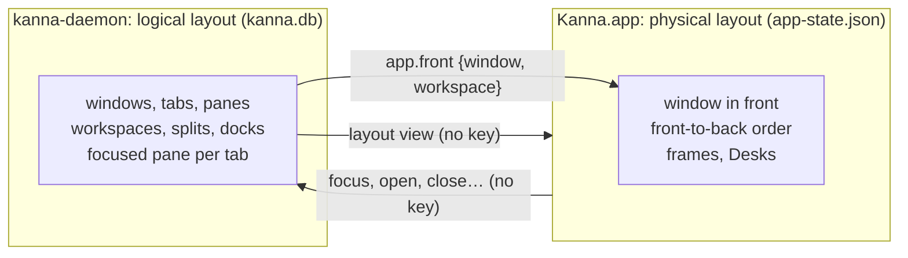
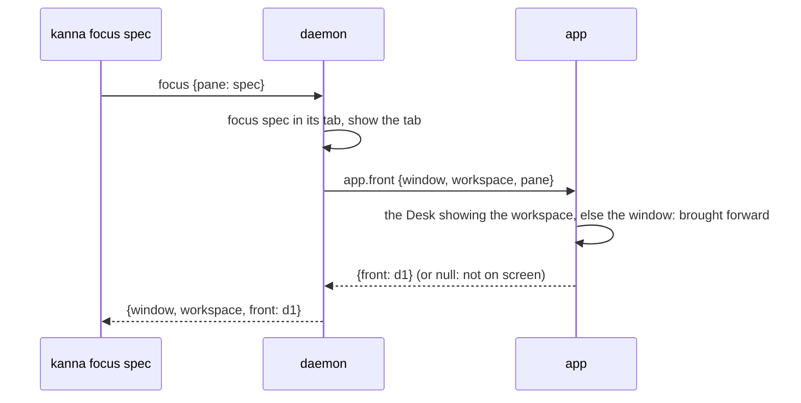

# The app owns the physical layout

**Status:** built (2026-10-28), in Kanna · **Builds on:** [the CLI acts on its caller](cli-caller.md), [windows](windows.md), [each app's Desks](app-desk.md) · **Why:** two copies of which window is in front, the daemon's key window and AppKit's, drifted apart on 2026-10-28 and ⌘W closed a pane in the wrong window

The layout has two owners. The **daemon** owns the **logical layout**: windows, tabs, panes, workspaces, splits and docks, and which pane is focused in each tab. The **app** owns the **physical layout**: which window is in front, the front-to-back order, and each window's frame. Each fact has one owner, so there's nothing to keep in step.

## Contents

1. [What each side keeps](#1-what-each-side-keeps)
2. [Bringing a window forward](#2-bringing-a-window-forward)
3. [The window in front, in the app](#3-the-window-in-front-in-the-app)
4. [A request that names no window](#4-a-request-that-names-no-window)
5. [How it's built](#5-how-its-built)

## 1. What each side keeps

| | Daemon | App |
|---|---|---|
| Windows, tabs, panes, workspaces, splits, docks | its model, saved in `kanna.db` | draws them from the `layout` view |
| The focused pane, the shown tab, zoom | its model | draws them |
| Which window is in front, and the order | — | AppKit, and its own record, `order` in `app-state.json` |
| Window frames, dock widths, Desks | — | `app-state.json`, as before ([windows §2](windows.md#2-what-the-app-keeps)) |

- **The daemon has no key window:** none in its model, the view it publishes, `list` replies or the saved layout. An older saved layout's `key` is ignored on load and not written back.
- **The app doesn't tell the daemon its key window.** A window becoming key (a click, ⌘\`, a new window) changes only the app's record.
- **Only Kanna changes.** kmux keeps its key window; `--mux kmux` and kmux's protocol cases still see one there ([workspaces §8](workspaces.md#8-backport-to-kmux)).

## 2. Bringing a window forward

`kanna focus` changes the logical focus and then asks the app to bring its window forward, the way `task park` and `task activate` are relayed to the app.

- **The app picks the window:** the Desk showing (or planning in) the pane's workspace, else the window the daemon named, if it has one on screen. A workspace on the Shelf, or on the Desk but not active, has none: `front` is null and nothing moves.
- **The reply says so:** `focused spec in win-1 (in front)`, `focused spec in ws-3 (task-1dfb, on the Desk)`, `brought win-1 forward`; with nothing to show, `win-1 isn't on screen`.
- **With no app attached** the logical focus still happens and the command succeeds; nothing is brought forward. An app that attaches later draws that tab and focus.
- **The app's own focus requests** (a click on a pane, Next Pane, a toast) come back as `app.front` too; a window the app already has in front isn't brought forward again.
- **Nothing else brings a window forward on the daemon's say.** A new window comes forward because the app made it; `open`, `move` and `arrange` into a window behind leave it there.

## 3. The window in front, in the app

The app's key window is AppKit's key window when it's one of Kanna's; otherwise (a `--bg` app, an alert in front) the first window in the app's record that's still open; otherwise the last window (`KeyWindow.resolve` in `KannaWindows`). There's no fallback to the daemon.

- **The record** is the front-to-back order of the windows the app brought forward or AppKit made key, newest first, saved as `order` in `app-state.json`. Closing a Desk drops it, and windows the daemon no longer has are dropped when the app attaches.
- **After a restart** the app brings its windows forward in the saved order once the daemon's view is in, so the window that was in front is in front again.
- **It decides:** menus and shortcuts ([menus](menus.md)), where toasts show ([toasts](toasts.md)), Unread ([agent status](agent-status.md)), a Desk picked by project ([the CLI acts on its caller §2](cli-caller.md#2-desks-by-project)), and the `debug.*` defaults (`debug.key`, `debug.snapshot`, `debug.type`, `debug.desk`); `debug.view` reports it as `key`.

## 4. A request that names no window

A request that needs a window and names none, with no caller (a kmux client, `kanna raw`), goes to the only window, or a new one if there is none. With several, the daemon can't know which is in front, so it's refused: `there are several windows: say which with --window WINDOW (or --window new)`. The `kanna` CLI never sends one ([the CLI acts on its caller](cli-caller.md)). kmux's protocol case that opens into the key window with two windows is skipped for Kanna ([kmux is the reference model](kmux-reference.md)).

## 5. How it's built

- **Daemon** (`crates/kanna-mux`): `Model` has no `key`; `target_window(None)` is the only window, a new one, or `bad_request`; the view, `list` and the saved layout carry no `key`. `CoreHandle::on_front` takes the relay; after a `focus` the core asks it with the reply's `window` and `workspace` and adds the app's `front` to the reply. `kanna-daemon` relays it to the app as `app.front`, or answers `{}` with no app.
- **App:** `Physical.order` (`setFront`, `forget`) is the record; `present` and AppKit's `windowDidBecomeKey` add to it; `show(window:)` brings a Desk or a window forward; `commands["app.front"]` answers the relay; `AppController.keyWindow` is `KeyWindow.resolve(appKit:front:windows:)`.
- **CLI:** `focused` prints `front`; `workspace list` marks no window with `*` for Kanna (kmux's replies still do).
- **Checked by** the `kanna-mux` owner tests (no `key` in the view, an old layout's `key` dropped, a targetless open with two windows refused), `KeyWindowTests`, `crates/kanna/tests/cli.rs`, and e2e `cli_caller` (no `key` in the daemon's list, the refused targetless open, `kanna focus` bringing win-1 forward), `windows_tabs_ui` (Next Pane, New Window and ⌘\` on a `--bg` app), `instance_stop` (`order` saved and win-1 in front after a restart), `desk_planner_stays`, `path_last_in_front`.

## Glossary

| Term | Meaning |
|---|---|
| **Logical layout** | What's in which window, tab and workspace, split how, focused where: the daemon's. |
| **Physical layout** | Where the windows are on screen: in front, their order, frames: the app's. |
| **Window in front** | The app's key window: AppKit's, else the app's record. |
| `app.front` | The daemon's request to the app to bring a focused pane's window forward. |
