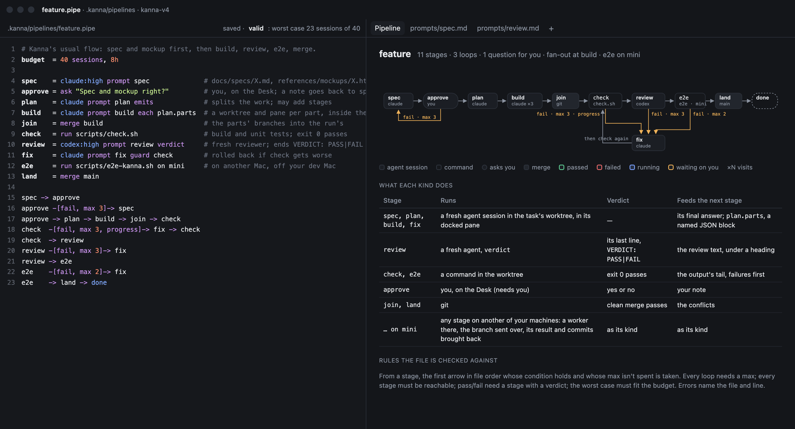
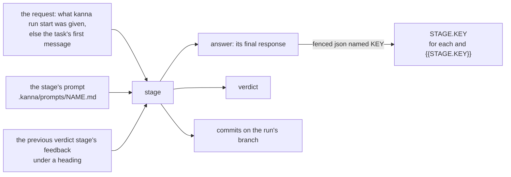
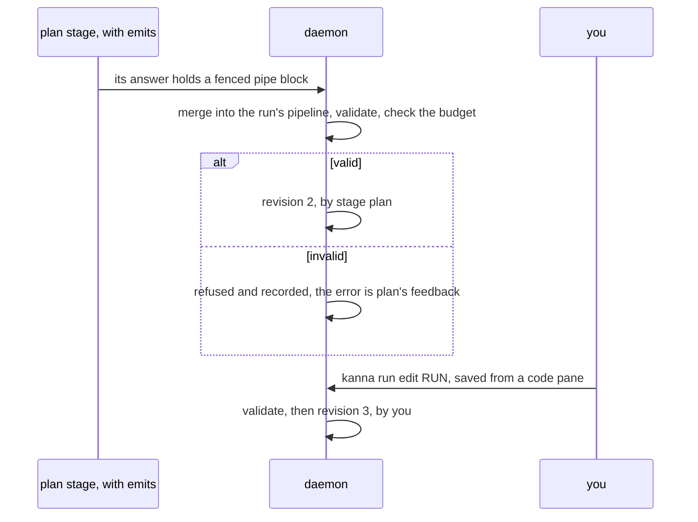

# Pipeline language

**Status:** the language is built (`crates/kanna-pipe`: parse, check, `pick`, `worst`, revisions; `kanna pipeline check` and `list`); runs are not · **Part of:** [software factory](software-factory.md) · **Mockup:** [`references/mockups/pipeline.html`](../../references/mockups/pipeline.html) (`#define`) · **Examples:** [`.kanna/pipelines/`](../../.kanna/pipelines/) · **From:** kojo's factory language ([research](../research/software-factory.md#1-kojo))

A pipeline is a short text file, `.kanna/pipelines/NAME.pipe`, that names its **stages** and joins them with **arrows**. A stage is an agent session, a command, a question for you, or the join of a fan-out. A run never merges to main: it hands its branch back to the task's worktree, where you review it and merge it as any task's work ([software factory](software-factory.md#1-what-a-run-is)). Arrows carry conditions and bounds, so a pipeline always ends and its worst-case cost is known before it runs. The daemon reads, checks and runs it ([software factory](software-factory.md)).



## Contents

1. [A file](#1-a-file)
2. [Stages](#2-stages)
3. [Attributes](#3-attributes)
4. [Arrows](#4-arrows)
5. [Inputs and outputs](#5-inputs-and-outputs)
6. [Checks on the file](#6-checks-on-the-file)
7. [Changing a pipeline while it runs](#7-changing-a-pipeline-while-it-runs)
8. [Glossary](#8-glossary)

## 1. A file

```
# Kanna's usual flow, once the spec and mockup are approved in the task's chat:
# plan, build, review, e2e; then the run hands its branch back to the task's
# worktree, where you review it before it merges.
budget  = 40 sessions, 8h

plan    = claude prompt plan emits             # splits the work; may add stages
build   = claude prompt build each plan.parts  # a worktree and pane per part, inside the run
join    = merge build                          # the parts' branches into the run's
check   = run scripts/check.sh                 # build and unit tests; exit 0 passes
review  = codex:high prompt review verdict     # fresh reviewer; reports pass or fail
fix     = claude prompt fix guard check        # rolled back if check gets worse
e2e     = run scripts/e2e-kanna.sh on mini     # on another Mac, off your dev Mac

plan -> build -> join -> check
check  -[fail, max 3, progress]-> fix -> check
check  -> review
review -[fail, max 3]-> fix
review -> e2e
e2e    -[fail, max 2]-> fix
e2e    -> done
```

- **Lines** are a stage (`NAME = …`), a flow (`a -> b -> c`), the budget, a comment (`#` to the end of the line) or blank, in any order. Names are `[a-z][a-z0-9_]*`; `done` and `budget` are reserved.
- **`budget = N sessions, DURATION`** bounds a run: at most N agent sessions (a fan-out instance or an attempt is one each) and DURATION of wall time (`8h`, `90m`). The file's worst case must fit, and so must every revision ([7](#7-changing-a-pipeline-while-it-runs)).
- **The first stage named in a flow line starts the run.** A file with one stage needs no flow line: it goes to `done`.
- **The budget line is optional:** without it, nothing bounds the worst case but the loops' `max`.
- **Prompts** live beside the pipelines: `.kanna/prompts/NAME.md`, the stage's name by default.

## 2. Stages

| Form | Runs | Verdict | Feedback it leaves |
|---|---|---|---|
| `NAME = AGENT[:EFFORT] [attrs]` | a fresh session of that agent (`claude`, `codex`, `copilot`, `opencode`, `agy`; `:low`, `:medium`, `:high` as the agent takes it) in a worker: the run's worktree and a terminal nothing shows unless you watch it, with the stage's prompt as its first message | with `verdict`, the one it reports: `kanna run done pass` or `kanna run done fail` | the answer it reports with `kanna run done` |
| `NAME = run COMMAND…` | the command in the run's worker with your login shell, as [task scripts](task-scripts.md) run, with the same variables plus `KANNA_RUN`, `KANNA_STAGE` and `KANNA_FEEDBACK` (a file holding the previous feedback) | exit 0 passes | its output's tail, lines matching the repo's failure pattern first |
| `NAME = ask "QUESTION"` | nothing: the task's agent is told and asks you in its chat, the Run tab shows a card, and the task shows needs you until one of you answers (`ok = ask "Is the plan right?"` after `plan`) | yes passes, no fails | your note |
| `NAME = merge STAGE` | joins every instance of a fanned-out STAGE into the run's branch | a clean merge passes | the conflicts |

- **Every agent session is fresh:** a new conversation with the stage's prompt, the request and the feedback. `resume STAGE` continues that stage's last session instead, for the rare case where the context is worth more than a clean start.
- **There's no `merge main`:** the file is an error there (`` `merge main` isn't a stage``). Landing is yours: the run's end hands the change back to the task's worktree, the gate before main.
- **A stage with a verdict** is one of `run`, `ask`, `merge` or an agent with `verdict`. Only those may have `pass` or `fail` arrows out of them.
- **An agent's effort and model** are the agent's own flags (`claude --model`, `codex -c model_reasoning_effort`); `model NAME` names a model when the default isn't wanted.

## 3. Attributes

Any order at the end of a stage line. `on` and `within` apply to every kind; the others to agent stages.

| Attribute | Does |
|---|---|
| `prompt NAME` | `.kanna/prompts/NAME.md` is the stage's prompt instead of the stage's own name |
| `verdict` | the stage reports `pass` or `fail` when it's done; the request is appended to its prompt |
| `each STAGE.KEY` | one instance per item of a named list a previous stage produced ([5](#5-inputs-and-outputs)), each a worker of the run (a worktree branched from the run's and a background terminal of the task's); the next stage waits for them all ([software factory §3](software-factory.md#3-workers-fan-out-join-and-other-machines)) |
| `xN by STAGE` | N attempts of the stage from the same code (2 to 10), each a worker in its own worktree; the `run` stage named scores each (its output's last line `score: 0.83`, else pass 1 and fail 0) and the best is kept, ties to the first |
| `guard STAGE` | that `run` stage scores the code before and after; a result that scores lower is discarded and the code before carries on, recorded as a rollback |
| `emits` | the stage's answer may add stages and arrows to the run ([7](#7-changing-a-pipeline-while-it-runs)) |
| `on PLACEMENT` | where the stage runs: a machine's name (`mini`), a role your machines declare (`mac`, `linux`, `e2e`), `any` (whichever has a free slot) or `here`, the run's machine, the default. The stage runs there as a worker of the run; its result comes back ([software factory §3](software-factory.md#3-workers-fan-out-join-and-other-machines)) |
| `within DURATION` | the stage is abandoned after that long: an agent is stopped and its worktree reset to the stage's start, a command killed; the stage's verdict is fail with `timed out` as feedback |
| `resume STAGE` | continue STAGE's last session rather than starting fresh |

## 4. Arrows

`a -> b -> c` chains stages. An arrow may carry options in brackets: `-[fail]->`, `-[pass]->`, `-[max N]->`, `-[reset]->`, `-[progress]->`, or several (`-[fail, max 3, progress]->`). `done` ends the run.

- **From a stage, the first arrow in file order whose condition holds and whose `max` isn't spent is taken.** `pass` and `fail` need a source with a verdict; an arrow with neither is always eligible. Nothing eligible ends the run as **stuck**, needing you.
- **`max N`** counts how many times that arrow is taken in one run; emitted arrows and the user's edits keep the counts of arrows they didn't change.
- **`reset`** restarts the destination from the code the run had when the destination first ran, with no feedback: a reroll. The worktree is reset to that commit; the abandoned work stays in the run's history as a branch.
- **`progress`** (from a `run` stage only) is taken only while the stage's failures differ from its previous visit: a fix that changed nothing ends the loop instead of spending its `max`. What's compared is the failure lines of the output.

## 5. Inputs and outputs



- **An agent stage's prompt** is, in order: the stage's prompt file, the request under `# The task`, the feedback under `# Feedback from STAGE` (a review's text, a command's output tail, your note, the conflicts), and how to report it's done (with its verdict when the stage has `verdict`). `{{STAGE.answer}}` and `{{STAGE.KEY}}` in a prompt file are replaced by that stage's last answer or named output; a prompt that names a stage that hasn't run is an error at validation.
- **Named outputs:** a fenced block in an agent's answer whose info string is `json name=KEY` (or any fenced JSON block when the stage has one `each` consumer) is kept as `STAGE.KEY`. `each` wants a list; each item is given to the instance as `# Your part`, and an object with `name` names the worker.
- **The stage reports its own end:** every agent stage's prompt ends with how to report, writing its final answer to `$KANNA_ANSWER` and running `kanna run done` (with `pass` or `fail` at a `verdict` stage), or `kanna run need TEXT` when it needs you. The answer is what it wrote; the daemon reads nothing from the screen or the agent's session files ([software factory §6.1](software-factory.md#61-sequential-runs-as-built)).
- **A command's feedback** is its last 80 lines, with lines matching the failure pattern (`FAILED|error\[|panic|✗|failed`) moved first, capped at 8000 characters; `KANNA_FEEDBACK` holds the full text for the next command.
- **Nothing else is shared between stages but the worktree.** A stage that wants a plan reads it from the branch, or from `{{plan.answer}}`.

## 6. Checks on the file

Read when the run starts and on every revision, with errors as `FILE:LINE: message`, and from the CLI with `kanna pipeline check NAME|FILE` (`kanna pipeline list` checks them all). Every error is reported, in line order, not only the first:

- every stage named in a flow is defined, and `done` has nothing after it;
- `pass` and `fail` only leave a stage with a verdict; `progress` only a `run` stage; `reset` only reaches an agent stage;
- every stage is reachable from the start, and `done` is reachable;
- every loop has a `max` on at least one of its arrows, so the run ends;
- `each` names a stage that runs before it, `merge STAGE` names a stage with `each`, `by` and `guard` name `run` stages, prompts exist;
- `on` names `here`, `any`, this machine, or a machine or role in your peer log ([your machines](machines.md)); anything else is `no such machine`. `kanna pipeline check` shows that as a warning (`FILE:LINE: warning: …`) and exits 0, since you may write a pipeline for a machine you haven't paired yet; a run refuses it;
- the worst case over every verdict sequence fits the budget (kojo's `max_sessions`: checks and asks cost nothing, `xN` costs N, `each` costs its list's length). The walk tries pass and fail at every verdict stage, and a stalled fail too where a `progress` arrow leaves it, taking arrows as `pick` does.

```
plan -> build (each plan.parts) -> join -> check
                 counted as 2 parts until plan answers: feature.pipe is 17 of 40
                 plan answered 3 parts:                  18 of 40
                 plan answered 30 parts:                 45 of 40, over: the run stops, waiting on you
```

- **A fan-out counts 2 parts** until the run knows its list, since a list's length isn't known before its stage answers; the file's check uses 2. When the stage named by `each` answers, the daemon checks the worst case again with the list's real length, as it does for a revision, and a run that no longer fits stops as waiting on you. The budget is there to bound fan-out and loops, not to price a run. Counting the budget's sessions instead, as first written here, made any pipeline with a fan-out fail its own check.

## 7. Changing a pipeline while it runs

A run keeps its own copy of the pipeline, in **revisions**. Revision 1 is the file when the run started. A new revision comes from one of two places, is checked as the file is ([6](#6-checks-on-the-file)), and applies from the next arrow the run takes; stages already visited keep their records and counts.



- **A stage with `emits`** may put a fenced block with the info string `pipe` in its answer: stage lines and flow lines in this language. New stages are added; a flow line from the emitting stage goes **ahead** of that stage's own arrows (so what it emits is taken first, and its static arrow is the fallback when it emits nothing); every other flow line is appended. A stage name that exists already is an error, so a run can't redefine a stage behind your back.
- **The merged revision is text,** so it can be shown with a diff and edited: the block's stage lines go after the last stage line; each emitted arrow from the emitter becomes a line of its own just above the line with the emitter's first arrow; every other emitted arrow becomes a line at the end. A block may not set the budget, and only a stage with `emits` may emit. Errors in the block name the block's lines; errors in the merged pipeline name the revision's lines.

```
e2e     = run scripts/e2e-kanna.sh on mini
lint    = run scripts/lint.sh        ← the block's stage line

plan -> lint                          ← plan's emitted arrow, ahead of its own
plan -> build -> join -> check
…
e2e    -> done
lint -> build                         ← the rest of the block, appended
```

- **Arrow counts carry over** to the new revision: an emitted revision keeps every arrow it didn't add, so each keeps its count; an edit keeps the count of every arrow it left exactly as it was (same ends and options), matched in file order, and an arrow you changed starts at 0.
- **You** (or the task's agent, when you tell it to) edit the run's current revision in a code pane (`kanna run edit RUN`, or Edit pipeline on the Run tab); saving it makes a revision if it's valid, else the pane shows the errors. Editing the file in the repo changes the next run, not this one.
- **Every revision is kept** with who made it and when ([software factory §6](software-factory.md#6-how-its-built)), shown on the Run tab with its diff, and counted as an intervention when it's yours.
- **Why not child runs or a free-form rewrite:** a child run would be a second task with its own view and metrics for what is one change; a free-form rewrite could drop the gates. Adding stages and arrows under the same validation and budget keeps one graph the user can read, and nothing the file promised can be removed by a stage.

## 8. Glossary

| Term | Meaning |
|---|---|
| **Pipeline** | A `.pipe` file: stages and arrows, with a budget |
| **Stage** | One step: an agent session, a command, a question, or a fan-out's join |
| **Verdict** | pass or fail from a stage that gives one; picks the arrow |
| **Feedback** | What a verdict stage leaves for the next stage's prompt |
| **Visit** | One run of a stage; a loop makes several |
| **Instance** | One of a fanned-out stage's runs (`each`) or attempts (`xN`) |
| **Revision** | One version of a run's pipeline; a stage's emission or your edit makes the next |
| **Budget** | The sessions and time a run may spend |
| **Placement** | Where a stage runs: `here`, `any`, a machine, or a role |
