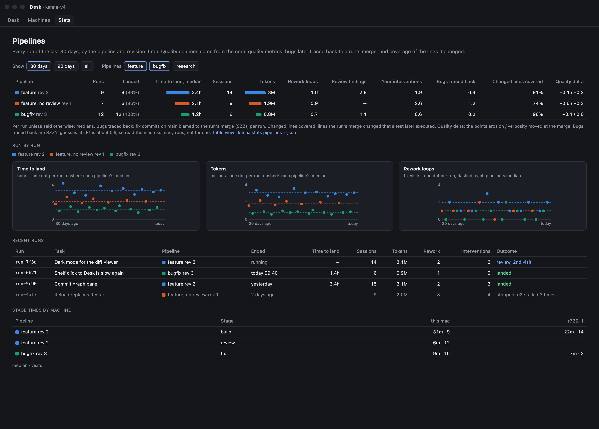
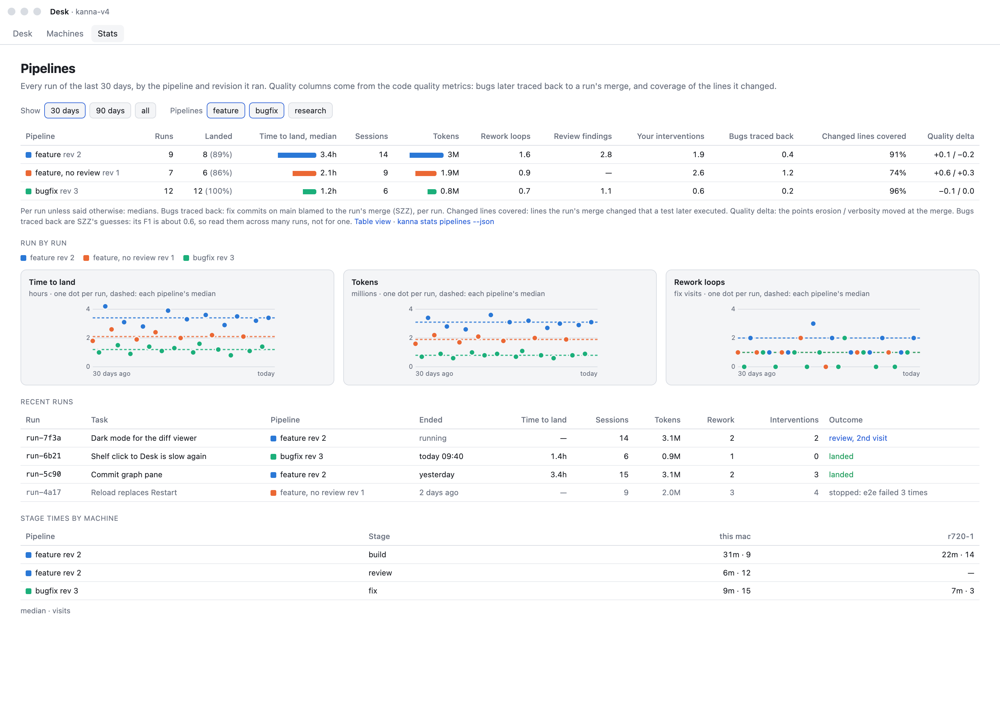
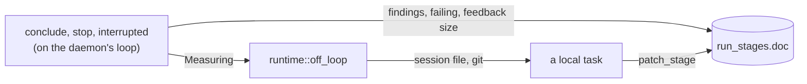

# Pipeline metrics

**Status:** built · **Tests:** `usage.rs`, `pipelines.rs`, `runs.rs`, `StatsFormatTests`, e2e `pipeline_stats` · **Mockup:** [`references/mockups/pipeline.html`](../../references/mockups/pipeline.html) (Runs compared; `#light`) · **Part of:** [software factory §5](software-factory.md#5-metrics) · **Builds on:** [Stats](stats.md), [code quality metrics](code-quality-metrics.md)

Every visit of a run keeps what it cost and what it changed. The Stats tab's **Pipelines** section and `kanna stats pipelines` compare runs by pipeline and revision, so a changed arrow or prompt shows as a new line.

| Dark | Light |
|---|---|
|  |  |

*(From the mockup: `#picture,metrics`, `#picture,metrics,light`.)*

## 1. A visit's numbers



| Field in `run_stages.doc` | From |
|---|---|
| `usage`: `turns`, `tools`, `in`, `out`, `cached`, `written`, `cost`, `costBy`, `model` | the stage's agent's session file, read once it has quit |
| `commits`, `files`, `added`, `deleted` | `git diff --numstat` and `rev-list` from the visit's `start` to its `end`, in the repo |
| `findings` | the answer's ```` ```json name=findings ```` block, counted by `severity`; none means no review, and `[]` a review that found nothing |
| `failing` | a failed `run` stage's failure lines, without summaries such as `test result:` |
| `feedbackSize` | the bytes of the feedback |

- **A turn** is one model response, so a stage's single prompt doesn't read as one turn. **A tool call** is one `tool_use` block, or one Codex tool item.
- **Reading off the loop:** session files can be large, so the file and git are read off the loop ([daemon runtime §3](daemon-runtime.md#3-a-handler-that-waits)) and the result is patched on the row. `measured: true` marks a row as read. A starting daemon reads any ended visit without it.
- **`since`:** only what came after the visit's start counts, so a later visit resuming a session doesn't count the session's past.
- **Agents without a reader** (opencode, agy) have `usage: null`, as does an agent with its own `HOME` or config folder that the daemon can't see.

### Claude

`CLAUDE_CONFIG_DIR` or `~/.claude`, then `projects/*/SESSION.jsonl`, found by the session ID so a folder's name needn't be worked out, and `SESSION/subagents/*.jsonl`.

- `assistant` lines repeat per content block, so a message counts once by its `message.id`. Lines from a `<synthetic>` model aren't turns.
- `in` is `input_tokens`, `cached` is `cache_read_input_tokens` and `written` is `cache_creation_input_tokens`.
- `cost` is the agent's own: the last `cost-state` line's `totalCostUSD`, less the last one before the visit. That line covers the whole session, subagents included.

### Codex

`CODEX_HOME` or `~/.codex`, then `sessions/Y/M/D/rollout-*-SESSION.jsonl`. **Its token events are in the rollout file, so the app-server isn't needed.**

- A session it didn't name comes from what it printed as it quit, else the first session in the worktree since the visit began.
- `event_msg` `token_count` carries cumulative `total_token_usage`: the visit's figures are its last total less the last before the visit, and each change is a turn.
- `input_tokens` includes the cached, so `in` is the rest.
- Codex reports no cost, so it comes from pricing.

### Pricing

`pipelines.pricing` in the repo's `.kanna/config.json`: dollars per million tokens by model. `cached` and `written` default to `in`. It's priced as the visit ends and stored, so a later price change doesn't rewrite history. `costBy` says `agent` or `pricing`; with neither, `cost` is null.

```json
{"pipelines": {"pricing": {"gpt-5": {"in": 2.5, "out": 10, "cached": 0.25}}}}
```

## 2. A run's numbers

| Number | Is |
|---|---|
| time to land | started to the merge that brought the run's last commit to main; none until it merges |
| time to hand back | started to handed back |
| active time | the sum of the visits, less what they waited |
| sessions, turns, tools, tokens, cost, commits, files, lines | sums over the visits; a file changed by two visits counts twice |
| rework loops | visits of any stage beyond its first, by stage; a fan-out's instances (`each`, `xN`) are each their own stage, so running them side by side isn't rework |
| interventions | by kind: the run's own count, kept as you answer, pause, skip, retry or resume ([software factory §6.2](software-factory.md#62-gates-and-steering-as-built)); for a run from before it, `run_events` from anyone but the daemon or the stage's own terminal |
| outcome | `landed`, `handed back`, `stopped` (why), `stuck` |

- **Tokens** in a headline are in, written and out. Cache reads re-read the same context each turn and would swamp them, so they stay in the JSON.
- **Landed:** a stats request's worker takes each handed-back run with commits and finds the first of main's first-parent commits holding its tip, then keeps it as `landing` and `landedAt` on the run. A run with no commits never lands.
- **Why land, not hand back:** the mockup and the task compare time to land, and the join to quality needs the merge anyway. It does include how long you took to review, so `timeToHandBack` is kept beside it for the pipeline's own speed.

## 3. Quality columns

Joined at read from `samples` by the run's `landing`, the merge commit.

| Column | Is | Unknown (—) when |
|---|---|---|
| bugs traced back | `fixes` samples whose `blamed` is the landing | the landing isn't sampled |
| changed lines covered | the last `coverage` sample's `landings` row for it | coverage isn't set up, or the landing is out of its 30 days |
| quality delta | erosion / verbosity at the landing, less the commit before | that commit isn't sampled |

A landing can hold more than the run, since a task's branch can add commits after it. SZZ's noise (F1 about 0.6) shows under the table, because a single run's count says little.

## 4. Comparing

Runs started in the window group by pipeline and revision hash. A revision's number counts a pipeline's hashes in the order they first ran, over all its runs.

- **Medians** are of ended runs; a live run counts in Runs only. Landed's share is of ended runs.
- **Hues:** the first three groups in a window get the validated palette in order, by when they first ran there. Any others are the context grey, and a filter doesn't repaint.
- **The app** draws what the daemon sends. A section with `filters` gets the chips; `table` and `runs` are chart kinds ([stats §4](stats.md#4-adding-a-metric)). Hiding a pipeline is the app's alone; Show asks again with `days`.
- **Table view** swaps the three charts for every run in the window, as the dataviz rules ask.
- **Stage times by machine:** each stage's median time and visits, a column per machine.

## 5. Interfaces

- `stats {repo, days}`: the usual reply, with the `pipelines` section last. `days` 0 is every run; it defaults to 30.
- `stats {repo, pipelines: true, days}`, printed by `kanna stats pipelines [--json] [--days N]`: `pipelines` (with `medians`), `runs`, `stages`, `caveat`, and `sections` for the text.
- `kanna run show --json`: `metrics` with the run's numbers, and each visit's `interventions`.

## 6. Tests

- `usage.rs`: `tests/fixtures/sessions/{claude,codex}.jsonl`, real sessions from `tools/agent-harness` against its mock, trimmed to the lines read: a message counted once, the agent's cost, Codex's cached out of in, only what came after `since`, a session found by ID, subagents added.
- `pipelines.rs`: a run's sums, interventions and rework; revisions; the landing; the quality join with unknown kept apart from zero; grouping, medians and hues; the section's cells.
- `runs.rs`: findings and failing tests. `tasks.rs`: pricing. The CLI: `stats pipelines` and its printer. `StatsFormatTests`: a run's place in its window.
- e2e `pipeline_stats` on a private instance: two runs each of two pipelines with the mock agent, whose session files the fixture writes. Three merge, and a `Fixes:` trailer names the first. `kanna stats pipelines --json`, its text and `kanna run show --json` against the expected numbers, then the app's table, charts, recent runs and machines, a pipeline hidden, Table view and 90 days, with snapshots in dark and light (`target/e2e-kanna/pipeline_stats-*.png`).

## 7. Rejected

- **Codex's app-server for tokens:** its rollout file has them.
- **Reading the session at each stats request:** files move and get pruned, and a price could change; a visit's numbers belong to the visit.
- **A landing found at each request:** it's git per run per minute; once found it can't change.
- **Cache reads in the headline tokens:** they'd measure context size, not work.
