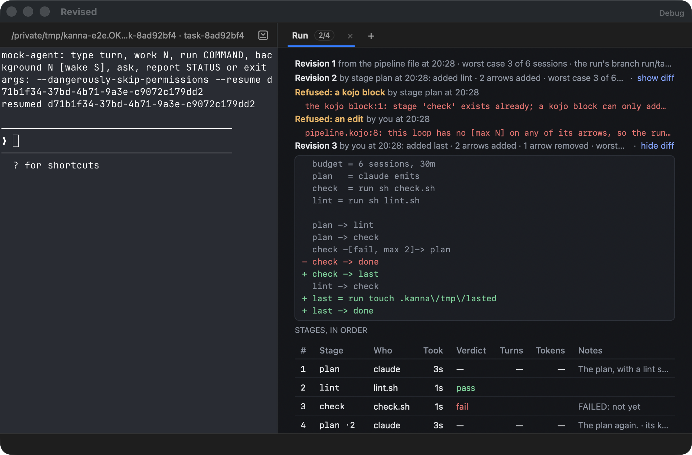
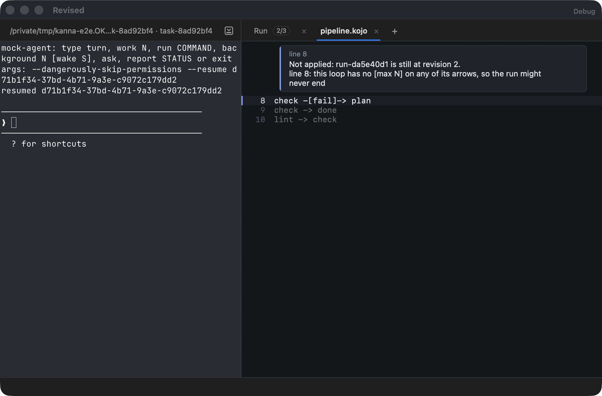
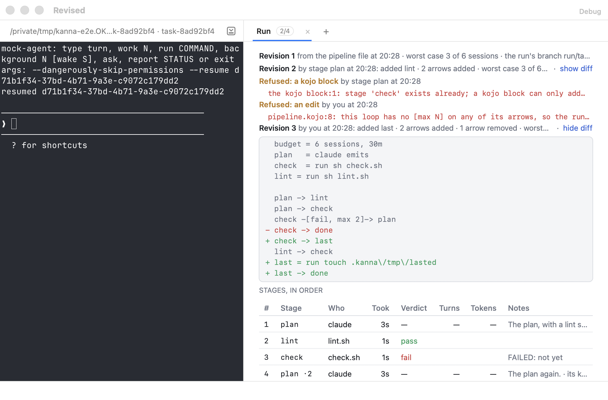
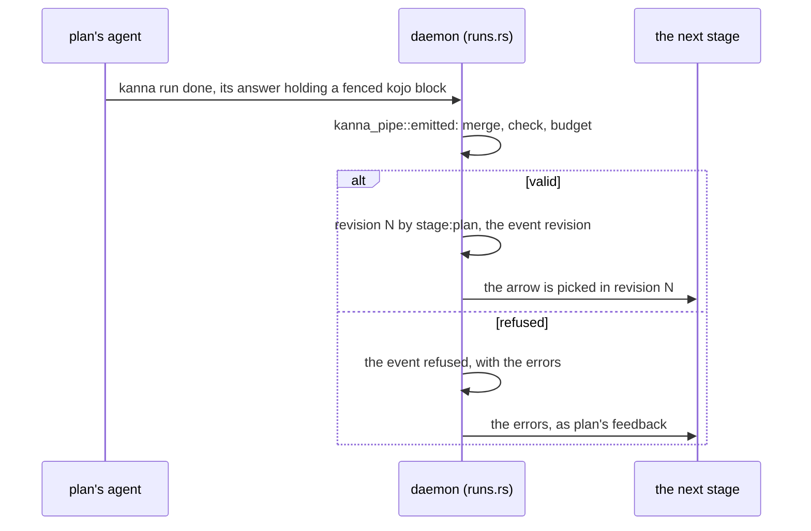

# Pipeline revisions

**Status:** built: a stage's `kojo` block merged and adopted or refused, `kanna run edit [RUN] [FILE]`, the Run tab's revisions with their diffs, a revision by you as an intervention · **Part of:** [software factory §4](software-factory.md#4-seeing-and-steering-a-run), [Kojo §7](kojo.md#7-changing-a-pipeline-while-it-runs) (the merge rules) · **Mockup:** [`references/mockups/pipeline.html`](../../references/mockups/pipeline.html) (`#run`) · **Tested:** `cargo test -p kanna-pipe --test flow`, `cargo test -p kanna-daemon runs::`, `cargo test -p kanna-daemon run_notice`, `swift test --filter KannaRunTests`, e2e `pipeline_revisions`

A run's pipeline can change while it runs. A stage with `emits` adds stages and arrows from its answer, and you edit the run's copy by hand. Either way the daemon checks the whole pipeline and its budget, then records the next revision or refuses it and records why.

| A revision by a stage and one by you, the second's diff open | A refused edit, in the draft's pane |
|---|---|
|  |  |

## Contents

1. [A stage's block](#1-a-stages-block)
2. [Your edit](#2-your-edit)
3. [What a revision changes](#3-what-a-revision-changes)
4. [On the Run tab](#4-on-the-run-tab)
5. [How it's built](#5-how-its-built)
6. [Not built yet](#6-not-built-yet)

## 1. A stage's block

- **When:** as an agent stage's visit ends, before its arrow is picked, so a block's own arrow from the stage is the one taken.
- **Merge:** [Kojo §7](kojo.md#7-changing-a-pipeline-while-it-runs)'s rules, in `kanna_pipe::emitted`.
- **Prompts:** a new agent stage's prompt is one kept with revision 1, or a file in the run's worktree (`.kanna/prompts/NAME.md`), which the stage may have written. Each revision keeps the prompts it was checked with.
- **Refused:** the pipeline stays as it was. The errors name the block's lines (`the kojo block:2: …`) or the merged pipeline's (`the merged pipeline:23: …`). The next stage gets them as feedback from the emitting stage, ahead of any feedback the stage's fail carries; a `run` stage reads them in `$KANNA_FEEDBACK`.
- **A stage without `emits`:** its block is refused the same way.
- **Parts runs can't do yet** (`each`, `guard`, …) are refused in a block as they are in the file.

## 2. Your edit

The code pane is read-only and can't save a file ([code viewer §2](code-viewer.md#2-rules)), so the edit goes through a file:

| Command | Does |
|---|---|
| `kanna run edit [RUN]` · **Edit pipeline** | Writes the run's current revision to `.kanna/tmp/pipeline.kojo` in the run's worktree, if it isn't there, and shows it in a code pane in a tab of the task's workspace. The pane follows the file. Prints the file and how to apply it; the Run tab says the same beside its buttons |
| `kanna run edit [RUN] FILE` | Checks FILE's text and makes it the run's next revision |

- **Who edits the file:** you, in any editor, or the task's agent when you tell it to.
- **By:** `agent` from the task's agent's terminal, else `user`. Either counts as an intervention (`revision`).
- **Refused:** nothing changes; the errors are printed as `FILE:LINE: message`, recorded as a `refused` event, and, when FILE is the draft, shown in its pane on the first line they name.
- **Applied:** the draft's pane closes, and the Run tab shows the revision.
- **Current stage:** an edit can't remove the stage the run is at, or the one it goes to next.
- **Unchanged text** is refused without a record.
- **A run waiting over its budget** carries on once an edit raises it.
- **A draft you haven't changed** is rewritten when a stage's block makes a revision. One you have changed is left, and applying it later drops what the block added; the diff shows it.
- **A run owned by the merge queue** has no task workspace: the draft is written and no pane opens.

## 3. What a revision changes

- **From the next arrow:** the open visit carries on; the arrow it takes when it ends is picked in the new revision. Its `within` is the new revision's.
- **Arrow counts:** carried as [Kojo §7](kojo.md#7-changing-a-pipeline-while-it-runs) says (`Revision::taken`).
- **Budget:** an edit may change it; a block may not.
- **Visits** keep their records, a removed stage's too.
- **The run's `revision_hash`** is the new text's, so [metrics](software-factory.md#5-metrics) group by it.

## 4. On the Run tab

- **Revisions,** oldest first, above the stages: its number, who made it and when, what it changed (stages added, removed or changed, arrows added and removed, the budget), and its worst case against the budget.
- **Show diff** opens the revision's text against the one before, line by line; **hide diff** closes it.
- **Refusals** sit among them in time order, with their errors.
- **The stage's row** notes the revision its answer made (`revision 2: added lint · 2 arrows added`) or that its block was refused.
- **Interventions** count your revisions and the task's agent's; a stage's isn't one.

## 5. How it's built

- **`kanna-pipe`:** `emitted` returns a `Refused` (the errors, and the merged text when the errors are in it); `diff` is a line diff of two texts.
- **Core:** `comment {pane}` puts a comment on that code pane, wherever its workspace is.
- **`run_revisions.doc`:** `text`, `file`, `prompts`, `worst`, and from revision 2 on `diff` (`[sign, line]` pairs), `summary`, `added`, `removed`, and a stage's `block`.
- **Events:** `revision {n, hash, summary}` and `refused {errors, stage, block | text}`, `by` as the revision's.
- **Run notice:** `revisions`, one entry per revision (`n`, `by`, `at`, `hash`, `summary`, `added`, `removed`, `worst`, `budget`, `diff`) and per refusal (`n: null`, `by`, `at`, `errors`).
- **Visit:** `doc.revision {n, summary}` or `doc.refused [errors]`.
- **Draft:** written to a new file and renamed into place, never through a link a stage left there.
- **`debug.run`:** `revisions` (the lines), `diff` (the open diffs' lines), `said`; `{diff: N}` opens or closes revision N's diff, `{reveal: "revision"}` scrolls to the revisions.
- **e2e `pipeline_revisions`:** the mock agent's plan emits a `lint` stage, which runs; on its second visit it emits a stage that exists, which is refused and reaches `lint` as feedback; Edit pipeline opens the draft; an edit with an unbounded loop is refused and shown in the pane; an edit adding a stage is applied and that stage runs after the visit that was open.

## 6. Not built yet

- **Saving from the code pane:** an editable code pane with save. `kanna run edit [RUN]` would then apply on save, and FILE stays for the agent.
- **A revision's diff in a diff pane,** for a pipeline too long to read inline.
