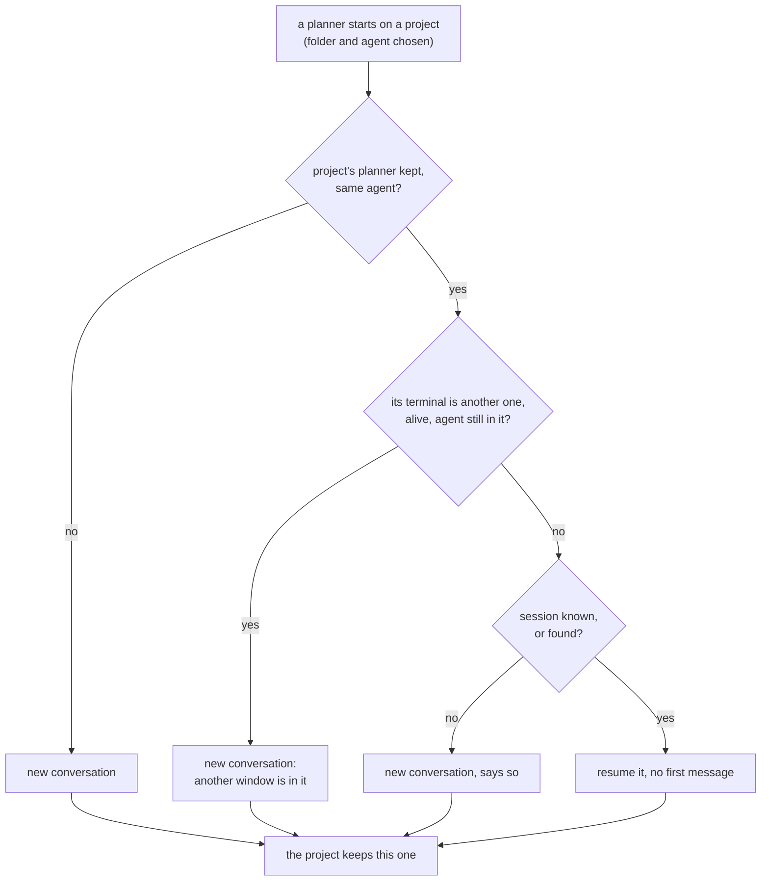

# Planner resume

**Status:** built (2026-10-28) · **Part of:** [planning terminal](planning-agent.md), [new Desk](new-desk.md) · **Builds on:** [tasks' resume](tasks.md#which-agents-resume), [database](database.md#planners) · **Tests:** `crates/kanna-daemon/src/backlog.rs` (unit), `scripts/e2e-kanna.sh` `planner_resumes`, `planner_choice`

A project's planning agent comes back to its last conversation whenever a planner starts on the project, so a lost planning terminal doesn't lose a long planning conversation.

**Done when** a claude and a codex planner come back to their conversation, without being told they're the planner again, after their terminal is closed, after `kanna restart`, and on a new Desk on the same repo; and a second window on a repo whose planner is running starts a new one.

## Contents

1. [When it resumes](#1-when-it-resumes)
2. [Each agent](#2-each-agent)
3. [How it's built](#3-how-its-built)
4. [Tests](#4-tests)
5. [Rejected](#5-rejected)

## 1. When it resumes

- **One planning conversation per project:** the repo's main checkout (a worktree's folder counts as its repo's; a folder that isn't a repo is its own project). It's kept in `kanna.db` ([database](database.md#planners)).
- **Whenever a planner starts on the project it resumes the project's conversation:** its terminal closed or replaced, the app, daemon or keeper restarted, `kanna restart` on it, a new Desk on the project (⌘N, `kanna PATH`, `task desk`), and a planner in `~` pointed at the project at its `Folder, repo or name` prompt. It's the project's conversation, not the one that terminal started with.
- **It says so** before the agent starts: `Back to NAME's planning conversation.`
- **No first message again:** the resumed agent already has `You are the Kanna planning agent.` and the kanna-planning skill it loaded in its history, so it goes on as the planner.
- **Another agent starts a new one:** a project's conversation is one agent's. Choosing another (or a new `planning.agent`) starts a new conversation, and the project keeps that one.
- **A second window on the project starts a new conversation** while the first window's planner is in it (its terminal alive, its agent not quit), since two agents can't share one session, and says so: `The planner in another window is in NAME's planning conversation, so this one starts a new one.` The project then keeps whichever planner started last, so the next planner resumes that one.
- **No "new conversation" choice in Kanna:** clear the agent's context in the agent (`/clear`, `/new`) for a fresh one.
- **Quitting the agent** frees the conversation for another window, and the line it leaves (`Start it again: …`) resumes it.

## 2. Each agent

| Agent | New conversation | Resumed with | Its session, when it takes no ID |
|---|---|---|---|
| claude | `claude --session-id UUID 'You are the Kanna planning agent.'`, the UUID Kanna's | `claude --resume UUID` | — |
| codex | `codex --yolo 'You are …'` (it takes no ID), through [its app-server](codex-app-server.md) | `codex --yolo resume UUID` | the one it says as it quits; else the first rollout in `$CODEX_HOME/sessions` (`~/.codex` by default) made since the planner started whose `session_meta` `cwd` is the main checkout |
| copilot | `copilot --yolo --session-id UUID -i 'You are …'` | `copilot --yolo --session-id UUID` | — |
| opencode | `opencode --prompt 'You are …'` | `opencode --session ID` | the first top-level session in `~/.local/share/opencode/opencode.db` made since the planner started whose `directory` is the main checkout |
| antigravity | `agy --dangerously-skip-permissions -i 'You are …'` | — | none: it starts a new conversation each time and says so (`agy didn't leave a conversation Kanna can find for NAME`) |

- **The main checkout isn't a task's own folder:** you and other agents start sessions there too, so the newest session in the folder (as a task's resume takes) may not be the planner's. A planner's is the **first** one made there since it started, which anything started there later can't be, unless the agent says its own as it quits, which wins.
- **Claude after `/clear`** goes on in a new session; Kanna learns it only from the `claude --resume` line claude prints as it quits. If the terminal is closed instead, the next planner resumes the conversation from before the `/clear`.
- **Best effort:** where no session is found (codex quit before it wrote one, opencode's records missing, antigravity always), the planner starts a new conversation and says so.

## 3. How it's built

- **The planner script asks the daemon** once it's in the folder and has the agent: `kanna raw` with `backlog` `planner` `start`, its terminal (`KANNA_TERMINAL`), folder and agent's name. The daemon answers with the command to run and a line to say. Without an answer (no daemon, an old one) it starts the agent new as before. No `kanna plan` command: only the planner script asks ([new Desk](new-desk.md#5-rejected)).
- **The daemon decides** (`planner_starts`, `comeback` in `backlog.rs`): it reads the project's row, checks whether its terminal is another live one with the agent still in it, looks for a session it didn't take an ID for (`first_session_since`), and builds the command from the `AGENTS` table (`resumed_as`, or `started_in` with a new UUID for an agent that takes one). Then it writes the row: agent, session, when it started, the terminal, running.
- **When the agent quits,** the script asks `backlog` `planner` `quit`: the daemon reads the terminal's screen for the session the agent said (the same [quit rules](tasks.md#which-agents-resume) as a task's stop), else keeps or looks for one, marks the row not running, and answers the command that resumes it, which the script prints as `Start it again`.
- **A closed or restarted terminal never says quit:** a row whose terminal isn't alive is free, whatever it says.
- **It waits for the last planner to end:** a closed terminal's agent can outlive it for a few seconds (codex's app-server gets [5 s to stop](codex-app-server.md)), and codex refuses a conversation another of its processes still has open. So the script passes its process group, kept with the row, and a resuming script waits, up to 10 s, until the previous planner's group is gone before it starts the agent.

## 4. Tests

- **Unit (`backlog.rs`):** each agent's new and resumed command lines; `comeback` resumes after the terminal is gone or restarted, refuses another live terminal running it, takes it once that agent quit, starts new for another agent, finds a session from when it started, says lost for antigravity; the first codex rollout in the project since the start, not an earlier one, another folder's or a later one; the planner script runs the daemon's command, says its line, reports the quit and prints the resume, and starts as before without a daemon. `db.rs`: a project's planner is kept across a restart and replaced by the next.
- **e2e `planner_resumes`:** the real claude and codex against the mock model (`tools/agent-harness`): told once they're the planner, they take a note, then after their terminal is closed, after `kanna restart`, and on a new Desk on the repo, each comes back, says so, and its next message carries the note, with no second first message; a ⌘N Desk pointed at the repo starts a new one and says why.
- **e2e `planner_choice`:** the mock codex says its session as it quits, the next Desk resumes it, and a second Desk on the project starts new.

## 5. Rejected

- **A session per window,** as new-desk.md once rejected resuming for: the planner belongs to the project, and a window gets a new terminal on every restart.
- **Keeping it in the `projects` table:** it holds the ten recent projects and `kanna projects clear` empties it; a conversation shouldn't go with them.
- **Two windows sharing the conversation:** two agents can't write one session.
- **The newest session in the main checkout** (as a task's resume): you start agents there too, so it's often not the planner's.
- **A `kanna planner` command:** only the planner script needs it, so it goes through `kanna raw`.
