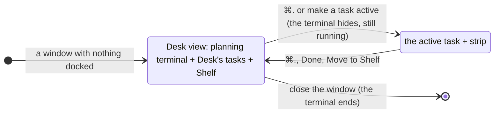

# Planning terminal

**Status:** built; Kanna starts the planning agent ([new Desk](new-desk.md)) · **Mockup:** [`references/mockups/desk.html`](../../references/mockups/desk.html) (Park, or Simulate: no tasks, first launch), [`desk-view.html`](../../references/mockups/desk-view.html) · **Builds on:** [Desk](desk.md), [Desk view](desk-view.md), [tasks](tasks.md), [docked pane](docked-pane.md) · **Tests:** `scripts/e2e-kanna.sh` `desk_shelf`, `desk_by_path`, `desk_planner_stays`, `planner_resumes`

Each Desk window has a **planning terminal**: in the [Desk view](desk-view.md), it's docked on the left, with the Desk's tasks and the Shelf on the right. Kanna starts the window's **planning agent** in it ([tasks](tasks.md#2-how-tasks-are-made)), the agent you choose, telling it it's the planner; the settings it gets are in [settings](settings.md).

## Contents

1. [When it shows](#1-when-it-shows)
2. [What it is](#2-what-it-is)
3. [Getting started](#3-getting-started)
4. [The window's folder](#4-the-windows-folder)
5. [How it's built](#5-how-its-built)
6. [Rejected](#6-rejected)
7. [Glossary](#7-glossary)

## 1. When it shows

- **Only in the Desk view.** While the active task shows, the planning terminal and the Desk view are out of sight, and the strip along the bottom is as [the Desk view](desk-view.md#2--and-pull-back) says.
- **The right side is the Desk's tasks and the Shelf,** where tabs would be: the Desk's tasks of the folder's repo with their status (click to make active) and the Shelf (Move to Desk), live.
- **The Desk view holds no tabs.** New Tab and the splits are off there. A pane opened onto it (`kanna open`, from the planning agent or anywhere) opens in a plain window of its own. A Desk left with tabs but no task (its agent closed or undocked) hands them to a window of their own, or, with no planning terminal yet, becomes that plain window.
- **Hidden means still running.** Showing the active task hides the terminal, and whatever runs in it; the Desk view brings it back as it was. It survives a restart of the app and the daemon like any terminal: the same pane, its workspace and its shell. A shortcut in another window never reaches it ([menus](menus.md#2-rules)).

## 2. What it is

- **Kanna starts the planning agent** when a [new Desk](new-desk.md#2-its-planning-terminal) opens: it asks which agent plans (or uses the project's), starts it with `You are the Kanna planning agent.` as its first message, and leaves you in your shell when you quit it.
- **It comes back to the project's conversation:** one planning conversation per project, kept in `kanna.db`, which every planner starting on the project resumes (a closed or restarted terminal, a restart of Kanna, a new Desk), unless another window's planner is in it ([planner resume](planner-resume.md)).
- **It has Kanna's environment** (`KANNA_TERMINAL`, `KANNA_SOCKET`) and the [settings](settings.md) for its agent.
- **One per window.** A Desk window gets its own the first time it shows the Desk view, and keeps it while tasks come and go. Every window is an independent Desk; there's no shared or cross-window planning terminal. Closing the window ends it.
- **Not a task.** It isn't on the Desk, the Shelf, the strip or in `kanna task list`, doesn't take one of the Desk's three places, can't be made active, moved or docked elsewhere, and has no Park button. Its header says **Planning**, the terminal's folder and branch.
- **In the window's folder, the repo's main checkout,** not a worktree.
- **It makes tasks an agent can do in one go,** since a Shelf task [runs by itself](shelf-runners.md) with nobody watching its first turn: it reads the code, asks you until the outcome, scope, decisions and how to judge it done are settled, and reads the task back to you before it makes it.
- **It says what a task waits for** when it makes it: `--after` for a task that has to wait until others are Done ([blocked tasks](task-dependencies.md)). When `kanna task done` frees a task, it offers to start it.

## 3. Getting started

A Desk with nothing in it starts here: where it opens and how its planning terminal starts the planning agent are in [new Desk](new-desk.md).

## 4. The window's folder

- **It opens where the [new Desk](new-desk.md#1-when-one-opens) does:** where Kanna was started, `~` for File → New Desk, or PATH for `kanna PATH`. A project outside `~/.kanna-v4/repos` is refused, with its move offered ([project folder](project-folder.md#2-outside-it)).
- **The window follows the terminal.** `cd` it elsewhere and the header, the Desk's tasks and the Shelf follow, to that folder's repo. With a task active, the task's repo is the window's.

## 5. How it's built

- **The layout keeps it as a planner:** a workspace with no task (`where: {"planner": app}`), its terminal docked with its width and no tabs, saved in `kanna.db`; the app's Desk record names it ([each app's Desks](app-desk.md)). An older layout's Desk `lead` (or `planner`) loads as one. ⌘. and making a task active change which workspace the Desk shows and leave it in place. `move` and `move --dock` refuse it. The [Quiz window](quiz.md#2-rules)'s agent is a window's `lead`, which isn't a task either.
- **The Desk view holds no tabs:** a pane opened from a planner or onto a Desk showing the Desk view goes in a new window.
- **The app asks for one** (`tasks` `plan`) when a Desk shows the Desk view and has no planner, passing the window's folder; it follows the terminal's folder as it reports it, as for a task's agent.
- **The daemon builds the terminal's command:** the [settings](settings.md), the [planner script](new-desk.md#3-how-its-built), then your login shell, with Kanna's zsh integration put back for it. It opens it with the `lead` placement, outside the task limit.

## 6. Rejected

- **Detecting the planner from its folder** (the main checkout of a repo with `.kanna-worktrees/`) **or with a hook:** an agent you start yourself in Codex's shared server never sees Kanna's environment, and a folder can't tell the planner from any agent started in the main checkout. Kanna starting the agent tells it for certain.
- **Marking the planning terminal with an environment variable** (`KANNA_PLANNER`): the agent is told in its first message, and the daemon knows which pane is a window's planner.

- **One Desk view window for every repo, with one planning terminal:** each window stays an independent Desk, so a planning terminal belongs to its window and its folder.
- **The planning terminal as a task** (docked like one, in a worktree): it would take one of the Desk's three places, show among the Desk's tasks, and hide behind the active task. It's for planning, so it stays in the main checkout and outside the task rules.
- **Showing it beside a task** (a third column, or on the strip): the Desk shows one conversation, and the strip stays as it is.
- **A Getting started tab beside a plain terminal** (before): the instructions are now in the terminal itself.
- **Tabs in the Desk view** (⌘T there, covering the Desk's tasks and the Shelf until closed): the Desk view is for choosing; work with tabs belongs to a task.

## 7. Glossary

| Term | Meaning |
|---|---|
| **Planning terminal** | A window's own terminal, docked on the left of the Desk view; not a task |
| **Planning agent** | The agent the planner script starts in a new Desk's planning terminal, the one you chose |
| **Desk view** | The planning terminal beside the Desk's tasks and the Shelf of the window's repo ([Desk view](desk-view.md)) |
| **Main checkout** | The repo's own folder, as opposed to a task's worktree |
| **Window's folder** | Where the planning terminal is: where Kanna was started, PATH, or wherever you `cd` it |
