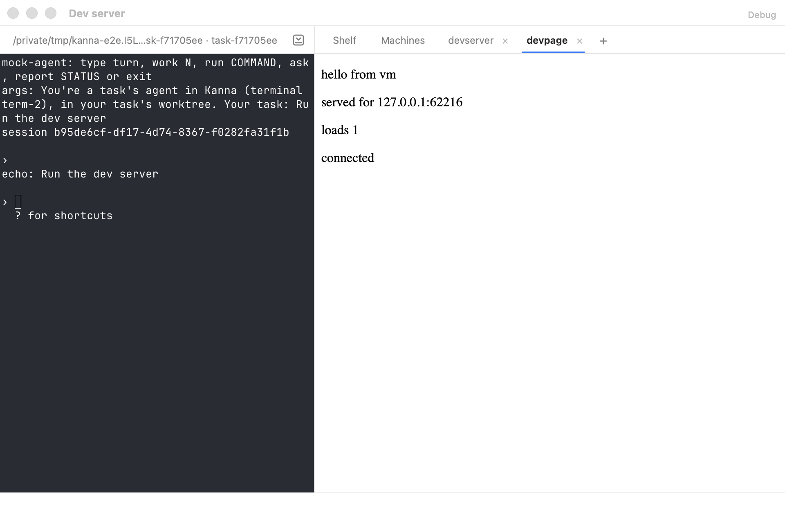
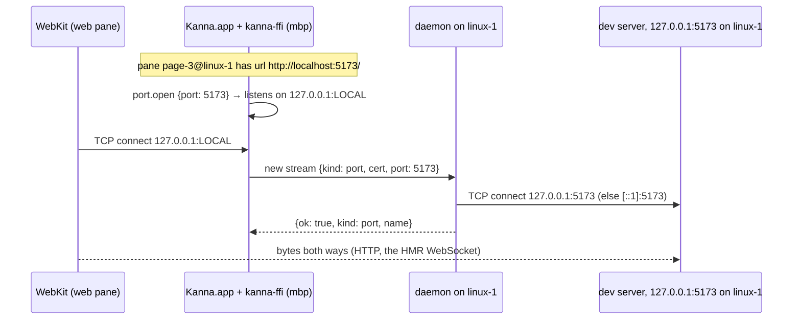

# Machines: Port Tunnels for Web Panes

**Status:** built (Machines 5) · **Part of:** [Machines §5, §7](machines.md#7-terminals-and-panes) · **Links:** [one link per machine](machine-links.md) · **Research:** [fleet §2.6](../research/fleet.md#26-files-diffs-markdown-web-and-ios-panes)

A remote task's dev server listens on its own machine's loopback. When a web pane of that machine names a loopback page (`http://localhost:5173/`), Kanna.app listens on `127.0.0.1:LOCAL` on the Mac and carries each connection to it as a `port` stream on the machine's existing iroh connection, which the daemon connects to the same port on its loopback. WebKit loads `http://127.0.0.1:LOCAL/`: the origin stays localhost, nothing listens publicly on the server, and bodies are never rewritten.

**Changed** from the research (and the slice's first message): no second **bulk** connection. Each tunnelled TCP connection is its own QUIC stream on the one connection per machine ([machines §5](machines.md#5-the-app-link-over-the-network)), so a keystroke never waits behind a page, and QUIC's per-stream flow control does what a second connection would have.

## 1. Rules

- **Which pages.** A web pane on another machine whose URL is `http(s)` to a loopback host (`localhost`, `*.localhost`, `127.*`, `::1`, `0.0.0.0`) is tunnelled; the port is the URL's, else 80 or 443. Other `http(s)` pages load directly, as before; anything else from a remote machine is refused ([links §3](machine-links.md#3-ids-and-routing)).
- **One listener per (machine, port)** for the app's life, so a page keeps its origin through reloads, re-opens and the machine dropping and coming back. A machine that leaves your machines loses its listeners and their open connections. `LOCAL` is whatever free port the Mac gives; it changes when the app restarts, so `localStorage` of a tunnelled page doesn't survive an app restart (cookies, which ignore ports, do).
- **The URL both ways.** The pane loads `127.0.0.1:LOCAL` with the original path, query and fragment. A page the page navigates to on `127.0.0.1:LOCAL`, and the URL editor (which shows the original), are reported to the daemon with the original host and port (`http://localhost:5173/next`), so the daemon, `kanna`, the agent and a later restore only ever see the machine's own address.
- **A data store per machine.** Cookies ignore ports, so every page on `127.0.0.1` would share one cookie jar. A machine's tunnelled pages use a WebKit data store of their own (`WKWebsiteDataStore(forIdentifier:)`, a UUID from the machine's name), so their cookies and storage never mix with this Mac's localhost pages or another machine's.
- **Waiting.** A connection to a port nothing listens on is refused by the daemon (`nothing_listening`) and closed; the pane shows "Waiting for localhost:5173 on linux-1…" and retries each second, as it does for a local server.
- **Who may open one.** A `port` stream is admitted like any other: a paired, unrevoked machine or an app it certified. A revocation closes the machine's open tunnels at once, including one revoked while it was being set up (the daemon watches for revocations before it admits the stream). A trusted machine can already run any command on its peers, so ports aren't further restricted.

## 2. Interfaces

| Where | Interface |
|---|---|
| stream header | `{"kind": "port", "cert": {…}, "port": 5173}`, answered by `{ok: true, kind, name}` or a refusal (`unpaired`, `revoked`, `bad_request`, `nothing_listening`); then raw bytes both ways, each side half-closing when its TCP end does. Without `port`, the stream is acknowledged and closed (`kanna machine ping`). |
| `kanna-net` | `Client::{port_open(key, addrs, cert, port) → LOCAL, ports_of(key) → [(port, LOCAL)], port_close(key)}`; the daemon's `Node` serves `port` streams. |
| `kanna-ffi` (`kanna_machines.h`) | `kanna_machines_port_open({key, addrs, cert, port}) → {port: LOCAL}\|{error}`, `kanna_machines_port_close(key)` |
| app | `Links.portOpen(port, on: machine)`; `PortTunnelURL` (KannaLinks) rewrites a pane's URL to `127.0.0.1:LOCAL` and back; `debug.machines` lists each link's `ports` (`{"5173": LOCAL}`). |

## 3. Tests

- `kanna-net` `node`: a port on a paired machine's loopback opens on the app's loopback (one listener per machine and port, 4 MB echoed); closing a machine's ports ends its open tunnels and stops listening; a half-closed connection still gets its answer; nothing listening closes the connection; an unpaired app gets nothing; an open tunnel closes when its machine is revoked.
- `KannaLinksTests` `PortTunnelURLTests`: which URLs are tunnelled, and the rewrite both ways.
- e2e `machine_remote_web`: a second daemon paired over iroh loopback; its task runs `tools/hmr-server` (a stdlib dev server that pushes changes over a WebSocket, as Vite's HMR does) in a terminal of its own, and opens `http://localhost:PORT/` in a web pane before the server is up (the pane waits for it). The app tunnels it on another port; the server sees `Host: 127.0.0.1:LOCAL`; editing the file on the machine updates the page without reloading it; a link followed in the page reaches the daemon as `localhost:PORT/next`; the URL editor shows and submits that address; vm's daemon restarting keeps the same local port, and the page loads through it again; after an app restart the restored pane loads and hot-reloads again.
- **By hand:** the same scenario with Vite 6.3.5 (`vite --port PORT --strictPort`, Node 22) as the task's dev server: the page loads through the tunnel, `import.meta.hot.accept` takes an edit without a reload, and again after an app restart.

## 4. Limits

- **Only the pane's own port** is tunnelled. A page that calls another loopback port from the browser (an API on `localhost:8080`, or Vite with `hmr.clientPort` set elsewhere) reaches this Mac's loopback instead; open that port in a pane of its own, or proxy it through the dev server (Vite's `server.proxy`), which is the usual setup.
- **The local listener has no secret.** Any process on this Mac can connect to `127.0.0.1:LOCAL` and reach the dev server, as it could a dev server running on this Mac. A process of the same user can already do more through the daemon's socket (`kanna --host`). A web page in a browser that rebinds a name to `127.0.0.1` is met by the dev server's own `Host` check (Vite's `server.allowedHosts`), as it would be locally. Restricting the listener to WebKit's network process is left until there's more than one user on a Mac.
- **No test races a revocation against setup.** The ordering fix (subscribe, then admit) is by construction.
- **The rig's machine is this Mac.** The e2e's second daemon runs on the same Mac, so the scenario proves the tunnel by the port the server sees, not by distance.
