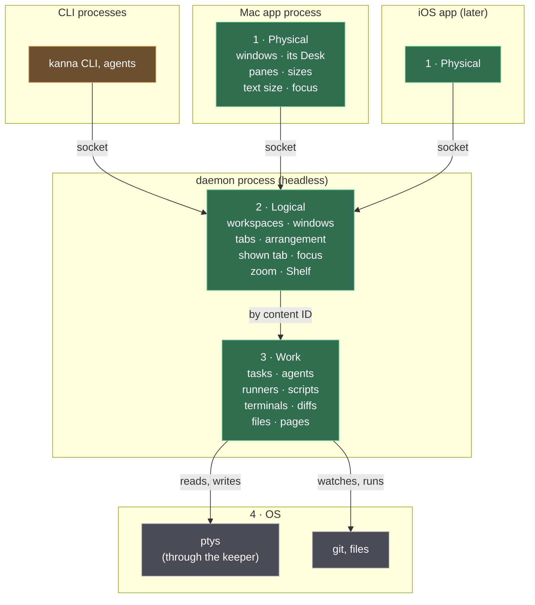
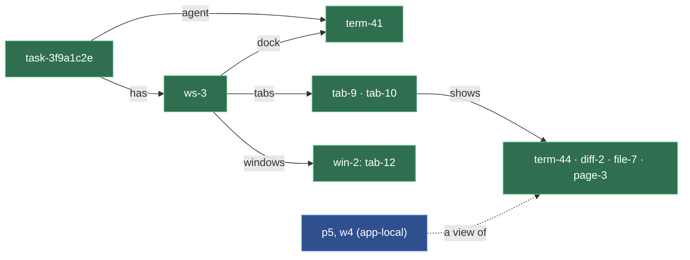

# Presentation Layers

**Status:** proposed · **Changes:** [architecture](architecture.md#2-what-the-daemon-keeps-what-the-apps-keep), [layout](layout.md), [app link](app-link.md), [workspaces](workspaces.md) · **Related:** [tasks](tasks.md), [diff viewer](diff-viewer.md), [restarting the daemon](daemon-restart.md)

Kanna's daemon runs headless, and any number of apps (the Mac app now, others such as iOS later) connect to it to view tasks and their workspaces. So what a task *is* and how it's *presented* are split into three layers: the **work** and the **logical presentation** live in the daemon and work with no app; the **physical presentation** lives in each app. Today the layers are mixed, and that's caused real bugs: diff panes go blank after a daemon restart, a restarted task's terminal couldn't be typed into, and Done left ghost windows.

## Contents

1. [The three layers](#1-the-three-layers)
2. [Who changes what](#2-who-changes-what)
3. [IDs](#3-ids)
4. [Content](#4-content)
5. [Decisions](#5-decisions)
6. [kmux](#6-kmux)
7. [Glossary](#7-glossary)

## 1. The three layers

Green: Kanna's code. Grey: the OS. Orange: clients. Clients and apps send the same commands on one socket: layout commands to the logical layer, content commands (`send`, `read`) straight to work. Apps also subscribe there, and the daemon publishes every change to them; it never asks an app for anything. The full stack, keeper included: [architecture](architecture.md#1-the-stack).

| Layer | Lives in | What's in it |
|---|---|---|
| **1 · Physical presentation** | each app | **Windows**: where each of a workspace's windows is, and how the app spreads tabs across windows; the app's own **Desk** (which Shelf task it shows); **panes** as views of content; sizes, **text size** (⌘+ and ⌘−, a page's or a terminal's scale), font, first responder, the dock's width. |
| **2 · Logical presentation** | daemon | Each task's **workspace**: its docked agent and its tabs, and any **extra windows** it asked for, each with tabs of its own; what each tab shows, by content ID; the arrangement as structure (this beside that, a ratio only as a hint); what the task is presenting: the shown tab, the focused content, and the **zoomed** content (`kanna zoom`: one content fills its tab); the **Shelf** and its three-per-repo limit; a **planner workspace** per project for content that's no task's. |
| **3 · Work** | daemon | **Tasks** as units of work: worktree, branch, agent, turns, runners, scripts, history, and whether it's queued, running, stopped or done. **Content**, each with an ID of its own: terminals, diffs, files, pages ([4](#4-content)). |

- **The daemon publishes every change** to work and logical presentation. An app connects, subscribes, and renders; on every (re)connect it subscribes again and gets the current state, so nothing depends on what the daemon was told before it restarted.
- **Every logical command works with no app.** A task opens a tab, shows a diff, focuses its spec, all in the daemon; an app that opens later shows the workspace as the task left it.
- **Logical windows, physical windows.** A task may ask for an extra window (`open --window new`); that's logical, so every app shows it, and the app realizes it at a default position that the user can then move. Independently, an app may spread a workspace's tabs across more windows of its own (a tab torn off): that's physical, and the task neither sees nor cares.
- **Physical state never leaves the app.** Pane and window IDs, frames, sizes and focus are the app's; the daemon never stores them and the CLI never sees them.
- **Each app has its own Desk.** Pulling a task onto the Desk in one app doesn't move it in another. The Shelf is shared: it's the set of tasks out, and a Desk shows one of them.

## 2. Who changes what

| Change | Made by | How |
|---|---|---|
| Start, stop, done, a turn, a runner, a script | the daemon, on a command from the CLI, an agent or an app | work |
| Open a tab, close it, rename it, move it to another workspace, focus or zoom content, shelve or defer a task | any client: the CLI, an agent, or an app (a drag, ⌘W) | a logical command, the same one the CLI sends |
| Window frames and positions, tabs torn off into windows, splits' sizes, text size, which Shelf task the Desk shows, first responder | the app alone | local; saved by the app |
| Pull a task onto the Desk, park it | the user in an app, or `kanna task pull` and `park` | physical, in one app: the CLI's instance's app (`KANNA_INSTANCE`), started if none is running, as the CLI starts Kanna.app today |
| A terminal's grid size | the app that last resized it (as tmux's `latest`) | `resize`, a work command; with no app it keeps its size |

- **An app is a client like any other** for work and logical presentation: dragging a tab to another workspace sends the `move` the CLI would, and the app redraws when the change comes back.
- **Stop** hangs up the task's tab terminals (the daemon finds them in its workspace) and **Start** reruns them, with no app needed. **Done** closes the workspace and its content; every app drops its views of it.
- **Hints, not orders:** a split's ratio and a line to scroll to are kept as hints that each app applies as it can.
- **Within a workspace, moving a tab between windows is the app's;** moving one to another workspace is a logical command.

## 3. IDs

| ID | Of | Made by | Seen by |
|---|---|---|---|
| `task-3f9a1c2e` | a task | daemon ([task IDs](task-ids.md)) | everyone |
| `ws-3` | a workspace | daemon | everyone |
| `win-2` | a workspace's extra window | daemon | everyone |
| `tab-9` | a tab in a workspace | daemon | everyone |
| `term-41`, `diff-2`, `file-7`, `page-3`, `ios-1` | content | daemon; never reused | everyone |
| `p5`, `w4` | a pane, a window on screen | each app | that app only |

- **A restart makes a new terminal with a new ID.** `restart term-41` (or a task starting again) ends it and answers `term-48`; the workspace's tab now shows `term-48`, and an app sees a new content ID, so it makes a new view instead of reusing the exited one.
- **A task keys on its agent's terminal ID and its workspace ID,** both in its record; neither is a pane.
- **`KANNA_TERMINAL`** replaces `KANNA_PANE` in a terminal's environment: the caller a command acts for. `kanna` finds the caller's task and workspace from it.
- **Content commands take content IDs:** `send`, `read`, `send-key` and `restart` take a terminal ID (or its name); pane IDs are no longer accepted. **Layout commands** (`open`, `close`, `focus`, `rename-tab`, `move`, `move-tab`) act on logical presentation and take workspace, tab and content IDs.

## 4. Content

| Kind | Identity | Shared | Ends |
|---|---|---|---|
| Terminal | one program run; `restart` makes a new one | by every tab and app that shows it | closed, or its task done |
| Diff | folder + git args: opening the same diff again gives the same ID | one watcher for all subscribers | when the last subscriber leaves (no grace period) |
| File | path + kind (`md`, `code`) | as the diff | closed from its last tab |
| Page | one browsing session: URL, title, history | by the tabs that show it | closed |
| iOS | a simulator device and app; only a Mac app can show it | — | closed |

- **Diffs:** an app subscribes to `diff-2` and gets the diff and every change; the daemon runs one watcher per folder + git args and stops it when the last subscriber leaves. An app subscribes again on every (re)connect, so a restarted daemon starts the watcher again. A failed diff answers an error that the pane shows, never a blank page.
- **Content in a workspace** appears once per workspace: opening content the workspace already shows shows its tab and focuses it.

## 5. Decisions

1. **The daemon runs headless** and publishes every change to work and logical presentation; apps subscribe and render.
2. **Three layers** as in [1](#1-the-three-layers); an app changes work and logical presentation only through commands, like any client.
3. **Each app has its own Desk;** the Shelf and its limit are shared.
4. **Terminals:** a restart makes a new terminal with a new ID; `KANNA_TERMINAL` replaces `KANNA_PANE`.
5. **Diffs:** one watcher per folder + git args, shared, stopped when the last subscriber leaves.
6. **CLI:** content commands take content IDs, layout commands act on logical presentation with no app; pane and window IDs never reach the CLI.
7. **Stop and Start** hang up and rerun a task's tab terminals from its workspace; **Done** closes it.
8. **Ruled out:** the app as the only owner of layout (a task could then open tabs only by starting the app); the daemon storing workspaces as an opaque app blob (something still has to understand a layout to change it); a grace period for diff watchers.
9. **`kanna task pull` and `park`** act on the CLI's instance's app, starting it if none runs.
10. **kmux gets the same layers** ([6](#6-kmux)).
11. **A workspace has logical windows** (`win-N`, asked for by a task, realized by each app at a default position, then moved freely); an app may also spread tabs across windows of its own without the task knowing.
12. **Logical state is saved in `kanna.db`** with the tasks, so Done closes a task and its workspace in one transaction.

## 6. kmux

kmux gets the same split, through [the kmux subtree](kmux-subtree.md) as a kmux PR: its server keeps the content and the logical presentation, with content IDs in its protocol and CLI, and its app keeps windows and panes. kmux stays the reference model ([kmux is the reference](kmux-reference.md)), so its protocol cases change with it and Kanna passes the new ones.

## 7. Glossary

| Term | Meaning |
|---|---|
| **Content** | Something a tab shows that has an ID of its own in the daemon: a terminal, a diff, a file, a page, an iOS device. |
| **Zoomed** | Logical: one content fills its tab (`kanna zoom`), as the task presents it; every app shows it so. |
| **Text size** | Physical: how large one app draws a page or a terminal (⌘+, ⌘−); local to that app. |
| **Pane** | One app's view of content; local to that app. |
| **Planner workspace** | A project's workspace for content that's no task's: the planning terminal and what's opened from it. |
| **Subscribe** | An app asks the daemon for something's current state and every later change. |
