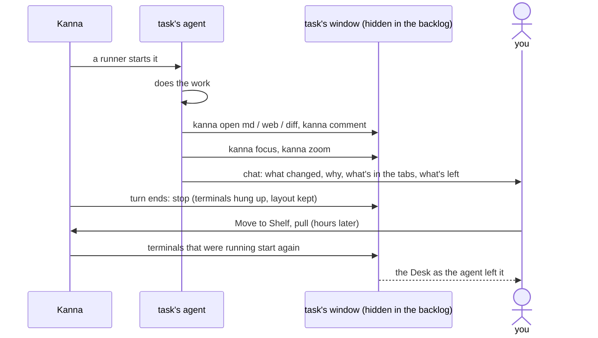

# Presenting

**Status:** built · **Tested:** e2e `backlog_runners`, `cargo test -p kanna-mux` (held windows) · **Builds on:** [tasks](tasks.md), [backlog runners](backlog-runners.md), [code tour](code-tour.md), [doc markup](doc-markup.md), [zoom](zoom.md)

Every task presents its work. When it's done, before its turn ends, its agent sets up its Desk to show you what it changed and why: the spec (its changes marked, [markdown diff](markdown-diff.md)), the mockup, a diff, comments on the key code. Kanna keeps that layout through a stop, so a task that ran unattended in the backlog shows it when you pull it hours later.

The layout is **latent**: the agent sets it while nobody's looking, and it's what you see when the task is shown.

## Contents

1. [What happens](#1-what-happens)
2. [Rules](#2-rules)
3. [How it's built](#3-how-its-built)
4. [Glossary](#4-glossary)

## 1. What happens

## 2. Rules

- **The agent decides how it presents itself.** Kanna sets no default layout and zooms nothing: the agent picks what to open, which tab is shown and focused, and whether to zoom. The directions are in the `kanna-tasks` skill ("Present your work"), since they apply to every task, watched or not.
- **Focus comes last:** once its tabs are set up, the agent focuses the tab you should see first (`kanna focus`), so that's the tab the task shows when it comes onto the Desk, not whichever one it opened last. From the backlog or the Shelf it goes to the task's own workspace, wherever that is ([workspaces](workspaces.md#3-commands-target-and-reply)).
- **A changed doc shows its changes:** the agent opens it with `kanna open md FILE --diff main`, or `--diff A..B` for what changed between two commits ([markdown diff](markdown-diff.md)).
- **The same when it stops to ask:** it sets up what the question is about.
- **Nothing worth a tab:** the agent closes its tabs and zooms its own pane, so its summary is what you see.
- **Stop keeps the whole layout:** every tab, the shown tab, focus and zoom; markdown, web, code and diff tabs, with their comments. Every terminal is hung up and stays in place, exited, like the agent's.
- **Start brings the terminals back:** starting the task again (`kanna task start`, or Move to Shelf) restarts each terminal that was running when it stopped, with its command and folder. One that had exited before the stop stays exited. What a terminal was in the middle of is lost.

## 3. How it's built

- **A backlog task's window is held in the backlog** ([tasks](tasks.md#7-how-its-built)), not shown. `kanna open`, `kanna comment`, `kanna focus` and `kanna zoom` from its agent (or from a terminal in its window) land there:
  - opening sends the caller as the `opener` (the CLI's `$KANNA_TERMINAL`) unless `--window` or `--dock` is given; a pane whose opener is in a held or Shelf window goes into a new tab of that window, whatever `--tab`, `--split` or `--size` say, and one whose opener is in a shown window goes into that window rather than the front one;
  - focus and zoom of a pane, and focus of a tab, in a hidden window set that window's shown tab, focus and zoom without bringing anything to the front;
  - the app keeps the content of a held window's markdown, web, code and diff panes (the layout's `held` list), so they start and stay while hidden.
- **Stopping** (`Backlog::stop`, and `Backlog::quit` when a runner's turn ends) asks the core to hang up the task's terminals (`CoreHandle::hang_up`): each running one is marked `hungUp`, saved with the terminals, and hung up; then the agent quits or is hung up. Nothing is closed.
- **Starting** (`Backlog::revive`, for start, Move to Shelf and pull back from the backlog) restarts the agent, then the task's `hungUp` terminals (`CoreHandle::wake`). Restarting a terminal any other way clears its mark.
- **Tested** by e2e `backlog_runners`: the mock agent opens a markdown tab with a comment, a terminal running a long command and one that exits at once, focuses the markdown tab and zooms, and ends its turn; once Kanna stops it, the held window still has its three tabs, focused and zoomed on the markdown, both terminals exited; Move to Shelf runs the long one again and leaves the other exited, and pulled, the Desk shows the same layout.

## 4. Glossary

| Term | Meaning |
|---|---|
| **Presenting** | The agent setting up its Desk to show what it changed and why, before its turn ends |
| **Held window** | A backlog task's window: its agent and tabs, kept off-screen by the layout |
| **Hung up** | A terminal ended by its task's stop, marked to run again when the task starts |
| **Opener** | The pane that ran `kanna open`; its window is where the new pane goes when that window is hidden |
