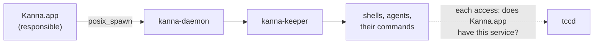
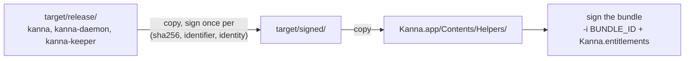

# Privacy Prompts

**Status:** built (2026-10-30) · **Related:** [release](release.md), [build channels](build-channels.md), [build targets](build-targets.md), [instances](instances.md)

macOS asks before a program reads a protected folder or device (TCC, its privacy controls), and it asks on behalf of the app that started the program. Every program in a Kanna terminal asks as Kanna. Dev builds used to be signed ad hoc, so each rebuild was a new app to macOS: it asked again for everything, and a grant given in System Settings went to a build that was already gone. Dev builds are now signed with a stable identity, so an answer lasts across rebuilds, as a release's does.

## Contents

1. [What macOS asks for](#1-what-macos-asks-for)
2. [Who is responsible](#2-who-is-responsible)
3. [How a build is recognised](#3-how-a-build-is-recognised)
4. [How dev builds are signed](#4-how-dev-builds-are-signed)
5. [Watching and resetting](#5-watching-and-resetting)
6. [Glossary](#6-glossary)

## 1. What macOS asks for

Kanna itself doesn't touch a protected folder: starting the app, a Desk at the home folder, its planning terminal and a task ask nothing (checked with the log in [§5](#5-watching-and-resetting)). The prompts come from what runs in its terminals:

| Service | Settings name | Asked when | Usual cause |
|---|---|---|---|
| `SystemPolicyRemovableVolumes` | Files & Folders › Removable Volumes | reading or running anything on an external disk | builds on another volume (`build.targets`, [build targets](build-targets.md)), projects there |
| `SystemPolicyDesktopFolder`, `…DocumentsFolder`, `…DownloadsFolder` | Files & Folders › Desktop, Documents, Downloads | entering the folder | an agent searching the home folder (`find ~`) |
| `Photos`, `MediaLibrary` | Photos, Media & Apple Music | entering `~/Pictures/Photos Library`, `~/Music` | the same search |
| `SystemPolicyAppData` | App Data | entering another app's `~/Library/Containers` | the same search, deeper |
| `Microphone` | Microphone | an agent's voice input | the user |
| `AppleEvents` | Automation | `osascript` from a terminal | the user or an agent |

A search of the home folder asks once per protected folder it walks into, so one `find ~ -maxdepth 3` is half a dozen prompts. The Kanna skills tell agents to look where the project points instead (`kanna-tasks`, `kanna-planning`).

## 2. Who is responsible

macOS gives every process a **responsible process**: the app whose permission it uses and whose name the prompt shows. A program inherits it from the process that spawned it, so it follows Kanna's chain down to the agent:



- **The daemon and keeper outlive the app.** The keeper the user's dev Kanna runs may be weeks old, and its terminals still answer to the app that started it. macOS looks the app up by its path (`responsible_path`) and checks the grant against the code at that path now, not the code that was running then. A stable signature is what makes the two agree ([§3](#3-how-a-build-is-recognised)).
- **An app run from a Kanna terminal is Kanna's.** A worktree's dev build started directly from an agent's terminal asks as the Kanna that agent runs in. Started with `open` (Launch Services), it's responsible for itself and asks as its own name, "Kanna Dev task-…".
- **Each worktree's build is its own app** to macOS: it has its own bundle ID (`dev.kanna.app.dev.task-…`, [build channels](build-channels.md)), so it gets its own grants, which last across that worktree's rebuilds.

## 3. How a build is recognised

A grant stores the app's bundle ID and its **designated requirement**: the rule its code must meet. macOS honours the grant, or the No, only while the code at the app's path still meets it.

| Signed | Designated requirement | After a rebuild |
|---|---|---|
| ad hoc (`codesign -s -`, and what the linker does) | `cdhash H"…"`: these exact bytes | a new app: it asks again. A No given to the current build fails silently ("Operation not permitted") until the next build |
| with a certificate | `identifier "dev.kanna.app.dev" and certificate leaf = H"…"` | the same app: the answer stands |

Before this, the build never signed the bundle: the main executable kept the linker's ad-hoc signature with a made-up identifier (`Kanna-5555…`), the Info.plist wasn't bound, and the helpers were `kanna_daemon-98480b85…`. Signing the bundle binds the Info.plist and seals its resources too.

## 4. How dev builds are signed

`scripts/build-kanna-app.sh` signs with **Kanna Dev Signing**, a self-signed code-signing certificate in the login keychain, or ad hoc when there is none and says so. `scripts/dev-signing-identity.sh` makes it once per Mac: an RSA key and a 20-year certificate made with `/usr/bin/openssl`, imported with `codesign` allowed to use the key, so builds sign without a keychain prompt. Nothing has to trust it: `codesign` signs by its hash, and the requirement names the certificate itself.



- **One signing step for dev and release:** `kanna_sign_app` in `scripts/env.sh` signs each helper with `--identifier BUNDLE_ID.HELPER` (`dev.kanna.app.dev.kanna-keeper`), then the bundle with `--identifier BUNDLE_ID` and `apps/kanna/Resources/Kanna.entitlements`. A release passes `--options runtime --timestamp` and its Developer ID ([release](release.md#signing-and-the-dmg)). A dev build has neither: no hardened runtime, so a debugger can attach, and no timestamp, which needs Apple's server.
- **Unchanged code keeps its bytes.** Kanna tells builds apart by the SHA-256 of the binary ([daemon build](daemon-build.md)), and a certificate signature carries its signing time, so re-signing an unchanged daemon would make the app replace it after every build. The signed helpers are kept in `target/signed/` with a stamp of the unsigned binary's hash, its identifier and the identity, and signed again only when one changes.
- **Signatures stay out of `target/release`:** cargo links its binaries there again on every build, even a no-op one. So the bundle's helpers aren't `target/release`'s: the e2e scenarios and `scripts/run-kanna.sh` run the bundle's (`Contents/Helpers`).

## 5. Watching and resetting

```sh
/usr/bin/log stream --predicate 'subsystem == "com.apple.TCC" AND eventMessage CONTAINS "AUTHREQ"' --style compact
```

Run it outside the sandbox (`log` won't run inside it; in zsh, `log` alone is a builtin). Each request is a few lines with the same `msgID`: `AUTHREQ_CTX` names the service, `AUTHREQ_ATTRIBUTION` the responsible and accessing processes, `AUTHREQ_SUBJECT` the app the answer is stored for, `AUTHREQ_PROMPTING` a prompt shown, and `AUTHREQ_RESULT` the answer (`authValue` 2 allowed, 0 denied; `authReason` 2 the user's answer, other values the system's).

- **To grant a service:** System Settings › Privacy & Security › Files & Folders (or the service's own page) › Kanna Dev.
- **To forget an answer,** so macOS asks again: `tccutil reset SystemPolicyRemovableVolumes dev.kanna.app.dev` (or `All` for every service).
- **The first signed build** doesn't match answers given to ad-hoc builds, so macOS asks once more for each service; from then on the answers last.

## 6. Glossary

- **TCC** (Transparency, Consent and Control): macOS's privacy controls; `tccd` is the daemon that decides and prompts.
- **Responsible process:** the app a process's privacy requests are attributed to; inherited from the spawning process unless the spawner disclaims it.
- **Designated requirement:** a code-signing rule (`codesign -d -r- APP`) that says which code counts as this app.
- **cdhash:** the hash of a signature's code directory, which changes with any change to the code or Info.plist.
- **Ad hoc:** signed without a certificate, identified only by its cdhash.
