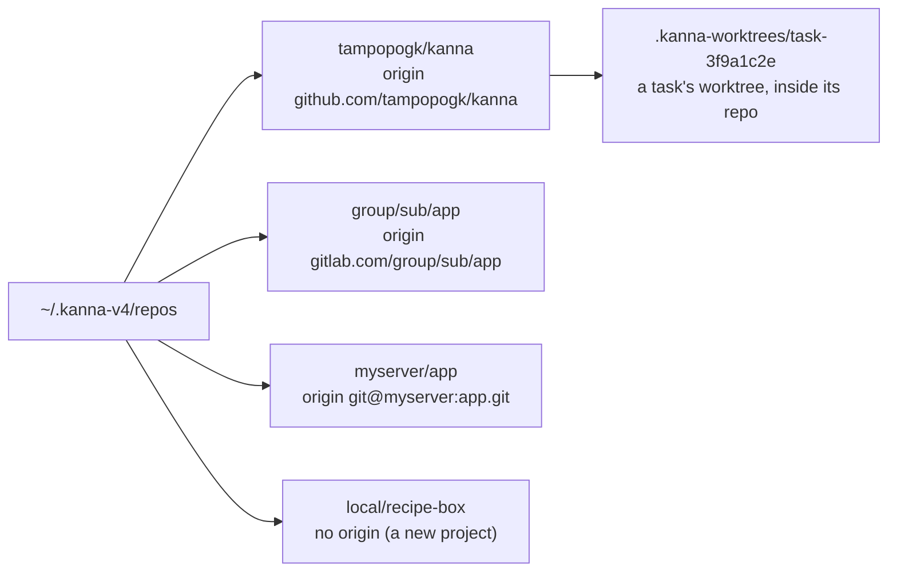
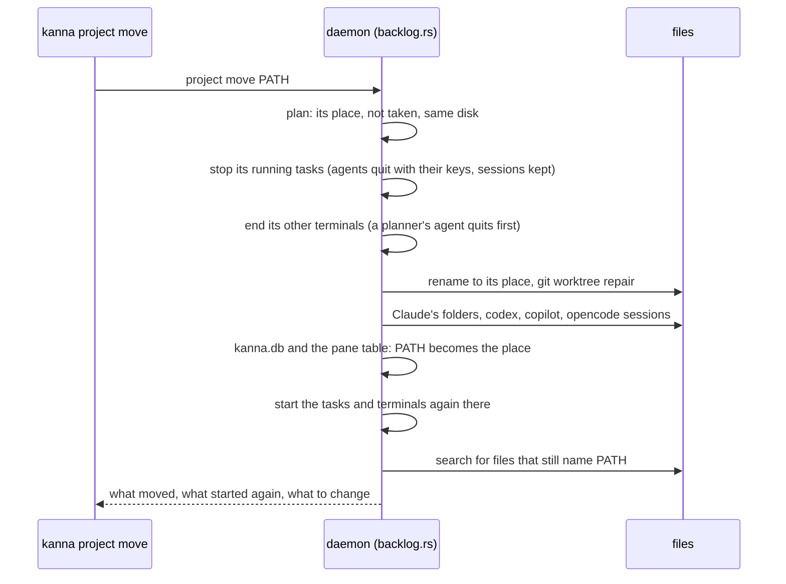

# Project folder

**Status:** built (2026-10-29) · **Tests:** `crates/kanna-daemon/src/projects.rs`, `project_move.rs`, `backlog.rs` (unit), `scripts/e2e-kanna.sh` `project_move` · **Builds on:** [your machines](machines.md), [tasks](tasks.md), [new Desk](new-desk.md) · **Code:** `projects.rs` (places, the refusal), `project_move.rs` (the move's steps), `backlog.rs` (`relocate`)

Every project Kanna works on lives in `~/.kanna-v4/repos`, at a place named after its origin remote. The projects stay tidy, and a project has the same path from `~` on each of your [machines](machines.md), so a replicated backlog or a task sent to another machine finds its repo there. Kanna opens Desks and runs tasks only for a project in its place; `kanna project move` puts one there.

## Contents

1. [Where a project lives](#1-where-a-project-lives)
2. [Outside it](#2-outside-it)
3. [kanna project move](#3-kanna-project-move)
4. [How it's built](#4-how-its-built)
5. [Rejected](#5-rejected)

## 1. Where a project lives



| The repo's `origin` | Its place |
|---|---|
| `https://github.com/a/app(.git)`, `git@github.com:a/app.git`, `ssh://git@github.com:22/a/app` | `a/app`: the remote's path, without the host or `.git` |
| a path with more parts (`gitlab.com/group/sub/app`) | all of them: `group/sub/app` |
| one part only (`git@myserver:app.git`) | the host, then it: `myserver/app` |
| none, a local path or `file://`, or a part starting with `.` | `local/NAME`, NAME the folder's name |

- **The place follows the origin.** A project made in `local/NAME` that gets an origin is out of place until it's moved, and so is a clone whose origin changes.
- **One clone per place.** Two folders cloned from the same remote can't both have it: the move refuses the second, naming both ([3](#3-kanna-project-move)).
- **The planner's prompt puts them there** ([new Desk](new-desk.md#2-its-planning-terminal)): a URL clones into its place, `owner/repo` into `owner/repo`, a name makes `local/NAME`.
- **`~/.kanna/repos`** (the old Kanna's) isn't Kanna's any more: a project there is outside.

## 2. Outside it

A project is **outside** when its repo's folder (the main repo for a worktree) isn't its place. Kanna refuses, saying where it belongs and the command that moves it:

```
~/work/app isn't in ~/.kanna-v4/repos, where Kanna keeps its projects so each has the same place on every machine: move it there with `kanna project move ~/work/app` (to ~/.kanna-v4/repos/tampopogk/app)
```

| What | Outside |
|---|---|
| `kanna PATH`, `task desk` | refused; `kanna ~` (and ⌘N) still opens a Desk in `~` |
| `kanna task new` | refused |
| `kanna task start`, Move to Shelf, a [backlog runner](backlog-runners.md) | refused; runners skip the project |
| the planner's prompt given a folder or a recent project | says so, offers `Move it to … now? [y/N]` (yes runs the move and opens it there), else asks again |
| a planning terminal that starts outside (Kanna started from a shell there, a restored Desk, a task docked there parked) | says so and offers the move: yes steps out to `~` (so the move doesn't stop it), moves the project and starts the agent there; no stays, so the window keeps its project and Shelf |
| a planning terminal you `cd` outside | the window follows as before: its Shelf shows that folder's tasks, and none of them start |
| recent projects | an outside one isn't listed or added; it's kept, and comes back when it's moved |

- **What already runs keeps running.** Tasks and terminals an older Kanna started in an outside project (restored from its saved state) run as they were; Kanna moves nothing by itself. Once one stops, it starts again only after the move.
- **Subfolders and worktrees** are their repo: a worktree of a project in its place is in place, wherever it is.

## 3. kanna project move

`kanna project move PATH` moves the project PATH is in to its place and leaves nothing at PATH: no symlink.



- **It refuses** when the place is taken: by another clone of the same remote (`… and … are both clones of github.com/a/app, and a project has one place: keep one of them …`), or by anything else (`… is already there`); when the project is on another disk than `repos`; when a task in it is starting, setting up or ending, or another move runs; and when it's run from a terminal in the project, which it would stop. Nothing has changed then.
- **Running tasks** stop as `kanna task stop` stops them and start again as `kanna task start` does: the agent resumes its conversation ([which agents resume](tasks.md#which-agents-resume)) in the moved worktree, and the task's hung-up terminals run again. A task that was stopped stays stopped.
- **Other terminals in the project** (plain windows, the Shelf's planning terminal, the quiz agent) end and start again with their own commands, in the new folder. A planning terminal runs the planner script again and comes back to the project's planning conversation ([planner resume](planner-resume.md)).
- **What it changes:**
  - the repo's worktrees, inside it or elsewhere (`git worktree repair`);
  - in `kanna.db`: tasks' repo and worktree, messages, recent projects, planners, quiz rounds; in the pane table (saved with the layout): terminals' folders and file panes' paths;
  - Claude's per-folder conversation and memory folders (`~/.claude/projects/<the folder, every non-alphanumeric a ->`) for the repo, its worktrees (also removed ones) and subfolders, merged into one that's there already (a file there already is kept, and the move says which it left);
  - codex rollouts' `cwd`, copilot's `workspace.yaml` `cwd` and `git_root`, opencode's sessions' `directory`: what Kanna [finds a session by](tasks.md#which-agents-resume). Antigravity resumes by the conversation it says as it quits.
- **What it doesn't change, it lists:** every line naming PATH (as written, `~/…` or `$HOME/…`) in `~/.claude` (but not its conversations), `~/.claude.json`, `~/.agents`, your shell's startup files, `~/.codex/config.toml` and `AGENTS.md`, and the repo's own files, as `FILE:LINE`, for you to change. Codex's trust and Claude's per-folder settings are among them: codex may ask to trust the folder again.
- **On another machine,** each machine moves its own copy with the same command, run there: `kanna --host MACHINE project move '~/work/app'` (quoted, so `~` is that machine's).

## 4. How it's built

- **`projects.rs`:** `home_place` reads `origin` from the repo's `.git/config` and maps it (`place_of`); `outside` is the refusal. The backlog (`placed`, from `ready` and `mint`) and the `desk` command call it; `Backlog.repos` is set by `main.rs`, so tests run without it.
- **`project move`** is the daemon's `project` command (`move`, `path`, `by`), in `backlog.rs` (`relocate`), with the file work in `project_move.rs`. While it runs, the backlog refuses to make or start a task in the project (`moving`).
- **The agents' folders** are under `KANNA_AGENTS_HOME` when it's set, else `CLAUDE_CONFIG_DIR`, `CODEX_HOME`, `COPILOT_HOME`, `XDG_DATA_HOME` or their defaults in `~`. Rewritten files keep their modification time, which the session lookups go by.
- **`planner.sh`** works out a place the same way (`place`, `misplaced`), so it can say where without the daemon, and runs `kanna project move` when you say yes.

## 5. Rejected

- **Moving outside projects by themselves** on first start: a move stops running agents and renames your folders; you run it when you choose.
- **A symlink at the old path:** two paths for one project is what this ends.
- **Rewriting every file that names the old path:** scripts, CLAUDE.md files and shell configs are yours; the move lists them.
- **The host in the place** (`github.com/a/app`): a project's place should read as its owner and name; a second host with the same owner and name is rare, and its move is refused because the place is taken.
