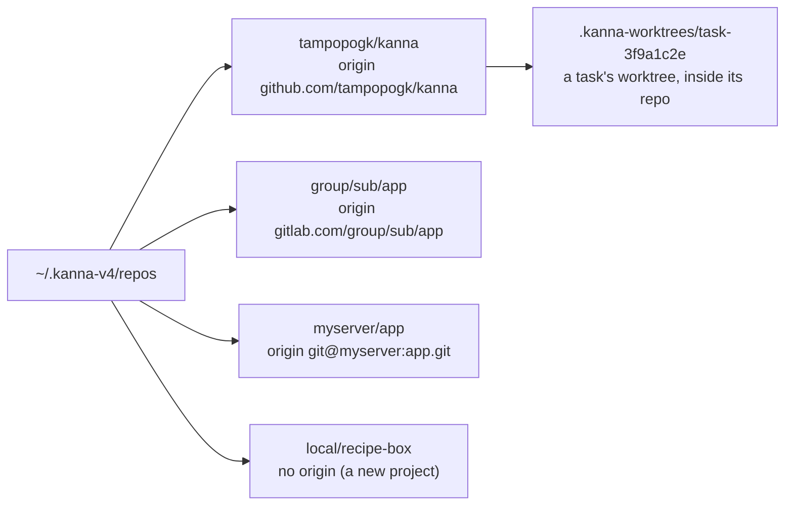
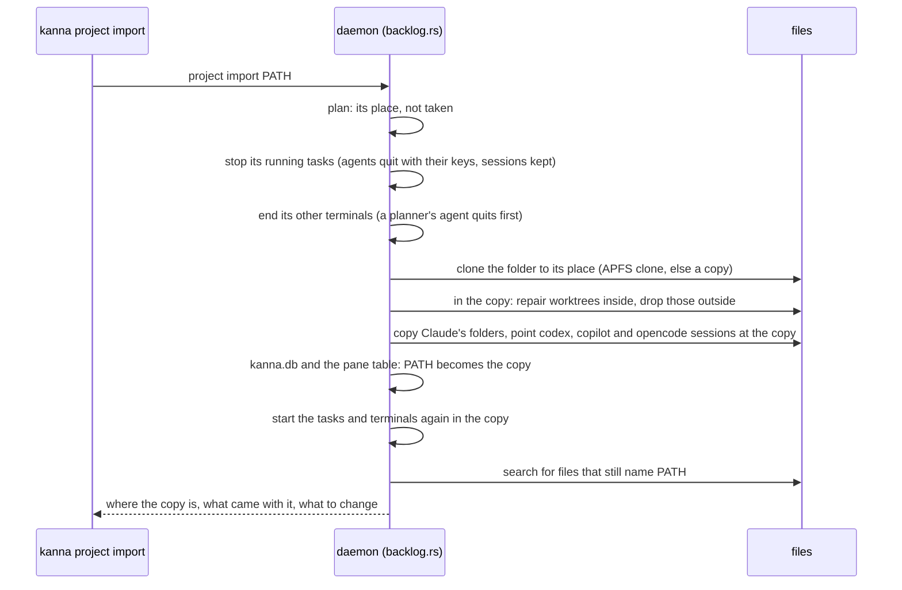

# Project folder

**Status:** built (2026-10-29) · **Tests:** `crates/kanna-daemon/src/projects.rs`, `project_import.rs`, `backlog.rs` (unit, the planner's offer), `scripts/e2e-kanna.sh` `project_import` · **Builds on:** [your machines](machines.md), [tasks](tasks.md), [new Desk](new-desk.md) · **Code:** `projects.rs` (places, the refusal), `project_import.rs` (the copy and what follows it), `backlog.rs` (`relocate`)

Every project Kanna works on lives in `~/.kanna-v4/repos`, at a place named after its origin remote. The projects stay tidy, and a project has the same path from `~` on each of your [machines](machines.md), so a replicated Shelf or a task sent to another machine finds its repo there. Kanna opens Desks and runs tasks only for a project in its place; `kanna project import` puts a copy of one there, and each planner offers it when it starts in a project outside.

## Contents

1. [Where a project lives](#1-where-a-project-lives)
2. [Outside it](#2-outside-it)
3. [The offer](#3-the-offer)
4. [kanna project import](#4-kanna-project-import)
5. [How it's built](#5-how-its-built)
6. [Rejected](#6-rejected)

## 1. Where a project lives



| The repo's `origin` | Its place |
|---|---|
| `https://github.com/a/app(.git)`, `git@github.com:a/app.git`, `ssh://git@github.com:22/a/app` | `a/app`: the remote's path, without the host or `.git` |
| a path with more parts (`gitlab.com/group/sub/app`) | all of them: `group/sub/app` |
| one part only (`git@myserver:app.git`) | the host, then it: `myserver/app` |
| none, a local path or `file://`, or a part starting with `.` | `local/NAME`, NAME the folder's name |

- **The place follows the origin.** A project made in `local/NAME` that gets an origin is out of place until it's imported to its new place, and so is a clone whose origin changes.
- **One clone per place.** Two folders cloned from the same remote can't both have it: the import refuses the second, naming both ([4](#4-kanna-project-import)).
- **The planner's prompt puts them there** ([new Desk](new-desk.md#2-its-planning-terminal)): a URL clones into its place, `owner/repo` into `owner/repo`, a name makes `local/NAME`.
- **`~/.kanna/repos`** (the old Kanna's) isn't Kanna's any more: a project there is outside.

## 2. Outside it

A project is **outside** when its repo's folder (the main repo for a worktree) isn't its place. Kanna refuses, saying where it belongs and the command that imports it:

```
~/work/app isn't in ~/.kanna-v4/repos, where Kanna keeps its projects so each has the same place on every machine: import a copy there with `kanna project import ~/work/app` (to ~/.kanna-v4/repos/tampopogk/app)
```

| What | Outside |
|---|---|
| `kanna PATH`, `task desk` | refused; `kanna ~` (and ⌘N) still opens a Desk in `~` |
| `kanna task new` | refused |
| `kanna task start`, Move to Shelf, a [Shelf runner](shelf-runners.md) | refused; runners skip the project |
| a planning terminal that starts outside (Kanna started from a shell there, a restored Desk, a Desk task docked there) | offers the import ([3](#3-the-offer)) |
| the planner's prompt given a folder or a recent project | offers the import, without never ([3](#3-the-offer)) |
| a planning terminal you `cd` outside | the window follows as before: its Desk view shows that folder's tasks, and none of them start |
| recent projects | an outside one isn't added; one already there, or one with tasks, is listed last in the planner's prompt, marked outside ([3](#3-the-offer)); File → Open Recent leaves it off |

- **What already runs keeps running.** Tasks and terminals an older Kanna started in an outside project (restored from its saved state) run as they were; Kanna imports nothing by itself. Once one stops, it starts again only in the copy.
- **Subfolders and worktrees** are their repo: a worktree of a project in its place is in place, wherever it is.
- **The original stays outside after an import.** It's left as it was, so Kanna still refuses it; the copy is the project now.

## 3. The offer

Each planner offers the import when it starts outside, in the window's planning terminal: no sheet or dialog.

```
~/work/app isn't in ~/.kanna-v4/repos, where Kanna keeps its projects so each has the same place on every machine.
Import a copy there: kanna project import ~/work/app
Import it into ~/.kanna-v4/repos/tampopogk/app now? [Y/n/never]
```

| Answer | Then |
|---|---|
| `Y` (or Return, or anything not starting with n or N) | the planner steps out to `~` (so the import doesn't stop it), runs `kanna project import`, prints what it says, and starts the agent in the copy; the window's Desk and Shelf follow it there |
| `n` (or anything else starting with n or N) | it stays on the original, whose tasks don't start, and asks again the next time a planner starts there; nothing is remembered |
| `never` | the daemon remembers the project (`never_import` in [kanna.db](database.md#never-import)); its planners stop asking at startup and say instead, in a line: |

```
~/work/app is outside ~/.kanna-v4/repos, so its tasks don't start. Import it: kanna project import ~/work/app
```

- **Choosing it still asks.** In the planner's where prompt ([new Desk](new-desk.md#2-its-planning-terminal)), a folder outside, or an outside project from the recent list, asks `Import it into … now? [Y/n]` whatever never says: you named it. No asks for a folder again.
- **Outside projects Kanna has work in are listed:** an outside project with a recent-projects entry or tasks not done comes after the others in the where prompt, labelled `~/work/app (outside)` (`outside` and `place` in `kanna projects --json`). File → Open Recent leaves them off, since it can only open a Desk.
- **Importing clears never,** whether from the offer or `kanna project import`.
- **A refused import** (the place is taken, a task is starting) prints why; the planner stays on the original, or asks for a folder again in `~`.

## 4. kanna project import

`kanna project import PATH` copies the project PATH is in to its place, and makes the copy the project: its tasks, terminals and records follow it. PATH stays as it was, byte for byte.



- **The copy is the whole folder:** `.git`, uncommitted and untracked work, stashes, local branches, ignored files, everything. On APFS it's a clone (`clonefile`), which is quick and takes no space until a file changes; elsewhere (another disk, Linux) it's `cp`, with `--reflink=auto` on Linux. It's made beside the place (`.NAME.importing`) and renamed there, so a copy that fails leaves nothing at the place.
- **Worktrees inside the folder** (`.kanna-worktrees`) come with it: each one's `.git` file is pointed at the copy and `git worktree repair` fixes the copy's `.git/worktrees` entry. **Worktrees outside it** stay with the original: their entries are dropped from the copy, and the import lists them.
- **It refuses** when the place is taken: by another clone of the same remote (`… and … are both clones of github.com/a/app, and a project has one place: keep one of them …, then import again`), or by anything else (`… is already there`); when a task in it is starting, setting up or ending, or another import runs; and when it's run from a terminal in the project, which it would stop. Nothing has changed then.
- **Running tasks** stop as `kanna task stop` stops them and start again as `kanna task start` does: the agent resumes its conversation ([which agents resume](tasks.md#which-agents-resume)) in the copy's worktree, and the task's hung-up terminals run again. A task that was stopped stays stopped.
- **Other terminals in the project** (plain windows, the Desk's planning terminal, the quiz agent) end and start again with their own commands, in the copy. A planning terminal runs the planner script again and comes back to the project's planning conversation ([planner resume](planner-resume.md)).
- **What follows the copy:**
  - in `kanna.db`: tasks' repo and worktree, messages, recent projects, planners, quiz rounds, and never (deleted); in the pane table (saved with the layout): terminals' folders and file panes' paths;
  - Claude's per-folder conversation and memory folders (`~/.claude/projects/<the folder, every non-alphanumeric a ->`) for the repo, its worktrees (also removed ones) and subfolders, **copied** to the copy's names, so the original's stay; into a folder that's there already, a file there already is kept, and the import says which it didn't copy;
  - codex rollouts' `cwd`, copilot's `workspace.yaml` `cwd` and `git_root`, opencode's sessions' `directory`: what Kanna [finds a session by](tasks.md#which-agents-resume), **rewritten** to the copy. Duplicating them would give two sessions one ID (codex's rollouts, opencode's rows), and either could be resumed; the original is outside, so Kanna resumes nothing there. Antigravity resumes by the conversation it says as it quits.
- **What it doesn't change, it lists:** every line naming PATH (as written, `~/…` or `$HOME/…`) in `~/.claude` (but not its conversations), `~/.claude.json`, `~/.agents`, your shell's startup files, `~/.codex/config.toml` and `AGENTS.md`, and the copy's own files, as `FILE:LINE`, for you to change. Codex's trust and Claude's per-folder settings are among them: codex may ask to trust the folder again.
- **Then it says where the copy is,** and that the original is as it was and can be deleted:

```
imported ~/work/app into ~/.kanna-v4/repos/tampopogk/app
  copied with it: 2 worktrees, 3 Claude folders
  resuming in the copy: 1 codex session
  started again there: task-3f9a, term-12
  worktrees outside it stay with the original:
    ~/work/app-hotfix
~/work/app is as it was, and Kanna won't open it: delete it once you're happy with the copy.
These still name ~/work/app; change them yourself:
  ~/.zshrc:12
```

- **A dev Kanna can import the checkout it was built in.** Its terminals' commands name files there (the planner script, the shell integration), and the original keeps them, so the restarted terminals run them from there as before.
- **On another machine,** each machine imports its own copy with the same command, run there: `kanna --host MACHINE project import '~/work/app'` (quoted, so `~` is that machine's).

## 5. How it's built

- **`projects.rs`:** `home_place` reads `origin` from the repo's `.git/config` and maps it (`place_of`); `outside` is the refusal. The backlog (the Shelf: `placed`, from `ready` and `mint`) and the `desk` command call it; `Backlog.repos` is set by `main.rs`, so tests run without it. Its `projects list` adds the outside projects with work in Kanna, marked `outside`.
- **`project import`** is the daemon's `project` command (`import`, `path`, `by`), in `backlog.rs` (`import`), with the file work in `project_import.rs` (`plan`, `copy`, `Stores::carry`, `mentions`). While it runs, the Shelf refuses to make or start a task in the project (`importing`). The same command's `asked` and `never` (`path`) read and set never, for `planner.sh`.
- **The agents' folders** are under `KANNA_AGENTS_HOME` when it's set, else `CLAUDE_CONFIG_DIR`, `CODEX_HOME`, `COPILOT_HOME`, `XDG_DATA_HOME` or their defaults in `~`. Rewritten files keep their modification time, which the session lookups go by.
- **`planner.sh`** works out a place the same way (`place`, `misplaced`), so it can say where without the daemon, asks the daemon for never (`kanna raw`), and runs `kanna project import` when you say yes.

## 6. Rejected

- **Importing outside projects without asking** on first start: an import stops running agents and makes a second copy of your project; you say when, or never.
- **Moving rather than copying:** the original is yours. A copy leaves it as it was, so nothing you had there (a build, a running server, a script that names it) breaks under you, and nothing is lost if the import goes wrong; you delete it when you're happy with the copy. On APFS the copy costs no time or space to speak of.
- **A symlink at the old path:** two paths for one project is what this ends.
- **Rewriting every file that names the old path:** scripts, CLAUDE.md files and shell configs are yours; the import lists them.
- **The host in the place** (`github.com/a/app`): a project's place should read as its owner and name; a second host with the same owner and name is rare, and its import is refused because the place is taken.
