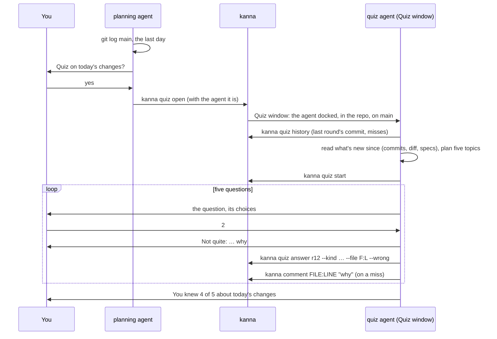
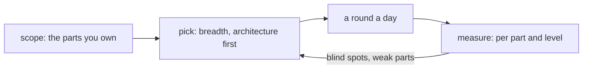

# Quiz

**Status:** planned; the Quiz window is built · **Tests:** `scripts/e2e-kanna.sh` `quiz_window`, `quiz_results` · **Mockup:** [`references/mockups/quiz.html`](../../references/mockups/quiz.html) · **Builds on:** [code tour](code-tour.md), [planning agent](planning-agent.md), [agent setup](agent-setup.md)

Agents write code faster than you can read it, and you lose track of how your own codebase works. The **quiz** is a short break between reading agent output that keeps you up with what they built: five multiple-choice questions about what landed on main in the last day, asked by an agent in its chat, each answer explained, with the code opened at the line. It's the same problem the `kanna-explain` skill addresses, from the other side: you're asked, rather than told.

It's a skill, `kanna-quiz`: the agent writes the questions itself when you start, and uses the `kanna` commands that already exist to open the code. Kanna adds `kanna quiz`: `kanna quiz open` opens the Quiz window with the quiz agent docked in it, told it's the quiz agent, and the rest keeps every round and answer in [the database](database.md#quiz-results).

**Done when** the planning agent offers a round on this repo's recent changes, and the agent in the Quiz window plays it as in the mockup, in light and dark.

## Contents

1. [A round](#1-a-round)
2. [Rules](#2-rules)
3. [Questions](#3-questions)
4. [The skill](#4-the-skill)
5. [Later: keeping you fluent](#5-later-keeping-you-fluent)
6. [Rejected](#6-rejected)
7. [Glossary](#7-glossary)

## 1. A round

## 2. Rules

- **The planning agent offers, the quiz agent asks.** The planning agent checks what's merged into main in the last day when its session starts, and offers a round once per session if anything has. It never asks the questions itself.
- **The Quiz window** is laid out like a Desk: the quiz agent docked on the left, running in the repo's own folder on main, and what it opens (`kanna comment`, `kanna open md`) as tabs on the right, wherever you are. **The docked agent isn't a task,** like the [planning terminal](planning-agent.md#2-what-it-is): it's not on the Desk or the Shelf or in `kanna task list`, takes none of the Desk's three places, and can't be made active, shelved or moved; nothing docks in its place. It's the window's **lead**, as the planning terminal is a Desk's ([how it's built](planning-agent.md#5-how-its-built)), and it closes with its window. There's no worktree, since a quiz changes nothing. **One per repo:** `kanna quiz open` brings the repo's Quiz window forward when one is open, instead of opening another.
- **Written when you start,** by the quiz agent, from what's on main: no background agent, nothing runs between quizzes. It asks the first question as soon as it's written, and writes each next one while you read the explanation.
- **A round is five questions, one at a time,** about two minutes once started. The quiz agent asks each with its multiple-choice tool: Claude's question tool, or a numbered list for an agent without one.
- **Every answer gets a short explanation** and an offer to open the code. **A miss opens it straight away:** `kanna comment FILE:LINE "why"`, so the code shows beside the agent with the explanation on its lines ([code tour](code-tour.md)). A comment on the same file reuses that tab; the tabs stay until the round ends, so you can still read one when the next question comes.
- **Pausing is leaving.** Close the window or go back to your Desk.
- **Every round and answer is kept** in Kanna's database ([quiz results](database.md#quiz-results)): the quiz agent records them with `kanna quiz start` and `kanna quiz answer`, and reads them back with `kanna quiz history`, so a round covers what's new since the last one and misses come back in a later round.
- **Nothing interrupts a round.** A task that needs you shows on the Desk in your Desk window, as always; the quiz doesn't stop for it.
- **No score to protect.** No streaks, no totals over time: the end of a round says what you knew of *these* changes ("You knew 4 of 5 about today's changes"). The kept answers are for the agent picking questions, never shown to you as a score.
- **Light and dark** follow the system, as every pane does.

## 3. Questions

| Kind | Example | Comes from |
|---|---|---|
| **Architecture** | Which process owns a pane's terminal: the app, the daemon, or the CLI? | the code's structure (crates, modules, who calls whom) and the specs' diagrams |
| **Pick the drawing** | Which drawing shows how a terminal's bytes reach Kanna.app? | the same as architecture, drawn three ways, two of them wrong |
| **Behaviour** | When you Move to Shelf, what happens to the agent? | the code and commit messages |
| **Where it lives** | Which file decides a pane's status? | the code |
| **Why** | Why does an instance have its own daemon? | the specs and docs |
| **Spot the bug** | Which of these lines from today's merge has a bug put in? | a few lines from recently merged code, one changed |

- **Only what's true on main:** the code at main's commit, the specs and docs there, and the messages of the commits in the last day. Never an agent's conversation.
- **What's new:** main's commits since the commit the last round asked about, else in the last day, at most 30; with none, the agent says so and offers the last 30 commits instead.
- **Misses come back:** up to two a round from earlier misses (`kanna quiz history --misses`), asked fresh, with new wording and the choices shuffled. Answered again (`--again`), right or wrong, a miss stops coming back; a new miss stands for it.
- **Architecture questions** ask how the pieces fit: which process or module owns something, how data flows between them, what talks to what, about what today's changes touched, seen from above.
- **Pick-the-drawing questions** have three diagrams for choices. The agent writes them as mermaid diagrams, headed A, B and C, in one markdown file (`$TMPDIR/kanna-quiz/drawings.md`) and opens it as a tab beside it (`kanna open md FILE`); you pick A, B or C.

- **Each question is about some lines,** a file and a line range on main: what the agent opens on a miss. An architecture question's lines are where the answer is plainest: a spec's diagram, or the code where one piece hands off to another.
- **A round:** the broader questions first (architecture before a line's detail), spread across files.

## 4. The skill

`kanna-quiz`, in `.agents/kanna-skills`, installed by [agent setup](agent-setup.md) like the others. It has two parts.

**Offering** (the planning agent, which the `kanna-planning` skill sends here):

- `git log main --since=1.day`. With nothing new, say nothing.
- Otherwise offer once, in a line: what landed, and "Quiz on today's changes? Five questions, about two minutes."
- On yes: `kanna quiz open`, with the agent you are (`--agent codex`; Claude by default).

**Asking** starts from that first message ([agent setup](agent-setup.md#2-how-an-agent-knows-its-in-kanna)), which says it's the quiz agent, on main, so the agent doesn't take itself for a task's (and rename main).

In the quiz agent:

- **Read before asking:** `kanna quiz history`, then the commit messages and diff since the last round's commit (else the last day), and the specs they touch; pick five topics, broadest first, with the misses brought back among them. Then `kanna quiz start`.
- **One question at a time,** written just before you ask it: four choices (three for a drawing), one right, the wrong ones plausible. Read the lines you'll point to, so the line numbers are right.
- **Never hint,** and never reword the choices once asked.
- **Answer:** right or not in one word, then why, in a sentence or two, and `kanna quiz answer` with the kind, the lines, right or wrong, and the question as JSON. On a miss, `kanna comment FILE:LINE "why"`; on a right answer, offer to open the code.
- **Follow questions** between questions, from the code, briefly; then go on.
- **At the end,** say what you knew of the five, and ask whether to close the window or play another round.

## 5. Later: keeping you fluent

Taken further, the quiz becomes a control loop whose goal is that you stay fluent in the code you're responsible for, not just what merged today.

- **Scope:** work out which parts of the codebase you're responsible for (asked once, then from what you review and merge).
- **A round a day**, across those parts, at every level from the architecture down to a line's detail, so code literacy doesn't fade.
- **Remember answers:** built ([quiz results](database.md#quiz-results)). Every answer is kept with its kind and file, so misses come back in a later round (asked fresh, choices shuffled) and a quiz covers what's new since the last one.
- **Measure** how well you know each part at each level, from those answers.
- **Adapt:** steer towards blind spots and parts you keep missing, while keeping breadth, and aiming for the higher levels first.

## 6. Rejected

- **A quiz pane** (its own pane type, with buttons): the quiz is a conversation, and the agent can answer your follow-up questions; a pane can't.
- **An offer on the Desk page:** the planning agent offers it in its chat.
- **A quiz task:** a quiz changes nothing, so it needs no worktree, branch or place on the Desk.
- **The quiz agent as the window's only tab pane,** with what it opens split beside it (before): the code got squeezed into a split, and the window didn't look like the rest of Kanna. Docking it as the planning terminal is docked, outside the task rules, keeps it off the Desk and out of its three.
- **A quiz-only mark on the dock** (a docked pane flagged as not a task, or a Quiz window kind): every rule that keeps a pane out of the task rules (the Desk, the Shelf, the list, the three, ⌘., making active, moving) would need a second check for it. The planning terminal already was a window's agent outside those rules, so it became the window's lead, for any window: a Desk's is its planning terminal, a plain window's is its quiz agent.
- **Stepping aside when a task needs you:** the Desk already shows it; the quiz never interrupts.
- **Preparing questions in the background after main moves:** it costs agent runs for quizzes you never take, and needs something watching every repo.
- **A question writer in the daemon,** writing rounds ahead for `kanna quiz` to hand out: the quiz agent writes better questions from what it just read, and answers follow questions. `kanna quiz` only keeps rounds and answers, which the agent writes; it was rejected at first, when nothing read them back, and came back once misses had to return ([quiz results](database.md#quiz-results)).

## 7. Glossary

| Term | Meaning |
|---|---|
| **Round** | Five questions, asked one at a time, ending with what you knew |
| **Quiz window** | The window the planning agent opens: the quiz agent docked on the left, on main, and the code it opens as tabs |
| **Quiz agent** | The agent in the Quiz window, running the `kanna-quiz` skill |
| **Lead** | A window's own agent, docked on the left and not a task: a Desk's planning terminal, a Quiz window's quiz agent |
| **Level** | How broad a question is: architecture, module, or a line's detail |
