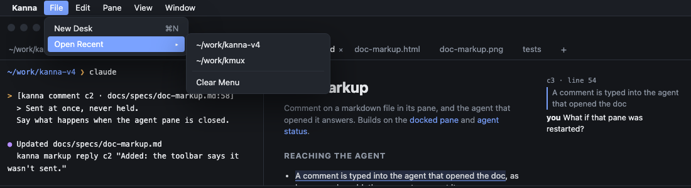
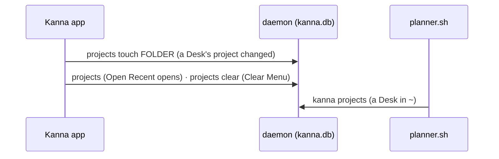

# Recent projects

**Status:** built (2026-10-19) · **Tests:** `crates/kanna-daemon/src/projects.rs` (unit), `backlog.rs` (`planner.sh`), `scripts/e2e-kanna.sh` `recent_projects` · **Mockup:** [`references/mockups/desk.html`](../../references/mockups/desk.html) (the File menu; File › New Desk ⌘N) · **Part of:** [New Desk](new-desk.md), [menus](menus.md) · **Kept in:** [the database](database.md#recent-projects), [architecture](architecture.md#2-what-the-daemon-keeps-what-the-apps-keep)

Reopen a project you've had open without setting it up again.

## File → Open Recent

- Latest first; Clear Menu at the bottom.
- Choosing one is `kanna PATH`: its Desk comes forward if one's open, else a Desk opens right on it, with no where question.

## A new Desk in ~

![A ⌘N Desk's planning terminal: Recent, numbered, and Folder, repo, name or number [1]](recent-projects-prompt.png)

- Return takes 1, a number takes that project; a folder, URL, `owner/repo` or name works as before ([New Desk](new-desk.md#2-its-planning-terminal)).
- A number that isn't listed: `Choose 1 to N, or a folder, repo or name.`
- No recent projects: `Folder, repo or name:`, as before.
- ⌘N still opens a Desk in `~` that asks; it never jumps to the latest project.

## What's recent

| A project moves to the top when | |
|---|---|
| a Desk opens on it | `kanna PATH`, Open Recent (also when its Desk is brought forward) |
| a Desk moves to it | its planning terminal's folder changes, a task from it is pulled onto the Desk |

- **A project is its repo's folder**: the main repo for a worktree, a subfolder's repo (`project()`). `~` never is.
- **Ten are kept;** a folder that's gone drops off when the list is read.
- **One list for every app and Desk,** in the daemon.

## How it's built

- **The app reports, the daemon keeps:** a Desk is the app's, so the app says when one's project changes (`deskMoved`, `openDesk` in `RecentProjects.swift` / `AppDesk.swift`); it remembers the Desk's project in `app-state.json`, so a relaunch reopening Desks doesn't reorder the list.
- **`kanna projects [--json]`** prints a path a line, latest first; `kanna projects clear` empties it.
- **`planner.sh`** asks `kanna projects` before the where question and shows the paths with `~`.

## Rejected

- **macOS recent documents** (`NSDocumentController`): only the app could read them, not the planning terminal's script, and they'd be one app's.
- **A file the script writes:** two writers and no one owning the order; the daemon already keeps Kanna's records in `kanna.db`.
- **⌘N opening the latest project:** a new Desk asks; Return takes the latest.
- **Remembering the agent you picked per recent project:** a pick is per Desk unless you save it for the project (`planning.agent`).
