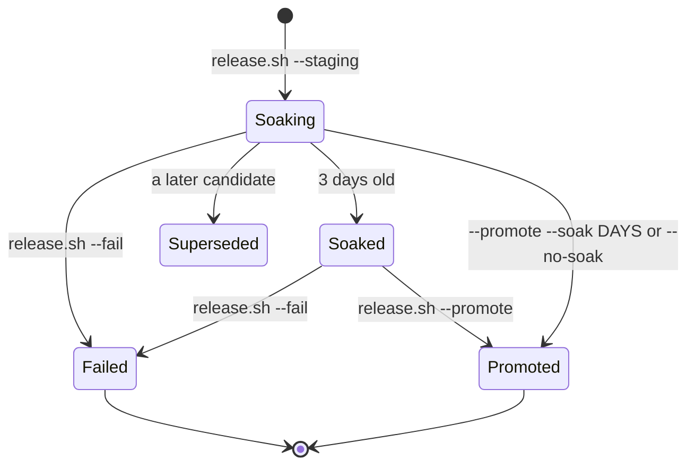
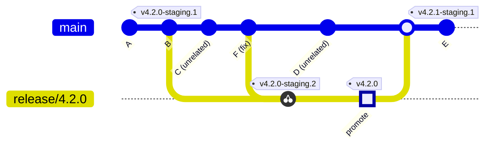
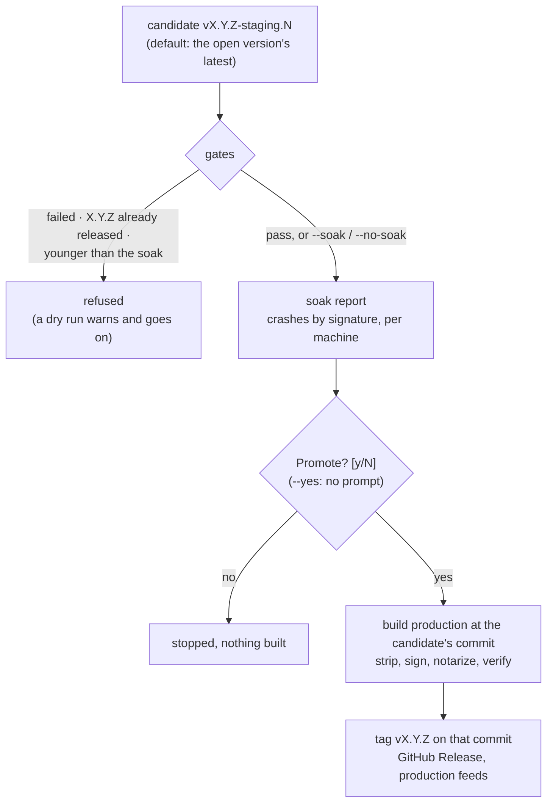

# Release candidates

**Status:** built · **Tested:** `scripts/test-release.sh` (a scratch repo and origin; no build, signing or GitHub) · **Builds on:** [release](release.md), [build channels](build-channels.md), [crashes](crashes.md), [machines](machines.md) · **Why:** a production release used to be a fresh build of whatever main was, so the build the user had worked in for days and the build users got were different source

Every staging release is a **candidate** for one production version. The user works in it for a few days (the **soak**), and then the same commit is released to production (**promoted**). A production release is made no other way. Decided with the user, 2026-11-10; the pattern is Kanna v2's ([its spec](https://github.com/tampopogk/kanna2/blob/main/docs/specs/release-candidates.md)), much reduced.

1. [Commands](#1-commands)
2. [A candidate's life](#2-a-candidates-life)
3. [The release branch](#3-the-release-branch)
4. [Promote and the soak gate](#4-promote-and-the-soak-gate)
5. [The soak report](#5-the-soak-report)
6. [Failing a soak](#6-failing-a-soak)
7. [Where the state lives](#7-where-the-state-lives)
8. [Same source, two builds](#8-same-source-two-builds)
9. [Who does what](#9-who-does-what)
10. [Tests](#10-tests)
11. [Glossary](#11-glossary)

## 1. Commands

| `scripts/release.sh …` | Does |
|---|---|
| `--staging [--major\|--minor\|--patch \| VERSION]` | builds and publishes the next candidate, `vX.Y.Z-staging.N` |
| `--pick COMMIT…` | cherry-picks commits of main onto the open version's release branch and pushes it |
| `--promote [vX.Y.Z-staging.N] [--soak DAYS \| --no-soak] [--yes]` | releases a candidate's commit to production as `vX.Y.Z`; the latest candidate of the open version by default |
| `--fail vX.Y.Z-staging.N [REASON]` | marks a candidate failed |
| `--status` | the open version: its candidates with age, crashes, failed or not, and what the release branch has gained since each |

- **`--dry-run`** goes with every one of them and changes nothing on origin or GitHub: `--staging` and `--promote` build, sign, notarize and verify as a real run does; `--pick` picks and then puts the release worktree back; `--fail` says what it would record.
- **The gates run in a dry run too** and are reported as warnings, so a rehearsal shows what a real run would refuse before any build.
- **A plain `release.sh`** (no mode) is refused: it says to make a candidate and promote it.

## 2. A candidate's life



- **A candidate is one commit,** tagged `vX.Y.Z-staging.N` and published as a GitHub pre-release; Sparkle updates Kanna Staging on both Macs from it ([release](release.md#the-staging-channel)).
- **Its soak starts when its tag is made** and is its own: a later candidate starts a new soak and inherits nothing.
- **A superseded candidate** can still be promoted if it soaked and didn't fail; `--promote` says a later one exists.
- **The open version** is the highest `X.Y.Z` that has candidates, until `vX.Y.Z` is tagged. A plain `--staging` continues it. A bump flag or `VERSION` above it starts a new version from main and leaves the old one unpromoted; one below it is refused.

## 3. The release branch



The `promote` dot only marks where `v4.2.0` goes: promoting makes no commit, and the tag sits on the candidate's own commit.

- **Cut by the first candidate:** a version's first candidate is built from the checkout's HEAD, which must be on `origin/main`, and `release/X.Y.Z` is pushed to origin at that commit just before its tag.
- **Later candidates build the branch:** when `origin/release/X.Y.Z` exists, `--staging` builds exactly its tip, wherever the checkout is. Main keeps moving without resetting the soak. A tip that is still the last candidate's commit is refused: there is nothing new to soak.
- **A fix lands on main first,** through the merge queue as any change does, so it is tested there and main never lacks a fix a release has. Then `release.sh --pick COMMIT…` cherry-picks it (`-x`; a landing's merge commit is picked against its first parent) onto the branch and pushes. A conflict stops the pick in the release worktree and says how to finish it by hand.
- **The branch has no merge queue.** What tests a pick is the next candidate's build and soak.
- **Back to main by a merge,** after the promote: a task merges `origin/release/X.Y.Z` into its branch and lands it through the merge queue. The next version's first candidate is refused until the last release's tag is an ancestor of its commit.
- **Why merge back:** the build number is `git rev-list --count`, and Sparkle offers only a higher one. With the branch merged, main counts the branch's commits too, so the next candidate is always above the last. Release notes list `LAST-TAG..COMMIT`, which also wants the tag behind main.
- **The version lookup needs nothing:** `crates/kanna-build` reads the highest `vX.Y.Z` of all the repo's tags, ancestors or not, so a dev build says `X.Y.Z-dev` as soon as the tag is fetched, merged back or not.
- **Fixes tracing** ([code quality metrics §5](code-quality-metrics.md#5-fixes)) walks main's first-parent landings and never reads tags. The merge back is a landing whose commits include the picks, so a `Fixes:` trailer on a picked commit (one with `cherry picked from commit`) is skipped: the fix was already counted when it landed on main.

## 4. Promote and the soak gate



- **The soak is 3 days** by default: `KANNA_SOAK_DAYS` in `scripts/env.sh`, the release's checked-in settings. `--soak DAYS` sets another length for one run (`--soak 0.5`), and `--no-soak` is `--soak 0`.
- **An override is recorded:** the production release's notes and its tag's message say which candidate it was built from, how long that soaked, and the soak asked for when it wasn't the default.
- **Crashes never refuse a promote.** The gate shows the report and asks; the user fails a soak (§6).
- **The prompt needs a terminal.** Without one, and without `--yes`, promote stops before building.
- **From there it is a production release** as in [release](release.md): the same preflight, stripping, signing, notarizing, publishing and update feeds.
- **Run again after a failed publish,** promote carries on when `vX.Y.Z` is already on origin at the candidate's commit.

## 5. The soak report

`--promote` prints it before asking, and `--status` prints its counts.

```text
==> Soak of v4.2.0-staging.2 (3f9a1c2e7b10)
    the staging build for 3d 4h, since 2026-11-10 09:12 (still is)
    built with rustc 1.91.0 · Swift 6.2 · Xcode 26.1 (17B55), as now
    mbp      runs 4.2.0-staging.2    2 crashes, 1 signature
    studio   runs 4.2.0-staging.2    no crashes
    a172cedcae47474b  ×2  app  SIGABRT  (mbp; last 2026-11-12 20:07)
```

- **Which crashes:** the [crash records](crashes.md#1-the-crash-record) whose `build.version` is the candidate's, from the app, the daemon and the keeper alike, grouped by `signature` with a count, the process, the reason, the machines and the last time.
- **This Mac's** are read from Kanna Staging's state folder, `~/Library/Application Support/kanna-staging/crashes/`.
- **The other machines'** come through Kanna Staging itself: its CLI lists the paired machines and what each runs (`kanna machine list --json`) and asks each for its records (`kanna --host NAME crashes --all --json`, [machines §4](machines.md)). So the Studio needs no ssh setup, and any Mac paired later is covered. A machine that can't be reached, or Kanna Staging not running here, is a line in the report.
- **How long it ran** is the time it was the staging build: from its tag to the next candidate's, or to now. What each machine runs now is beside it. Hours a build actually ran aren't recorded anywhere yet.

## 6. Failing a soak

`release.sh --fail vX.Y.Z-staging.N "the Desk loses focus after sleep"`:

- **Marks it** with an annotated tag `failed/vX.Y.Z-staging.N` on origin, whose message is the reason and whose date is when.
- **Says so on GitHub:** the pre-release's title gains `(soak failed)` and its notes start with the date and reason. The notes and downloads stay, so what was soaked and why it failed is kept.
- **A failed candidate can't be promoted,** with any flag. The next candidate from the release branch starts a new soak.
- **Kanna Staging keeps running it** until the next candidate: the staging feed isn't rolled back.

## 7. Where the state lives

All of it is on origin, so any checkout on any Mac agrees:

| State | Where |
|---|---|
| A candidate, its commit, when its soak began | the annotated tag `vX.Y.Z-staging.N` and its date |
| The branch and toolchain it was built from | `Branch:` and `Toolchain:` lines in that tag's message |
| Failed, when and why | the tag `failed/vX.Y.Z-staging.N` |
| Promoted | the tag `vX.Y.Z`; its message names the candidate and the soak |
| The fixes waiting for the next candidate | `origin/release/X.Y.Z` past the last candidate |

## 8. Same source, two builds

Production and Staging are different apps (name, bundle ID, state folder, update feed: [build channels](build-channels.md)), so a promote rebuilds the candidate's commit as production; a staging DMG can't be re-signed into it. What keeps the two builds alike, apart from the channel and the version's `-staging.N`:

- **One place:** every release build is made in the release worktree, `.worktrees/release` in the main checkout, detached at the commit. The checkout path a build bakes in is the same for both, and the main checkout stays on main with its dev build untouched.
- **The candidate's own build:** `scripts/build.sh` and `scripts/build-linux.sh` run from the worktree, so the build steps are the commit's. Packaging (strip, sign, DMG, notarize, feeds) is the running `release.sh`'s, so a release fix made during the soak applies.
- **Checked:** the worktree is at the commit and clean; each app's `KannaCommit` and the Linux tarball's `release.json` name that commit. The build number is the same, since it counts the same commit's history.
- **The toolchain** (`rustc`, Swift, Xcode) is written in the candidate's tag; the soak report says when this Mac's has changed since. It doesn't refuse.

Nothing compares bytes: signing times and notarization differ every run.

## 9. Who does what

- **The user decides** to make a candidate, to pick a fix, to promote and to fail.
- **The planner** offers a candidate when main has moved and the user wants one, runs `--pick` when the user says which fix goes into the soak, and makes the task that merges the branch back after a promote. It never promotes or fails a candidate without being told ([AGENTS.md](../../AGENTS.md)).
- **release.sh** runs on the MacBook Pro, which has the release credentials.

## 10. Tests

`scripts/test-release.sh` runs `release.sh` against a scratch repo with a bare scratch origin. Its hooks file (`KANNA_RELEASE_HOOKS`, sourced after release.sh's functions) replaces the ones that reach outside the repo: the origin and credential checks, the build and packaging, the notes, `gh`, and the feeds. `KANNA_SOAK_STATE` and `KANNA_SOAK_CLI` point the report at fixture crash records and a fake `kanna`. The versions, branch, tags, gates, report and git pushes are the real ones. It covers: a first candidate cuts the branch; a second builds the branch's tip while main has moved; a pick; promote refuses a 1-day-old candidate and `--soak 0` passes; promote builds the candidate's commit, not main; a failed candidate can't be promoted; the report groups fixture crash records by signature; `--status`; a dry run pushes nothing.

## 11. Glossary

| Term | Meaning |
|---|---|
| **Candidate** | A staging release, `vX.Y.Z-staging.N`: one commit that may become production `X.Y.Z`. |
| **Soak** | The days a candidate is the Kanna the user works in, before it may be promoted. |
| **Promote** | Release a candidate's commit to production. |
| **Open version** | The highest version with candidates, until it is released. |
| **Release branch** | `release/X.Y.Z`: the candidate's commit plus the fixes picked during the soak. |
| **Release worktree** | `.worktrees/release`: where every release build is made. |
